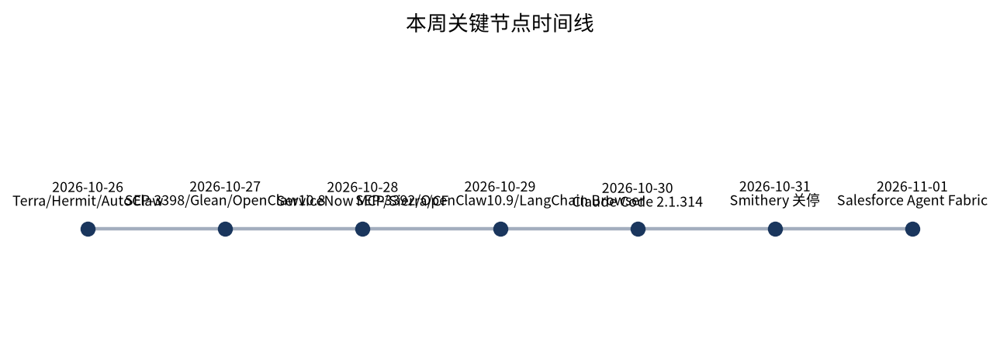

本周 MCP **没有新协议版本**（仍 `2026-07-28`），但连接身份、规格发布火车与企业控制面同时变硬：托管代理退出、下一版规格排到 2027 春季，企业把 MCP server 当成与 LLM 同级的生产依赖来评测与熔断。编码侧则把「工作区写边界 + idle/百分比 compaction + 跨工具登录」打成可运维产品能力；开源 Gateway（OpenClaw）继续以安全补丁与失败可恢复为主叙事。

## 本期要点

### 1. Smithery MCP Proxy 关停 + SEP-3398 / SEP-3392

MCP 的主矛盾已从「有没有服务器」转为「谁托管身份、规格何时可排期、扩展稳不稳、企业控制面能不能看见」——本周三件套同时落地。Smithery 官方页确认 **2026-10-31** 关闭 connection management：`run.tools` / `server.smithery.ai` URL、API/Connect/Toolbox、账户与 API keys、CLI/SDK（deprecated）全部停用；**保留** smithery.ai 作非代理公共目录（Arcade.dev 驱动），已验证服务器页展示厂商直连 URL（例 `mcp.linear.app/mcp`）。公司披露付费自 8-05 起退款并取消订阅。PR **#3398**「SEP-3398: Release Cycle Updates」于 **2026-10-27** merged：形式化每年约 **3 月与 9 月**发布、重叠约八个月周期、轮值 release manager；过渡将原 2026-12 发布目标改至 **2027-03**。PR **#3392** 于 **2026-10-29** merged（Final）：扩展成熟度 Experimental → Beta → Stable（仍为扩展）或晋升核心；仓库命名 `experimental-ext-*` / `beta-ext-*` / `ext-*`。

凡 `.mcp.json` / Cursor / Claude Desktop 仍指向 Smithery URL 或 `@smithery/cli` 的连接在 10-31 后**失效**——须改厂商 URL 并重新 OAuth。生产基线整个冬天应以 **2026-07-28** 为准；「等下一大版本」应对齐 2027 春季。

### 2. Claude Code 2.1.314–316：工作区外写拒绝 + idle compaction / 企业网关

编码 Agent 企业化的下一段不是「新模型」，而是路径边界、长会话运维与 IdP 组预算叠成多层控制面。窗内稳定版约 **v2.1.311 / 312 / 314 / 316**（约 10-26～10-31）。**2.1.314** 新增 `permissions.blockWritesOutsideWorkingDirectories`——Write/Edit/NotebookEdit 在**任何** permission mode 下拒绝工作目录外路径；将 **idle compaction** 扩展到 VS Code 与 Claude Desktop Code tab（闲置 200K+ token 对话摘要；prompt cache 过期后下次消息用摘要）；gateway upstream 可按 IdP `groups` 路由。**2.1.316**：子 agent 独立 effort；Claude apps gateway **pooled group budgets**；`managed.policy_mode: layered`；Bedrock `guardrail.input_tagging`；**Deprecated Opus 4.8 fast mode**（自 10-30，将于 **2026-11-30** 移除，迁 Opus 5.5）。

默认拒绝工作区外写入降低越权写盘；IDE/Desktop 与终端对齐 idle compaction。仍依赖 Opus 4.8 fast 的工作流须在 11-30 前迁移，否则将直接报错不回退。

### 3. OpenClaw 2026.10.8 / 10.9：安全与恢复

自托管个人/团队助理的「Gateway 类」开源本周主叙事仍是安全补丁 + 失败可引导，而非新功能清单。**2026.10.8**（2026-10-27）：更新失败后 Doctor 重启 Gateway；孤儿 maintenance worker 不再堵 CLI；会话恢复与安全硬化（exec allowlist `test -v`、拒绝 generic node invoke 上的 browser proxy、沙箱子进程禁 host CLI）。**2026.10.9**（2026-10-29）：依赖安全（fast-uri 4.2.3、Zod 集合边界、nodemailer 10.1.4、MSAL Node 7.1.1）；`tools.fs.workspaceOnly` 落到 Gateway 构建的 delegate/media 工具；凭证不出 MCP CLI / Google OAuth 日志；失败回滚与 SQLite tokenizer/全文索引恢复；磁盘满后可自愈。**extended-stable 2026.9.35/9.36** 回灌上述安全与恢复；**2026.10.10-beta.4/5** 修流式卡住与 Node 兼容口径。

生产自托管必须跟进 10.9 级补丁；启用 `workspaceOnly` 的部署应验证 delegate/media 行为变化；LTS 用户可走 extended-stable。这与编码侧路径边界、企业 Kill Switch 同向「边界硬化」。

### 4. Codex 0.165 / 0.166 + GPT-6.1 Terra

OpenAI 把「多云模型编目 + computer use 标签模型 + 长会话 queue/resume」钉进 Codex/Work；开源侧 OpenCode 用 Claude Agent `/connect` 复用 Claude Code 登录，形成对照的「登录互通」产品动作。**2026-10-26**：官方 changelog 宣布 **GPT-6.1 Terra** 进入 ChatGPT Work 与 Codex（Plus/Pro/Business/Enterprise/Edu）；定位快速高效专业模型，强图像理解 + **computer use**；桌面/Work 可选，Chat 不可用，无 UAE inference residency。**Codex CLI 0.165.0**（changelog 10-27）：内置 **Google Cloud Vertex AI** provider（`model_provider = "gcp"`）；编目加入 Terra；memory v2 默认对新 profile 开启；实验性 attached thread forks。**Codex CLI 0.166.0**（≈10-29/10-30）：`codex queue --resume`；TUI 更清晰的 safety-block 与更安全改写选项；`codex doctor --network-only`；保留 resume/fork 时的 permission 与 reasoning-token 记账以免过早 compaction。

已在 GCP 的团队可用同一 Codex CLI 直连 Vertex；Terra 强化「看图/看屏再操作」。对照面：OpenCode **v2.2.0–2.2.5**（10-27～10-31）内置 Claude Agent provider、`/goal`、百分比 `compaction.buffer`，并**移除 OpenCode GitHub Action**（破坏性，CI 用户须迁自建流水线）。

### 5. Salesforce Agent Fabric：Agent Evals 覆盖 MCP + Kill Switch / FinOps

企业把 MCP server 当作与 LLM/Agent 同级的生产依赖——持续评测、可熔断、可计费管控；本周控制面信号强于单纯「又多一个合规仪表盘」。**2026-11-01** Salesforce 宣布 Agent Fabric 扩展：**Agent Evals**（部署前自动生成测试，生产中对 agents / LLMs / **MCP servers** 按质量准则评估；不达标可触发预定干预，含 **Agent Kill Switch**，可要求审批）；**API Evals**；FinOps Dashboard / Model Wallet / Cost Optimization Policies **今日 GA**；Kill Switch GA；Triggered Kill Switch 预期 2027-01 GA；Agent/API Evals Beta 2026-11、GA 预期 2027-01。文中「>1.2B 日请求」等规模数字为公司披露。

多 Agent 平台企业获得生产级 SRE+FinOps for agents 的产品化路径；MCP 运营者会被纳入与 LLM 同级的持续评测。Kill Switch 对业务流量可破坏。同周强对照：Glean **565**（10-27）+57 MCP 模板并收紧受众/预算字段；Sierra **Compliance Console**（10-28）主动 outreach 合规控制面；ServiceNow×OpenAI（10-28）ChatGPT marketplace **MCP plugin**。

## MCP：从托管代理到官方端点 + 发布火车 + 企业控制面

{: .notice--info}
本周 MCP **没有新协议版本**，但连接层、发布治理与企业控制面同时变：托管代理退出、规格火车定档、扩展成熟度 Final、企业把 MCP 当生产依赖评测/熔断。

### 连接身份从中间人迁回厂商

早期托管代理统一 OAuth/连接，把多服务器身份收在 Smithery。当 Linear/GitHub/Notion 等普遍自建 Streamable HTTP 官方端点后，中间层边际价值下降。关停后身份与令牌回到「客户端 ↔ 厂商 OAuth」，目录与「替终端用户托管 MCP」产品位移到 Arcade 或其他方案。配置里的 Smithery URL / `@smithery/cli` 在 10-31 后失效——**破坏性**；迁移动作是改厂商 URL + 重新 OAuth。个人「开箱 Gmail/Slack」与「帮用户管多服务器」是两条不同产品问题，不再由同一代理层解决。用户规模与 Arcade 迁移完成率未取得公开数字。

### 规格时间线可排期，扩展稳定性可沟通

SEP-3398 用流程 SEP（非 wire 变更）把「下一个规格何时来」变成可排期火车：一般每年 3 月与 9 月、重叠约八个月、轮值 release manager。生产基线至少整个冬天仍应以 **2026-07-28** 为准；流程本身不破协议，破坏性来自未来按火车合并的特性。SEP-3392 用命名约定 + SEP 门禁替换「每次破坏换 identifier」的碎规则；企业选型可看生命周期阶段，跟 Experimental 的实现方在进 Beta 前仍可能遇破发——设计内允许。

### 企业控制面把 MCP「对象化」

| 信号 | 日期 | 机制要点 |
|---|---|---|
| Glean 565 | 10-27 | +57 MCP 模板；service-credential 须显式 audience；list API 收窄；`private_key_jwt`；invocation ID；预算金额不再暴露给调用方 |
| ServiceNow × OpenAI | 10-28 | ChatGPT marketplace **MCP plugin**；动作仍落 ServiceNow 权限/审批 |
| Salesforce Agent Fabric | 11-01 | Agent Evals 覆盖 agents/LLMs/**MCP servers**；Kill Switch；FinOps GA |
| MCP docs | 10-30 | enterprise managed auth / IdP 文档 |

共同点：MCP server 开始像生产 API——有受众、调用 ID、持续评测、可熔断、可计费管控。上期主线是「自治等级 / 权限 / 恢复 / 身份」；本期 MCP 主线是同一「边界」问题的协议层答案。

协议工程面补充：Spec 仍 **2026-07-28**；TS/Python SDK 本周无窗内新 major；**MCP Inspector 2.13.0**（≈10-28/29）跟进 Node.js CA/runtime 安全发布，属安全运维必做项。

## 编码 Agent：长会话、权限边界与跨运行时登录可运维化

{: .notice--info}
本周编码 Agent 主线不是「新榜分数」，而是 CLI/IDE 把长会话、权限边界与跨运行时登录打成可运维产品能力。

Claude Code 与 Codex 的核心结论见本期要点第 2、4 条。跨对象看，三条机制同时出现在头部 CLI：长上下文（idle/百分比 compaction、resume 记账）、权限（路径边界、Assisted Permissions、企业 policy）、运行时桥（Claude 登录复用、Vertex/GCP、云 sandbox）——采购 checklist 应问这三件事而非模型名。

**OpenCode v2.2.0（10-27）→ 2.2.5（≈10-31）**：2.2.0 加入 Terra、实验 Desktop GUI plugins、可配置 cache TTL，并**移除 OpenCode GitHub Action**；2.2.1 提供 `/goal <objective>` 目标循环至评审确认；2.2.3 内置 **Claude Agent provider**（`/connect` 复用 Claude Code 登录与模型），managed policy 拆分 `integration.use` / `mcp.use` / `skill.use` / `plugin.use`；2.2.5 百分比 `compaction.buffer`（如 `"20%"`）。机制是把 Claude Code 可执行文件与已有 auth 挂成 provider，而非重做 Anthropic OAuth。

**Gemini CLI v0.66.0 稳定**（≈10-27/28）：tool call groups 由 scheduler 发出、去掉 UI lookahead；Windows openDiff quoting；禁用 git 交互式凭据/SSH 提示；MCP OAuth 可选私网 endpoint；横幅提示 Gemini CLI 未针对 Gemini 4 优化。同窗 **v0.67 preview/nightly** 活跃。官方 docs announcements 仍滞后于 v0.64 叙述——本期稳定通道以 GitHub 为准。

**GitHub Copilot CLI 1.0.104 / 1.0.105（10-27）**：Fusion 新会话默认从 Auto 起步；**Assisted Permissions 无需再开 experimental mode**；长上下文可选 Fusion High/Max 修复——与 Claude Code / Codex 企业权限叙事同向。

其余有料：Cline v4.1.26 与 CLI/Desktop/SDK 同日（约 10-26）；Devin Desktop 3.11.228–238 以 Remote-SSH/WSL 与 Cyber Verification 修复为主（大改 Agent Window 对齐 web 在 3.11.212=10-23，窗外背景）；Replit 博客 Published Oct 27，把 Cloud Agents for company codebase 卖成「非工程自然语言改公司库 → 沙箱浏览器验收 → PR/MR 附截图与视频证据」（self-improving workspace memory 的 token 降幅等为厂商自述）。**Cursor** 本窗无新产品 changelog；**Aider** 最新仍 v0.86.0（2025-08）；**Roo Code** 已关停；SWE-Bench Pro V2 属窗外背景——勿用窗外近天花板榜首百分比替代上述机制证据。

## 开源框架：Gateway 安全恢复 + Skill/Adapter 可进化

{: .notice--info}
本周开源三条并行线：个人助理 Gateway 的安全与恢复硬化；编排内核与应用壳的正确性补丁；名单外 Hermit v0.1.0 首发可训练 harness adapter。

OpenClaw 结论见本期要点第 3 条。机制层再强调一点：单机长驻 Gateway（WS 控制面 + 渠道）把「受信控制面 / 不可信执行 / 策略用代码强制」落地；本周改动集中在依赖与解析边界、`workspaceOnly` 扩展到 Gateway 合成工具、以及更新/Doctor/回滚状态机避免半更新不可引导。仓况规模信号约 ~394k ★（非窗内增量主张）。与 Hermes 同属 messaging Gateway + 本地状态赛道；Hermes 窗内无新 tag、最近正式版 v0.22.5=10-23 窗外，发版节奏更「提交密集、tag 滞后」。

**Hermit v0.1.0**（2026-10-26）：框架训练/评估/部署 **harness adapter**——在不改原模型与原 harness 前提下，学习可版本化的外部指令/技能/记忆/工具/协作逻辑；可生成 Codex/Claude Code 工作区或导出为 native plugins（Apache-2.0；早期 0.x API 可能变）。给「只调 prompt/skill、不动基座」的持续改进提供工程化训练环，仍属早期，勿当生产默认。

编排与应用壳要点：LangGraph **1.2.18**（10-26）收紧 `error_handler` 与 DeltaChannel 快照频率（默认每 100 次更新，原 1000）；**1.2.19**（10-30）修流式与子图，**ToolNode 工具名写入 graph node metadata**。CrewAI **1.15.31–33**（10-27～10-29）加 conversational flow **context compaction**、`crewai skill search`、安全类修复（path traversal / SQL / 反序列化）；**1.15.34** published 2026-11-01 晚间 → 窗外不采用。browser-use **0.13.14**（10-26）保留 Python agent、加入 OpenAI browser tools，明确 Pi migration 仍分离。OpenHands **v1.34.0**（10-27）per-conversation Docker runtime + markdown 外链安全。AutoGPT Platform **beta v0.10.0**（10-27）：自托管 Docker Compose 每安装生成服务密码 + 数据端口仅 `127.0.0.1`（破坏性，需 `make init-env`）；External API **v2**（v1 弃用至 2027-01-31）。Microsoft Agent Framework **python-1.24.0**（10-30）：MCP 本地工具默认审批；AgentTriggeredCompaction / UnloadSkillsCompaction；RedisContextProvider 索引迁移破坏性。AutoGen 文档 10-28 加 archive caution，无窗内产品 release。Dify / Google ADK / OpenAI Agents SDK 无窗内正式 tag。

## Computer Use：入口品牌退场，配额与托管浏览器成为控制面

{: .notice--info}
增量不在「又一个能点网页的 demo」，而在 OpenAI 把 computer use 钉进 Work 模型目录、平台把浏览器当一等基础设施、中系继续以本地高权限发行版消化能力。

官方 ChatGPT agent 帮助页写明：**「ChatGPT agent is no longer available. Use ChatGPT Work…」**；Operator 功能已并入 agent/Work（关停本身属更早产品事件，作背景 + 本周文档口径确认）。**10-26** Terra 入 Work/Codex；**10-28** Pro（美国）beta「Texting your dot」——经 iMessage/RCS 与自有 dot 双向短信；**10-29** Pro 档与受影响套餐 **Work 与 Codex 额度翻倍**。Cloud browser 机制：远程独立浏览器；登录 secure form、凭据对模型不可见；结果性动作（支付/预订等）仍需确认；与本机会话隔离。采购口径应以 Work cloud browser 为准，而非旧 agent mode / Operator 站。

平台托管浏览器：**LangChain Managed Deep Agents Browser（10-29）** 提供 `define_browser(scope=thread|user)` 与 snapshot/run/screenshot/handoff；厂商自测 WebVoyager 100 任务 90% pass / $1.98——未独立核实。**Cloudflare Agents SDK internal hostnames（10-28）**：持久浏览器可配置 `internalHosts`，请求回源到 Agent Durable Object / 沙箱端口，**无需把 dev server 暴露公网**（需 Agents SDK ≥0.31.0）；安全上需限制可代理目标，防内网 SSRF。

中系与其他：智谱 **AutoClaw 2.2.0（10-26）** 项目模式、卡顿重连与限流断点续跑、专业库直连、IM 机器人增强；窗内 Tokens 活动覆盖至 11-01；**10-28** GLM-5.3-flashX-Legal（Harvey LAB 通过率等为厂商口径）。Genspark **Media Studio（10-27）** 让 Agent 任导演编排多模型影视流水线。Anthropic Computer Use API / Duet、Project Mariner、Perplexity Comet、Kimi/Qwen 浏览器扩展本窗无新的可核一手产品发布。

## 企业治理与评测：主动触达合规 + Skills 组合攻击面

企业 Agent 叙事从「能不能做事」转向「长周期主动触达能否合规」+「跨平台 Agent 能否被评测/熔断/控费」+「垂直场景是否用真实工作产物评测」。Salesforce / Glean 结论见本期要点第 5 条与上表。

**Sierra Compliance Console（10-28）**：Horizon 内置主动 outreach 护栏——渠道 disclosure、时区 contact windows、节假日排除、频次上限、全渠道 opt-out 存档、Insights（allowed/deferred/blocked/held）。**10-30** 披露 $400M+ ARR 等经营数据（公司披露，未独立核实）；推进开放标准 **Poppy**（进行中）。**Harvey**（10-26/28/29）更新 Tirant 知识源、Agent Builder、Retention policy、**Ethical Walls – iManage SPM** 等；**LAB: USCL（10-29）** 用真实 PACER/RECAP + CourtListener，成对 Elo，环境暂不公开样本——垂直域用真实工作产物替代合成 quiz。

**CoSA / CoSA-Bench**（arXiv 2610.35082，published 2026-10-26）提出 Conflict of Skills：单 Skill 过静态检查仍可能在组合时违规。攻击向池中加入通过单包检查的「良性」Skills，预算 ≤ 原池 5%。Bench：288 任务 × 多领域。五模型 × 三 harness（**OpenClaw / OpenHands / OpenCode**）：违规率 **35.02% → 58.45%（+23.43pp）**（论文数字）；轻量护栏后 OpenClaw 招聘任务违规 **65.28% → 6.67%**。静态扫描增强前后严重告警数不变。采用 Agent Skills / MCP 工具池的团队，安全评审须从「扫每个包」扩展到「组合工作流与产物用途」。

通用编码榜（SWE-Bench Pro V2、OSWorld / WebArena / GAIA / τ-bench）本周无核出重大官方突破一手。

## 本周事件时间线

*图 1：本周关键节点时间线（条高为当日公开信号计数，示意密度非排名）。数据来源：本期研究母稿窗内已核事件。*

## 本周关键变化对照

| 产品/项目 | 版本或日期 | 变化摘要 | 是否破坏性 | 影响面 |
|---|---|---|---|---|
| Smithery MCP Proxy | 2026-10-31 | 关停代理与托管身份；目录留存由 Arcade 驱动 | **是** | 所有 Smithery URL 用户 / Connect B2B |
| SEP-3398 | merged 2026-10-27 | 3/9 月发布火车；下版目标→2027-03 | 否（流程） | SDK/产品排期 |
| SEP-3392 | Final/merged 10-28/29 | 扩展 Experimental/Beta/Stable 生命周期 | 对跟实验扩展者潜在是 | 扩展作者/实现方 |
| Claude Code | 2.1.314–316 | 工作区外写拒绝；idle compaction IDE 化；组预算/layered policy；Opus 4.8 fast 弃用倒计时 | 低～中（行为收紧+模型弃用） | 编码 Agent 企业部署 |
| OpenClaw | 2026.10.8/10.9 | 依赖安全；workspaceOnly→合成工具；Doctor/回滚/磁盘满自愈；extended-stable 回灌 | 低（策略开启后行为变） | 自托管 Gateway |
| Codex CLI | 0.165.0 / 0.166.0 | Vertex 内置；Terra；queue --resume；safety UX | 否 | 多云编码 CLI |
| OpenCode | 2.2.0–2.2.5 | Claude Agent 桥；/goal；百分比 compaction；**移除 GitHub Action** | **部分是**（CI Action） | 开源桌面/TUI |
| Salesforce Agent Fabric | 2026-11-01 | Agent/API Evals；Kill Switch/FinOps GA；评测含 MCP | 干预可破坏业务流量 | 多平台 Agent 治理 |
| Glean 565 | 2026-10-27 | +57 MCP 模板；受众/预算字段收紧；JWT 机密客户端 | **部分是**（API 字段收窄） | 企业 MCP 网关 |
| Hermit | v0.1.0（10-26） | 可训练 harness adapter 首发 | 0.x API 可能变 | 跨宿主 skill/adapter |
| AutoGPT Platform | beta v0.10.0 | 本机绑定+生成密钥；API v2 | **是**（自托管网络/密钥） | 自托管平台 |
| Sierra Compliance Console | 2026-10-28 | 主动 outreach 合规控制台 | 否（新增） | 受监管主动触达 |

## 本周 vs 上周

| 主线 | 上周（第21期） | 本周 | 走向 |
|---|---|---|---|
| 权限/沙箱硬化 | Claude Code 密集修 bypass；Codex 企业 MCP 授权与凭据遮蔽 | `blockWritesOutsideWorkingDirectories`、网关 layered policy / 组预算；OpenClaw `workspaceOnly`→合成工具；Copilot Assisted Permissions 出实验 | 延续 |
| 会话恢复与压缩 | OpenClaw 恢复 provenance、OpenCode keepID | OpenClaw Doctor/磁盘满自愈；Claude Code idle compaction 扩到 IDE/Desktop；Codex `queue --resume` + reasoning-token 记账；CrewAI flow compaction | 延续 |
| MCP 连接与治理 | 协议冷静、agent identity 路线图为窗外坐标系 | Smithery 代理 10-31 关停；SEP-3398/3392；企业把 MCP 纳入评测/熔断 | 新出现 |
| 编码产品能力 | Monitor、企业接入、keepID 契约 | Terra + Vertex；OpenCode Claude Agent `/connect` 与 `/goal`；百分比 compaction | 新出现 |
| Computer Use | Claude Duet 主动型预览；Operator/agent 口径混杂 | Terra computer use 标签；Work/Codex 额度翻倍；Dot 短信；托管浏览器（LangChain / Cloudflare） | 新出现 |
| 企业主动触达/治理 | ServiceNow Arc / NVIDIA OpenShell | Sierra Compliance Console；Salesforce Kill Switch/FinOps；Glean 565 | 延续 |
| OpenClaw | 10.6/10.7 运行时基线 | 10.8/10.9 + extended-stable 回灌 | 延续 |
| 通用榜 / Duet / Cursor | Duet 上线；Cursor 弱；榜无突破 | Duet/Anthropic CU 消化期；Cursor 无新产品 changelog；榜仍无窗内突破 | 降温 |

上期重心是「自治等级尚未标准化」——一边收紧权限一边放开生产自治。本期把同一「边界」问题推到协议层与企业控制面：身份不再经第三方代理、规格火车可排期、MCP 被对象化为可评测/可熔断依赖；编码侧则把路径边界与长会话压缩做成可运维产品能力，而不再以刷榜或新模型叙事为主。

## 对你意味着什么

> **编辑建议**：以下动作均可从本期事实推导，不是厂商承诺。

- **仍在用 Smithery URL / `@smithery/cli` 的团队**：立刻盘点 `.mcp.json`、Cursor、Claude Desktop 与 CI 里的代理端点，改成厂商官方 Streamable HTTP URL 并重新走 OAuth；把「目录发现」与「托管身份」拆成两条产品决策。
- **按 MCP 下一版本排期的产品/SDK 团队**：生产基线整个冬天锁定 `2026-07-28`；把「等大版本」对齐 **2027-03** 火车，并用扩展生命周期标签（experimental / beta / ext）做选型与依赖声明。
- **编码 Agent 企业采购**：checklist 问三件事——路径/工作区写边界是否默认强制、idle 或百分比 compaction 是否可预期、跨云/跨登录（Vertex、Claude `/connect`、IdP 组预算）是否一等能力；Opus 4.8 fast 依赖方须在 **11-30** 前迁 Opus 5.5。
- **自托管 OpenClaw**：跟进 **10.9** 级补丁；开启 `workspaceOnly` 后回归测试 delegate/media；需要可预测补丁火车的走 extended-stable。
- **运营 MCP / Agent Skills 池的安全与 SRE**：把 Salesforce「评测含 MCP servers + Kill Switch」与 CoSA「组合攻击绕过单包扫描」放进同一清单——需要 invocation 级可观测、组合工作流评审，以及不达标可熔断。
- **Computer Use 选型**：停止按 Operator / 旧 ChatGPT agent mode 招标；改问 Work cloud browser、dots 权限边界、以及托管浏览器的 session scope / handoff / egress allowlist。
- **OpenCode CI 用户**：GitHub Action 已移除，须迁移自建流水线后再升 2.2.x。

## 来源

### 主线 / MCP

- [Smithery future](https://smithery.ai/future)
- [SEP-3398 PR #3398](https://github.com/modelcontextprotocol/modelcontextprotocol/pull/3398)
- [SEP-3392 PR #3392](https://github.com/modelcontextprotocol/modelcontextprotocol/pull/3392)
- [MCP Inspector releases](https://github.com/modelcontextprotocol/inspector/releases)

### 编码 Agent

- [Claude Code changelog](https://code.claude.com/docs/en/changelog)
- [Claude Code releases](https://github.com/anthropics/claude-code/releases)
- [ChatGPT / Codex changelog](https://learn.chatgpt.com/docs/changelog)
- [Codex releases](https://github.com/openai/codex/releases)
- [OpenCode changelog](https://opencode.ai/changelog)
- [Gemini CLI v0.66.0](https://github.com/google-gemini/gemini-cli/releases/tag/v0.66.0)
- [Copilot CLI changelog](https://raw.githubusercontent.com/github/copilot-cli/main/changelog.md)
- [Replit Cloud Agents](https://replit.com/blog/anyone-can-bring-ideas-to-company-codebase)
- [Devin Desktop changelog](https://docs.devin.ai/desktop/changelog)

### 开源框架

- [OpenClaw releases](https://github.com/openclaw/openclaw/releases)
- [OpenClaw docs releases](https://docs.openclaw.ai/releases)
- [Hermit v0.1.0](https://github.com/Infini-AI-Lab/hermit/releases/tag/v0.1.0)
- [LangGraph releases](https://github.com/langchain-ai/langgraph/releases)
- [CrewAI releases](https://github.com/crewAIInc/crewAI/releases)
- [browser-use 0.13.14](https://github.com/browser-use/browser-use/releases/tag/0.13.14)
- [OpenHands v1.34.0](https://github.com/OpenHands/OpenHands/releases/tag/v1.34.0)
- [AutoGPT Platform beta v0.10.0](https://github.com/Significant-Gravitas/AutoGPT/releases/tag/autogpt-platform-beta-v0.10.0)
- [Microsoft Agent Framework python-1.24.0](https://github.com/microsoft/agent-framework/releases/tag/python-1.24.0)

### Computer Use

- [ChatGPT release notes](https://help.openai.com/en/articles/6825453-chatgptrelease-notes)
- [Cloud browser help](https://help.openai.com/en/articles/20001280-using-cloud-browser-in-chatgpt)
- [ChatGPT agent help](https://help.openai.com/en/articles/11752874-chatgpt-agent)
- [LangChain Managed Deep Agents Browser](https://www.langchain.com/blog/browser-use-in-managed-deep-agents)
- [Cloudflare Agents SDK internal hostnames](https://developers.cloudflare.com/changelog/post/2026-10-28-browser-internal-hostnames/)
- [AutoClaw 2.2.0](https://autoclaw.zhipuai.cn/blog/news/autoclaw-2-2-0-upgrade-data-migration/)
- [Genspark Media Studio](https://www.genspark.ai/blog/genspark-media-studio)

### 企业 / 评测

- [Salesforce Agent Fabric](https://www.salesforce.com/in/news/stories/agent-fabric-catch-failures-control-ai-costs/)
- [Glean 2026-10-27 release](https://docs.glean.com/release-notes/releases/2026-10-27-october-release)
- [Sierra Compliance Console](https://sierra.ai/blog/introducing-compliance-console)
- [Harvey LAB: USCL](https://www.harvey.ai/blog/legal-agent-bench-us-case-law)
- [ServiceNow × OpenAI](https://investor.servicenow.com/news/news-details/2026/ServiceNow-and-OpenAI-accelerate-enterprise-AI-from-models-and-operations-to-cybersecurity-and-agentic-development/default.aspx)
- [CoSA arXiv 2610.35082](https://arxiv.org/abs/2610.35082)
