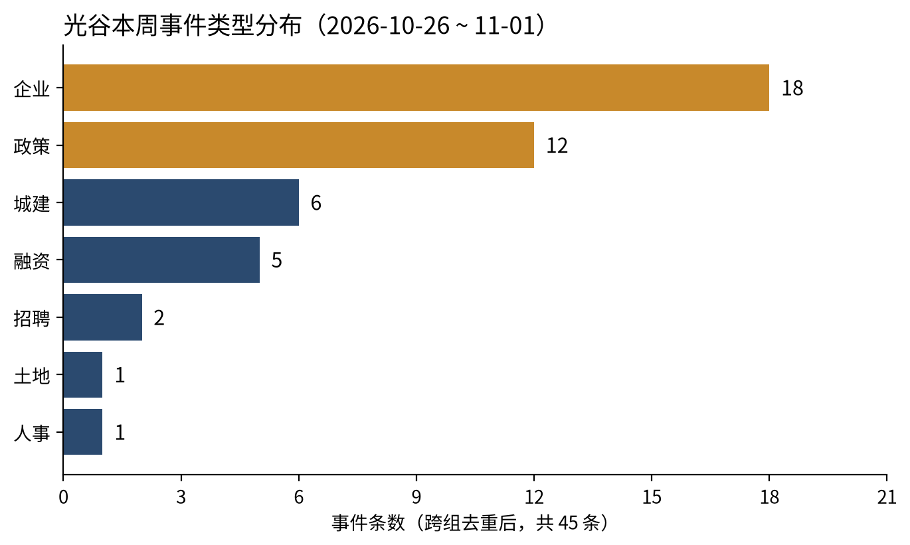
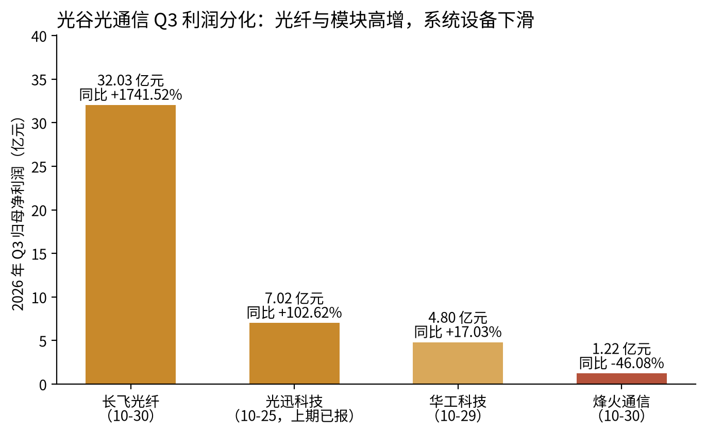

光谷这一周的主线是：规划刚写下五年目标，最硬的落地信号就来自企业和国资平台自己掏的钱，而唯一一条撤退，恰好出在靠外部私募出资的项目上。

10 月 27 日公布的东湖高新区「十五五」规划，把集群、基金、人才和算力计价都写成了数字。同一周，光迅科技把上周刚兑现的利润转成 102 亿元扩产，武汉奕材 50.77 亿元增资开始交割，湖北科投投资建设的千卡超节点一个月点亮；湖北广电则公告终止原计划 25 亿元的光谷智算中心。读光谷，开始要看「钱到没到位、工开没开」，签约额本身说明不了多少。

## 本期要点

**1. 十五五规划把光谷的五年目标量化成了「集群 + 基金 + 词元」，但还没有附钱（10-27）。** 武汉市政府 10 月 27 日公布《武汉东湖新技术开发区发展“十五五”规划》（武政〔2026〕23号），目标是 2030 年形成 1 个万亿级（光电子信息）、2 个五千亿级（生命健康、现代服务业）产业集群，培育千亿级企业 2 家、百亿级 25 家、国家级专精特新「小巨人」300 家。工具层同样具体：新增 1000 亿元自主可控基金集群、带动投资总额超 3000 亿元，财政资金「拨改投」，国有投资基金容错容亏；3551 人才总量破 5000 人；打造 10 个垂直行业大模型，发展按词元（Token）计费的算力服务。执行靠年度重点项目清单和中期评估，规划本身没有附资金拨付、项目名单和年度分解。它确定了未来五年光谷招商和申报国家试点时对照的条款，钱和项目要等年度清单出来才看得到。

**2. 光迅科技 102 亿元项目开工，上周的利润一周内就变成了扩产（11-01）。** 11 月 1 日，光迅科技高端光电子及硅光芯片器件产业化项目一期在东湖综保区开工，总投资 102 亿元，规划总建筑面积 16.63 万平方米，工期 14 个月，方向是下一代可插拔光模块、CPO/NPO 光引擎和全光交换。官方口径为达产后年产高速光模块超 1000 万只；湖北日报写的是「新增 1200 万只、年产值 200 亿元」，两者口径不同，本文以官方为准。押注 CPO/NPO 与全光交换，意味着光迅在从卖可插拔模块往卖光引擎、光交换系统上走。代价也看得见：截至 9 月底存货 121.10 亿元、较年初增长 110.76%，前三季度经营现金流净额 −18.81 亿元（媒体摘自三季报），扩产在靠营运资金垫付，资金来源公司未披露。按工期，新产能大约在 2027 年底到 2028 年释放。

**3. 算力同一天一建一撤：千卡超节点一个月点亮，25 亿元光谷智算中心终止（10-28）。** 10 月 28 日的华为湖北省人工智能创新发展大会上，昇腾 950 千卡超节点业务上线，省经信厅称该超节点「落地湖北」；据媒体报道，投资建设方是湖北科投，单节点 1024 张昇腾 NPU、全液冷、FP8 算力 1 EFLOPS，从启动到点亮用时 1 个月。具体落在哪个园区没有披露，不能写成落在光谷。同日盘后，湖北广电公告终止与武汉华鑫信股权投资集团共建的光谷智算中心：该项目 2024 年 6 月签约，计划算力不少于 25000P、基建投资 25 亿元，协议以华鑫信向托管账户打入不少于 3 亿元为生效前提，这笔钱截至 2026 年 4 月 10 日仍未到账。两件事放在一起说明，智算项目能不能落地，看的是谁出钱、谁带客户，机房和备案决定不了。今后引用规划算力，要按出资主体和到位资金打折。

**4. 武汉奕材 50.77 亿元增资开始交割，光谷资本从「种子票」切到了「项目股权」（10-30）。** 西安奕材 10 月 30 日晚公告，公司与市场化战略投资方对武汉奕材的融资协议已签署、资金开始交割，合计 50.77 亿元，其中公司出资 10 亿元、战略投资方 40.77 亿元，投资方包括央企投资平台、银行 AIC、地方国资和产业投资方（机构名单本次未取得）。钱进的是两层项目公司：武汉奕材再向实施主体武汉硅片增资，母公司股本不被稀释，外部资本拿的是项目股权。这个 12 英寸硅片基地 10 月首批设备搬入，计划 2027 年 6 月首批产能投产；公告自述交割仍存在一定不确定性。这一笔超过了前三周光谷早期融资的总和，光谷资本链的厚度开始由重资产项目撑起来。

**5. 光通信三季报出现分化：离 AI 数据中心越近，利润越厚（10-29/30）。** 长飞光纤第三季度归母净利 32.03 亿元、同比增长 1741.52%，公司自述是主要产品销量和平均单价同比大幅增长。华工科技第三季度归母净利 4.80 亿元、增长 17.03%，光互联业务单季净利环比增长 211%，原因是此前受物料齐套约束的订单集中确认，前三季度扣非净利只增长 7.19%。烽火通信第三季度营收增长 35.48%，归母净利却下降 46.08%，下滑原因本次没有取得原文。光纤和光模块量价齐升，卖系统设备的增收不增利，「光电子整体景气」这个说法因此不够准确。上周有人提示普通光纤扩产可能在两三年后压低价格，本周的数据显示价格仍在上行，这个读数也可能接近周期顶部。

## 规划给出的目标与工具：企业行动先于配套资金

把规划条款逐条对照本周事件，能对上的落地信号几乎都来自企业和国资平台的自有资金，规划配套资金本周还没有出现；靠外部私募出资的项目，本周倒是撤了一个。

| 规划写下的工具 | 本周对应信号 | 读法 |
|---|---|---|
| 光电子信息万亿级集群；高速全光通信、智能激光 | 光迅开工；长飞、华工高增；激光大会发布 100 亿元意向需求清单 | 龙头已经按规划方向扩产 |
| 存算一体基地、化合物半导体街区；「小巨人」300 家 | 奕材增资；志橙半导体零部件基地落户综保区；精测在手半导体订单 36.57 亿元 | 半导体链在补材料与零部件层 |
| 1000 亿元基金集群；拨改投；容错容亏 | 光谷集电产业投资基金 16 亿元；投贷保联动服务中心；3551 大赛种子意向 | 基金和载体在设，单只规模离目标很远 |
| 按 Token 计费的算力服务 | 千卡超节点点亮（园区未披露）；25 亿元光谷智算中心终止 | 国资直投兑现快，私募合作口径要打折 |
| 10 个垂直行业大模型；国家 AI 应用中试基地 | 光谷人民医院启用；楚天云运维采购；本周无新增模型备案 | 买方场景在增，模型供给没增 |
| 3551 总量破 5000 人；以赛代评 | 3551 快速通道 10-31 截止；管委会员额制校招 | 机制在运行，效果待公示名单 |

规划之外，市级「价目表」也在本周出现。市经信局 10 月 30 日公布《关于加快推进新型工业化 全力建设制造强市的若干政策措施》征求意见稿，未生效，意见截至 11 月 30 日：技改按生产性设备投资 8% 补助、最高 1000 万元，智能工厂（含工业模型、智能体开发）最高 200 万元，智能编程、智能测试等一体化智能开发体系最高 300 万元，同样设立「拨改投」的市中小企业创新发展基金。区级本周没有新发政策文件，做的是兑现：单项冠军区级奖励公示（华中数控、四方光电各 200 万元）、首台（套）资格申报转发（材料 11 月 6 日 17:00 截止）。规划定方向、市级给价目、区级做兑现，财政资金正从「发钱」变成「当早期股东」，早期项目今后的融资条款里更可能出现政府股东。

### 同周信号一览

*图 1：光谷本周事件类型分布（跨组去重后 45 条，不含窗外背景）。数据来源：本期研究母稿对比表，按东湖高新区、武汉市政府、上市公司公告等原文登记。*

| 事件/主体 | 类型 | 日期 | 要点 | 产业 |
|---|---|---|---|---|
| 十五五规划（武政〔2026〕23号） | 政策 | 10-27 | 1 万亿 + 2 个五千亿集群；1000 亿元基金集群 | AI/半导体/具身 |
| 制造强市措施（征求意见稿，未生效） | 政策 | 10-30 | 智能工厂最高 200 万元 | AI/互联网/半导体 |
| 全市作风优化营商环境工作会 | 政策 | 10-26 | 12 条整治举措；「办不成事」窗口 | 其他 |
| 光谷企业出海综合服务体系 | 政策 | 10-30 | 1+N+X；阿里国际站长期运营 | 互联网/AI |
| 市委书记调研智能体企业 | 人事 | 10-27 | 格创东智、中地软件、亿量科技 | AI |
| 管委会储备干部 + 国企管培生校招 | 招聘 | 10-27 | 10 校 + QS 前 50 硕博 | 其他 |
| 武汉奕材增资 | 融资 | 10-30 | 50.77 亿元开始交割 | 半导体 |
| 光谷集电产业投资基金 | 融资 | 10-26 | 出资额 16 亿元 | 半导体 |
| 光迅科技项目开工 | 企业 | 11-01 | 总投资 102 亿元 | AI/半导体 |
| 长飞 / 华工 / 烽火三季报 | 企业 | 10-29~10-30 | 利润分化 | AI/光通信 |
| 湖北广电终止光谷智算中心 | 企业 | 10-28 | 原计划 25 亿元、≥25000P | AI |
| 昇腾 950DT 千卡超节点点亮 | 企业 | 10-28 | 落地园区未披露 | AI/半导体 |
| 志橙半导体落户东湖综保区 | 企业 | 10-28 | 碳化硅、长晶热场零部件 | 半导体 |
| 光谷人民医院启用 | 城建 | 10-29 | 政院企共建 AI 医院 | AI/医疗 |
| 智能建造博览会 | 城建 | 10-27~10-29 | 签约超 73 亿元 | 具身/AI |
| 81 号公告 3 宗工业地挂牌 | 土地 | 10-26 | 约 14.59 万㎡，未成交 | 产业用地 |

## 光通信：利润在扩产，现金流在垫付

光通信的景气是真的，但利润只集中在离 AI 数据中心最近的那一层，而且高增企业的扩产在靠营运资金垫付。

*图 2：光谷光通信企业 2026 年 Q3 归母净利润与同比（光迅为 10-25 披露、上期已报）。数据来源：长飞港交所三季报、华工巨潮三季报、烽火与光迅三季报媒体摘要。*

现金流是第一个要盯的点：华工前三季度经营现金流为 −12.88 亿元，前三季度还有 4.64 亿元非经常性收益；光迅为 −18.81 亿元。两家都在用营运资金垫付扩产，后续可能出现定增、可转债或银团贷款，这是资本侧下一阶段的观察点。

光通信之外，光谷半导体链本周补的是「设备零部件 + 材料」这一层，没有新晶圆厂。精测电子在手订单 54.50 亿元，其中半导体 36.57 亿元、同比增长 105.34%，但第三季度归母净利只有 499 万元，被股份支付和研发费用吃掉，剔除股份支付后为 1.16 亿元（券商点评引公告）；志橙半导体 10 月 28 日签约落户东湖综保区光电融合产业园，补碳化硅、长晶热场等零部件，投资额未披露。离 AI 远的板块在下滑：华灿光电第三季度营收下降 32.54%、亏损 1.23 亿元，园区开发商东湖高新第三季度归母净利下降 61.4%。

## 算力：一建一撤之后，采购被拆成小标的

超节点和光谷智算中心的对照已在要点里展开。更值得留意的是本周出现的价格锚：政务和国企的大模型采购，正在拆成「算力租、模型用开源、运维外包」三个小标的，单标金额小、门槛低。

楚天云 10 月 29 日发布大模型及 AI 应用技术服务采购，标的是已部署在内网的 2 台国产智算服务器、5 类大模型的 1 年期运行保障与开源新模型适配，最高限价 35 万元，业绩门槛只要近 3 年 1 项 20 万元以上同类合同。采购公告同时确认楚天云地址在东湖开发区花城大道 9 号，补上了上期「东湖大模型位置待明确」的缺口；这笔采购是楚天云内部办公用，不等于东湖大模型政务平台的采购。再看超节点，湖北科投旗下光谷爱计算的同名 1024 卡项目用的是「设备租赁 + IDC 服务外采」，国资平台不一次性背芯片资产；它和 950DT 超节点是否同一个项目，目前没有官方确认。

模型层本身仍薄：本周没有光谷企业发布新基础模型，湖北生成式 AI 备案仍停在 9 月 23 日的累计 13 款，与规划「10 个垂直行业大模型」的目标还有明显距离。规划写入的 Token 计费也还没有本地公开定价。

## 资本：项目股权加厚，中段仍空

奕材之外，本周国资补的多是「投资载体」，直接投出去的钱有限；中间的 A 到 C 轮成长期融资仍是空白，光谷企业的早期单笔融资本周没有首次披露。

光谷金控体系 10 月 23 日登记、10 月 26 日首次见诸媒体的光谷集电产业投资基金出资额 16 亿元，出资方包括光谷金控全资子公司和专门的光谷半导体产投平台，指向集成电路链；投资策略与首批项目未披露。10 月 27 日，武创投光谷科创投资中心、武汉科创投资联盟基地同日揭牌，元航资本在光谷设立北京总部外的首个办公室，并联合工行湖北省分行、人保财险搭「投贷保联动」，瞄准验证周期长的商业航天。种子端，江城基金拟出资湖北省长江科创华科种子投资基金（公示至 11 月 3 日），3551 国际创业大赛复赛后光谷科创种子基金与 5 个项目达成初步投资意向、每个 100 万元，人才认定与种子首投正在并成同一个筛选漏斗。

签约额要打折看。本周智能建造博览会签约超 73 亿元，以建筑供应链交易为主；湖北激光产业创新大会发布「价值意向金额 100 亿元」的需求清单、6 个项目签约超 10 亿元。这些都不是股权融资，也不是已交割投资，同一周 25 亿元智算中心的终止就是现成的提醒。

## AI 三方向：Agent 有了买方，模型层仍薄，具身先做数据

| 方向 | 本周候选 | 有增量 | 一句话读数 |
|---|---|---|---|
| AI Agent | 17 | 15 | 政府带看、平台搭台，首次出现订单额口径（企业自述） |
| 大模型 | 16 | 8 | 增量在算力建与撤，无新模型、无新备案 |
| 具身智能 | 17 | 13 | 数据工厂先于整机兑现，光谷无整机融资或量产 |

### Agent：光谷卖行业 Know-how，硚口卖交付

10 月 27 日，市委书记盛阅春连看三家智能体企业：光谷的格创东智（「章鱼智脑」工业智能决策中枢、为半导体产线设计的空中自动搬运系统）、中地软件（MapGIS 智能体），以及洪山的亿量科技（「销售保 AI」），并提出「加快培育智能原生企业」。亿量随后对长江日报称累计服务 5 万多家企业、今年订单额 3 亿元，模型用 1000 万小时真实销售对话训练，这是本期第一个可以核对的武汉 Agent 订单额口径。它是企业自述，订单额不等于收入，企业也不在光谷。格创东智的做法是大模型负责理解与调度、小模型和工业软件负责实时控制，高风险操作进入人工确认；这套机制来自 8 月的企业文章，本周新增的只有调研本身。

两条路线由此清楚了。光谷是本地垂直平台型企业（格创东智、中地软件、华工科技工业智能体平台），卖的是行业 Know-how；硚口走「区国企 + 外部大厂平台 + 本地集成商驻场」，10 月 29 日百度智能云超级智能体大会上，本地服务商鸿海鑫披露已有 28 家客户。硚口在已落地客户数上给出的数字更多，是光谷招商的直接竞品模式。华为同期联合发布湖北行业 AI 智能体模板，覆盖政务、交通、制造、教育、医疗，模板化可能压低本地集成商的项目单价，也会降低政府和国企首单的门槛。

### 具身：数据工厂多区并起，光谷要靠场景和真机

武汉本周的具身增量几乎都在数据生产环节，整机这边没有新进展，而且三条路线分在三个区。光谷的湖北人形机器人创新中心 10 月 29 日通过市政府英文网面向全球发布揭榜挂帅清单，单项最高 50 万元；据极目新闻报道，运营团队已达百人，采集员每天有效数据时长由 1.5 到 2 小时提高到约 4.5 小时，还和华威科合作给机器人手指加装触觉传感器。东西湖的帕西尼数采工厂数采区超 1 万平方米，采集员计划下月增至约 100 人，正式投产后称年产数亿条数据；硚口的蚂蚁数科数据基地称数据集全球下载量破 1600 万。后两家都在武汉但不在光谷，规模也均为企业口径。

单比采集规模，光谷可能被兄弟区追上，差异化要落在「真机验证 + 场景题目 + 整机企业集聚」。最接近订单的场景来自建筑：方石机器人在光谷智博会发布 10 款建筑机器人，与中建三局签战略合作，提供地面整平、室内涂饰、地砖铺贴三类成套方案（框架协议，未披露金额）；湖北三年行动计划要求 2028 年政府投资项目智能建造应用率达到 100%。本周光谷没有具身整机融资、量产下线或新产线投产。

## 土地、营商与城建：综保区成为制造项目主承载

本周光谷城建和土地的增量集中在东部：开工、签约和规划载体都落在东湖综保区，新挂牌的工业地也在左岭流港片区。

土地是「新挂牌、零成交」。10 月 26 日武工告字〔2026〕81号挂出东湖高新区 3 宗工业用地，合计约 14.59 万平方米，两宗在流港西路一带、一宗在九龙湖街以北，起始价和行业类别本次未取得。光谷产业地多按底价定向成交，10 月 8 日的 3 宗全部底价成交给长飞光纤、长飞石英和中科飞测，所以看点在行业类别和竞得人，溢价反映不了多少。宅地方面，10 月 23 日挂牌的 133 号地块（汽发社区）起始价 9.154 亿元、楼面价约 10171 元/平方米，11 月 13 日开拍。

城建方面，光迅项目、志橙签约和规划约 13.7 万平方米的低空装备智造中心都在东湖综保区，览翌航空 eVTOL 研发生产基地同期落户（自述 14 家客户 860 架订单，属意向性质，适航证未取得）。公共载体也在往产业的需求端设计：10 月 29 日启用的光谷人民医院是区属公立、委托中南医院管理，官方称为全国首家政院企共建的人工智能医院，七成医疗设备由光谷企业研发生产，给本地医疗器械和医疗 AI 提供了首试首用的临床场景。10 月 27 日至 29 日在光谷科技会展中心举办的智能建造博览会，发布了 8323 个城建项目、总投资约 2.18 万亿元。

营商的信号从便利化转向了可追责。10 月 26 日全市作风优化营商环境工作会以「办证效率低下」专题片开场，市纪委出 12 条整治举措，市区两级政务中心设「办不成事」反映窗口，没有明确承办部门的由政务服务部门兜底，办理成效纳入绩效考核。光谷自己的动作在出海：10 月 30 日发布企业出海综合服务体系，开通 027-50766666 热线，首批整合 11 大类超 50 家专业机构，阿里国际站成为长期运营主体，并把智能体工具 Accio 引入光谷跨境电商产业园。官方预计光谷前三季度进出口超 2600 亿元、同比增长超 50%。

## 人才与招聘：上端抢编制，下端出新岗

光谷本周的人才信号集中在两端，中间的 3 到 5 年经验工程化人才在公开招聘中几乎看不到，和上期的判断一致。

上端是管委会自己下场招人。10 月 27 日，东湖高新区党工委组织部启动 2027 届管委会储备干部和区属国企管培生校招，面向 10 所国内顶尖高校和 QS 前 50 海外高校的硕博，报名至 11 月 6 日；复旦等东部 5 校批次储备干部计划 35 人，其中产业发展岗 14 人，专业清单涵盖集成电路、智能科学等理工科。员额制让管委会能像企业一样校招，光谷把「懂技术的招商员」当成稀缺资源，也给本地企业多了一个带编制的竞争者。

下端是新工种。10 月 29 日区人社分局在武汉工程大学的专场列出 41 家企业，出现了「具身智能数据采集员」「机器人动作训练师」「AI 智能体开发工程师」等岗位，岗位数和名额未披露。人才政策则进入评审空档：3551 举荐快速通道（领军人才 200 万元、高层次人才 100 万元）和留学回国人员奖励 10 月 31 日截止，接下来要看公示名单的行业结构。

## 本周 vs 上周

| 主线 | 上周（第 21 期） | 本周（第 22 期） | 走向 |
|---|---|---|---|
| 光通信 | 光迅单季净利翻倍，多芯光纤标准发布 | 光迅 102 亿元开工；长飞、华工高增，烽火利润下降 46.08% | 延续，开始分化 |
| 制度位置 | 央地共建推进会把光谷写成「先导」 | 十五五规划写下集群、基金、人才、Token 目标 | 延续，从位置转到目标与工具 |
| 资本 | 母基金「耐心资本」制度，无可核新增融资 | 奕材 50.77 亿元增资；集电基金 16 亿元；种子意向 | 新出现，项目股权加厚 |
| 算力与大模型 | 算力强、模型弱；东湖大模型位置待明确 | 超节点点亮、25 亿元智算中心终止；楚天云确认在光谷 | 新出现「一建一撤」 |
| AI Agent | 工作台按 128.7—215.5 元/人/月定价 | 市委书记调研；亿量自述订单 3 亿元；华为行业模板 | 延续，从价目到订单口径 |
| 具身智能 | 六大类场景揭榜挂帅 | 揭榜清单全球发布；数据工厂多区并起；无整机进展 | 延续，重心移到数据层 |
| 土地与城建 | 18 宗挂牌、只挂不拍；微电子产业园开园 | 3 宗工业地挂牌、零成交；综保区集中开工签约 | 延续 |
| 营商与人才 | 审批链拼服务链；省博士后公示 | 作风整风与「办不成事」窗口；员额制校招与具身新岗 | 延续，营商转向可追责 |

上周加固的是利润、规则、位置三条慢变量，本周变成规划写下目标、资本兑现成项目，同时出现了第一条公开的项目撤退。央地共建推进会、新型显示揭榜挂帅和智能体工作台采购本周都没有后续，光谷东智等具身整机企业也没有新动态；判断光谷的依据，正从「签了多少」移到「到位多少、开工多少」。

## 对你意味着什么

{: .notice--info}
**编辑建议**：以下建议只基于本期已核事实，不构成投资建议。

**区域观察者**
- 把十五五规划当作对照表来用：后续每个项目，先看它对得上哪一条（存算一体、化合物半导体、垂直行业大模型、国家 AI 应用中试基地），再看是否进入年度重点项目清单。清单公开之前，规划里的数字都只是目标。
- 引用算力规模时按出资主体和到位资金分级：国资直投、已点亮的算力可以计入，签约未生效的应剔除。光谷智算中心的 25000P 约为上期口径光谷已建算力（超 5000P）的 5 倍，引用过它的规划口径都要下调。
- 跟踪烽火利润下滑原因，以及光迅、华工负经营现金流之后的融资动作，用来检验「光电子整体景气」的说法。

**招商与产业从业者**
- 11 月 6 日 17:00 前，电子专用装备、激光装备企业可向区企服局提交首台（套）资格材料，这是进入国企招标与保险补偿的门票。
- 11 月 30 日前可就市「制造强市」措施征求意见稿反馈；它与区级政策「就高不重复」，企业需要算清哪一级更高。
- 光迅（14 个月工期）与奕材（2027 年 6 月首批投产）两个项目带来设备导入、洁净厂务、自动化装备的本地配套窗口；综保区与流港片区是这一轮制造项目的集中地。
- 具身招商不要只比采集规模：东西湖、硚口已有数据工厂，光谷的卖点应放在真机验证、揭榜题目和建筑、医疗两类有采购主体的场景。

**投资人**
- 光谷国资种子基金的首投锚是每个项目 100 万元；集电基金 16 亿元与华科种子基金是半导体与高校成果方向的新 LP/直投入口。
- 81 号公告 3 宗工业地挂牌期满后会揭晓竞得人，竞得人如果是上市公司，常伴随募投或扩产公告；11 月 13 日 133 号宅地拍卖，可以看光谷核心区地价。
- 亿量订单额、具身数据工厂产能、览翌 860 架订单都是企业自述；在财报、融资披露或适航证出现之前，只作线索。

## 来源

**政府与官方渠道**

- [武汉市政府：东湖高新区发展「十五五」规划](https://www.wuhan.gov.cn/zwgk/xxgk/zfwj/szfwj/202610/t20261027_2868577.shtml)（2026-10-27）
- [武汉市经信局：制造强市若干政策措施（征求意见稿）](https://jxj.wuhan.gov.cn/xxgk_9/fdzdgknr/ygzdgk/jcygk/202610/t20261030_2871294.html)（2026-10-30）
- [东湖高新区：光迅科技投资百亿建设高端光电子及硅光芯片器件产业化项目](https://www.wehdz.gov.cn/2022/ggxw_68627/ggxw_68629/202611/t20261102_2872022.shtml)（2026-11-02）
- [东湖高新区：光谷人民医院正式启用](https://www.wehdz.gov.cn/2022/ggxw_68627/ggxw_68629/202610/t20261030_2870941.shtml)（2026-10-30）
- [东湖高新区：盛阅春调研数智经济](https://www.wehdz.gov.cn/2022/ggxw_68627/ggxw_68629/202610/t20261028_2869314.shtml)（2026-10-28）
- [东湖高新区：志橙半导体签约落户](https://www.wehdz.gov.cn/2022/sjgg_68763/zsyz/cydt/202610/t20261029_2870512.shtml)（2026-10-29）
- [东湖高新区：览翌航空研发生产基地落户](https://www.wehdz.gov.cn/2022/sjgg_68763/zsyz/cydt/202610/t20261030_2870951.shtml)（2026-10-30）
- [东湖高新区：单项冠军区级奖励公示](https://www.wehdz.gov.cn/2022/ggxw_68627/tz_68628/202610/t20261028_2869807.shtml)（2026-10-28）
- [东湖高新区：首台（套）重大技术装备资格申报](https://www.wehdz.gov.cn/2022/ggxw_68627/tz_68628/202610/t20261026_2868410.shtml)（2026-10-26）
- [武汉市政府：全市深入转变作风优化营商环境工作会](https://www.wuhan.gov.cn/sy/whyw/202610/t20261027_2868480.shtml)（2026-10-27）
- [武汉市政府：武创投光谷科创投资中心揭牌](https://www.wuhan.gov.cn/sy/whyw/202610/t20261028_2869153.shtml)（2026-10-28）
- [武汉市政府：帕西尼武汉数采工厂](https://www.wuhan.gov.cn/sy/whyw/202611/t20261101_2871854.shtml)（2026-11-01）
- [武汉市政府英文网：人形机器人揭榜挂帅清单](https://english.wuhan.gov.cn/H%5F1/NWP/202610/t20261029_2870549.shtml)（2026-10-29）
- [湖北省经信厅：华为湖北省人工智能创新发展大会](https://jxt.hubei.gov.cn/bmdt/gzdt/202610/t20261029_6043468.shtml)（2026-10-29）
- [武汉市科创局：蚂蚁数科武汉数据基地](https://kjj.wuhan.gov.cn/xwzx_8/kjspxw/202610/t20261029_2870054.html)（2026-10-29）
- [湖北省住建厅：2026 国际（武汉）智能建造产业博览会开幕](https://zjt.hubei.gov.cn/bmdt/dtyw/zjyw/202610/t20261028_6042256.shtml)（2026-10-27）
- [湖北大数据阳光招标采购平台：楚天云大模型及 AI 应用技术服务采购](http://www.hbdsjygzc.com/jyxx/004001/20261029/d7d6d1da-e861-4429-9389-ed2eaef3b507.html)（2026-10-29）
- [港交所披露易：长飞光纤 2026 年三季报](https://www.hkexnews.hk/listedco/listconews/sehk/2026/1030/2026103001843_c.pdf)（2026-10-30）
- [巨潮资讯：华工科技 2026 年三季报](https://static.cninfo.com.cn/finalpage/2026-10-30/1225643857.PDF)（2026-10-30）
- [华中科技大学就业网：东湖高新区储备干部与国企管培生校招](https://job.hust.edu.cn/jcfw/2462731.htm)（2026-10-27）
- [武汉土地市场网：出让公告](https://www.whtdsc.com/transaction/letNotice)（2026-10-26）

**媒体与行业**

- [上证报：光迅科技项目开工](https://finance.eastmoney.com/a/202611013917750645.html)（2026-11-01）
- [湖北日报：光迅科技项目开工](https://news.hubeidaily.net/mobile/c_6130188.html)（2026-11-01）
- [西安奕材增资进展公告全文（凤凰网）](https://feng.ifeng.com/c/8xf7RjQjrbv)（2026-10-30）
- [经济参考网：武汉奕材](http://jjckb.xinhuanet.com/20261030/f87593a8c2f64520a607dc2daafee243/c.html)（2026-10-30）
- [每日经济新闻：光谷集电产业投资基金](https://www.nbd.com.cn/articles/2026-10-26/4617512.html)（2026-10-26）
- [每日经济新闻：湖北广电终止光谷智算中心](https://www.nbd.com.cn/articles/2026-10-28/4625664.html)（2026-10-28）
- [上海证券报：湖北广电终止光谷智算中心](https://www.21jingji.com/article/20261029/herald/052ddf22c951e5b3f4068969ce4dff1d.html)（2026-10-29）
- [IT之家：昇腾 950DT 超节点点亮](https://www.ithome.com/1/019/419.htm)（2026-10-29）
- [证券日报：华工科技三季报解读](http://www.zqrb.cn/gscy/gongsi/2026-10-30/A1793343817138.html)（2026-10-30）
- [同花顺：烽火通信三季报](https://stock.10jqka.com.cn/20261030/c681292018.shtml)（2026-10-30）
- [九方智投（华西证券点评）：精测电子三季报](https://www.9fzt.com/detail/sz_300567_10_846603845870.html)（2026-10-29）
- [长江日报：亿量科技「销售保 AI」](http://news.cjn.cn/whpd/yw_19947/202610/t5354019.htm)（2026-10-29）
- [中国日报网：百度超级智能体大会（硚口）](https://hb.chinadaily.com.cn/a/202610/29/WS6ae33161e4b09a165c792715.html)（2026-10-29）
- [新华网：光谷发布出海综合服务体系](http://hb.news.cn/20261030/d7f04783534d4aa381bcee3e0498ff73/c.html)（2026-10-30）
- [极目新闻：人形机器人创新中心机器人训练师](https://www.ctdsb.net/c1734_202610/2891980.html)（2026-10-30）
- [凤凰网（中国光谷）：湖北激光产业创新大会](https://feng.ifeng.com/c/8xifUm9y2MU)（2026-10-30）
- [科技日报：3551 国际创业大赛](https://www.stdaily.com/web/gdxw/2026-10/28/content_604088.html)（2026-10-28）
- [投资界：江城基金拟出资华科种子基金](https://news.pedaily.cn/202610/571113.shtml)（2026-10-30）
- [ai4elab：方石机器人与中建三局签约](https://ai4elab.com/11586.html)（2026-10-31）
- [腾讯新闻（凤凰网房产）：武汉 18 宗地起拍](https://news.qq.com/rain/a/20261027A04M8V00)（2026-10-27）
- [方阵招聘：东湖高新区金秋招聘月专场](https://zhaopin.4sjob.com/bible/articleDetails?id=2114614107934175233)（2026-10-26）
