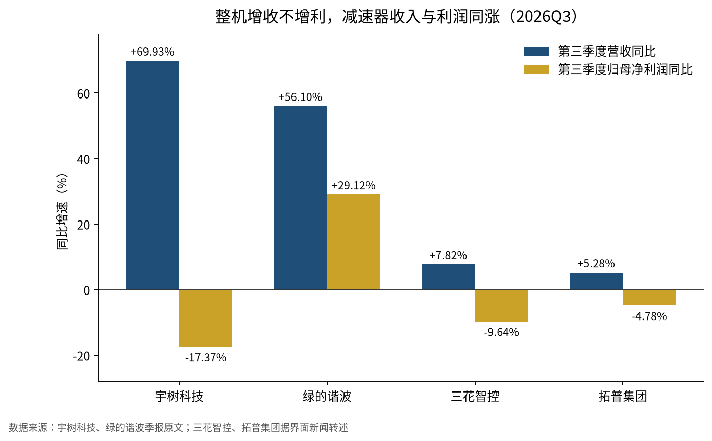
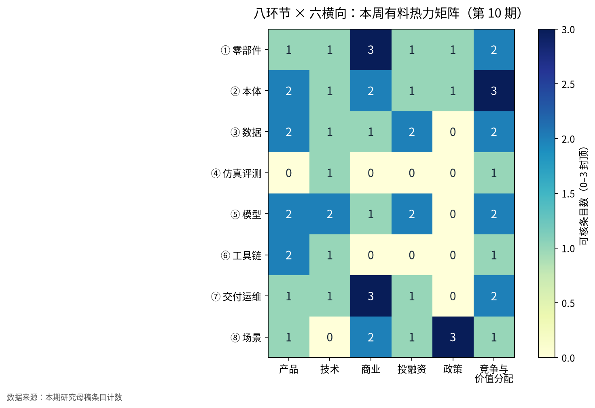

本周产业链的利润开始按新的方式分配：整机把利润投进「大脑」，零部件用现金换收入增长，资本给还没有收入的模型公司更高估值，下游第一次有头部厂商提出按「有效工时」而不是按台数计价。

上期的结论是瓶颈转向「谁来验收、按什么数字付款」。这一周第一次拿到能对上这个问题的财务和计量材料，而同一周美国用 232 程序和一条全韩国的 Atlas 供应链，把上游按地缘重新划了线。

## 本期要点

**一、整机龙头的第一份季报证明，利润正在让位给模型。** 宇树 10 月 28 日晚披露上市后首份季报：第三季度营收 6.65 亿元、同比增长 69.93%，归母净利润 1.13 亿元、同比下降 17.37%，按媒体计算比二季度少了近一半。季报原文把研发投入同比增长 249.58%、达到营收 19.10% 的原因写得很直接——「具身大模型相关模型研发与算力投入大幅增长」；媒体测算的单季毛利率同比下滑 8.36 个百分点，产品结构正从四足转向人形与组件。同一周，减速器厂绿的谐波第三季度营收增长 56.10%，但前三季度经营现金流为负 7,132 万元。整机把毛利投向大脑，零部件拿现金换份额，这是本周价值分配最硬的一组证据。

**二、智元把计价单位从「台」换成了「有效工时」。** 10 月 29 日的智元创新日上，联合创始人彭志辉提出 Worken：活跃机器人数量 × 自主工作时长 × 产出效能比，三个因子分别剔除库存机、开机但非自主的时间和低于人类基准的产出，并表示希望未来按 Worken 计费、费率随任务与智能水平不同。同场发布的 GO-3 Preview 计划年底开源，公司演示的便利店机器人五天内全流程成功率从 28.6% 升到 85.7%；彭志辉还称上半年交付 9700 台、「一年制造几万台没有问题」，瓶颈在客户是否买单。如果软件能让同一台机器的有效工时随时间上升，按工时收费就能把模型升级的价值收回来——但目前没有任何客户或第三方公布过 Worken 数据，它仍是厂商自定义的尺子。

**三、美国把机器人进口放进 232 程序，Atlas 同周换成全韩国供应链。** 10 月 28 日白宫签署公告，认定机器人、工业机械及其零部件进口威胁国家安全，指示商务部和贸易代表与各国谈判，暂未设定关税。韩国经济新闻 10 月 27 日报道，波士顿动力已确定 Atlas 主要供应商，除 NVIDIA 芯片外全部由韩企承担，关节执行器与手部夹爪由现代摩比斯包下，并要求供应商准备到明年底 1 万台份的部件；名单尚未获公司确认。反方向的信号来自 Meta：据 The Information 报道，Meta 与傅利叶在上海约三个月做出人形原型 Max，Meta 称部分零部件在美国仍难以获得。美国市场的上游正在分成「盟友化 BOM」和「中国身体」两条路。

**四、资本在给大脑和上市通道重新定价。** Agility 与 SPAC Churchill XI 在 10 月 30 日公布毛募资约 4.65 亿美元：信托只剩约 1.64 亿美元，富士康领投的 PIPE 约 2.01 亿美元，另有 1 亿美元已到账；交易拟于 11 月 5 日以 AGLT 在纳斯达克挂牌，成为美股第一个纯人形标的。另据彭博报道，Physical Intelligence 正以约 200 亿美元估值洽谈至少 10 亿美元新融资，知情人称公司目前没有收入。前者说明产业方在托底整机上市，后者说明一级市场对跨本体大脑的定价已与当期收入脱钩。

**五、大脑和数据开始像云服务与标准件一样出售。** Google 10 月 27 日把 Gemini Robotics ER 2 以公开预览放上 Google Cloud：开发者把 VLA 模型和导航接口声明为「工具」，由 ER 2 读取视频流、编排调用并判断每一步是否成功，失败时原地重试而不必重启流程。两天后，Scale AI 与 Hugging Face 开源 FineART：40,543 条演示、1,718 小时、533,913 个子任务标注。LG 电子则在 10 月 28 日把数据工厂的年底目标从 10 万小时提到 50 万小时，并考虑对外卖数据。高层规划可以按调用外购，数据的单位从「小时」变成「子任务标注」，纯采集服务两头受压。

## 钱在哪里赚到、在哪里花掉

三季报把产业链的利润表拉开了，整机、零部件、总成三类公司呈现三种形态。

*图 2：代表公司 2026 年第三季度营收与归母净利润同比增速（%）。数据来源：宇树科技、绿的谐波季报原文；三花智控、拓普集团据界面新闻转述季报。*

**整机：收入高增，利润被大脑吸收。** 宇树前三季度营收 18.17 亿元、增长 55.71%，账面归母净利润增长 270.54%，但这主要是上年一次性股份支付带来的低基数，反映主业的扣非净利润为 3.49 亿元、同比下降 18.78%；前三季度经营现金流 1.94 亿元，下降 54.69%。大脑研发是固定成本，在出货规模起来之前会按季度直接压低整机利润。智元给出同方向的口径：研发团队 30% 做本体、70% 做大脑。

**零部件：先兑现收入，再等现金。** 绿的谐波把增长归因于「工业机器人行业份额提升以及具身智能机器人业务规模大幅增长」，按利润表计算的前三季度毛利率约 32.7%，明显低于整机，但它是本周唯一把具身业务写进收入归因的上游公司。据界面新闻转述，运动控制商雷赛智能前三季度净利润增长 86.80%；而三花智控、拓普集团第三季度净利润分别下降 9.64% 和 4.78%，机器人业务占比仍低到不足以影响利润。

**新入场者靠绑定整机。** 车规轴承厂兆丰股份与乐聚合资的子公司中标约 3 亿元的机器人平台项目，丝杠仍处于送样与小批量试制，前三季度净利润下降 90.68%，同时拟募资 14 亿元、其中 11.04 亿元投精密部件。丝杠环节的进入方式是合资绑定与平台项目，而不是市场化量产订单。

结论是：本阶段零部件商的首要约束是现金流，整机的首要约束是模型开支；二级市场已在用脚投票——宇树 11 月 2 日盘中跌至 575.07 元、跌幅 11.12%，同日多家材料与零部件概念股跌停。

## 计价单位从台数转向有效工时

交付侧的衡量尺正在从「下线多少台」换成「上岗多少有效产出」，谁掌握机队数据，谁就有机会定义计费口径。

Worken 能成立，依赖两样东西：每台机器的自主时长与人工接管记录，以及每类任务的人类基准。前者来自厂商自己的机队平台，后者需要按场景逐个设定——这意味着计量权天然落在拥有遥测的整机或大脑方手里。新华社与信通院上海工创中心联合发布的产业报告给出了同方向的样本：龙旗南昌工厂 8 台智元 G2 在 6 天测试中累计作业 64 小时以上、完成 64,828 次作业、综合成功率 99.99%；报告同时测算，单个动作成功率 99% 时，十个动作连续完成只有约 90%，所以部署必须从短链条任务起步。

需求侧拿到了第一组政策数量目标。上海 10 月 28 日发布的《加快发展新一代智能制造行动方案》写明，到 2028 年推动 8000 台人形机器人进工厂、工业机器人密度达到 600 台/万人、智能制造系统集成产业规模达到 1000 亿元，并布局一个承担装备验证、工业大模型测试与标准符合性检测的中试验证平台。这是目标而非完成结果，但它把「人形进工厂」与「系统集成」并列成可考核指标。

场景上，精密装配出现首批付费交付：瞬恒智能 SynDexy C1 于 10 月 30 日完成首次小批量交付，用于消费电子与电子元器件的精密装配，公司称测试中关键任务成功率超过 98%，但未披露台数与客户。Agility 则在融资公告里复述：除 GXO 两个新站点和 AGCO 2027 年试点外，另有三家制造客户参加付费项目，潜在客户超过 30 家。

{: .notice--warning}
按工时计价会把稼动率和人工接管的风险从买方转给卖方。在第三方验收或审计出现之前，Worken 数字只能当作厂商自述。

## 大脑层的三种卖法

模型层本周同时出现了三种商业形态，共同点是把「判断失败与恢复」做成产品功能。

| 形态 | 代表 | 怎么卖 | 本周锚点 |
|---|---|---|---|
| 云 API | Google Gemini Robotics ER 2 | 按云服务调用，VLA 作为被编排的工具 | Google Cloud 公开预览；Spot、Arm 等为示例客户 |
| 开源 + 现场学习 | 智元 GO-3 Preview、Link-U OS 1.0 | 模型与 OS 年底开源，价值通过部署后的工时收回 | Link-U OS 捐赠开放原子基金会 |
| 平台估值 | Physical Intelligence | 跨本体通用软件，尚无收入 | 据报约 200 亿美元估值洽谈 |

智元的选择值得单独看：GO-3 靠部署期的经验积累提升成功率，Link-U OS 以统一硬件抽象层连接本体与上层应用，再把 OS 捐给基金会以争取接口标准。中国头部整机在用开源与基金会治理争夺机器人 OS 的定义权，美国侧的接口则由云厂与芯片厂的栈来定义。平台层本身本周是真实冷清：Isaac Lab 和 LeRobot 都没有新版本。

## 数据：从卖时长到卖标注

数据环节的定价锚继续从「采了多少小时」移向「标得多细、验得多严」。

FineART 的每条演示同时带任务级和时间分段的子任务描述，平均约 13 个子任务；23% 的数据覆盖织物、线缆、工具使用与精密插装等复杂操作；采集、标注、质检由三支团队分段完成。配套发布的 FineART-VLA 先预测子任务、再转成动作，并附带标注工具——更大规模、更高质量的标注则指向 Scale 的付费服务。开源数据集在这里承担的是引流角色。

两股力量同时压缩纯采集服务：LG 这类大厂自建数据工厂，把采集服务商的客户变成竞争者；仿真数据在有限任务上开始逼近真机数据。北京通研院、清华等与德塔智能推出的 Zero-HLM 用手机拍摄重建场景，从 45 条仿真示范生成 4800 条物理验证轨迹；在宇树 G1 的三项长时序任务上，每任务 100 条仿真数据训练的成功率为 43.3%，与 100 条真机数据的 46.7% 接近（论文原文未读，数据据媒体转述）。国内一级资金也在往这里走：一周内织物电子皮肤、电磁触觉皮肤、第一视角采集平台等公司拿到亿元级或数千万美元融资，「只做大脑、不造本体」的理格万物首轮出现了 DeepSeek 的名字。

## 上游按地缘重新划线

美国市场的准入正在从「清单禁入」变成「谈判 + 本土或盟友产能」，执行器是这次重排的核心。

232 公告的写法是先认定威胁、再谈判、关税留作后手——这与此前钢铝、汽车、半导体的 232 路径一致，事实清单直接把「通过谈判与关税获得投资」列为成果。对中国本体与零部件出口美国，短期是不确定性而不是成本。Atlas 的供应链则给出了「去中国化」的完整样本：执行器据报占部件价格一半以上，全部由集团内的现代摩比斯承担，电池由三星 SDI 与 LG 新能源供应，现代计划 2028 年起年产 3 万台，首先投入佐治亚工厂做零件分拣。在这类垂直集团体系里，独立执行器供应商没有位置。

Meta 与傅利叶的合作说明另一面：美国科技公司要快速迭代本体，仍然要到中国供应链里做。Meta 称这只是内部研究、没有销售计划，因此目前无法据此判断国内整机厂的订单与份额变化。

## 八个环节的本周位置

*图 1：八环节 × 六横向本周纳入研究的可核条目数（0–3，封顶 3）。数据来源：本期研究母稿条目计数。*

| 环节 | 本周主要变化 | 商业或产能含义 |
|---|---|---|
| ① 零部件 | 绿的谐波收入 +56%、现金流转负；兆丰中标约 3 亿元；Atlas 执行器内部化 | 收入先兑现，现金与地缘是约束 |
| ② 本体 | 宇树利润让位研发；智元称产能非瓶颈；Atlas 按 1 万台备料 | 整机利润由模型投入决定 |
| ③ 数据 | FineART 子任务标注开源；LG 目标 50 万小时 | 采集服务被开源与自建挤压 |
| ④ 仿真评测 | Zero-HLM 仿真与真机接近；Isaac 无新版本 | 评测仍以厂商自建榜单为主 |
| ⑤ 模型 | ER 2 上云；GO-3 年底开源；PI 高估值 | 大脑层商品化加速 |
| ⑥ 工具链 | Link-U OS 1.0 捐赠基金会；LeRobot 无新版本 | OS 标准之争开始 |
| ⑦ 交付运维 | Worken 公式；8 台 G2 六天 64,828 次作业 | 遥测成为计价基础设施 |
| ⑧ 场景 | 上海 2028 年 8000 台进工厂；精密装配首批交付 | 工厂是近两年主场景 |

## 本周 vs 上周

| 主线 | 上周 | 本周 | 走向 |
|---|---|---|---|
| 付款与验收 | 上海黑盒盲测，采购合同拆价 | Worken 公式、99.99% 作业样本、上海 8000 台目标 | 延续并具体化 |
| 量产叙事 | 特斯拉「量产就绪」却无产量数字 | 特斯拉无新披露；智元称产能非瓶颈；Atlas 按 1 万台备料 | 降温，约束转向需求 |
| 利润归属 | 价值向四端迁移（分析判断） | 宇树、绿的谐波季报给出财务证据 | 新出现 |
| 准入与地缘 | FCC 个案豁免 | 232 公告转入谈判；Atlas 韩国化；Meta 在上海造原型 | 延续并扩大到零部件 |
| 资本 | 港股机器人新股多数破发 | PI 约 200 亿美元洽谈；Agility 约 4.65 亿美元；微亿智造暂缓 IPO | 向大脑分化 |
| 数据与平台 | Isaac Lab 3.0、Human 1M 数据集 | FineART、LG 50 万小时；平台无新版本 | 数据延续，平台降温 |

上周的问题是「谁来验收、按什么付款」，本周答案开始成形：付款单位可能从台数变成工时，利润正从整机硬件流向模型开支，而美国市场的上游先被地缘规则重新分组。量产叙事明显降温——特斯拉没有新数字，智元干脆说产能不是约束，瓶颈落在客户愿不愿意按产出买单。宇树 H2-X 上周的结构失效，截至检索仍未见正式说明。

## 对你意味着什么

{: .notice--info}
以下为编辑建议，均基于本期正文事实推导。

- **整机与零部件企业的战略负责人**：把有效工时、人工接管率、稼动率做成可导出的遥测指标，为按工时计价或第三方验收做准备；零部件商把应收账款与存货周转放进扩产决策，而不只看订单。
- **出海与供应链负责人**：对美业务按「232 谈判结果未定 + 盟友化 BOM」准备两套产地与报价方案；在现代这类垂直集团体系里，执行器不会对外采购。
- **集成商与场景方**：上海类数量目标会释放工厂试点预算，提前准备中试验证与标准符合性材料；精密装配和零件分拣是本周可核的新入口。
- **投资人**：区分报表上「收入随具身放量」的零部件公司与「估值随大脑叙事」的模型公司；Agility 挂牌后的交易价格会成为美股纯人形公司的估值锚。
- **暂不建议**：以单家厂商自建的榜单名次或未经审计的 Worken 数字作为采购依据。

## 来源

- 宇树科技 2026 年第三季度报告（10-28 晚披露）：<https://static.cninfo.com.cn/finalpage/2026-10-29/1225637442.PDF>
- 绿的谐波 2026 年第三季度报告（10-30 晚披露）：<http://static.cninfo.com.cn/finalpage/2026-10-31/1225648782.PDF>
- 界面新闻，机器人产业链公司三季度业绩分野（10-31）：<https://www.jiemian.com/article/15277973.html>
- 金融界，宇树科技一度跌超 10%（11-02）：<https://stock.jrj.com.cn/2026/11/02100558971143.shtml>
- AGIBOT Innovation Day 2026 新闻稿（10-29）：<https://www.prnewswire.com/news-releases/agibot-introduces-worken-to-measure-productive-robot-work-at-agibot-innovation-day-2026-302923486.html>
- 澎湃新闻，彭志辉专访（10-30）：<https://news.qq.com/rain/a/20261030A02U9N00>
- Interesting Engineering，GO-3 Preview（10-30）：<https://interestingengineering.com/ai-robotics/humanoid-robot-achieves-success-with-agibot-go3>
- 白宫 232 公告事实清单（10-28）：<https://www.whitehouse.gov/fact-sheets/2026/10/fact-sheet-president-donald-j-trump-adjusts-imports-of-robotics-industrial-machinery-and-their-parts-and-components-into-the-united-states/>
- 韩国经济新闻，Atlas 1 万台部件（10-27）：<https://www.hankyung.com/article/2026102787761>
- MEKAWIRE，Atlas 供应链（10-26）：<https://mekawire.com/news/hyundai-atlas-supply-chain-mobis-actuators-samsung-sdi-lg-energy-solution-batteries-reported-20261026>
- TNW，Meta 与傅利叶（11-01）：<https://thenextweb.com/news/meta-humanoid-robot-fourier-max>
- Agility 与 Churchill XI 联合公告（10-30）：<https://www.agilityrobotics.com/content/agility-robotics-and-churchill-capital-corp-xi-announce-expected-gross-capital-raise-of-approximately-465-million-and-anticipated-closing-of-business-combination>
- HIMIAO 转述彭博，Physical Intelligence 融资洽谈（10-28）：<https://himiao.ai/en/news/2026-10-28-physical-intelligence-1b-talks>
- Google Cloud，Gemini Robotics ER 2（10-27）：<https://cloud.google.com/blog/products/ai-machine-learning/gemini-robotics-embodied-reasoning-2-is-now-available-on-google-cloud>
- Scale Labs，FineART（10-29）：<https://labs.scale.com/blog/fineart>
- Seoul Economic Daily，LG Data Factory（10-28）：<https://en.sedaily.com/finance/2026/10/28/lg-electronics-to-quintuple-robot-training-data-eyes-home>
- 机器人前瞻，Zero-HLM（10-30）：<https://tech.ifeng.com/c/8xeYRWMz1aM>
- 上海市加快发展新一代智能制造行动方案（10-28，21 经济网转载）：<https://www.21jingji.com/article/20261028/herald/94fe980dc80a7fb1b5948925a03ed796.html>
- 新华网，真实场景「上岗」后机器人还要过几关（10-30）：<http://www.xinhuanet.com/tech/20261030/9bb92ff8022d4112a35f6e81ee654aa8/c.html>
- TechWeb，瞬恒 SynDexy C1 小批量交付（10-30）：<https://news.qq.com/rain/a/20261030A05DYB00>
- 维科网，兆丰股份中标约 3 亿元（10-29）：<https://finance.sina.com.cn/roll/2026-10-29/doc-iniwwyav5187971.shtml>
- 机器人大讲堂，一周 16 笔融资（11-01）：<https://www.roboind.com/mobile/news/show-htm-i-910227526-4f4e3568704d0cb65da18320/>
