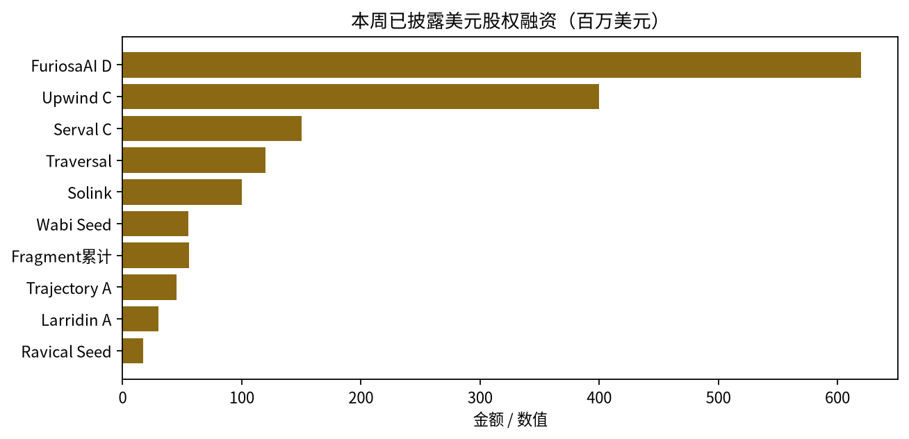

主权资本开始给「量产推理硅」和「主权模型股权」写估值分母；美国仍用公开市场文件与美元私募给 Agent 生产层出价；中国仍用地方国资与产业资本的项目落地条款给存算/稀疏芯片与具身交卷期分层——三地比的是谁有权写分母，不是谁披露的美元更多。

上期主线是「定价权换手」：美国把锚搬到 Anthropic S-1，中国把锚搬到国资领投的 Token 工厂与存算流片。本周换手外溢到第三地带——韩国国民成长基金以约 2.8 亿美元最大支票撑起 FuriosaAI Series D 6.2 亿美元、投后 29 亿美元；加拿大联邦拟以商业性股权至多 16 亿加元入股 Cohere Series E 首关（目标至多 70 亿加元、投后近 360 亿加元；目标与承诺上限不得计入已完成总额）。对照侧，中国窗内微纳核芯 C2 超 10 亿元与墨芯 C+ 近 10 亿元同周构成「推理降本芯片」双峰；美国 Upwind、Traversal、Serval 把钱砸向云安全与 Agent 生产/ITSM 层，Anthropic S-1/A 则补齐第三季收入与约 8954 亿美元算力承诺。

## 本期要点

**一、韩国国民成长基金把已量产推理硅抬到 29 亿美元投后。** FuriosaAI 于 10 月 28 日宣布 Series D 6.2 亿美元、投后估值 29 亿美元；国民成长基金承诺约 3700 亿韩元（公司口径约 2.8 亿美元）为最大单笔，韩系银行与产业及 Cisco Investments 等国际资本跟投。第二代推理加速器 RNGD 已于今年 1 月量产，公司称今年约 2 万卡，客户例含 Samsung SDS 与 LG 本地混合云。钱的结构首先是国家增长资产配置，其次才是市场化竞价；与上期以色列 NeuReality 被美国买家收购对照，韩国选择把同类资产留在国内并抬估值。评估韩系 AI 硅时，须单列主权股东条款与保供溢价。

**二、Anthropic 用完整三季数据把公开市场锚写硬。** 11 月 2 日递交的 S-1/A 补齐截至 9 月 30 日：第三季收入约 169.56 亿美元，九个月约 332.4 亿美元，算力与基础设施相关采购承诺与租赁合计约 8954 亿美元。公司称价格下调与合同折扣使第三季相对第二季少约 6 亿美元；环比增速约 +47%（CNBC），显著低于前两季三位数环比。这不是新融资轮，而是公开市场锚用完整三季说话；late-stage 辩论的焦点从「有没有收入」转为「斜率是否仍支撑溢价、近万亿承诺如何兑付」。

**三、Upwind 用 38 亿美元估值赌云与 AI 安全平台位。** 10 月 28 日 Series C 融资 4 亿美元、估值 38 亿美元，Bessemer 领投，累计超 8 亿美元；约 9 个月前 Series B 为 2.5 亿美元、15 亿美元估值。产品侧强调 runtime 云安全与 AI Sensors / Agent·Skills 扫描；卖方选择私募高估值继续独立，而非被观测巨头吸收。同周 CrowdStrike 收购 Fiddler 与 Dreadnode 补 Agent 安全栈——安全巨头用并购补栈，Upwind 用股权赌平台位。

**四、中国主星切到推理降本芯片双峰：微纳超 10 亿、墨芯近 10 亿。** 微纳核芯 10 月 28 日披露 C2 超 10 亿元，建投投资领投，公司口径两月累超 20 亿、半年约 30 亿；墨芯人工智能 11 月 3 日披露 C+ 近 10 亿元，五个月两轮累近 20 亿。投资方均为国资、产业与财投密度高，估值均未披露。相对上期趋境 Token 工厂超 13 亿与亿铸存算超 10 亿，本周切换为芯片侧「可部署才给钱」；金额用「超/近」，上沿不确定，不得写成精确 20 亿合计。

**五、Traversal 把 Agent「保生产」单独抬到 10 亿美元估值带。** 11 月 3 日新融资 1.2 亿美元、估值 10 亿美元，Kleiner Perkins、Redpoint、Khosla 共同领投，累计 1.73 亿美元；产品自称 AI Site Reliability Engineer。把「Agent 写代码」推到「Agent 保生产」，定价锚更接近可靠性 SaaS 与可观测性。与同窗 CrowdStrike 买 Fiddler、以及 Upwind、Serval（1.5 亿美元、30 亿美元估值）共同构成美国「Agent 生产层 + 云安全」私募定价样本周。

## 主权资本：谁有权写估值分母

上期回答「中美各自用哪把尺子」；本周要回答的是，当国民成长基金与联邦财政部同时出现在 AI 股权表上，区域冠军的估值分母开始含什么溢价——保供、就业、本地算力、出口管制联动——以及这些溢价如何对照中国国资项目条款与美国公开市场/私募双锚。

Furiosa 一轮约 45% 韩元口径来自国民成长基金，说明本轮首先是国家增长资产配置。观察点落在 2026 年约 2 万卡是否兑现、Samsung SDS / LG 是否从试点扩到第三方可核案例，以及 HBM 与先进制程供给约束。风险侧：金额、客户与产量均为公司与媒体披露，细项跟投不完全同构处不作铁证。

Cohere 于 10 月 29 日宣布 Series E 首关，目标至多 70 亿加元，Schwarz Group 领投；新投资者含 Bell Ventures、Bullhound 与加拿大联邦政府。总理府宣布联邦拟作商业性股权投资至多约 16 亿加元，分期拨付并挂钩至 2030 年前不少于 1000 个高薪技术岗、不少于 17 亿加元追加加拿大算力、保持加注册与总部、与 AI Safety Institute 合作等；媒体引公司口径投后近 360 亿加元。「已获目标大部」仅公司口径，未独立核实到账。硬口径：70 亿加元是目标上限，16 亿加元是联邦承诺上限，二者均不得计入「本周已完成」一级总额；整轮 close 前不得写作「已募满 70 亿加元」。

四把尺子本周同时在场：主权资产负债表（Furiosa、Cohere）、中国项目条款（微纳、墨芯、脑虎、易成）、美国公开市场文件（Anthropic S-1/A）、美国美元私募（Upwind、Serval、Traversal、Wabi）。国家角色从补贴方/客户走向持股人与估值书写人，是上期「定价权换手」的全球外溢，而非简单「非美中长尾变大」。韩/加标的尽调须单列主权股东条款；跨币种不得用不折算的美元加人民币总额做「谁更热」结论。

辅证同向不同调：英国 Fractile 约 5.77 亿英镑 Series C preferred 经 Companies House 配股回执被媒体挖出（媒体 10-30；配股主峰至 10-23）——本周新披露的历史配股；与 Furiosa 高调主权叙事对照，同是推理芯片，一个国民基金站台，一个私人配股静默堆金额。韩国 Intellivix（10-30）、Lablup（11-03）科斯达克挂牌，则显示同一国家私人市场巨额与公开市场小市值出口并行。

## 美国：斜率变硬，私募给生产层高倍数

上期美国一级偏冷、基金偏热；本周私募明显回暖。可核大额股权约 7 笔，粗算披露额约 8.56 亿美元（Upwind 4 亿 + Serval 1.5 亿 + Traversal 1.2 亿 + Wabi 5500 万 + Fragment 5600 万累计 + Trajectory 4500 万 + Larridin 3000 万）；Furiosa 归韩国，不计美。Form D 已售字段与媒体融资额分列，禁止相加。

公开市场侧，Anthropic S-1/A 把第三季斜率与近万亿算力承诺摊开，与同周私募 40 倍级前瞻 ARR 倍数并存——定价权分裂，而非单边降温。Wabi 以种子轮 5500 万美元、12.5 亿美元估值进入消费 Agent；Trajectory 4500 万美元、3 亿美元估值做持续后训练平台；Larridin 3000 万美元做 AI ROI 度量。生产层之外，并购同步补栈：Salesforce 收购 Cresta（官方未披露；外媒约 27 亿美元仅作传闻口径）、CrowdStrike 收购 Fiddler AI 与 Dreadnode（官方未披露；Fiddler 外媒约 4 亿美元）、Harvey 收购 Aida。窗内未见 Cresta/Fiddler/Dreadnode 的 8-K 命中，不等于交易不存在；金额保持未披露或传闻分列。

Form D 抽样：Serval 发行上限 1.5 亿美元、已售约 1.492 亿美元（首次销售 2026-10-20，申报 11-03），与媒体 Series C 数值对齐，仍不等于法律「完成额」；Powerlattice、General Compute 等首次销售早于报道窗，勿写作本周新完成轮。Traversal、Upwind、Wabi、Trajectory 等大额媒体轮次本周未见对应 Form D。

## 中国：交付尺子下的芯片双峰与具身分层

窗内可核亿元级约 12 笔核心，有料对象约 16–17；主线从「Token 工厂单笔超大额」切换为「存算/稀疏芯片连续加注 + 脑机国资亿元 + 具身交卷期分层」。估值几乎全线未披露。DeepSeek 约 1055 亿元媒体细节仅作背景，不进统计。

芯片侧除微纳与墨芯双峰外，奕泰智能端侧交换芯片 A 轮超 2 亿元，智子光垣光计算种子「数亿元」。脑机侧同周出现脑虎科技 B 轮 7 亿元（国投聚力、深创投、勤智联合领投）与暖芯迦 C+ 5 亿元（高榕领投，年内累计约 10 亿）。具身侧分层清晰：简智机器人 A+ 1 亿美元（2026 年第三季度完成、11 月 2 日披露，统计记窗内披露，勿写作「本周刚交割」）；易成创新工业无人作业 C 轮 2 亿元；机器科学全栈 A2「数亿元」；艾利特 D+/D++ 2 亿元；飒智 Pre-B「数亿元」；潜行创新水下 C+ 近亿元。超进化智能研究基础模型天使「数亿元」，共绩科技分布式算力「数亿元」（披露 11-03，完成日或在 9 月，须脚注）。

并购与上市通道给出另一把温度计。国际商业结算有条件全资收购 QuantumCompute/天璟富联体系，对价 5.63 亿港元（港交所公告），不得写作已交割完成；华大九天拟控股奇捷科技，对价不超过 2.2 亿元，协议截至披露未签。东山精密 10 月 28 日挂牌，发行价 86.80 港元，截至 10-30 首周约 −10.14%，公开认购约 0.52 倍；登临科技 10 月 30 日起招股，价 231–288 港元，基石约 6.464 亿港元，拟 11-10 挂牌；国星宇航 PHIP 披露 2025 收入 7.03 亿、净亏 2.56 亿，在手 114 颗 AI 卫星订单、合约值 34.75 亿；微亿智造原定 10-28 未上市，窗内无重启。公开市场判断：挂牌兑现偏冷 + 招股供给偏热 + 零递表周，与上期微亿暂缓连成「通道情绪降温」，不是产业政策转向。登临基石结构（产业封测相关 + 地方财团 + 光大理财）与一级「国资换产能」同构，发生在 IPO 层。

基金侧，上海木澜和聚 AI 互连芯片备案 25.125 亿元；国泰海通「领航科创」拟 200 亿元属广义科创，不计入 AI 专项核心；南京物理 AI 基金签约日在 10-27，属窗外背景。

## 本周融资表

*图 1：本周已披露美元股权融资金额（百万美元）。未计入人民币轮次、Cohere 目标上限与未披露金额；数据来源：本期冻结母稿已核披露。*

下表精选主交易；金额保留原文「超/近/数亿」口径，未披露写未披露。Cohere 行为目标/承诺上限，Fractile 为历史配股本周披露，二者均不得计入已完成股权完成额加总。IPO、基金、Form D、并购另表外分列。

| 公司 | 轮次 | 金额 | 投资方 | 赛道 | 地区 |
|---|---|---|---|---|---|
| FuriosaAI | Series D | $620M（韩媒 KRW 820B） | 国民成长基金约 $280M；进出口银行、UAMCO、韩华资管；NAVER/DSC/KDB 等；Infinitum、Jericho、QUDA、Cisco Investments 等 | 算力 | 韩国 |
| Upwind | Series C | $400M | Bessemer 领投；Greylock、Craft、Salesforce Ventures、TCV 等；Canapi | AI 原生基础设施 | 美国 |
| Serval | Series C | $150M | Sequoia 领投；Conviction、Headline；Redpoint、GC、First Round 等 | Agent 基础设施 | 美国 |
| Traversal | 新一轮（媒体称 Series B） | $120M | KP、Redpoint、Khosla 共领；Sequoia、Battery、Amex | Agent 基础设施 | 美国 |
| Solink | 成长轮 | 超 $100M | Vertu Capital 领投；GS Alternatives、Golub Growth、Comcast Ventures 等 | 垂直 | 加拿大 |
| Wabi | Seed | $55M | IVP；a16z、Forerunner、Amazon Alexa Fund 等 | Agent·横向 | 美国 |
| Fragment | Seed+A 累计 | $56M 合计 | 8VC；GC、A* 等 | Agent 基础设施 | 美国 |
| Trajectory | Series A | $45M | Sequoia；Nvidia、Bessemer、BCV | AI 原生基础设施 | 美国 |
| 微纳核芯 | C2 | 超 10 亿元人民币 | 建投领投；杭州资本、凯泰、晓池、烟台财金、盛堃、国投泰康、领阳等 | 算力 | 中国 |
| 墨芯人工智能 | C+ | 近 10 亿元人民币 | 仁爱、海棠、东恒石油；比丘、派拉、中财等 | 算力 | 中国 |
| 脑虎科技 | B 轮 | 7 亿元人民币 | 国投聚力、深创投、勤智；中芯聚源、黄浦、基石、IDG 等 | 垂直 | 中国 |
| 暖芯迦 | C+ | 5 亿元人民币 | 高榕领投；人保股权、砺思、建发新兴、东方嘉富、丹合、杭州产投；君联等 | 垂直 | 中国 |
| 简智机器人 | A+ | 1 亿美元（Q3 完成 / 11-02 披露） | 上汽、Eastworlds、百度、首程、银河通用；光合、SUNHELM、中信金石等 | 具身终端 | 中国 |
| 易成创新 | C 轮 | 2 亿元人民币 | 粤科、善达、安徽国投、佛山创投等 | 具身终端 | 中国 |
| Cohere | Series E 首关 | 目标至多 CAD$7B（非已完成额）；联邦至多 CAD$1.6B 股权 | Schwarz 领投；Bell、Bullhound、加拿大政府、Inovia、NVIDIA、Prosperity7 等 | 基础模型 | 加拿大 |
| Fractile | Series C（披露型） | 约 £577M（历史配股本周披露） | 未完整公开名单 | 算力 | 英国 |

完整股权表（含早期与数亿元口径行）

| 公司 | 轮次 | 金额 | 投资方 | 赛道 | 地区 |
|---|---|---|---|---|---|
| Larridin | Series A | $30M | Pelion；a16z、Gradient 等 | AI 原生 / Agent | 美国 |
| Ravical | Seed | $17M | MMC 领投；Lakestar、Pitchdrive、Shapers | 垂直 | 欧洲 |
| NanoForge AI | Seed | KRW 146 亿 | Mirae Asset Venture 领投；FuturePlay、Mashup、DSC、KDB、Ecopro 等 | 垂直 | 韩国 |
| 机器科学 | A2 | 数亿元人民币 | 琥珀、鸿瑞达、上海半导体产投；爽资本、360、国联民生、金鼎等 | 具身终端 | 中国 |
| 艾利特机器人 | D+/D++ | 2 亿元人民币 | 建信股权领投 | 具身终端 | 中国 |
| 奕泰智能 | A（A3） | 超 2 亿元人民币 | 锡创投领投；金投致源、洪山资本 | 算力 | 中国 |
| 超进化智能 | 天使 | 数亿元人民币 | 蓝驰领投；商汤国香、联想之星、英诺等 | 基础模型 | 中国 |
| 智子光垣 | 种子 | 数亿元人民币 | 海桐、云启、国泰海通、险峰、原子、同鑫、交大 AI 未来基金 | 算力 | 中国 |
| 飒智智能 | Pre-B | 数亿元人民币 | 建投投资、南通投管、云启 | 具身终端 | 中国 |
| 共绩科技 | 新一轮 | 数亿元人民币（完成日存疑） | 中网投、宁德时代系、元禾璞华等 | AI 原生基础设施 | 中国 |
| 潜行创新 | C+ | 近亿元人民币 | 广聚投控、云创启真等 | 具身终端 | 中国 |
| 赛感科技 | Pre-A++ | 数千万元人民币 | 广州工控独家 | 具身终端 | 中国 |

表外分列（禁止与上表完成额加总）：IBS 收购 5.63 亿港元；华大九天拟购奇捷 ≤2.2 亿；东山/登临/国星等上市进展；木澜和聚 25.125 亿备案；BYVP Fund III 6000 万美元与 U&I Ventures I 约 3223.7 万美元终关；Form D 已售字段；DeepSeek 媒体约 1055 亿（背景）。

## 本周 vs 上周

| 主线 | 上周 | 本周 | 走向 |
|---|---|---|---|
| 非美中定价主体 | 欧洲成长基金写应用估值（Pigment）；以色列卖芯片 | 韩国民成长基金写推理硅；加拿大联邦写模型股权 | 升温（主权化） |
| 美国一级温度 | 股权冷、基金热、S-1 定锚 | 私募给 Agent 生产层/云安全高倍数；S-1/A 补斜率与算力承诺 | 私募升温、公开锚变硬 |
| 中国一级主星 | Token 工厂 + 存算单峰 | 存算/稀疏芯片双峰 + 脑机 + 具身分层 | 切换簇群 |
| 港股 AI 硬件 | 定价完成、认购弱 | 挂牌兑现偏冷、招股供给偏热、零递表 | 通道情绪延续偏冷 |

上周比的是中美两把尺子谁写分母；本周第三把尺子登场——主权资产负债表直接持股。美国侧「一级极冷」叙事被约 8.56 亿美元媒体披露私募簇打破，但公开市场锚同时用斜率放缓与巨额承诺把溢价辩论写硬。中国侧不再靠单笔 Token 工厂超大额，而是芯片双峰、脑机双亿元与具身交卷期分层并行；港股通道则从定价弱认购走到挂牌偏冷。以色列退出通道仍在，标的从芯片切换到运维 Agent（Freshworks 收购 Robusta）。Cohere 目标上限与 Form D 已售不进「已完成」金额对比；跨币种不做精确折算冷热结论。

## 对你意味着什么

{: .notice--info}
以下为编辑建议，均基于本期正文事实推导，不构成投资建议。

1. **尽调清单加字段「主权股东条款」。** Furiosa / Cohere 表明估值分母已含就业、本地算力、保供与治理约束；韩/加基础设施与模型标的不能只看轮次金额。建议：条款矩阵模板，单列分期拨付与本地算力/就业挂钩条件。
2. **中国尺子仍是交付，不是估值。** 微纳+墨芯双近 10 亿、脑机双亿元、具身「数据美元 / 工业 C 轮 / 全栈数亿」分层——能进集群/临床/产线的给钱。建议：投后跟踪出货与注册临床节点，而非等待估值披露。
3. **美国 Agent 生产层进入独立估值带。** Traversal 10 亿、Serval 30 亿、Upwind 38 亿估值，叠加 CrowdStrike / Salesforce 并购补栈——「保生产 / 替 ITSM / 守云运行时」比又一个 coding copilot 更易拿到平台价。建议：组合上区分 copilot 与 system-of-record 替代者。
4. **公开市场锚看斜率与承诺，不看热闹。** Anthropic S-1/A 的第三季放缓 + 约 8954 亿美元承诺，是未来两季 late-stage 谈判的硬参照；东山首周破发与登临基石高占比，提醒港股硬科技「开得了通道、接不住溢价」。建议：一级对标时折扣港股情绪，而非只折 A 股。
5. **统计纪律。** Cohere 目标上限、Form D 已售、媒体并购传闻额三套数字分列；跨币种不精确加总中美「周热度」。建议：内部仪表盘分币种、分事件类型。

观察名单（下期必跟）：Furiosa 出货与第三方部署；Cohere 后续 close 与联邦分期；登临 11-6 定价与 11-10 挂牌；微亿是否重启；Anthropic 价位/股数填空；Traversal/Upwind 是否补 Form D；木澜 AMAC 原页。

## 来源

- FuriosaAI Series D 公司博客（10-28）：<https://furiosa.ai/blog/furiosaai-620-million-series-d>
- MoneyToday，Furiosa 韩元口径与国民成长基金（10-29）：<https://www.mt.co.kr/en/future/2026/10/29/2026102908523397390>
- Cohere Series E 公司博客（10-29）：<https://cohere.com/blog/who-gets-to-build-the-frontier-for-ai>
- 加拿大总理府，联邦至多 CAD$1.6B（10-29）：<https://www.pm.gc.ca/en/news/news-releases/2026/10/29/canada-announces-landmark-investment-cohere-scale-secure-sovereign-ai>
- BetaKit，Cohere 估值近 CAD$36B（10-29）：<https://betakit.com/canada-to-invest-up-to-1-6-billion-in-ai-firm-cohere/>
- Anthropic S-1/A（EDGAR，11-02）：<https://www.sec.gov/Archives/edgar/data/2130357/000162828026068676/0001628280-26-068676-index.html>
- Upwind Series C 公司博客（10-28）：<https://www.upwind.io/feed/the-next-wave-is-here-upwinds-400m-series-c-to-build-the-cloud-ai-security-platform>
- Traversal 融资，BusinessWire 公司稿（11-03）
- Serval 媒体轮次；Form D 转述：<https://www.formds.com/issuers/serval-inc>
- 微纳核芯超 10 亿（10-28）：<https://finance.sina.com.cn/tech/roll/2026-10-28/doc-iniwueft3730676.shtml>
- 墨芯近 10 亿（11-03）：<https://news.pedaily.cn/202611/571246.shtml>
- 脑虎科技 7 亿（10-28）：<https://www.neuroxess.com/news/naohukejiwancheng7yiyuanblunrongziguotoujulishenchuangtouyuqinzhizibenlingtou/>
- 简智机器人 1 亿美元（11-02）：<https://cn.technode.com/post/2026-11-02/genrobot-ai-100-million-series-a-plus-funding/>
- 国际商业结算收购公告（HKEX，10-30）：<https://www.hkexnews.hk/listedco/listconews/sehk/2026/1030/2026103002663.pdf>
- 国星宇航 PHIP（10-29）：<https://www1.hkexnews.hk/app/sehk/2026/108536/documents/sehk26102900163_c.pdf>
- Trajectory $45M（TechCrunch，11-02）：<https://techcrunch.com/2026/11/02/trajectory-raises-45m-to-make-ai-model-training-accessible-to-nontechnical-experts/>
- Freshworks–Robusta（10-28）：<https://www.freshworks.com/theworks/company-news/freshworks-robusta-acquisition/>
- Fractile £577M 披露（10-30）：<https://techfundingnews.com/fractile-577m-series-c-nvidia-ai-chips/>
- BYVP Fund III $60M（10-29）：<https://tech.eu/2026/10/29/by-venture-partners-closes-60m-fund-iii-and-opens-lisbon-office-to-deepen-european-push/>
- Ravical $17M（10-29）：<https://tech.eu/2026/10/29/ravical-raises-17m-to-break-the-link-between-accounting-firms-growth-and-hiring/>
