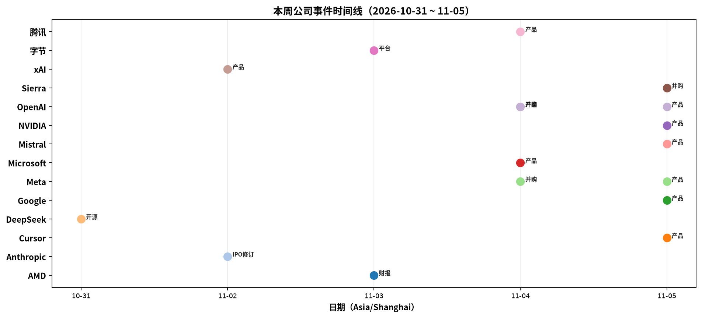
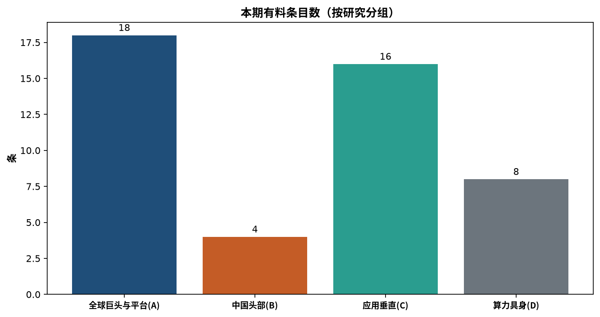

模型能力已经便宜到可以按秒、按 token 打折买，于是这一周的钱转向买模型之外的那一层：谁存你的 diff、谁调度你的多个 agent、谁替你登录那个没有 API 的网站。

窗口 2026-10-31 ~ 11-05，三笔并购在 24 小时内落地，恰好各占一层且互不重叠——OpenAI 买下源码的存储与审阅，Conductor 加入 Meta 补多 agent 并行，Sierra 买下浏览器登录。同一周还有两份能拿计算器验算的文件：Anthropic 的 S-1/A 修正案与 AMD 的 Q3 财报。前者说明算力承诺有多重，后者说明算力已经能从第二家买到；把这两件事并排放，本周的资本动作就不难解释——钱往买不到的地方走。本周没有通用旗舰基座换代，最大的模型发布是腾讯 Hy4 与 OpenAI GPT-6 Cyber，一个是国产开源，一个是垂类专用。

## 本期要点

### Anthropic：第一家把完整账本摊到公开市场的前沿实验室

刺眼的不是增速，而是承诺与收入的比例结构——它把「AI 需求是否可持续」从叙事问题变成了算术题。11-02 提交的 S-1/A 修正案 No.1 给出：前九个月收入 **$33,242M**（上年同期 $2,545M），Q3 单季 Claude 收入 **$17.0B**，净亏损 **$(104,039)M**——其中 **$(94,324)M** 是可转换证券、衍生品与 SAFE 的公允价值变动，这是融资工具估值上升的会计结果，不是现金流出。算力与基建采购承诺加租赁约 **$895.4B**，其中约 **$447.5B** 预计 2030 年底前发生、约 **$69.8B** 在 12 个月内到期；现金及短期投资 **$131,845M**，累计募资 **$141.1B**。拟上纳斯达克，代码 **ANT**，PBC + LTBT / Class F 的治理结构。

按本报计算：上半年收入为 $16,242M，Q3 单季略高于上半年全部（前提是 Claude 收入为该期总收入的主要构成，分部对账表未取得）；承诺相当于前九个月收入的约 **26.9 倍**、年化收入的约 **20.2 倍**；现金对 12 个月内到期承诺的覆盖约 **1.9 倍**。读法是「近端安全、远端靠融资」——短期无虞，2030 年前的到期墙需要 IPO 募资、经营现金流与新增融资三者接续。产品侧本周完全静默，带宽在文件上；发行价区间与日程均未给出。

### OpenAI：买下「源码审阅」，同时把网安做成产品线

一周之内做了两件互补的事——买下 agent 产出物的存储与审阅层，同时证明 agent 能自己找出并修掉漏洞；前者是流程，后者是能力。11-04 收购 Pierre Computer Company：它提供 Code Storage 与开源的 Trees / Diffs / Highlights，已在 Codex 内使用；目标是改造 Git 与审阅工作流以适配 agent，开源部分保持开源，交割需监管批准，对价未披露。11-05 的 GPT-6 Cyber 做授权范围内的漏洞发现、验证与修复：ExploitGym **48.5%** 对 GPT-5.6 Cyber **32.1%**，Honeypot 保持在范围内 **99.93%**（无提示）/ **100%**（有提示），Preparedness Framework 网络安全类判 **Critical**，初期仅限 Daybreak Red 的 API 与 Codex。

同一周还有两条支撑。Linux 管线把 **2,308** 个候选压到 **1,724** 个动态复现、最终确认 **948** 个本地提权漏洞，API 成本 **$1.213M**（约 **$1,279/个**），而 7 月同一管线是 166 个——按本报计算约为 **5.7 倍**。同日 Daybreak Red 进入 AWS GovCloud（US-East），GPT-5.6 Cyber 经 Bedrock 提供，需双重审批、推理不用于训练、数据无需回传。需要说清的是：48.5% 是自家代际跃升，不是行业最好成绩——Gemini 4 Carbon 在 10-28（窗外）为 **54.8%**，且这些数字均为厂商自测。

### Meta：买下「多 Agent 编排」，顺带把 Muse 推到语音

三笔并购里金额最不透明的一笔，结构性意义却最明确：并行跑多个 coding agent，从独立 SaaS 变成平台内部能力。11-04 Conductor 宣布加入 Meta（卖方公告，Meta 侧未见对应新闻稿，条款未披露）。Conductor 的形态是在隔离工作区里并行运行多个 AI 编码 agent；云服务的结局在公告日就已排定——11-04 起停止新注册、11-13 转只读、11-20 删除数据，本地应用更新支持到 2027 年初，留给现有客户的迁移窗口只有 16 天。

这是典型的 acquihire 形态：要团队与工程经验，不要 SaaS 业务。次日 Meta 把 Muse 推到实时语音与表达型形象——数百种声线、先在美国上线、AI Glasses 与 Muse Charm「即将推出」。同周还有一篇 GSLM2 论文（多流语音表征），但那是研究题录，窗内没有转成产品权重的动作。

### AMD：数据中心 +97%，五客户名单，Q4 指引约 $17B

本周唯一带完整财务口径的一手，也是「第二供应商」从叙事变成订单的一刻。11-03 财报：营收 **$13.377B**（同比 +45%、环比 +16%，创纪录），数据中心 **$8.546B**（同比 **+97%**，点名 Instinct MI450 系列），GAAP EPS $1.46 / 非 GAAP $2.09，Q4 指引约 **$17B** ±3%（同比约 +66%）。按本报计算，数据中心已占营收约 **63.9%**，Q4 指引隐含环比约 **+27.1%**——在 HBM 紧供给的背景下，这等于宣称产能已落实。

更值得记的是客户名单：Helios 机柜级方案正在 **Anthropic、Meta、Microsoft、OpenAI、OCI** 五家运行。其中三家就是本周的主角——OpenAI 与 Meta 是两笔工作台并购的买方，Anthropic 是 S-1/A 的披露方。同一周里，它们一边买流程层，一边用第二供应商的整机柜。财报同时披露 ROCm 10 与 Helion 参考架构，以及已签署协议收购 World Labs 与 Taalas（业务描述与对价未给）。

### Sierra：买下「浏览器登录」，让 agent 真的把事办完

三笔里最小、也最容易被低估的一笔：它补的不是能力，是行动半径。11-05 Sierra 宣布收购 Anon——为 agent 提供浏览器登录与身份基础设施，让 agent 能登录、填表、在没有 API 的网站上执行动作（业内比喻是「AI agent 的 Plaid」）。Anon 累计融资超过 **$13M**，服务数百家客户；交易条款未披露。Sierra 的说法是支撑更长时间的 Horizon 目标：agent 不止于建议，而要完成。

这一层的价值断点很具体：能想出该做什么，但登录不了供应商门户、过不了二次验证、填不了老系统的表单。登录不是通用算法，而是逐站点积累的适配——表单结构、验证流程、会话保持、失败回退，只能靠时间堆。结合 10-09（窗外）的 Poppy 草案看，Sierra 是先在协议层定规则，再买实现层给执行力。

*图 1：本周公司事件时间线（10-31 ~ 11-05）。数据来源：母稿对比表。*

## 为什么是「买」而不是「做」

结论先行：三笔标的都是**时间密集型**资产，不是算力密集型。买它们不是没钱做，是没时间做——而这恰好是模型降价之后唯一没有降价的资源。

| 层 | 标的 | 买方 | 买的是什么 | 为什么不自建 |
|---|---|---|---|---|
| 产出物（存储 / 审阅） | **Pierre** | OpenAI | Code Storage + 开源 Trees / Diffs / Highlights，已在 Codex 内使用 | 已是自家产品的底层依赖，重写等于替换正在跑的依赖；数据结构的所有权比实现更重要 |
| 调度（多 agent 编排） | **Conductor** | Meta | 隔离工作区并行多 agent 的工程经验 | 难点在状态隔离与合并冲突的真实仓库迭代，无法用算力换时间 |
| 身份（登录 / 执行） | **Anon** | Sierra | 逐站点的登录适配 + 数百客户验证过的会话维持 | 登录是长尾适配资产，只能靠时间堆；自建至少落后 1–2 年 |

三笔还有一个共同点：都不承诺产品延续。Conductor 的云服务直接排定了关停时间表，Pierre 只承诺开源部分保持开源，Anon 的产品去留未披露。这是能力内化的典型形态，也提醒客户一件事——**工作台层的供应商风险高于模型层**：模型停用可以换 API，工作台停用要迁移数据与流程。

## 三个前置条件为什么在这一周同时成立

**模型价格已经低到不构成差异化。** 窗内证据是 Google Omni 1.2 Flash 降价 **30%** 至 **$0.07/秒**（720p），同时把原生视频从 10 秒拉到 15 秒；腾讯 Hy4 能力增加（首次视觉理解 + Computer Use）但定价保持 **6/18 元**每百万 tokens 不变。再加上上期 OpenAI Terra 的腰斩，单位智能价格持续下行，「用哪个模型」的决策价值下降，「工作流怎么搭」的决策价值上升。

**agent 并发数正在成为新的容量单位。** NVIDIA 11-05 把指标改成「每瓦 agent 数」（1.6× 对最快 x86）与「agent 速度」（2× 对最高效 x86），并用 Daytona 的「1,000 个沙箱 10.8 秒 vs 88.4 秒」举例——全部为厂商与伙伴自测。并发一上升，调度与隔离就从「可以做」变成瓶颈。

**资本周期偏好轻资产并购。** 上期是资本密集的大周（Meta ~$95B 股权、Anthropic S-1、Broadcom $63B SPV、三云财报）；本周三笔标的都是几十人规模、条款多数未披露的小额交易。在巨额算力承诺压顶的周期里，小额、快速、能立刻改进产品的并购，是资本效率最高的动作。

## 同样三层需求，四种解法

结论先行：四种解法的分界线是**分发结构**，不是技术偏好。

| 解法 | 代表 | 做法 | 优势 | 代价 |
|---|---|---|---|---|
| **买公司** | OpenAI / Meta / Sierra | 收购 Pierre / Conductor / Anon | 立刻获得时间密集型资产 | 整合风险、标的业务关停、条款不透明 |
| **发原语** | Microsoft / AWS | Copilot Studio 持久化 agent（自带凭证 + 业务记忆 + 触发器）、Foundry Browser Automation **GA**、MCP/A2A 双支持；AgentCore **Web Answer GA**（一次 MCP 调用、带引用、$10 / 1,000 次、零外流） | 分发已在企业云合同里，不必买客户 | 原语通用，难覆盖客户的特殊流程 |
| **做货架** | Glean / Cohere / 字节（据媒体） | Auto 路由（Economy / Balanced / Frontier）+ 75% / 90% 成本闸；Model Vault 上架 DeepSeek、Gemma、GLM 等（默认零留存）；豆包工作接 Kimi / GLM / DeepSeek | 把模型选择变成成本旋钮，客户不被锁定 | 品牌在终端消失，分成让给平台 |
| **底座化** | Databricks / Broadcom / Oracle | Claude 原生 OTel → MLflow → Unity Catalog；Tanzu 数据产品 + 嵌入式 MCP；FDI agent 目录（ZIP 交付） | 不下场竞争工作台，收工作台的数据与治理 | 价值实现慢，依赖上层生态繁荣 |

已经有企业合同的（Microsoft / AWS / Oracle）发原语；有开发者入口的（Glean / Cohere / 字节）做货架；有数据底座的（Databricks / Broadcom）做底座；只有在产品形态上需要立刻改变、又没有现成分发的（OpenAI / Meta / Sierra），才选择买公司。这也解释了为什么中国侧本周没有并购——入口集中在少数超级 App 与云平台手里，自建入口的边际价值低于买流程层（推断）。

## 资本侧：算力越可替换，流程层越贵

把 S-1/A 的披露值折成几个比率，资本流向就清楚了。

| 比率 | 数值（本报计算） | 读法 |
|---|---|---|
| Q3 单季 vs 上半年合计 | $17.0B vs $16,242M | 采用在加速，一个季度做了上半年全部的量 |
| 承诺 / 前九个月收入 | 约 26.9 倍（年化约 20.2 倍） | 收入只有三个月的可见度，承诺是按多年签的 |
| 现金 / 12 个月内到期承诺 | 约 1.9 倍 | 近端安全，远端要靠 IPO 与新增融资接续 |
| 剔除公允价值项后的净亏余额 | 约 $(9,715)M，仍含其他非经营项，不等同经营亏损 | 现金消耗要看经营现金流，本期材料未取得 |

Anthropic 的模式是「用承诺锁供给、用收入证明需求、用 IPO 补缺口」，每一环都需要资本市场配合。而同期 OpenAI、Meta、Sierra 买的资产不需要多年承诺、没有 HBM 依赖、不受电价影响。这不说明 Anthropic 的策略有问题——承诺同时是竞争壁垒——但它解释了为什么本周的并购全部落在轻资产侧。

## 供给侧的对照：五客户名单里有三个买方

| 客户 | 本周在做什么 |
|---|---|
| OpenAI | 买 Pierre；发 GPT-6 Cyber |
| Meta | 买 Conductor；发 Muse 语音 |
| Anthropic | 发 S-1/A（约 $895.4B 算力承诺） |
| Microsoft | 发持久化 agent 与 Browser Automation GA |
| OCI | 发 FDI agent 目录 |

同一批公司在算力侧多源、在流程侧自建或并购，说明两层的替代性完全不同：算力有第二供应商、有二手市场、有标准化机柜，工作台没有。Google 不在名单里，与其 TPU 自用加外售给 Oracle 的路线一致，这是结构性而非偶然。ROCm 10 与 Helion 参考架构则是另一重信号——硬件可替换，迁移成本才是留存。

## 中国侧是另一道题

结论先行：不是能力差距，是分发结构不同——入口在超级 App 与云平台手里，买流程层的边际收益低于美国，所以打法是「货架 + 折扣」而不是「买公司」（推断）。

腾讯 11-04 发布 Hy4：相较 preview 扩展了预训练与后训练，首次支持视觉理解，首次支持 Computer Use（CLI + GUI 双通道）；金融众测 3.04，对照 Kimi K3.1 Pro 2.68、GLM-5.3 2.68、DeepSeek-V4.1-Flash 2.97；幻觉率 12.95% → 7.2%；定价保持 6/18 元每百万 tokens 不变；权重「将近期开源」但未给日期。TokenHub / WorkBuddy / CodeBuddy / 元宝四端同时上线，11/4–11/15 有免费额度，TokenHub 五折至 2026-12-31（基准与幻觉率为厂商口径）。

字节走的是另一条路：doubao-seed-evolving 强化复杂任务的规划与验收、工具调用与事实一致性，公告未给量化数字；豆包工作接入 Kimi K3.1 Pro / GLM 5.3 / DeepSeek V4.1 Flash 据媒体，未获官方确认。DeepSeek 10-31 以 MIT 许可开源 dsh-superagent-prototype，战略意义大于产品意义——用开源维持开发者心智，把 harness 做成入口。9 个固定对象里 3 家有动态、2 家仅被他方引用、4 家静默（阿里、百度、华为、MiniMax）；静默可能是抓取覆盖不足，也可能是确实没有发布，本期无法区分。

*图 2：本期有料条目数（按研究分组 A/B/C/D）。数据来源：母稿覆盖统计。*

## 本周 vs 上周

| 主线 | 上周（10-24 ~ 10-29） | 本周（10-31 ~ 11-05） | 走向 |
|---|---|---|---|
| AI 资本 | 三云财报 + Meta ~$95B 股权 + Anthropic S-1 + Broadcom $63B SPV，问「谁出钱」 | 一份 S-1/A 完整口径 + 三笔小额并购，问「钱买到什么」 | **迁移：从出钱到买了什么** |
| Agent 执行与授权 | Sierra 的 Poppy 协议草案 + Compliance Console；Devin Security 2.0 | Sierra 买 Anon 补实现；Hy4 首次 Computer Use；GPT-6 Cyber 判 Critical | 延续，从协议到实现 |
| 分发 / 治理 | Oracle×OpenAI 企业栈；豆包工作默认三方模型 | 持久化 agent + Browser Automation GA + Web Answer GA；Cohere Model Vault；Mistral Studio | **升级：云厂商原语化** |
| 算力供给 | Helios 装机 Meta + $1B 股权；Oracle 上架 Google TPU（2027 起） | Helios 五客户名单；Q4 指引约 $17B；ROCm 10 | 延续，第二供应商坐实 |
| 具身 | 以「第 N 个商业仓」计量商业化进度 | 四家静默，唯一实质是优必选 Thinker-Sim（官微经媒体） | **降温** |

上周的问题是「账单到期，谁出钱、谁供硅、谁分发」，答案在股权、SPV、负自由现金流与 IPO 文件里；本周把同一个问题往下问了一层：钱付出去之后，买到了什么。答案不在机房里——三笔并购买的都是数据结构、并发原语和逐站点的登录适配，这些东西没有第二供应商、没有二手市场、也没法用算力加速。Anthropic 的 $895.4B 与 AMD 的五客户名单从反面证实了这一点：算力这一层已经能被买到、也能被替换，所以资本开始往买不到的地方走。

## 对你意味着什么

*以下为编辑建议，面向公司战略观察者与投资人，均由本期母稿事实推导。*

1. **工作台尽调按三层拆开看指标。** 产出物层看数据结构的所有权、是否已被自家产品依赖；调度层看真实仓库的迭代量；身份层看站点覆盖与合规口径。三层的关键指标完全不同，不能用「Agent 平台」一个标签打包估值。
2. **把「关停时间表」写进条款。** Conductor 的三条时间戳说明平台买方只要团队与经验，不要业务。对创业公司，「客户迁移成本」应单独计价；对企业买方，工作台停用的迁移成本远高于换一个模型 API。
3. **把云厂商的控制台当成头号对手。** Browser Automation GA、持久化 agent、一次 MCP 调用返回带引用答案——对客户是加个配置，对创业公司是整个产品。能守的只剩云不愿做的长尾与云做不了的合规特例。
4. **身份要单独估值。** Sierra 买 Anon、Cursor 用自家 SSO 做应用登录、Microsoft 让 agent 自带凭证，三家在同一周把身份放进产品核心。模型可以换、算力可以换，身份关系换不了。
5. **采购评审加一条成本上限。** Glean 的 75% / 90% 阈值与 Copilot Credit 管理同周出现，说明企业已在月中撞额度；给不出成本上限的工作台，会在评审里直接失分。
6. **用 Anthropic 的披露颗粒度校准同类标的。** $895.4B 承诺与约 26.9 倍覆盖比一旦成为公开基准，下一轮实验室融资会被要求同等颗粒度——对头部是护城河，对长尾是门槛。
7. **勿升格清单。** Perplexity ultra 的 $21.71/任务、Cognition 的 $80B 融资、Midjourney V9、Tesla 12 月预订、Broadcom $43B 兜底、Anthropic 的估值与上市日、OpenAI 购 TPU、Kimi 的开源兑现——一律保持待核、未见或未核到，不写进确定事实句。

## 来源

### 一手 / 官方

- Anthropic Form S-1/A Amendment No.1（Reg. 333-299633）｜[sec.gov](https://www.sec.gov/Archives/edgar/data/2130357/000162828026068676/anthropicpbc-sx1ax1.htm)（11-02）
- OpenAI｜[收购 Pierre](https://openai.com/index/openai-to-acquire-pierre/)（11-04）、[GPT-6 Cyber](https://openai.com/index/introducing-gpt-6-cyber/)（11-05）、[A thousand fewer paths to root](https://openai.com/index/a-thousand-fewer-paths-to-root/)（11-04）、[Daybreak Red on AWS GovCloud](https://openai.com/index/daybreak-red-aws-govcloud/)（11-04）、[Images 2.6](https://openai.com/index/introducing-images-2-6/)（11-04）
- [Conductor 加入 Meta](https://www.conductor.build/announcement)（11-04）；[Muse 语音与形象](https://about.fb.com/news/2026/11/introducing-muse-ai-voice-expressive-avatars/)（11-05）
- [AMD FY2026 Q3 财报](https://newsroom.amd.com/news/amd-reports-third-quarter-2026-earnings/)（11-03）
- [Sierra 收购 Anon](https://sierra.ai/blog/sierra-acquires-anon)（11-05）
- [Gemini Omni 1.2 Flash](https://blog.google/innovation-and-ai/technology/developers-tools/introducing-gemini-omni-1-2-flash/)（11-05）；[Antigravity 化学信息学](https://deepmind.google/blog/agentic-cheminformatics-with-google-antigravity/)（11-03）
- Microsoft｜[Copilot Studio 更新](https://www.microsoft.com/en-us/copilot/blog/copilot-studio/new-and-improved-agents-that-are-persistent-agents-for-customer-conversations-and-improved-maker-experience-in-microsoft-copilot-studio/)（11-04）、[Foundry 10 月汇总](https://devblogs.microsoft.com/foundry/whats-new-in-microsoft-foundry-october-2026/)（11-05）
- [AWS Web Answer on AgentCore](https://aws.amazon.com/about-aws/whats-new/2026/11/web-answer-amazon-bedrock/)（11-05）；[xAI Data Bot](https://x.ai/news/data-bot)（11-02）；[NVIDIA Vera 性能](https://blogs.nvidia.com/blog/vera-cpu-highest-throughput-fastest-agents/)（11-05）
- [腾讯混元 Hy4](https://www.tencent.com/zh-cn/tencent-launches-hy4-joining-the-ranks-of-the-worlds-leading-open-source-ai-models/)（11-04）；[火山方舟模型发布公告](https://ark.volcengine.com/region:cn-beijing/docs/model-release-announcement)；[DeepSeek dsh-superagent-prototype](https://github.com/deepseek-ai/dsh-superagent-prototype/)（10-31）
- 应用与平台｜[Perplexity Teammates](https://www.perplexity.ai/hub/blog/teammates-are-agents-for-complex-ongoing-work)、[Runway Characters](https://runway.com/news/research/real-time-video-at-batch-size-one)、[Harvey×Jus Mundi](https://www.harvey.ai/blog/harvey-and-jus-mundi-announce-an-agent-to-agent-partnership)、[Glean Release 567](https://docs.glean.com/release-notes/releases/2026-11-03-november-release)、[Cohere Model Vault](https://cohere.com/blog/open-source-model-vault)、[Mistral Studio](https://mistral.ai/news/build-with-studio/)、[Cursor Build Live Apps](https://cursor.com/changelog/build-live-apps)、[Databricks × Claude OTel](https://www.databricks.com/blog/claude-platform-now-supports-native-opentelemetry-observability-databricks-mlflow)
- 算力与云｜[Broadcom Tanzu 数据底座](https://blogs.vmware.com/tanzu/announcing-ai-ready-data-foundations-in-tanzu-platform-trusted-data-for-reliable-agentic-ai/)、[Broadcom 多站点 AI 网络](https://www.broadcom.com/company/news/articles/ai-infrastructure/scaling-ai-beyond-data-center-buffer-depth-multi-site-clusters)、[Oracle FDI Agents Repository](https://blogs.oracle.com/analytics/from-discovery-to-use-introducing-the-fdi-fusion-agents-repository-for-oracle-ai-agent-studio)（11-04）

### 媒体 / 二级

- 经济观察网：[豆包工作接入三方模型](http://www.eeo.com.cn/2026/1105/1084503.shtml)（11-05，据媒体）
- Axios / TechCrunch：Conductor 交易条款未披露
- Digg：Perplexity ultra 数值二手佐证，待核
