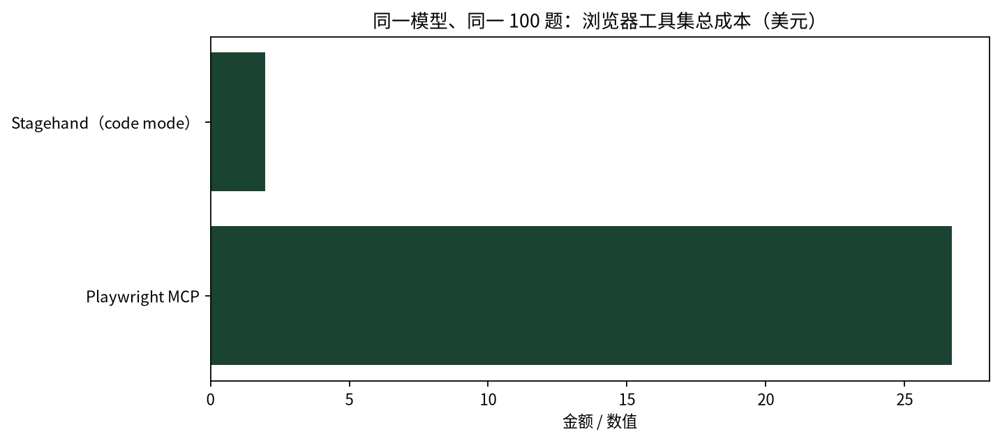
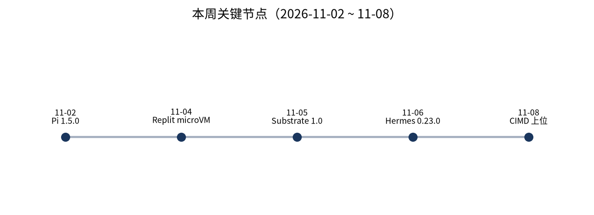

本周真正的分水岭不是模型，而是 **Agent 的执行面开始分层**：沙箱从产品功能下沉为基础设施，身份从用户委托上收到服务账号与协议，授权规则则被证明可以成为泄漏载体。

这不是一次厂商发布会式的共识。Google、Replit、Cloudflare、Anthropic、Perplexity、OpenClaw 与 Hermes 各自从自己的位置出发，最后指向同一个问题：Agent 在哪里跑、以谁的身份跑、跑完能不能证明它没越界。前两层这周有了可比较的时延与隔离级别，第三层连「规则存在哪里」都还没解决。

## 本期要点

**沙箱这周变成了可以采购的基础设施，而权限这周被证明还是手工作业。** Google 宣布把 Agent Substrate、gVisor、OpenRL 捐给 CNCF（上月已进 Sandbox），Agent Substrate 到 1.0 并在 GKE GA：它把有状态会话与算力解耦，空闲快照后 **<500ms** 恢复，宣称 10x 容器密度，隔离可选 gVisor 或 Cloud Hypervisor microVM；同一周 Replit 披露沙箱引擎完整重写为每沙箱一个 microVM（KVM + Cloud Hypervisor，vsock + gRPC，guest 内核从 tinyconfig 起），审计 2026-06 至 11-04 的 **6,211** 条 Linux-CNA CVE、规避 **96.1%**，获取一个沙箱约 **500ms**。与此同时，Claude Code 一边在 2.1.319 上线 `permissions.denyInsteadOfPrompting`、把 auto mode 改成服务端核不了就问或拒，一边被 Apiiro 公开了另一面：用户点「Yes, and don't ask again」后，被批准的整条命令（含内联密码）会写进项目内 `.claude/settings.local.json`，扫描到 **1,122** 个公开 GitHub 文件、**1,105** 个含真实密钥的仓库，其中 **539** 个仓库有一次 Claude 共同署名提交。沙箱防的是执行越界，权限规则防的是授权扩散，两者不能互相替代。

产品和开源侧的动作则说明「执行位置」本身在移动。Perplexity 11-06 把 Computer 做成**完全跑在 Mac 上**：Local 与 Hybrid 两种模式，端侧模型 + harness + 执行，数据不发云，代价是 Apple silicon 与推荐 36 GB 内存的门槛，而且权限仍停在「with your permission」，没有逐动作审批或审计说明。OpenClaw 2026.11.1 继续把「一个 Gateway 就是一个信任边界」写成补丁线：畸形日志条目不能让脱敏规则失效，出站代理拒绝不受信的根，配置保存失败不再覆盖 secret。最后，评测的风向也变了：Surge AI 固定 Opus 5.5 跑 100 个真实任务，把 thinking 从 medium 提到 xhigh 提升 **11.3 分**，而最有效的 harness 增量只有 **2–3 分**，成本 8× 的配置没有统计显著提升。本周没有「某模型又涨点」，只有「评测本身正在被重做」。

## 沙箱、身份、授权：执行面为什么这周分层了

把本周的材料按「强制点在哪」排一遍，会得到四层，而不是一堆产品。

**客户端沙箱**管的是「这条命令能碰什么」。Claude Code 的 Bash 沙箱在 macOS 用 Seatbelt、在 Linux/WSL2 用 bubblewrap + socat，默认关闭（`sandbox.enabled=false`），写限工作目录与临时目录，网络默认无直连、全部经本机代理按 `allowedDomains` 逐 host 检查（初始为空）。但它的覆盖范围只有 shell 命令及其子进程：Read/Edit/Write/WebFetch 等内置工具、MCP server、hooks、plugin monitors、LSP、状态栏命令都在界外；`excludedCommands` 与 unsandboxed retry 是明确的逃生门。官方文档的建议很直白——要把这些纳入同一边界，得把 Claude Code 进程本身放进容器或 VM。

**云端运行时**管的是「代码在哪个内核上跑」。Replit 的答案是把共享内核容器换成每沙箱一个 microVM：host↔guest 走 vsock，不需要 IP 网络；VMM 无特权、无 capabilities；egress 在 guest 外强制（按 TLS SNI + DNS 过滤，guest 关不掉）；凭据由 credential broker 代附加，workload 拿不到账号 key。那 96.1% 的 CVE 规避率不是「没有漏洞」，而是「审计的 Linux-CNA 条目里，70.4% 补丁先于披露落地、10.9% 靠配置排除」——它把隔离变成了可比较的口径。

**集群编排**管的是「几百万个空闲 Agent 怎么不烧钱」。Agent Substrate 的关键不是虚拟化，而是**不创建新 Pod 对象**：请求先到 L7 代理挂起，controller 放置到预热池的空闲 slot，从分层存储恢复内存与磁盘，回合结束快照并释放 slot。身份绑在 Actor 上而不是 Pod 上，这是它与「每会话一个 Pod」最本质的差别。Kubernetes 侧对应的原语是 `kubernetes-sigs/agent-sandbox` v1.0.10：Sandbox CRD + WarmPool + Python/Go SDK，`create_sandbox(warmpool=…)` 直接拿预热沙箱。

**授权**是跨层的第四层，也是本周唯一出事的一层。Apiiro 的 1,122 个文件不是沙箱被突破，而是「用户批准的命令被持久化进仓库」：Claude Code 只把 `.claude/settings.local.json` 加进**全局** gitignore，不写进仓库 `.gitignore`；换机器、容器、复制目录或文件已被跟踪时照常提交。作者在 HN 讨论中更正了最初「fresh clone 也会带上」的说法，Claude Code 团队成员也公开表示历史上没做 secret scrubbing、正在研究如何防止。这里的教训不是「别用这个功能」，而是**allow-rule 应绑定命令形状，而不是连参数一起记下来**；项目级 settings 需要入库前扫描；降低摩擦的设计必须与密钥检测同批上线。

四层拆开之后，采购问题就变得具体：唤醒/恢复时延、状态快照粒度、隔离级别（gVisor vs microVM vs 容器）、egress 与凭据是否在 guest 外强制。四个都能测，也都有人给了数——这在前几个季度是做不到的。

## 编码 Agent：默认值比新功能更重要

本周一批 CLI/IDE 的发布里，最值得记的不是功能，而是「升级后行为会变、但不会报错」的地方。

Claude Code 把默认姿态从「先问」推向「先拒」：`denyInsteadOfPrompting` 让原本会弹窗的调用直接拒绝并继续回合（含子 agent 与 teammates）；关闭 telemetry 或 feature flags 后，auto mode 对服务端无法核查的调用改为询问或拒绝，且项目设置与插件不能在被外部关闭后重新打开服务端核查。Codex 0.167.0 走的是「每次都新鲜」：`prompt-user` 对高风险命令形状重新取得批准，`[permissions.network]` 把网络访问写成声明式配置，MCP 改为 per-chat 租约。Copilot CLI 1.0.107 把沙箱扩到扩展进程与本地 MCP server，并把 `write(path)`/`read(path)` 做成 glob 规则——同时明确「未限定范围的 `write` 只批准 shell 输出重定向、不批准命令本身」。

三个「静默变化」必须单列。Copilot CLI 的插件规则 `alwaysApply: false` 语义反转，从默认生效改成需在 `/instructions` 显式启用；Google ADK 2.14.0 让 16 个特性「毕业」后始终可用，`ADK_DISABLE_*`、`override_feature_enabled(..., False)`、`--disable_features` 不再生效且不报错不告警；OpenAI 把打包模型目录里 `gpt-6-astra` 等默认 reasoning effort 从 low 提到 medium。三条都容易在「只对照版本号与 breaking changes 清单」时被漏掉，却都会改变线上行为。升级检查表应单列「默认值差异」一栏。

还有一条 CI 陷阱：OpenCode 2.2.6 的 `opencode run` 现在会等本次 prompt 启动的后台 shell、子代理、图像任务全部结束才退出，**没有时间上限**；一个永不退出的 dev server 会让 job 永久占用 runner，只能 Ctrl+C 或 SIGTERM（退出码 143）。同时它把 webfetch 规则收紧到「拒绝含凭证的 URL、忽略 fragment、每个重定向都重新对照规则」——这类「规则匹配的是 A、实际请求到 B」的绕过，终于被当成一等威胁。

## 开源 Gateway：两个项目独立收敛到同一个架构

OpenClaw 与 Hermes 在本周独立得出同一个判断：**一个 gateway 拥有每个会话，所有界面都只是客户端**。Hermes v0.23.0 写得很清楚——此前 CLI、TUI、Desktop、编辑器（ACP）、消息 bot、cron 各自对同一聊天跑一份 agent 副本，导致消息重复写或丢失；现在一个聊天 = 一个队列 + 一份历史。OpenClaw 则把它写成一句信任模型：One Gateway is one trust boundary，顺序是 Identity first → Scope next → Model last。

两者的差别在边界哲学。OpenClaw 用「拒绝」保护用户：导航 fail-closed，MCP loopback grant 按铸造者 + 受众回收且在暖回合最多复用 3 轮，工作区 `.env` 不能设置 `PATH`，日志脱敏即使遇到畸形自定义条目也必须继续生效。Hermes 用「让你看清代价」保护用户：付费 MCP 工具可声明单次成本，审批卡显示单次价格与该聊天累计，**即使在 YOLO 模式也会问**；Group Chat 的 bot 间回环以 `max_hops`（默认 4）硬截断，不是靠提示词劝；插件目录增至 1,050+ 条并新增 Verified 层，`hermes curator lock` 让 agent 通过任何工具都不能改写你手改过的技能。

代价是两边都要排期破坏性升级。Hermes 删掉了 `browser_*` 十件套与 `agent-browser`，只保留 `browser_exec`；Electron 44 把门槛抬到 macOS 13+；`hermes mcp serve` 改名 `mcp-serve` 且不自动改写客户端命令。OpenClaw 的 2026.11.2 主题相同（配置密钥、会话内容、工具错误、渠道载荷不进诊断日志），在 11-09 凌晨发布，属于下期。

## 浏览器与端侧：执行位置在移动，取证没跟上

本周没有新的 computer-use 模型。变化都在运行时和管控面。

Perplexity 把 Computer 搬到 Mac 端侧，是浏览器/端侧这条线上唯一的产品架构级动作：支持的文件与原生应用任务用端侧模型、harness 与执行，完全本地的任务不经云编排；同时发布 Teammates，把「一次一个任务」改成「一个持续岗位」，接收 ongoing job 后自行规划、并行执行，产出进入人工复核。它给不能把屏幕与文件送云的场景第一次提供了可选方案，但 36 GB 内存门槛把它限定在高端 Mac，且企业若需要审计 Agent 点了什么、读了哪些文件，当前 changelog 没有给出对应能力。

Cloudflare 把「让 Agent 看、但不让它填」做成了策略：11-04 Browser Isolation 新增只读键盘档（beta），阻断数据录入但保留查找、全选、复制、打印、缩放，复制与打印仍受各自策略控制、**策略组合而非互相覆盖**；同日把 AI bot 策略改名并扩到按 Personal Agent 逐个授权；11-03 Browser Run 的 `/crawl` 增加逐 URL outcome 与 robots.txt 诊断——这是少见的取证级 crawl 记录。

工具协议对成本的影响，本周有了可复算的证据。LangChain 比较 7 个浏览器工具集后选了 Stagehand：同一 Claude Sonnet 5.5、同一 100 题 WebVoyager，通过率 **90%**、总成本 **$1.98**；Playwright MCP 通过 **78%**、**$26.71**，约 13 倍成本、约 3 倍耗时。机制是 code mode——只给三个工具（`snapshot` 读可访问性树、`run` 一次调用里批量执行、`screenshot`），Agent 写一段代码完成「开页→填表→点击→校验」，中间变量留在代码里、只有结果进上下文。Playwright MCP 单个任务平均 **26 个模型轮**，而一次 hosted MCP 导航的页面内容中位数约 **17,000 字符**：两个瓶颈都被工具协议直接对准。

Anthropic 补的是外围身份：11-05 组织级 IP allowlist（beta，每组织最多 1,000 条地址或 CIDR）与 Admin API 全局登出（beta）。它的 browser toolset 是客户端工具集——27 个默认成员 + 4 个可选，用可访问性树 + 元素 ref，执行、URL/文件策略与 approval callback 都在你的进程里。含义很明确：**取证点在你自己的 executor**，平台不会替你留 browser 会话证据。OpenAI 本周不可评：`help.openai.com` 的 release notes、agent、cloud browser 三页全部 403，只能确认已核入口无相关条目，不能反推「没有发布」。

## 企业侧：服务账号、席位价与身份收购

四家企业的动作指向同一件事：Agent 要成为生产依赖，先得回答「它是谁、花谁的钱、出错谁负责」。

Glean v568 把 Agent 身份从「用户 OAuth 代跑」改成**服务账号**：Atlassian、Coda、Datadog、incident.io、Intercom、Linear、Zendesk（v567 另有 ServiceNow）的 service-credential MCP servers 转 GA。代价是权限粒度从「用户可见范围」变成「服务账号被授予的范围」，所以同版必须补「投递前校验订阅者可见性」——Slack 触发先校验频道可见性，Zendesk 触发在无法核验时不再投递。成本侧把选模型改成管理员策略：按组织或部门指定 Economy/Balanced/Frontier，Frontier 用户到月度额度 **75%** 降 Balanced、**90%** 降 Economy。

Salesforce 给的是价格与入口：Coworker 已有 185,000+ 用户、三个月用量增长 21x，定价 **$50/用户/月**，在 Teams 内直接派活并沿用既有权限与 sharing rules。Sierra 则在 11-05 收购 Anon——凭证处理、浏览器基础设施、agent harness、可嵌入 SDK，直接目的是让 Horizon 的长周期目标（放贷、医保 prior authorization）穿过没有 API 的登录墙。Harvey 走另一条：Harvey Graph 让多个 Agent 共享同一张 matter 工作地图，Fact Graph 维护事实与证据链，Intake 直接从业务方邮件接单。四家都没有把「更强的模型」当卖点。

## 评测：编码榜单没动，方法论在拆地基

本周编码评测没有权威榜单更新：SWE-bench 仓库停在 2026-09-02，OSWorld 只有任务修复，τ-bench 自 2026-03 起指向 τ³-bench。真正的进展是几篇把旧假设拆掉的研究。

Surge AI 的数字最实用：固定 Opus 5.5、100 个真实任务，thinking 从 medium 到 xhigh 提升 **11.3 分**；Superpowers +2.4 分、成本 +10%；`/goal`+`/code-review` +3.3 分、成本 1.8×；Compound Engineering 成本 **8×**、无统计显著提升。先调思考预算，再评估 skill 与多 agent 的边际收益。

arXiv 窗内五篇互相咬合：项目接管在 Full History 下完整交付率仅 **4.95%**；69 个 5–15 步依赖链任务最强仅 **18.5%**；只看题难度的参考分可达 **0.92 AUROC**，而轨迹预测器约 **0.62**——现有失败预测器主要学到题难度与模型能力，而非 run 状态。Terminal-Bench 2.0 的「benchmark maintenance debt」解释了为什么厂商自述与独立复现会分叉：模型变强后，合法解会被旧验证器误判。

安全侧的数字更硬：官方 MCP registry 1,000 仓库抽样中约 **90%** 的破坏性工具没有服务端确认；41 个主流 host/SDK 里 32 个默认没有审批步骤，配对后 **60.7%** 的工具×宿主组合没有强制人工批准；MCP 工具投毒的跨框架实测跑 9,720 格，总体攻击成功率 **22.9%**。Google 的《Agent Distraction》则给代码库噪声定了价：13% 的读文件会话接触到过期 `TODO(bug/...)` 引用，其中 6% 触发动作、83% 是用户没要求的；控制变量后每会话 **+70% 步数、+77% token、+105% 等待时间**。

## 本周 vs 上周

| 维度 | 上周（第 22 期） | 本周（第 23 期） | 走向 |
|---|---|---|---|
| 权限与沙箱 | Claude Code 工作区外写拒绝、网关 layered policy | `denyInsteadOfPrompting`、auto mode fail-closed、Codex `[permissions.network]`、Copilot 扩展进程进沙箱 | 从「配置项」变成「默认姿态」 |
| MCP 治理 | Smithery 代理关停、发布火车定档 | CIMD 上位、DCR 退场、Inspector 修 3 个 CVE、Registry 键语义变更 | 从「连接」转向「注册与索引」 |
| 沙箱基础设施 | 多为产品内实现 | Agent Substrate 1.0 捐 CNCF、Replit microVM 重写、agent-sandbox v1.0.10 | 新出现，成为可采购的一层 |
| 企业身份与预算 | Agent Evals / Kill Switch（10-27） | Glean 服务凭证 GA + 75%/90% 阈值、Sierra 收购 Anon、Coworker $50/席位 | 身份成为并购与产品化标的 |
| 评测 | 单任务榜单与厂商涨点 | 接管 4.95%、多步 18.5%、维护债、投毒 22.9% | 转向「方法是否可信」 |
| 终端与分叉 CLI | 仍有零星维护 | Aider 停更 9 个月、Roo 停更 6 个月、Windsurf 入口并入 Devin | 应从 Q4 选型清单移出 |

上周的主线是「把 MCP 收进官方端点」，本周则是「把执行面拆成可采购的层」。两者的连接点是同一个：当 Agent 从「一个会话」变成「一个生产依赖」，治理对象就从协议转向运行时、身份与预算。下周 KubeCon NA（11-09~12）会期大概率给出 CNCF 侧的第一批治理细节，值得作为下期开篇。

## 对你意味着什么

**编辑建议：先查默认值，再谈新功能。** 下面几条按「本周就能做」排序。

对开发者：

- 升级前把「默认值差异」单列一栏：ADK 的 `ADK_DISABLE_*` 已是空操作、Copilot CLI 的 `alwaysApply: false` 已反转、OpenAI 打包模型默认 reasoning 已从 low 到 medium。三条都不报错。
- CI 里跑 `opencode run` 的，自带 timeout 与 SIGTERM 处理；同时用 `--archived` 让 CI 会话不污染会话列表。
- 别把含密命令存进 allow 规则。Claude Code 的「don't ask again」会写进项目内 `.claude/settings.local.json`，且只加全局 gitignore；用 `denyInsteadOfPrompting` 把「本该问」的调用变成拒绝更安全。
- MCP 客户端/网关做三件事：注册迁 CIMD、registry 按 name+version 索引、升级 Inspector 2.14.0。三件都有明确失效模式。
- 评估 harness 时先调思考预算：11.3 分 vs 2–3 分，先加 thinking 再加 skill/多 agent。

对架构负责人：

- 沙箱选型问四个可测指标：恢复时延、快照粒度、隔离级别、egress 与凭据是否在 guest 外强制。Agent Substrate 与 Replit 都给了可比较的数字。
- 权限模型能否承载「服务账号」是核心问题：Glean 的答案是服务账号 + 投递前可见性校验 + 预算阈值；Salesforce 的答案是沿用既有权限。两种都要回答「Agent 越权是否等于用户越权被放大」。
- 预算做成准入控制，而不是账单告警：参考 `RunBudget` 的 fail-closed（缺 usage 即停止）与 Glean 的 75%/90% 降级。
- 评测改用接管与多步口径：一次性 patch 的分数已不能预测生产表现（4.95% / 18.5%），同时给基准留维护预算。
- 自托管 gateway 把「日志脱敏、出站代理信任链、配置写入不覆盖密钥」当三条常驻回归线。

## 来源

- Google：Open infrastructure for autonomous agents comes to CNCF｜https://cloud.google.com/blog/products/containers-kubernetes/open-infrastructure-for-autonomous-agents-comes-to-cncf/
- Replit Frontier：sandbox engine microVMs｜https://frontier.replit.com/sandbox-engine-microvms-part-1/
- Apiiro 研究（正文 403，机制取自 HN 讨论帖作者回复）｜https://apiiro.com/blog/coding-agents-leaking-secrets-github-dont-ask-again
- Claude Code release notes｜https://docs.claude.com/en/release-notes/claude-code
- Claude Code Bash sandbox 文档｜https://docs.claude.com/en/docs/claude-code/sandboxing
- Codex releases｜https://github.com/openai/codex/releases
- OpenClaw v2026.11.1｜https://github.com/openclaw/openclaw/releases/tag/v2026.11.1
- Hermes v0.23.0｜https://github.com/NousResearch/hermes-agent/releases/tag/v0.23.0
- Perplexity changelog（2026-11-06）｜https://www.perplexity.ai/changelog
- Cloudflare changelog（2026-11-03/04）｜https://developers.cloudflare.com/changelog/
- LangChain：How We Optimized Browser Use for Deep Agents｜https://blog.langchain.com/how-we-optimized-browser-use-for-deep-agents/
- Anthropic API release notes｜https://docs.claude.com/en/release-notes/api
- Glean release notes｜https://docs.glean.com/release-notes/
- Salesforce Coworker｜https://www.salesforce.com/news/stories/agentforce-coworker-surpasses-185k-users/
- Sierra acquires Anon｜https://sierra.ai/blog/sierra-acquires-anon
- MCP PR #3518｜https://github.com/modelcontextprotocol/modelcontextprotocol/pull/3518
- MCP Inspector 2.14.0｜https://github.com/modelcontextprotocol/inspector/releases
- Surge AI harness 基准｜https://surge.ai/
- Google：Agent Distraction｜https://developers.googleblog.com/en/agent-distraction/
- arXiv 2611.02527 / 2611.03555 / 2611.08417｜https://arxiv.org/abs/2611.02527
