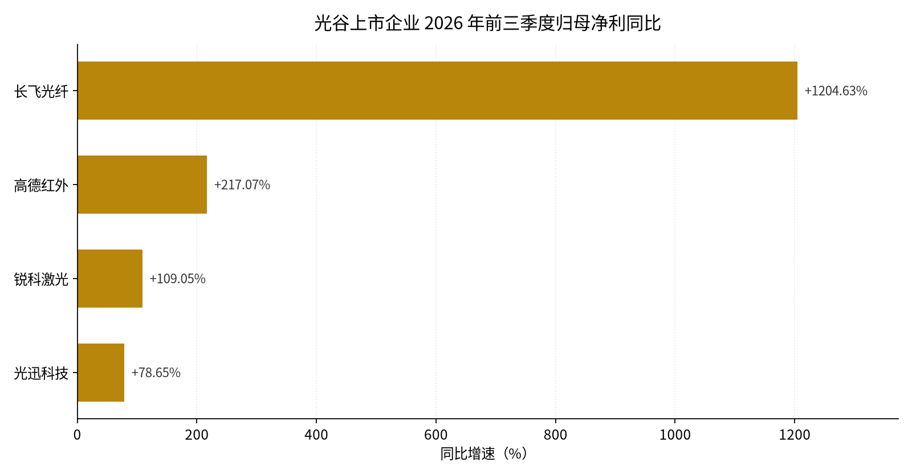
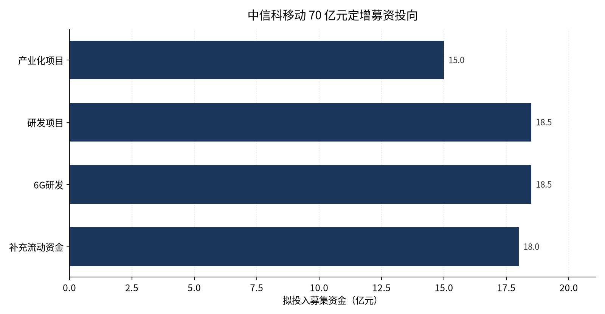

光谷这一周把「国产计算」从适配层推到了整机与政企采购层：OS、整机、主板、外设认证和伙伴制度第一次在同一场发布会上对齐，而同一周的三季报和园区签约，给了这条链利润与载体。

11 月 5 日的 2026 鸿蒙办公产业峰会在光谷举行，华为发布首款鸿蒙台式机擎云 HM65（元器件国产率 100%）、鸿蒙电脑企业版和擎云鸿途伙伴计划 2.0。这不是一次普通的产品发布：过去做一台国产 PC 要同时搞定主板、固件、OS、外设与管理软件，现在 OS 与主板由华为止住，整机厂只做结构、散热、接口与行业配置，门槛从「全栈」降到「一段」。光谷在这条链上占的不是整机，而是外设适配与认证的枢纽位置。同一周，光通信链交出前三季度成绩单，泛半导体产业园首开区签约即满园——规划里的「自主可控」，第一次同时有了 OS、整机、订单和载体。

## 本期要点

**1. 鸿蒙办公产业峰会在光谷举行，国产桌面生态从「适配」走到「整机 + 政企采购」（11-05）。** 1400 余名华为生态伙伴到场，华为董事、终端 BG 首席执行官何刚与武汉市委常委、东湖高新区党工委书记沈悦出席。三项发布构成一条完整产品线：硬件端首款鸿蒙台式机擎云 HM65 系列，面向政企固定办公与业务生产，元器件国产率 100%；软件端鸿蒙电脑企业版，补齐终端部署、设备管理与数据安全；生态端擎云鸿途伙伴计划 2.0，整机伙伴可基于鸿蒙主板自定义产品，首批伙伴整机即将上市。华为口径称，鸿蒙电脑布局 6 年、覆盖 13 个行业、在 300 余家客户规模使用、独立应用 2.1 万款、终端用户即将突破亿级；峰会连续三年在光谷举行，参会伙伴三年增长四倍。光谷的承载是鸿蒙生态（武汉）创新中心与星汉实验室（全国鸿蒙外设适配枢纽，四大平台累计完成 2000 余款外设产品认证），标杆产品为风行在线「欢鸿」与泰康科技「康鸿OS」，场景落在医疗、水务、政务、交通。它改变的是招商对象：可招的不再只是整机品牌，而是主板伙伴、外设厂与行业应用商三类。（[区官网通稿](https://www.wehdz.gov.cn/2022/ggxw_68627/ggxw_68629/202611/t20261106_2875690.shtml)）

**2. 「感传存算」链三季报交卷，利润继续向光通信与红外集中（11-05）。** 区官网以「感传存算」概括光谷上市企业前三季度成绩：长飞光纤营收 191.24 亿元（+86.12%）、归母净利 61.28 亿元（+1204.63%），增长来自智算中心建设带动光纤需求、销量与单价同升；光迅科技营收 116.83 亿元（+36.94%）、归母 12.84 亿元（+78.65%），800G、1.6T 持续批量交付，第三季度营收、归母、扣非三项均创单季历史新高；华工科技 1.6T 规模化交付，光模块出口北美及东南亚增长 396%；高德红外归母 18.45 亿元（+217.07%）；烽火通信营收 204.44 亿元（+19.75%），长江计算自研 51.2T NPO 交换机与 800G 算力互联产品；精测电子半导体在手订单约 36.57 亿元（+105.34%）；锐科激光归母 2.57 亿元（+109.05%）；达梦数据营收 11.14 亿元（+34.22%）。需要注意口径：烽火只披露营收增速，利润口径未公布，不能据此写成全面景气。（[区官网汇总](https://www.wehdz.gov.cn/2022/ggxw_68627/cydt_68630/202611/t20261105_2874604.shtml)）

*图 1：光谷上市企业 2026 年前三季度归母净利同比（%）。长飞光纤 +1204.63%、高德红外 +217.07%、锐科激光 +109.05%、光迅科技 +78.65%。数据来源：东湖高新区政务网《光谷上市企业三季报「交卷」》（2026-11-05）。*

**3. 中信科移动 S 频段相控阵天线下线，70 亿元定增同周给出用途明细（11-03）。** 华中首套 S 频段相控阵天线在武汉下线，这是适配手机直连卫星的星载载荷，搭载于平板式低轨卫星、联动星载基带实现「基站上天」，有效口面可达地面产品的 8 至 10 倍，整机由近 15 万个元器件构成。它放弃机械扫描，用电子相位差实现毫秒级波束切换，超薄低剖面共形结构可贴合平板卫星、适配一箭多星堆叠发射。同日省委书记关志鸥调研中国信科，专门看了中信科移动的「空天地一体全栈产品智造基地」。资本侧，定增方案给出完整口径：拟募资不超过 70 亿元、发行不超过总股本 20.48%，投向产业化 15 亿元、研发 18.5 亿元、6G 研发 18.5 亿元、补充流动资金 18 亿元，项目总投资约 95 亿元；公司近四期归母净利分别为 −3.57、−2.79、−2.70、−0.34 亿元，补流占募资 25.7%。70 亿元是发行上限、不是到账金额，定增仍在审核。（[长江云报道](https://news.hbtv.com.cn/p/4639877.html)｜[募集说明书](https://static.cninfo.com.cn/finalpage/2026-10-24/1225619990.PDF)）

**4. 泛半导体产业园首批 6 个项目签约、10 亿元基金设立，跨区域共建两个月「满园」（11-04）。** 200 余名链主企业与投资机构代表到场，首批 6 个项目覆盖集成电路备件公共仓、精密洗净及再生服务基地、泛半导体研发制造基地、泛半导体中试基地等环节；武汉泛半导体产业园投资基金同步设立，目标规模 10 亿元、首期认缴 5 亿元，直接投资、优先投园区产业链项目。园区与鄂州共建、毗邻光谷，服务「梧桐树计划」，以集成电路龙头为链心引进设备、材料、零部件、晶圆检测、设计、封测与存算一体企业，目标「5 分钟产业协同圈」；同一天区官网披露，与青山区共建的新材料产业园首开区一期一个月「满园」。基金「优先投园区项目」等于把返投要求前置进基金定位，这是光谷第一只锚定飞地园区的资本工具。（[区官网通稿](https://www.wehdz.gov.cn/2022/ggxw_68627/cydt_68630/202611/t20261105_2874611.shtml)）

**5. 创青春大赛科技创新专项在光谷颁奖，20 个金奖、三只种子基金现场签约（11-05）。** 赛事 7 月启动，共 6159 个项目团队、2 万余名青年参赛，63 个进总决赛，产生金奖 20、银奖 43、铜奖 60、优秀奖 115，覆盖脑机接口、集成电路、先进材料、高端装备、现代农业。光谷企业武汉百英诺（2025 年成立）以「智能超声无创脑机接口治疗系统 NeuroTune A1」获金奖。签约环节，湖北省新楚种子投资基金、武创星火种苗基金、光谷科创种子基金分别与获奖项目签订意向投资或合作协议；银奖项目「房叮咚」与光谷人才集团签战略框架，拟在本地建运营中心。签约是意向、不是到账，金额未披露。（[区官网通稿](https://www.wehdz.gov.cn/2022/ggxw_68627/cydt_68630/202611/t20261106_2875711.shtml)）

## 鸿蒙：光谷拿到的是「适配枢纽」，不是整机

把峰会拆开看，三件发布物各自解决一个问题。

**主板成了标准件。** 伙伴计划 2.0 允许整机伙伴「基于鸿蒙主板自定义产品」。主板是 PC 里耦合最深的部件——CPU、内存、接口、供电、固件、OS 引导都在这块板上；把它做成可被引用的标准件之后，伙伴只需做结构件、散热、接口扩展（串并口、网口、专用插槽）、行业认证与整机测试，研发周期与 BOM 风险大幅下降，同一块主板可以衍生出办公机、工控机、医疗一体机。这是把手机产业的「平台 + 白牌」分工复制到 PC。

**企业版解决的是「谁签字」。** 官方只给三个能力名：终端部署、设备管理、数据安全。对应政企采购的三个必答题——批量装机、资产与策略统管、数据不落私。把这三件事做进 OS 层而不是靠第三方软件外挂，好处是策略不可被用户绕过；代价是必须适配企业现有的目录服务与运维工具链。企业版是否提供标准 MDM 协议、是否支持第三方 EMM 接入、国密与等保细节，本次均未公开。

**外设认证才是物理瓶颈。** 桌面替代真正的卡点不是 CPU 和 OS，而是打印机、扫描枪、读卡器、医疗仪器、工控设备能不能用。外设厂为每一种 OS 重写驱动不经济，于是需要第三方把「外设 × 鸿蒙版本 × 主板」做成认证矩阵：外设厂送样、实验室测兼容性、出认证结论、整机厂与集成商按清单选型。星汉实验室做的就是这件事，四大平台累计完成 2000 余款外设产品认证。认证清单一旦被采购文件引用，实验室就掌握了准入节奏——这比任何一次发布会都更能解释「为什么是光谷」。

**光谷出的不是新文件，是软件政策里的开源鸿蒙专章。** 载体是《东湖高新区加快促进软件和信息技术服务业创新发展的若干措施》（武新管〔2025〕3 号），14 条中第三部分专设「支持软件开源生态建设」5 条，覆盖开源原生应用开发（移动端和 PC 端）、开源硬件适配、开源示范应用，第四部分含开源人才培训补贴。金额条款为：首次通过开源系统原生应用认证并上线商用的软件给 10 万元研发支持；重大原生应用开发项目按实际投入 50% 资助、单项目最高 3000 万元；入选武汉市优秀开源软件的项目单个奖励 30 万元、每家企业每年累计不超过 150 万元。这是一套「按环节补贴」而非「按主体补贴」的设计，企业可按自己所在的环节取钱。

市级层面是《武汉市加快培育发展开源鸿蒙生态的实施方案》：到 2027 年落地 100 个示范场景、4 款行业级 OS、200 款应用软件研发、50 款终端适配、10 万名开发者，构建「政务 30 + 行业 30 + 消费 30」场景矩阵。区级下一步更具体——依托武汉软件新城规划武汉开源生态产业园，已完成选址、土地调规、方案设计，计划年内开工一期，建成后挂牌「鸿蒙原生应用示范孵化街区」；建立「鸿蒙应用场景机会清单」定期发布机制；政府采购与项目遴选对符合条件的鸿蒙原生应用软件「优先考量、适度加分」。场景机会清单加采购加分，是把政府需求变成可预期订单流的工具，比一次性补贴更能决定开发者是否愿意为鸿蒙重写一遍。

已经跑起来的场景有据可查：「鄂汇办」鸿蒙版 2025 年 6 月上线，完成 53 个省级部门、1031 项政务服务事项、442 项便民服务应用的适配改造；龙王嘴污水处理厂建成全省首个污水处理厂鸿蒙化工艺应用场景；泰康养老园区「康鸿OS」智慧康养；光谷珞瑜首府小区鸿蒙智慧社区示范。人才侧，武大、华科常态化开设鸿蒙专项课程，年均培育认证鸿蒙专业工程师超 5000 人，与 12 所院校签约挂牌「鸿蒙生态星光学堂」。

> **两条限定**：其一，金额条款来自 2026-08-11 区政协提案答复的转述，措施正文在官网是 8 张图片、无文字层，未能逐条核对，「50% 资助」的基数未说明具体科目；本周也没有任何鸿蒙奖补申报通知。其二，峰会的生态数字（13 行业、300 余家客户、2.1 万款应用、终端用户将破亿、1400 余名伙伴）全部来自区宣传部一篇通稿，市科创局次日转载为同一文本，不构成独立信源，按企业口径读。
{: .notice--info}

## 资本：用途写细了，钱没变多

本周资本侧的重心不是「新钱进场」，而是已有的大额再融资把用途写细、园区基金开始绑定落地条件。

中信科移动的 70 亿元定增是本周唯一「融资额—产线—产品」三件齐全的案例：四段预算同时买产能（产业化 15 亿元）、技术（研发 18.5 亿元）、下一代标准（6G 18.5 亿元）与现金流（补流 18 亿元），指向「具备卫星载荷全工序制造能力的卫星互联网智能工厂」。它的会计实质是用股权资金替换运营商资本开支下滑造成的收入缺口——补流占募资 25.7%，说明前三年经营性现金流不足以自撑 77 亿元项目投资。

*图 2：中信科移动 70 亿元定增募资投向（亿元）。产业化项目 15、研发项目 18.5、6G 研发 18.5、补充流动资金 18。数据来源：中信科移动《2026 年度向特定对象发行 A 股股票募集说明书（申报稿）》（2026-10-24）。*

泛半导体基金是另一种写法：目标 10 亿元、首期认缴 5 亿元、直接投资，且明文「优先投资落地园区的产业链项目」。首期认缴对应 10 亿元目标，意味着二期扩募取决于首批项目落地质量，GP、LP 结构与单项目上限未披露。

两项上市公司动作需要分开读。精测电子董事长彭骞 11-04 提议回购 1–2 亿元，价格不高于董事会审议前 30 个交易日均价的 150%，用途为股权激励/员工持股或减资；而提议前 6 个月内，他以 60.24 元/股协议转让 14,044,100 股、占总股本 5.02% 给一家私募基金。回购仍是提议阶段，尚未过会。长飞光纤半年度 A 股每股派现 1.060 元，股权登记日 11-09、除权除息与发放日 11-10——与光迅把利润转成资本开支形成同周对照：一家分红，一家扩产。

与上期连起来看，结论更清楚：中段（A~C 轮成长期）仍无光谷企业首次披露的单笔融资，这个空白已连续第二期。本周三笔「签约」也都要按上限或意向读——三只种子基金是意向投资、精测回购是提议未过会、信科移动 70 亿元是发行上限。

## 算力与 Agent：制度价格先于市场价格成形

**算力券白名单（11-03）。** 市数据局公示 22 家算力券算力供给方，光谷爱计算、武汉云计算、并行智算等在列。条款比名单更重要：算力券补贴仅限于已入库供给方；算力中心在湖北省内规模须 20 PFlops（FP16）以上并具备 IDC/ISP 资质；云服务商须提供自研大模型备案证明；Token 服务须合规可追溯；须与武汉算力公共服务平台（whsuanli.com）完成对接注册与监测调度。券加白名单等于定向采购权——企业拿到的券只能花在名单内，未入库的算力无法被券支付。Token 首次被写进补贴范围，算力的计价单位从「卡时/P」进一步官方化为「词元」。

同周还有两件事与这套框架咬合：11-18 的算力互联网大会将首发国家算力互联互通「1+M+N」行业节点、发布《算力互联网发展研究报告》、成立算力互联网联盟；11-09 市数据局又公告委托第三方审计机构做算力券发放审计。谁可以收券、谁可以调度、钱怎么核，三件事拼起来是一套算力要素市场的监管框架。

**Agent 侧，供给已登记，订单仍稀缺。** 11-04 省政府新闻办发布会给出武汉口径：发掘培育工业智能体超 170 个、高质量数据集超 50 个、238 家人工智能应用服务商资源池、601 家中小企业完成数字化改造；省级口径为 5G 基站 20 万个、省级及以上工业互联网平台 138 个、85 家数字化转型服务商。运行逻辑是「先入库、再给场景」——资源池是准入名录，智能体与数据集是可被采购的标的清单，11-18 大会的「智能体示范网络」是接入工厂的通道。170 个智能体、238 家服务商的名单与客户均未披露。

唯一一条把 AI 写进产业合同的记录来自激光链：10-30 的湖北激光产业创新大会上发布《激光赋能重点行业场景应用及技术需求清单》，意向金额 100 亿元，会后 6 个项目签约、总金额超 10 亿元；华工激光作为需求方提出「高功率激光器稳定性及带 AI 工艺反馈」，锐科激光接单。AI 在这里不是独立产品，而是采购规格的一部分——要求供应商不只卖光源，还要提供传感、算法与接口，计价随设备走。这是本周最现实的落地路径：不做独立 Agent 产品，做设备厂商的技术条款供应商。

## 具身：卖得动的一周，不是造得出的一周

本周具身的增量全部落在场景与商业闭环层，不在本体制造、不在融资、不在数据工厂。

武汉晴山科技的人形机器人「幻核晴山」在进博会湖北展区首演，舞蹈由企业联合武汉音乐学院编排。技术底座是自研 H-Bot 具身智能训练平台：先在平台上训练可复用的动作策略，再迁移到人形与四足等不同形态本体，因此同一套能力可以切成导览、巡检、遥操三种工种。导览机器人已在武汉梧桐服务区「就业」，后续进驻武商集团承担寻货、导购；产品已出口肯尼亚、马来西亚、新加坡。付钱的是场景运营方与海外集成商，不是政府补贴，也不是消费者。

中科机器人产业创新发展湖北有限公司的咖啡机器人「火星同学」在进博会首发，一个月前开启预售、拿到 100 多台订单，本月在江岸区亮相、12 月中旬进入光谷核心地段及部分商业中心。机制上，人形是交互界面，咖啡制作是确定性执行任务，中间层用语音模型做意图理解、推荐与多轮追问，再把点单结果转成设备指令；任务限定在柜台内，可靠性可控。预售 100 台不等于交付 100 台。

武汉创现科技的扫床机器人「喵卫」是另一种样本：2019 年成立、深耕 7 年，2023 年海外年销量突破 10 万台、国内累计上万台、预计全年营收 5000 万元（企业口径）。它不做通用人形，做「限定平面 + 复杂材质」的专用本体，靠 OTA 按家庭推送参数解决长尾场景，先出海再回国内。

三家企业给出的都是订单、落地点位、出口国别与营收，没有一家公布新产线、新融资或新本体参数。湖北人形机器人创新中心与光谷人形机器人专业园区本周均无公开新动态；零部件层（关节、灵巧手、传感）本周无窗内新增，是最大信息缺口。11-18 大会设有「具身智能与工业智能制造」平行会议，参会名单与对接会排期未取得。

## 政策、人才与土地：三个截止日、一条通道、一个没结果

**政策的重心从「发文件」转向「报题目」。** 本周光谷没有新发区级规范性文件。省科技厅连发两项调研：高新领域技术需求覆盖光通信、集成电路、智能终端、新型显示、激光、工业母机、工业软件等 18 个领域，11-09 24:00 前报盖章 PDF 与 Excel；2027 年前沿技术领域技术问题调研覆盖 6G、人形机器人、低空经济、量子科技、人工智能、氢能与核聚变能六个领域，11-20 17:00 截止，明确用于 2027 年省级技术创新计划指南编制。省级指南走「自下而上报技术问题、归集为指南方向、再组织申报」两段式，本周填的清单会成为明年的指南条目，决定谁能以「揭榜/定向」拿到省级经费。

市级层面，市委常委会 11-02 传达央地共建武汉区域科技创新中心工作推进会精神，要求「项目化、清单化」推进，统筹「六个创新」和「八个环境」，建立定期调度机制；市政府第 199 次常务会点名「加快建设光谷科技成果转化中心」，并对重点难点实施「目标化、项目化、绩效化、考核化」闭环管理。市经信局的独角兽培育库申报（11-06，11-16 截止）把估值口径写死：独角兽为 2015 年及以后成立、投后估值不低于 10 亿美元；潜在独角兽为 2016—2020 年成立且投后不低于 5 亿美元，或 2021 年及以后成立且投后不低于 1 亿美元；种子独角兽为 2021 年及以后成立且投后不低于 1 亿元人民币，且须获备案私募股权/创投直接投资、未上市。

**人才：校招被提前到了「在校」。** 「AI 光博 300」首批 102 名博士入选（206 人申请，年度目标约 100 名），39 家重点企业提供 113 个岗位，年薪 40 万元以上岗位占 65%、最高超 100 万元（政府与企业口径）；华工科技、江城实验室、达梦数据库、聚芯微电子、长盈通 5 家企业现场签约。兑现条款是到岗就业或创业实缴即认定为「光谷 3551 优秀青年人才」，3 年合计 20 万元、分 5/5/10 三笔拨付，叠加最长 2 年免租、第 3 年七折的人才安居。认定权后置、分期与在岗核查绑定，避免「拿了帽子不来」。11-07 华科企业家大会上，市人才工作局发布「校友聚汉全城礼遇服务平台」，华科企业家协会机器人与智能制造分会成立——校友网络被拆成平台、组织、技术三条可运营的线。

**土地：程序在走，结果未出。** 窗内唯一土地类公文是 11-02《武汉东湖新技术开发区征地区片综合地价调整听证会补充公告》，正文为空、内容全在 JPG 附件，调整幅度与新标准未取得。上期的 81 号公告 3 宗工业地（合计约 14.59 万平方米），本轮用 6 类入口均未拿到挂牌截止日、竞得人与成交价：土地交易网接口返回 401、公共资源交易网 TLS 握手失败、中国土地市场网被 WAF 拦截、中指云 429、市级出让公告栏停在 9 月 15 日、东湖分局转让公示停在 10 月 23 日。因此本期不能回答「谁在光谷扩产」，也不写任何「本周成交 X 宗」的表述。

## 本周 vs 上周

上周的主线是「规划写下目标、资本开始兑现」，本周换成「国产计算生态从适配走到整机与政企采购」。

| 主线 | 上周（第 22 期） | 本周（第 23 期） | 走向 |
|---|---|---|---|
| 国产计算 / 信创 | 十五五规划写 1000 亿元自主可控基金集群、存算一体 | 鸿蒙峰会：企业版 OS + 首款台式机 + 伙伴计划 2.0；区级开源鸿蒙专章条款曝光 | 新出现 |
| 光通信利润 | Q3 单季分化：长飞 +1741.52%、烽火 −46.08% | 9M 累计：长飞归母 +1204.63%、光迅 +78.65%（Q3 三项创新高） | 延续 |
| 交付能力 | 华工「核心物料齐套约束」 | 光迅 11-04 澄清「物料短缺、停工」传闻 | 延续（紧张未解） |
| 资本 | 武汉奕材 50.77 亿元增资交割；A~C 轮空白 | 中信科移动 70 亿元定增用途明细；三只种子基金签约；A~C 轮仍空白 | 延续 |
| 载体 | 志橙半导体落户综保区 | 泛半导体园 6 项目 + 10 亿元基金，跨区域共建两月满园 | 新出现 |
| 具身 | 数据工厂扩张、训练师岗位 | 场景与订单：晴山进服务区/武商、中科预售 100 余台、创现海外 10 万台/年 | 重心转移 |
| 土地 | 81 号 3 宗工业地挂牌 | 结果仍不可得；11-02 征地听证补充公告 | 降温（无终态） |
| 其他 | 光谷人民医院启用、3551 大赛 | 人民医院无新增；3551 只以「光博 300 到岗即认定」出现 | 降温 |

上周看的是「钱到没到位」，本周看的是「生态有没有闭环」：鸿蒙给出 OS 与整机的分工，三季报给出利润，园区给出载体，三者第一次在同一周对齐。但同一条链上也出现了第一次公开的交付疑虑——需求与供给的紧张，同时出现在光通信这条最赚钱的链上。

## 对你意味着什么

> 以下为编辑建议，均可由本期事实推导。

**如果你是招商或产业从业者**：鸿蒙这条线的可招对象已经从「整机品牌」扩到主板伙伴、外设厂、行业应用商、集成商四类，载体是年内开工的武汉开源生态产业园与「鸿蒙原生应用示范孵化街区」，抓手是「场景机会清单 + 政府采购加分」。招商话术里可以加一句「2000 余款外设已完成认证」，这比补贴数字更能说服外设厂。

**如果你是本地制造企业**：11-20 17:00 前把自家技术路线写进省科技厅前沿技术调研，是本周性价比最高的动作——它决定 2027 年省级指南的题目。工业「小进规」第一批 11-08 截止、后续两批 12-18 与 2027-01-15，入规是技改、单项冠军、小巨人等政策的前置资格，错过要顺延。

**如果你是投资人**：本周所有金额都要按「上限/意向」读——70 亿元是发行上限、三只种子基金是意向、精测回购是提议未过会。可投环节在行业整机、外设适配与「鸿蒙 + 行业」集成，OS 层机会已被华为占据；Agent 侧供给已过剩、订单仍稀缺，最现实的落地形态是「带 AI 反馈的设备」而不是独立 Agent 产品。

**如果你在做具身**：本周的买单方是商业场景运营方与海外渠道，不是工厂。估值锚应是「点位数量 × 单点收入」，不是本体 BOM 成本；需要的是场景开放（服务区、商场、园区巡检），不是土地。

## 来源

- 东湖高新区政务网：鸿蒙办公产业峰会（2026-11-06）https://www.wehdz.gov.cn/2022/ggxw_68627/ggxw_68629/202611/t20261106_2875690.shtml ｜ 光谷上市企业三季报「感传存算」（11-05）https://www.wehdz.gov.cn/2022/ggxw_68627/cydt_68630/202611/t20261105_2874604.shtml ｜ 泛半导体产业园两大园区「满园」（11-05）https://www.wehdz.gov.cn/2022/ggxw_68627/cydt_68630/202611/t20261105_2874611.shtml ｜ 5G+工业互联网大会定档（11-05）https://www.wehdz.gov.cn/2022/ggxw_68627/cydt_68630/202611/t20261105_2874890.shtml ｜ 创青春大赛（11-06）https://www.wehdz.gov.cn/2022/ggxw_68627/cydt_68630/202611/t20261106_2875711.shtml ｜ 激光需求清单（11-03）https://www.wehdz.gov.cn/2022/ggxw_68627/cydt_68630/202611/t20261103_2873458.shtml ｜ 关志鸥调研中国信科（11-04）https://www.wehdz.gov.cn/2022/ggxw_68627/ggxw_68629/202611/t20261104_2873939.shtml ｜ 盛阅春走访（11-05）https://www.wehdz.gov.cn/2022/ggxw_68627/ggxw_68629/202611/t20261105_2874628.shtml ｜ 「小进规」通知（11-05）https://www.wehdz.gov.cn/2022/ggxw_68627/tz_68628/202611/t20261105_2874881.shtml ｜ 省科技厅技术需求调研（11-03）https://www.wehdz.gov.cn/2022/ggxw_68627/tz_68628/202611/t20261103_2873166.shtml ｜ 2027 前沿技术调研（11-03）https://www.wehdz.gov.cn/2022/ggxw_68627/tz_68628/202611/t20261103_2873150.shtml ｜ 政协提案答复（2026-08-11）https://www.wehdz.gov.cn/2022/zfxxgk/fdzdgk/qtzdgk_68703/jytabl_68710/202608/t20260811_2832324.shtml
- 武汉市政府与市直部门：市委常委会（11-03）https://www.wuhan.gov.cn/sy/whyw/202611/t20261103_2872802.shtml ｜ 市政府第 199 次常务会（11-02）https://www.wuhan.gov.cn/sy/whyw/202611/t20261102_2871892.shtml ｜ 「光博 300」首批签约（11-06）https://www.wuhan.gov.cn/sy/whyw/202611/t20261106_2875108.shtml ｜ 华科企业家大会（11-08）https://www.wuhan.gov.cn/sy/whyw/202611/t20261108_2875925.shtml ｜ 6G 竞逐（11-06）https://www.wuhan.gov.cn/sy/whyw/202611/t20261106_2875111.shtml ｜ 独角兽培育库（11-06）https://jxj.wuhan.gov.cn/xwzx_9/tztg/202611/t20261106_2875834.html ｜ 算力券供给方公示（11-03）https://whsj.wuhan.gov.cn/tzgg_93641/202611/t20261103_2873298.shtml ｜ 交通「十五五」规划（11-06）https://jtj.wuhan.gov.cn/jtzx/zwdt/202611/t20261106_2875556.shtml ｜ 机器人「三兄弟」进博会（11-06）https://kjj.wuhan.gov.cn/xwzx_8/kjspxw/202611/t20261106_2875217.html ｜ 征地地价听证补充公告（11-02）https://zrzyhgh.wuhan.gov.cn/dhxjskfqfj/dhxjskfqfj_tzgg/dhxjskfqfj_gsgg/202611/t20261102_2872539.shtml
- 省级与媒体：省经信厅 5G 大会发布会（11-04）https://jxt.hubei.gov.cn/bmdt/rdjj/202611/t20261105_6065920.shtml ｜ 长江云 S 频段天线下线（11-03）https://news.hbtv.com.cn/p/4639877.html
- 上市公司公告：光迅科技澄清公告 2026-068（11-04）https://static.cninfo.com.cn/finalpage/2026-11-04/1225656345.PDF ｜ 中信科移动募集说明书（10-24）https://static.cninfo.com.cn/finalpage/2026-10-24/1225619990.PDF ｜ 精测电子回购提议（11-05）https://static.cninfo.com.cn/finalpage/2026-11-05/1225657475.PDF ｜ 长飞光纤权益分派（11-03）https://static.cninfo.com.cn/finalpage/2026-11-03/1225654071.PDF
- 说明：本期窗口为 2026-11-02 00:00 至 2026-11-09 00:00（Asia/Shanghai）。文中「11-09」条目仅作背景，不计入本周；81 号 3 宗工业地结果、鸿蒙奖补申报通知、泛半导体 6 个项目主体与投资额、光谷交通项目清单均未取得一手来源，已在正文相应位置注明。
