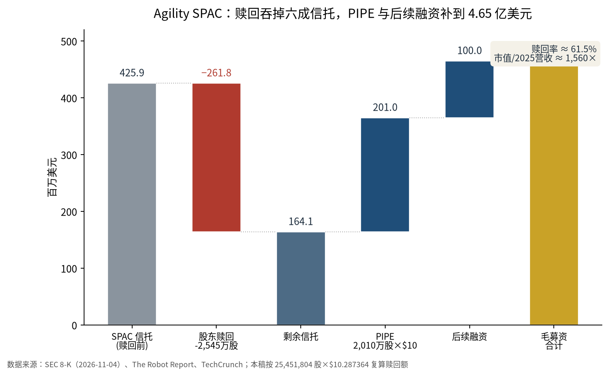
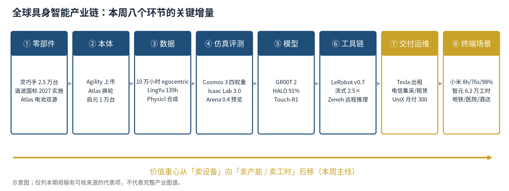
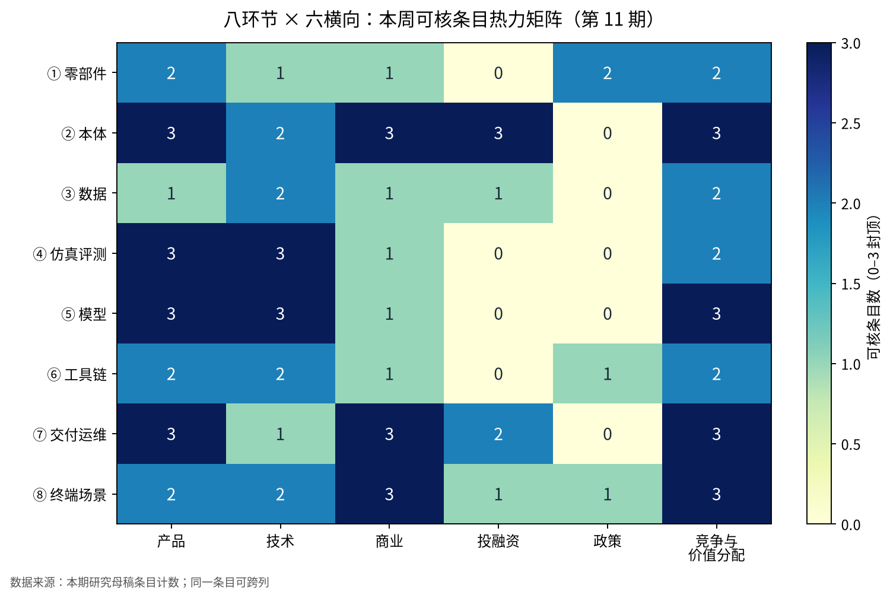

本周产业链第一次同时出现三张定价表：公开市场的市值表、租赁合同的现金流表、工厂与门店的有效工时表。它们给的是同一件东西——人形机器人未来能产出多少——但三个价格差了两个数量级。

上周的问题是「谁来验收、按什么数字付款」。这一周，Agility 用上市给出了资本市场的答案，Tesla 和中国电信给出了合约结构的答案，小米、智元、启元给出了工时与产能的答案。答案还不一致，但计价的语言开始统一。

## 本期要点

**一、Agility 成为美股第一个纯人形标的，但 4.65 亿美元是「续命钱」，不是成长资本。** 11 月 4 日完成与 Churchill XI 的合并，11 月 5 日以 AGLT 交易，首日开盘 11.26 美元、收 11.49 美元，对应 242,089,880 股、市值约 27.8 亿美元。毛募资约 4.65 亿美元，由三部分组成：信托留存 1.641 亿美元、富士康领投的 PIPE 2.01025 亿美元、交割前已收到的 1 亿美元；代价是 25,451,804 股、约 2.618 亿美元被赎回，赎回率 61.5%。经营面必须拆开看：2025 年营收 178 万美元、净亏 1.381 亿美元、63.5% 营收来自关联方；2026 年上半年营收只有 17.4 万美元、净亏 3.62 亿美元，但其中 2.52 亿美元是非现金的股权激励，真实经营现金净流出 8,620 万美元，6 月末账上仅 1,470 万美元，管理层明示现有现金不足以支撑未来 12 个月。按 2025 年收入算，市值/营收约 1,560 倍——这个倍数定价的不是现金流，是「唯一美股纯标的」的稀缺性。

**二、中国否决软银收购 ABB 机器人：机器人数据第一次成为「不可交割」的理由。** 11 月 4 日，中国外商投资安全审查工作机制办公室通知软银，禁止其在中国境内收购 ABB 机器人业务；软银 11 月 6 日公告确认，交易是 2025 年 10 月 8 日签署的 53.75 亿美元确定性协议。据 The Robot Report 引 ABB 确认、FT 首报，理由涉及机器人数据被转移出境并用于训练模型。最值得注意的不是金额，而是三个细节：审查管辖权来自标的的中国子公司，所以日本公司买瑞士公司的中国实体同样被管；结论选的是三分支里最硬的「禁止投资」，不是「附条件通过」，监管不接受以承诺换准入；ABB 上海工厂已承担约 90% 对华产品本地制造、2026 年三季度中国业务还增长 32%，仍被否——本地化生产替代不了控制权安排。对照美国 232 公告（10 月 28 日签署、11 月 2 日刊出、本周零实施动作），美国管的是入境后的成本，可逆、可谈；中国管的是交割前的控制权，不可谈、直接否。

**三、NVIDIA 把训练、评测与数据接口收进同一套栈，但「发布」不等于「可采购」。** 11 月 5 日至 9 日，NVIDIA 在 CoRL 前后放出四层东西：Cosmos 3 的四个 post-trained checkpoint，把动作条件视频生成做成可下载的仿真器/数据生成器（官方口径 16B 可训练参数、16.45B 总参、OpenMDW1.1、每 chunk 4 步去噪）；GR00T 2 世界-动作模型，用 10 万小时人类第一视角数据预训练，无任务示范时 50 个任务完成 40 个，每条示范 1 条时平均 71%、5 条升到 95%；Isaac Lab 3.0 把 PhysX/Newton 变成可替换后端，训练吞吐最高 2.5 倍，AlphaNIST 单一策略 20 个装配任务训练成功率 98%、逐任务基线 81%，GPU 时间约 1/39；LeRobot v0.7.0 把流式数据读取（2.1–2.5 倍）、FSDP2/HSDP、Zenoh 远程推理做成开源默认件，Hub 约 300TB。但三处缺口要记住：GR00T 2 截至本周没有公开权重/模型卡，Isaac Lab-Arena 0.4 只在博客、GitHub 仍是 0.3.x，Cosmos 3 的 15B/16B/16.45B 三个参数口径并存。能力被开源了，可复现性没有同步开源。

**四、租赁与集采同时出现：卖的不是机器，是「一年能产出多少」。** 11 月 6 日马斯克在 Barron 投资大会称 Optimus 很可能「只租不售」，初期造价约 3 万美元；对外交付预计 2027 年底左右，沿用 10 月电话会口径；未披露租金、数量、期限。11 月 9 日，中国电信全资子公司天翼电信终端与优必选签约，三年目标是推动家庭陪伴机器人**行业规模**突破 100 万台、超仿生/轮式人形**行业规模**突破 10 万台，路径含统筹集采、租赁服务、「AI 权益 + 终端」、营业厅体验试点——是行业目标，不是采购订单，原文没有金额、台数、分成。Agility 则给出了本周唯一可核的 RaaS 价目表：一次性部署约 2.5 万美元 + 8,500 美元/月（含软件与维护），买断为硬件约 20 万美元 + 部署 2 万美元 + 每年 3.6 万美元软件/维护；自身 BOM 约 15 万美元，年产 1,000 台降到 7.5 万、1 万台降到 3 万。按年租金 10.2 万美元算，对 15 万美元 BOM 的硬件回本约 1.5 年、加服务约 2 年；只有 BOM 降到 3 万美元，回本才缩到约 4 个月。租得动的前提，是产能与停机成本同时降下来。

**五、中国「可计费产出」有了三个刻度，但只有一个能复算。** 小米 11 月 3 日视频里，人形在小米汽车工厂中控台侧板分拣工位完成 8 小时整班、工位节拍 76 秒；今年 3 月自攻螺母 3 小时成功率 90.2%，7 月升到 98%，并增加了两个更难工位；模型用 10 万小时真机数据预训练。智元披露 10 月累计超过 6.2 万个有效智能工时，120 台 G2 进广州地铁，北京大学人民医院导诊单台自主运行 170 小时、形成 153 个有效智能工时（约 90%）；11 月 2 日至 3 日，6 台 G2 在上海徐汇一家正常营业的便利店连续 24 小时完成 1,730 项任务，**6 台中 4 台通过最终考核**。启元 11 月 8 日第 10,000 台 Q1 下线，距 10 月 25 日第 5,000 台仅 14 天，日产能 240 台。三个刻度里，只有智元给了「自主时长→有效工时」的换算；小米缺分拣件数、整班成功率、人工介入次数，启元 14 天新增 5,000 台隐含约 357 台/日、与自述 240 台/日对不上。产能是产出，不是可计费产出。

## 三张表：市值、租金、工时

把本周的价格放在一起，会看到一条与「技术含量」无关、与「可替代性」严格对应的序列。

*图 1：Agility SPAC 的资金结构。数据来源：SEC 8-K（2026-11-04）、The Robot Report、TechCrunch；赎回额按 25,451,804 股 × 10.287364 美元复算。*

**公开市场给「买不到的东西」付溢价。** Agility 约 27.8 亿美元市值对 178 万美元收入，约 1,560 倍 PS；上纬新材/启元 11 月 9 日涨停后市值 871 亿元，公司随后风险提示市盈率 1,767 倍、行业均值 19.57 倍，按市销率约 72 倍；来福谐波 11 月 9 日收 29.12 港元、市值 30.3 亿港元，较 85.50 港元发行价跌 65.9%，按年化收入约 9 倍 PS。1,560、72、9 的排序，恰好等于稀缺性排序：美股只有一个纯人形标的，A 股只有一个「人形壳」，国产减速器有第二、第三、第四家。同一周里，Agility 的 61.5% 赎回是套利退出，来福的破发是可比公司太多，两者都不构成对行业基本面的否决，却共同说明公开市场只给稀缺性付溢价。

**租金的账，比市值诚实。** Agility 的 8,500 美元/月对应年租金 10.2 万美元，对 15 万美元 BOM，硬件回本约 1.5 年；加上部署 1.5 万美元、年服务 1.5 万美元，约 2 年。这个模型在 1,000 台/年的产能下不成立（BOM 7.5 万美元），在 1 万台/年、BOM 3 万美元时才成立（回本约 4 个月）。所以「只租不售」不是商业模式创新，是**产能与可维护性的函数**：谁的 BOM 更低、停机更少，谁才租得起。Agility 的 65,000 小时摊到 9 个客户约 7,200 小时/户，不到单班一年，说明多数还是早期部署，不是规模化 RaaS。

**工时的账，只有一家给了分母。** 智元 6.2 万有效工时是月度总量，但没有披露机队规模与单机工时，无法反推整体利用率；医院点位 153/170 约 90% 是唯一可复算的样例。小米的 8 小时/76 秒/98% 是目前最接近「可计费产出」的口径，但缺件数与接管次数；启元的 1 万台是下线量，种子用户日均在线 3 小时、日活峰值 40%，按 240 台/日年化 8.8 万台，而累计下线只有 1 万台，产能利用率约一成。三张表里，市值最响、租金最实、工时最缺。

## 八环节：本周真正的增量

*图 2：八环节本周关键增量示意。仅列有可核来源的代表项，不代表完整产业图谱。*

**① 零部件：硬化在标准与接口，不在价格。** IDC 预计 2026 年全球灵巧手出货约 2.5 万台，明确不含厂商向自有整机的内部配套，中国厂商占 85% 以上；这个口径衡量的是「灵巧手作为零部件被采购」，不是人形出货量。三星 SDI 为 Atlas 供 2170 电芯、每台 70 节、约 1.3kWh，LG 新能源是二供但初期产能有限，三星在一段时间内近乎独家。谐波减速器两项国标 GB/T 12601-2026、GB/T 14118-2026 的行政发布日是 9 月 28 日、实施日是 2027 年 4 月 1 日，11 月 6 日至 7 日嵊州会议是宣贯会，不是发布日；产品标准替代 1993 版，2027 年起招标文件可直接引用。工信部 11 月 6 日就机器人产品标识码征求意见至 12 月 5 日，据媒体引述为「一机一码」、四段构成、执行 GB/T 48541-2026、终身不变——售后、租赁计费、保险、召回都要挂到唯一码上。

**② 本体：从「能不能造」转到「按什么单位卖」。** 除 Agility 外，本周两个工程细节值得记：波士顿动力 11 月 9 日把现成滑板车轮圈加一个转接件装到 Atlas 的踝关节执行器上，软件把轮子建模为「连续旋转的踝」，直接替换基础模型中的足部，控制栈不重写——末端正在变成可替换参数，踝/腕关节要按连续旋转与快换设计。启元第 10,000 台下线，Q1 身高 88cm、22 个柔顺力控自由度、可折叠入背包，蓝思科技负责精密制造与整机组装；但日产能与下线速度的矛盾，说明「产能」仍是叙事口径。Figure、1X、Apptronik、银河通用、傅利叶本周没有取得窗内一手新增，连续两周安静。

**③ 数据：人类视频与程序化仿真同时把成本压向算力。** NVIDIA 的 GR00T 2 用了 10 万小时开源人类第一视角数据，EgoHand 把人类视频转成手部轨迹，发布两周 Hugging Face 下载 4 万+；Video to Data 工作流把人类视频转成仿真示范。LingYu 数据集补的是「部署视角」：139.4 小时、13,263 条成功 episode、22 个子集、15 个桌面任务族，轮式双臂、3 路立体 RGB、45Hz、约 9.16TB，只收成功轨迹。Physicl 用 1,000 万美元种子轮做「物理保真」合成数据，Studio 提供 1 万个 3D 环境、10 万个资产。两条路径都只覆盖视觉，触觉/力仍是稀缺模态——戴盟 Touch-R1 的 132.3 万同步触觉数据对是少见的补位，但论文在 5 月、本周只是中文深访披露。

**④ 仿真评测：引擎可替换，评测协议才是产品。** Cosmos 3 的四个 checkpoint 分别覆盖驾驶场景→多传感器、驾驶控制→流式观测、仿真器控制+文本→RGB、机器人动作→视频；Sim-Transfer 不让模型学物理，物理状态仍由仿真器给深度/分割/边缘/模糊控制，模型只负责渲染 RGB。Isaac Lab 3.0 一套 API 可切换 PhysX/OVPhysX/Newton，视觉灵巧操作训练吞吐最高 2.5 倍；Newton 能建模线缆、布料与多关节灵巧手。真正被采购的是评测：Isaac Lab-Arena 0.4 把场景、变化维度与策略运行拆开，输出「哪些条件导致失败」；DexBench v1.0 是 15 任务 × 4 场景；VABAR 是 6 类工业任务；AllenAI ToyBlocks 用 85,336 条积木示范把泛化失败拆成可归因实验。缺口同样明显：Arena 0.4 只在博客、仓库仍是 0.3.x。

**⑤ 模型：开源基座 + 少量示范对齐，模型本身更难单独收费。** GR00T 2 用人类视频预训练，无示范完成 40/50、1 条示范 71%、5 条 95%；Apple HALO 用 300 小时仿真、1,000 个程序化住宅训练，在 6 个未建图真实住宅 360 次试验零样本成功率 91%，但明确局限是接触-rich 任务退化、无直接触觉、物体离开视野后失去信号；小鹏 GroundingPI 是 4B 感知基座，34 个 benchmark 综合 73.68、对比 GPT-6 Astra 71.54，RoboCasa-GR1 用 50% 示范超过对比模型用 75%，但都是仿真/离线结果；戴盟 Touch-R1 是 7B，TouchReason-1M 含 1,000+ 物体、9 类材料、4 种传感器，综合 60.1、比 Octopi-13B 高 18.4（团队自评）。共同点是：发布很多，可采购的很少；差异化转向数据配方、评测协议与本体适配。

**⑥ 工具链：锁定点从模型转到数据与传输件。** LeRobot v0.7.0 把语言在环（`/subtask`、`/vqa`、`/autosteer`）、流式数据（4 worker 下样本/秒提升 2.1–2.5 倍）、FSDP2/HSDP、DCP（8×H200/6B 模型 checkpoint 保存快 3 倍、恢复峰值 143GB→42GB/GPU）、Trackio、Zenoh 远程推理做成默认路径；ACT 在 H100 快 2.8 倍、A100 快 3.3 倍；新增 4 个 WAM（Cosmos 3、FLUX 3 Action、LaWAM、Long-WAM）与 4 个 VLA，LingBot-VLA 2.0 在 RoboTwin 2.0 clean 93.5% vs π0.5 82.7%，action chunk 时延约 756ms→120ms。模型可以换，但这些件一旦进入训练脚本就很难换。Serve Robotics 则把机队连接、数据筛选、真实世界数据目录做成对外产品，Q3 收入 283.5 万美元（+313%）、917 台日活/2,000+ 部署、27 家医院——集成运维能力开始外溢成基础设施。

**⑦ 交付运维：合约结构取代项目制。** 中国电信的「集采 + 租赁 + AI 权益 + 营业厅」是本周最完整的分销模板，但签约不等于收入；Tesla 的出租把利用率与停机风险转给卖方；Agility 用 50 万美元的现场 PoC 筛选客户，再用里程碑订单锁定交付；UniX 用 5 亿元 Pre-A 把绿地（场景）、柯力（部件）、玉林产投（地方产能）变成股东，客户从买方变成股东，获客成本转成股权成本。仓储物流侧，波士顿动力 Stretch Gen 2 基于 100,000+ 运行小时重做，1,000 箱/小时、线缆减少 81%、驱动更换从一天降到 1 小时、客户可自维护、新机 2 周部署——卖点从「抓得准」转向「停得少」。Ambi 在 8 个设施做旺季前部署、备件前移，睿尔曼称支持 50 台集群、MTBF 50,000 小时，都是同一方向。

**⑧ 终端场景：排序已经清楚。** 按本周证据强度：物流/仓储（GXO 10 万箱、Stretch 多站点、Ambi 8 站点）> 医院（Serve 27 家、12 份多年续约）> 工厂（小米 8h/76s/98%，但缺件数与接管次数）> 酒店/安保（UniX 百台订单但客户未具名）> 零售（智元 4/6、京东七鲜仍是试验）> 家庭（启元万台但日在线峰值 40%、Amazon 尚无产品）。家庭侧最诚实的数字是启元的「日均在线 3 小时」：它说明消费级人形仍是低频使用，租赁/订阅模式下不足以覆盖成本。中国电信的 100 万台是行业规模目标，不是需求证明；两者之间的差距，就是渠道叙事与真实使用之间的距离。丰田 11 月 5 日公告新设全社直辖「トヨタロボティクス」（2027 年 1 月 1 日生效），是本周唯一「车企把机器人当独立事业而非成本项」的组织信号，但无预算、无量产时间表。

*图 3：本期八环节 × 六横向可核条目计数（同一条目可跨列，0–3 封顶）。材料最厚的是本体与模型，边际变化最大的是交付合约与场景刻度。*

## 本周 vs 上周

| 主线 | 上周（第 10 期） | 本周（第 11 期） | 走向 |
|---|---|---|---|
| 计价单位 | 智元提出 Worken 公式，希望按工时计费 | 10 月 6.2 万有效工时；Tesla 只租不售；电信集采/租赁 | 从公式变成月度数，从一家变成三种合约 |
| 公开市场 | Agility 待交割，PI 约 200 亿美元估值 | AGLT 首日 11.49 美元，赎回 61.5%，市值约 27.8 亿美元 | 兑现但缩水，纯标的锚建立 |
| 产能叙事 | Atlas 备料 1 万台份；智元称产能非瓶颈 | 启元 1 万台下线（口径冲突）；Agility 1 万台/年；小米 8h/76s/98% | 从「备料」转向「下线/整班」 |
| 数据供给 | FineART 4 万条、LG 50 万小时 | 10 万小时 egocentric、LingYu、Physicl、HALO | 从标注更多转向人类视频+合成 |
| 仿真评测 | Zero-HLM 对照；评测以厂商榜单为主 | Cosmos 3、Isaac 3.0、Arena/DexBench/VABAR | 评测独立成面 |
| 地缘准入 | 美国 232 转谈判、Atlas 韩国化 | 中国否决软银×ABB，数据出境为理由 | 从美国进口准入扩到中国控制权审查 |
| 零部件 | 绿的 Q3 增收、现金流转负 | 灵巧手 2.5 万台、谐波国标、Atlas 电池双源 | 从报表转向标准与单点供应 |
| 本体形态 | 宇树季报、智元 AHA3、Meta×傅利叶 | Agility 上市、Atlas 装轮、云深处 X50 | 资本与形态工程化 |

上周的「按工时付款」还是设想，本周有了月度数字、租赁价目表与运营商渠道；上周的「产能不是瓶颈」本周被启元的下线速度与 Agility 的 1 万台产能检验，但两者都还没给出利用率。降温的是宇树、PI 估值、上海 8000 台与 Gemini ER 2——不是它们变差，而是本周没有新披露。Figure、1X、Apptronik 连续两周没有窗内一手，说明美国本体梯队的分化正在拉大。

## 对你意味着什么

**产业链从业者/战略负责人。** 如果卖整机，先把「可计费产出」的计量做出来：在线时长、接管次数、单班产出、验收口径。没有遥测，就只能回到一次性卖硬件，估值与回款都受制于人。如果做部件，把新国标号、接口一致性、二供能力写进投标文件；灵巧手 2.5 万台的独立市场仍小，真正的量在整机配套。如果做交付/集成，运营商集采 + 租赁 + AI 权益是本周最完整的分销模板，但签约不等于收入，先谈计量与结算，再谈点位。如果做出海/并购，先设计控制权与数据流向，再谈原产地——ABB 上海 90% 本地化仍被否，本地生产不是通行证。

**投资人。** 用「可计费工时 × 单位工时价格」而不是「规划产能」做估值起点；对只有下线台数、没有在线时长的标的，给产能折扣。关注三个价格锚：Agility 约 1,560 倍 PS、上纬/启元约 72 倍 PS、来福约 9 倍 PS；同赛道公司最终会向其中一个收敛，问清楚「它凭什么享受另一个的倍数」。把 180 天锁定期、61.5% 赎回率、PIPE 折价与发起人激励放进模型；小流通盘的价格发现不等于全股本定价。

**政策/标准关注者。** 本周中国没有机器人专项政策，支持将以「十五五」规划内项目、平台、标准落地，申报窗口比口号重要。跟踪三条标准线：GB/T 14118-2026（2027 年 4 月 1 日实施，产品一致性）、ISO 21423:2026（多厂商互操作）、以及 Isaac/DexBench/VABAR 这类事实标准（评测任务集）。它们决定招标文件怎么写，也决定谁的差异化还能留在交付层。

{: .notice--warning}
本周最容易被误读的三个数字：Agility 的「逾 3 亿美元订单」受里程碑与规格约束，不是确定在手订单；中国电信的「100 万台」是行业规模目标，不是采购量；启元的「1 万台」是下线量，不是付费部署。三者都不能直接当收入。

## 来源

- Agility 交割与赎回：SEC 8-K（[交割](https://www.sec.gov/Archives/edgar/data/2074973/000121390026116898/ea0311204-8k_churchill11.htm)、[股东会/赎回](https://www.sec.gov/Archives/edgar/data/2074973/000121390026115034/ea0310517-8k425_churchill11.htm)）、[424B3 招股书](https://www.sec.gov/Archives/edgar/data/2074973/000121390026109058/ea0297114-07.htm)、[S-4（RaaS 价目表）](https://www.sec.gov/Archives/edgar/data/2074973/000121390026097764/ea0297114-04.htm)；[The Robot Report 首日](https://www.therobotreport.com/how-did-agility-robotics-perform-on-its-first-day-on-the-stock-market/)；[TechCrunch](https://techcrunch.com/2026/11/05/agility-is-the-first-pure-humanoid-robot-company-on-the-stock-market-are-you-buying/)
- 软银×ABB：[SoftBank 公告](https://group.softbank/en/news/press/20261106)；[The Robot Report](https://www.therobotreport.com/chinese-regulators-block-softbanks-5-4b-acquisition-of-abb-robotics/)；[《外商投资安全审查办法》](https://www.gov.cn/zhengce/zhengceku/2020-12/19/content_5571291.htm)
- NVIDIA 栈：[CoRL 仿真/GR00T 2](https://blogs.nvidia.com/blog/robotics-simulation-advancements-corl/)；[Cosmos 3](https://huggingface.co/blog/nvidia/cosmos-interactive-world-simulation)；[LeRobot v0.7.0](https://github.com/huggingface/lerobot/releases/tag/v0.7.0)
- 数据与模型：[LingYu 数据集卡](https://huggingface.co/datasets/LingYu-Robotics/LingYu-realworld-robotics-dataset/raw/main/README.md)；[Apple HALO（arXiv 2611.06908）](https://arxiv.org/abs/2611.06908)；[Touch-R1（arXiv 2605.27154）](https://arxiv.org/abs/2605.27154)；[GroundingPI（arXiv 2609.39601）](https://arxiv.org/abs/2609.39601)；[ToyBlocks](https://huggingface.co/blog/allenai/toyblocks)；[Physicl（TechCrunch）](https://techcrunch.com/2026/11/06/physicl-raises-10m-to-make-the-digital-world-real-enough-for-robots/)
- 中国交付与场景：[中国电信×优必选（IT之家）](https://www.ithome.com/1/024/340.htm)；[智元便利店（AGIBOT）](https://www.agibot.com/article/231/detail/134.html)；[智元 10 月工时（证券日报，经中国机器人网）](https://www.robot-china.com/news/202611/09/97338.html)；[小米 8 小时（Electrek）](https://electrek.co/2026/11/04/xiaomi-humanoid-robot-8-hour-shift-ev-factory/)；[启元 1 万台](https://www.robot-china.com/news/202611/09/97360.html)；[UniX 5 亿元](https://www.robot-china.com/news/202611/09/97356.html)
- 零部件与标准：[IDC 灵巧手（IT之家）](https://www.ithome.com/1/024/146.htm)；[三星 SDI×Atlas](https://www.ithome.com/1/024/339.htm)；[GB/T 14118-2026](https://openstd.samr.gov.cn/bzgk/std/newGbInfo?hcno=22E570859AAA52DF0ADD07BFD9295793)；[一机一码（IT之家）](https://www.ithome.com/1/023/625.htm)；[来福谐波 2026 中报](https://www1.hkexnews.hk/listedco/listconews/sehk/2026/0928/2026092800613_c.pdf)
- 运维与组织：[Serve Q3 8-K](https://www.sec.gov/Archives/edgar/data/1832483/000183248326000048/serv-20260930_ex991earning.htm)；[Stretch Gen 2](https://bostondynamics.com/news/boston-dynamics-launches-next-generation-stretch-robot/)；[丰田组织改正](https://global.toyota/jp/newsroom/corporate/44969952.html)；[ISO 21423:2026](https://www.therobotreport.com/new-iso-interoperability-standard-covers-collaboration-among-mobile-robots-from-multiple-vendors/)
- 政策与市场：[NDRC 11-03 发布会](https://www.ndrc.gov.cn/xwdt/xwfb/202611/t20261103_1408537.html)；[Federal Register 232](https://www.federalregister.gov/documents/2026/11/02/2026-22385/)；[宇树 11-09 行情（财联社）](https://www.cls.cn/detail/2529104)

*本周报为产业链研究，不构成投资建议。所有数字均标注口径；厂商自述、媒体转述与监管原文在正文中已区分。*
