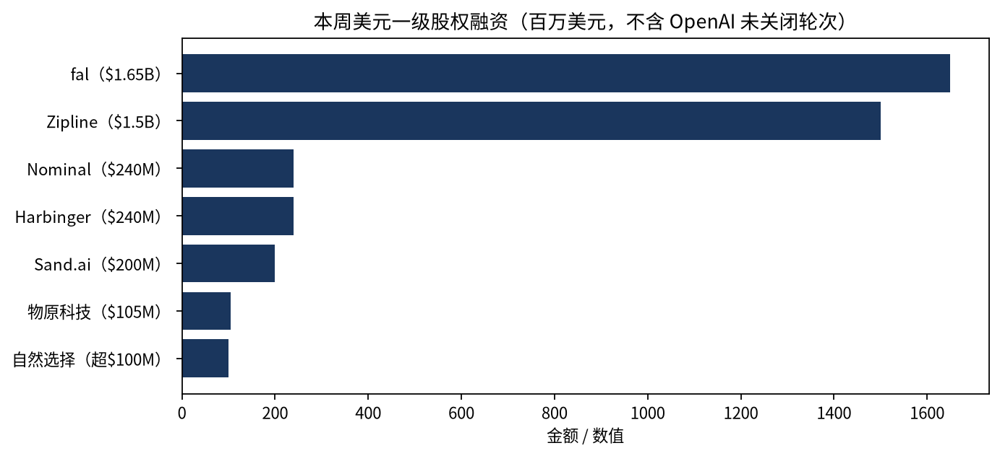
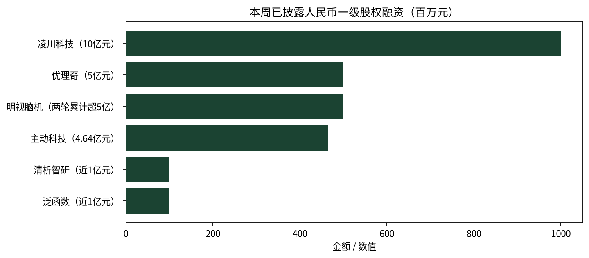

公开市场在本周接过了前沿模型公司的估值分母书写权，并且第一次把它往下写：Anthropic 把 IPO 价格区间定在每股 70—78 美元，同一份招股书能算出 1.021 万亿和 1.404 万亿两个估值；OpenAI 一轮原定 300 亿美元只募到 110 亿；同周的企业支出数据显示，AI 用量还在涨，花费却走平了。

这三件事放在一起，才是本周真正的故事。过去半年一级市场对头部模型公司的加价，不是被否证，而是在公开市场门口被打了一次折。上期是主权基金愿意为保供、就业和本地算力付溢价；本期接手的买方只为可兑现的现金流付价。同一个资产、两把尺子、两个方向。

## 本期要点

**一、Anthropic 的 1.404 万亿不是"更高估值"，是"更大分母"。** 11 月 10 日更新的招股书给出 8.25 亿股 Class A、70—78 美元区间、代码 ANT，预计 11 月 19 日前后在纳斯达克开始交易。按发行后流通股本 130.87 亿股乘 78 美元，隐含约 **1.021 万亿美元**；按完全稀释约 180 亿股乘同一价格，才是媒体广泛引用的 **1.404 万亿**。两个数字来自同一份文件、同一个价格，差 37%。这不是会计花招，而是本周最实质的定价问题：你买的到底是流通股对应的那部分公司，还是把期权、限制性股票全部算进去的那部分。同一份文件还披露，10 月底年化收入 810 亿美元、第三季收入 170 亿、九个月净亏损 1,040 亿美元、算力与基础设施承诺 9,009 亿美元、现金及短期投资近 1,320 亿美元。用年化收入做分母约 17 倍，用九个月实际收入做分母是 42 倍——引用这家公司的倍数而不写口径，等于不可比。

**二、公开市场接手后做的第一件事是压价。** 据彭博报道，OpenAI 新一轮已募 110 亿美元、估值 1.25 万亿，但这一轮**尚未关闭**，预计总额约 200 亿，而 9 月底的原目标是 300 亿；同一报道称 OpenAI 已把拟议估值从 1.4 万亿下调。Anthropic 一侧，潜在 IPO 买方在考虑低至 1.1 万亿的估值，一个月前的市场预期还是 2 万亿。最能说明问题的是需求端：Ramp 的企业卡数据显示，AI token 花费 8—9 月**两个月合计只涨 1.5%**，而 7 月单月环比曾涨 42%；中位企业每月每员工只花 12—15 美元。Ramp 首席经济学家的说法是"已成为买方市场""超高速增长的时代可能结束了"。原因不复杂：OpenAI 9 月把两款主力 API 价格减半，Anthropic 下调 Fable 5.1 与 Opus 5.5 价格、自称使收入增长少收约 6 亿美元。**用量在涨、单价在跌，年化收入的斜率就无法外推**——这对 17 倍的分母是直接压力。

**三、中国的钱从模型层挪到了卖铲层。** 11 月 4 日同一天，后摩智能披露 B 轮"数十亿元人民币"、凌川科技披露 10 亿元 B 轮。后摩做存算一体，公司口径把核心计算单元面积压到传统架构约三成、运行功耗约一成，用"每美元多少 Token、每瓦多少 Token"跟客户谈价值；凌川做视频转码与生成专用芯片，出身快手芯片事业部，基于全国产 3D 堆叠的芯片 4 月流片、近日回片。两笔的投资方都是"国资平台 + 产业资本 + 老股东"，**估值全部未披露**。同周还有 Sand.ai 2 亿美元 A+（视频生成，10 个月三轮累计约 3 亿美元）、物原科技 1.05 亿美元种子（具身世界模型，成立约四个月）、自然选择超 1 亿美元 A+（AI 情感陪伴）。中国一级本周的定价语言已经不是"峰值算力更大"，而是"单位 Token 更便宜"——这是估值锚的迁移，不是金额的大小。

**四、中国 AI 芯片同周出现三个价格，最高的和最冷的差了一个市场。** 燧原科技 11 月 7 日登陆科创板（688801），11 月 10 日收 1,911 亿元、盘中一度重返 2,000 亿元，市净率逾 22 倍；同一周，登临科技 11 月 10 日在港交所挂牌（09917），发行 612.5 万股 H 股、定价 231 港元，**正好是招股区间 231—288 的下限**，募资约 14.15 亿港元，公开发售只占 5%、获 2.11 倍，首日以 229 港元开盘、盘中一度跌超 6%。第三个价格还没形成：11 月 10 日晚，阿里公告拟分拆平头哥赴港主板独立上市，而**平头哥早在 9 月 11 日就已保密递交 A1**，公告里规模、估值、摊薄比例全部写着"尚未落实"。三家同是国产算力，A 股给 22 倍 PB，港股把新股定在下限，港股分拆连价都还没开——这不是三家公司质地之差，是三个市场此刻愿意给算力资产的倍数之差。

**五、具身智能先上了市，代价是把估值锚交给公开市场。** Agility Robotics 通过 SPAC 合并于 11 月 5 日以 AGLT 在纳斯达克交易，股权价值 25 亿美元，新增资本约 4.65 亿美元（信托 1.641 亿 + PIPE 2.01 亿 + 1 亿美元 SAFE）。代价写在招股文件里：今年上半年收入 **17.4 万美元**（主要来自关联方）、同期亏损 3.62 亿美元；所谓"逾 3 亿美元订单"是附里程碑条件的多年期计划合同，不是在手订单。25.45M 股赎回让信托从约 4.26 亿缩到 1.64 亿美元，PIPE 与 SAFE 实际上是补上了被赎回的公众现金，SAFE 还带着 25% 折扣、换来 5.35% 稀释。这是全球第一家纯人形机器人上市公司，也是公开市场第一次给具身公司定价——它给出的倍数是"25 亿美元对 3 亿美元计划订单"，而不是对收入。

## 分母之争：同一份文件里的两个万亿

把 Anthropic 的招股书拆开看，估值争议其实是一个股本口径问题。发行 8.25 亿股里有 8.0135 亿股是公司新发、2364.9 万股是老股东出售；绿鞋另有 1.2375 亿股，全部是新股。注册费表交叉核验后，本次注册 9.4875 亿股、按 78 美元计最高总发行价 740.03 亿美元。这些数字都不直接给估值，只给股数与价格——估值是读者自己乘出来的，而乘哪个股本，决定了是 1.021 万亿还是 1.404 万亿。

散户配售至多 20%、创始人合计控制 50.1% 投票权（招股书原文；部分媒体写作 51.1%）、Long-Term Benefit Trust 持 Class T 有权选举多数董事，且 Class T 没有经济权。也就是说，公开市场买到的是现金流，不是控制权；指数基金按流通盘加权时，还会遇到流通盘与投票权错配的问题。锁定期同样值得记：董事、高管及几乎全部股东合计约 155 亿股受 180 天约束，创始人与持股超 0.5% 的股东最长 365 天，其中 36 亿股可提前解禁，非创始人董事与员工最多 10% 可在首个交易日转让。

## 供应链折成股权：260 亿美元买的是什么

与公开发行同时交割的，是一笔 260 亿美元的 Class N 私募配售，按 IPO 价卖给 AMD、Broadcom、Google、Micron、Microsoft、NVIDIA、TSMC 七家，其中 Google 与 NVIDIA 各 100 亿美元。这笔股票**无投票权、不注册、不受承销锁定期约束**，约占 1.404 万亿的 1.85%、占 846 亿美元净募资的约 31%。

结构上是三件事捆在一起：公司承诺 9,009 亿美元的算力与基础设施支出；供应方以发行价买入 260 亿美元股票；估值里有一部分，正是因为这些供应方拿到了长约。会计上不抵消，经济上却构成回路——**供应商的股权回报，取决于它们自己供货的那家公司的估值**。无投票权加无锁定期，说明这不是战略控制，而是纯财务绑定加流动性让渡。对同赛道公司做竞争分析时，该问一句：它的供应商，是不是也是它竞争对手的股东。

同一逻辑在英国 neocloud 身上反向出现。Nscale 正筹备纽约 IPO、目标估值 350 亿美元，锚是 3 月 Series C 的 146 亿；但就在本周，微软取消了从它 Essex 数据中心租算力的协议，理由是那个站点"2030 年前不太可能有供电"。有分析师预测，到 2030 年 80% 的 neocloud 会停止独立运营。**估值往上、合同基础往下**，这是本周最该被记住的一对反向箭头。

## 需求侧：用量在涨，花费走平

Ramp 的数据不是需求萎缩的证据，恰恰相反——token 用量仍在增长。问题在价格：两家头部同时降价，单价下行吞掉了用量增长，8—9 月企业花费两个月合计只涨 1.5%。Ramp 还指出，几乎全部 AI 花费来自风投支持的高增长科技公司，前 1% 的企业每员工每月花费略低于 1 万美元，而中位企业只有 12—15 美元。这意味着客户基础本身是顺周期的，且扩散的天花板可能比预期低。

对估值的含义是直接的：如果增长靠量、单价在跌，年化收入的斜率就不能线性外推。这也是为什么同样的 810 亿美元年化收入，用一个月的数据外推得到 17 倍，用九个月实际数据得到 42 倍——两个数字之间，就是"斜率能否维持"的全部争议。

## 中国：钱挪到了卖铲层

本周中国可核的 AI 一级融资约 27—29 笔。给出具体数字的人民币侧合计约 21.94 亿元，美元侧"超 4.05 亿美元"，两侧不折算、不相加。

除了后摩与凌川，值得记的还有几笔。优理奇 5 亿元 Pre-A，卖点不是本体自由度，而是"月出货超百台、峰值 300 台/月"，以及把绿地集团这样的下游场景方变成股东。物原科技成立约四个月拿 1.05 亿美元种子，卖的是具身世界模型——没有收入、没有交付披露，定价依据是团队与路线。主动科技 4.64 亿元天使+，8 月刚拿 3.3 亿，两轮累计约 8 亿元，创下国内脑机单轮与累计纪录；明视脑机两轮累计超 5 亿元，走的是视觉重建路线，已完成 7 例研究者发起的临床试验。清析智研近亿元天使，把 AI 原生仪器、科学世界模型与材料 IP 串成一条线。

一个必须分列的数字：DeepSeek 新一轮"约 1000 亿元、接近完成"仅见于彭博与投资界报道，公司未官宣、未完成，**不计入本周完成额**，也不能拿来推断其他模型公司的估值。

## 退出通道：开的是哪一扇门

同一个"IPO 窗口"，本周有四种命运。硬件能上——燧原上了科创板、登临上了港交所，但登临定在区间下限、首日盘中跌超 6%。具身能上——Agility 走 SPAC 完成了。模型层要等——Anthropic 还在定价，OpenAI 总裁说 2027 年才可能具备条件，Oura 则把至多 22 亿美元的 IPO 无限期推迟、改用 6.25 亿美元收购 AI 原生初级保健公司 Counsel Health 来扩张。已经上市的 AI 公司开始回购——智谱 11 月 10 日公告拟回购 H 股，总额上限 40 亿港元、不超过已发行股份 1%；但**两个上限里先触顶的是数量**：按当日收盘 482 港元、市值约 2,350 亿港元倒推，1% 约合 23.5 亿港元，40 亿要等股价跌到约 300 港元才用得上。公告只写"拟"，不等于已执行。

还有一扇门是给"上市公司体内的资产"开的。阿里 11 月 10 日晚公告，已就分拆平头哥在港主板独立上市提交分拆建议并获港交所确认；平头哥 9 月 11 日已保密递表，方式是全球发售 H 股，完成后仍是阿里子公司。两个细节值得记：一是阿里股东**拿不到**平头哥的打新配额（已获豁免 PN15 第 3(f) 段保证配额），价值发现只归认购方；二是分拆对阿里的最高适用百分比率低于 5%，说明体量还不构成须予披露交易——这是一次增量募资，不是 2023 年阿里云那种量级的价值重估。

并购端同样在换方向。本周六笔可核并购，没有一笔是买基础模型：Oura 买临床闭环（6.25 亿美元）、Dropbox 买 agent 的存储底座（3.5 亿美元）、Meta 买多 agent 编排团队、OpenAI 买旅行入口、Crusoe 把未完工的 10GW 园区卖给 Google（对价未披露，Google 另投 170 亿美元建设）。模型层已经进入"自建 + 战略入股"，并购战场移到了入口与底座。另有一笔传闻要单列：Palo Alto Networks 据报正洽谈以 5 亿美元现金加里程碑收购 agent 安全公司 Clutch，约 50 倍 ARR——**谈判中，未完成**。

## 基金端：头部在收缩组织

Sequoia 11 月 4 日的备忘录是本周基金侧最重要的一份文件：新募约 100 亿美元的同时，关闭 Arc 加速器与 Scouts 计划、关闭伦敦办公室、合并早期与成长团队、取消周一合伙人会议，改由七位普通合伙人共同拥有与运营。它自己的解释是走出"约 20 年扩张期"，"一个非预期副作用是层级"，"目标函数不是规模，是质量"。对照来看，欧洲早期基金 Redalpine 的第八期只关账到 2.5 亿美元——**头部在收缩组织，中部在收缩规模**。

中国一侧的钱不在 VC 手里，在国资的五年计划里。中国诚通 11 月 10 日给出「十五五」新增基金投资约 **1,500 亿元**，并写明科创不低于 80%、AI/具身/量子/6G 等前沿不低于 18%、卡脖子不低于 24%——这是**五年期的出资下限承诺，不是基金 close**。存量盘子是 9 只基金、总规模 7,100 亿元；诚通科创基金期限 15 年，第三只科创基金与央企战新并购基金正在筹设，等于同时补"投早"和"并购退出"两条腿。地方层面，合肥 11 月 9 日用"15 亿元项目公司（16 方）+ 50 亿元产业基金（首期 20 亿）"把太空智能产业链组织起来；中原科技城则直接删掉 1.2 倍返投要求，把子基金出资上限抬到 40%/50%。**备案侧反而是安静的**：中基协「私募基金登记备案动态」最新一期停在 10 月 23 日，本周唯一能确认"已备案"的规模数字是温州浩澜潮智由 7 亿扩到 16.005 亿元（浪潮信息出资 1 亿元、占约 6.25%）。

本周还有一条容易被忽略的结构信息：5 只 AI 相关基金/SPV 递交了 Form D，其中 4 只的首次销售日早于本周，Anthropic SPV 的首次销售日是 2024 年 1 月、Figure AI SPV 是 2024 年 2 月。Form D 的"本周"只说明披露时点，不说明资金时点；而这些 SPV 的已售金额（从 20 万美元到 2462.5 万美元）是 SPV 层的份额，不是标的公司的融资额。Greenbird 对 Anduril SPV 收 8.9% 的销售佣金，是"pre-IPO 敞口"的显性价格。

## 本周融资表

*图 1：本周已披露美元一级股权融资（百万美元），不含 OpenAI 未关闭轮次与 Anthropic IPO。数据来源：本期冻结母稿已核披露。*

*图 2：本周已披露人民币一级股权融资（百万元）。后摩智能"数十亿元"未给具体数值，未入数值轴，单独计 1 笔。数据来源：本期冻结母稿已核披露。*

下表精选主交易；金额保留原文"超/近/数亿/数十亿"口径，未披露写未披露。人民币与美元分列，不折算、不加总；IPO、并购、基金、Form D 另表不并入。

| 公司 | 轮次 | 金额 | 投资方 | 赛道 | 地区 |
|---|---|---|---|---|---|
| OpenAI | 新一轮（未关闭） | $11B 已募（或达约 $20B） | 未披露 | 基础模型 | 美国 |
| Zipline | 新轮 | $1.5B | Paradigm、WCM、Layer Global 领投；Uber、Fidelity、ARK 等 | 自主配送 | 美国 |
| Nominal | Series C | $240M（投后 $30 亿） | Lightspeed 领投；Insight 联合领投；Sequoia、GC、Lux | AI 硬件测试 | 美国 |
| Harbinger | Series D | $240M（估值未披露） | Tiger、Capricorn、Ridgeline 共领；FedEx、Fidelity | 具身/防务 | 美国 |
| fal | Series E+F | $1.65B（投后 $160 亿） | Bessemer、Sequoia 领投；NVIDIA、T. Rowe Price 等 | 推理基础设施 | 未披露总部 |
| Sand.ai | A+ | $200M | 基石资本、网宿科技 领投 | 视频生成 | 中国 |
| 物原科技 | 种子 | $105M | 凯辉、红杉中国、蚂蚁、美团战投等 | 具身世界模型 | 中国 |
| 自然选择 | A+ | 超 $100M | 五源、启明、源码律动、经纬 | AI 情感陪伴 | 中国 |
| 凌川科技 | B 轮 | RMB 10 亿 | 亦庄国投屹唐盛和、启明、朝晖 领投 | 视频专用芯片 | 中国 |
| 后摩智能 | B 轮 | 数十亿元人民币 | 未具名（产业资本、国资、国际投资人） | 存算一体 | 中国 |
| 优理奇 | Pre-A | RMB 5 亿 | 谢诺、涌铧 追加；绿地集团（战略）等 | 通用具身 | 中国 |
| 明视脑机 | Pre-A 两轮累计 | 累计超 RMB 5 亿 | 普华、上海科创集团、闵金投 | 视觉重建脑机 | 中国 |
| 主动科技 | 天使+ | RMB 4.64 亿 | 高榕、国投先导、上海科创投 领投 | 侵入式脑机 | 中国 |
| 清析智研 | 天使 | 近 RMB 1 亿 | 中芯聚源、高瓴创投、智元机器人 | AI for Science | 中国 |

并购、IPO、基金分列（不与上表加总）

| 事件 | 金额 / 定价 | 状态 |
|---|---|---|
| Anthropic IPO 定价区间 | $70—78；8.25 亿股；隐含 1.021 万亿（流通股本）/ 1.404 万亿（完全稀释） | 预计 11-19 前后交易 |
| Anthropic 同步私募（Class N） | $26.0B，七家产业方 | 与发行同时交割 |
| Agility Robotics de-SPAC | 股权价值 $2.5B；新增资本约 $465.1M | 11-05 起交易（AGLT） |
| 登临科技 港股上市 | 231 港元；募资约 14.15 亿港元 | 11-10 挂牌 |
| 燧原科技 科创板上市 | 发行细节未取得 | 11-07 挂牌 |
| Oura → Counsel Health | $625M | 预计 2027 年底前交割 |
| Dropbox → Tigris Data | $350M | 预计 2026 Q4 交割 |
| 意力国际 → 泰然若晴 67% | HK$171,395,349.00 | 未完成，需股东批准 |
| Palo Alto → Clutch | 据报 $500M + 里程碑 | 谈判中，未完成 |
| Sequoia 新募基金 | 约 $10B | 11-04 备忘录 |
| Nscale 筹备纽约 IPO | **目标**估值 $35B（非融资额，不计入） | 未完成 |
| 中国诚通「十五五」基金投资 | 约 RMB 1,500 亿（五年计划，非 close） | 11-10 发布 |
| 星云太空智能产业基金 | 总规模 RMB 50 亿、首期 20 亿（目标，非已募集） | 11-09 设立 |
| Proximal Ventures 首期 | $27.5M | 11-10 |

## 本周 vs 上周

| 主线 | 上周 | 本周 | 走向 |
|---|---|---|---|
| 谁写分母 | 主权基金直接持股定价（韩国民成长基金、加拿大联邦） | 公开市场招股书用股数乘价格写分母 | 换手：主权 → 公开市场 |
| 分母往哪走 | 一级抬价，S-1/A 补收入斜率 | 区间上沿下修，买方谈更低，OpenAI 募不满 | 下修 |
| 中国钱往哪去 | 推理降本芯片双峰（微纳、墨芯） | 存算一体 + 视频专用芯片 + 具身世界模型 | 延续但换路线 |
| 退出通道 | 港股挂牌偏冷、零递表周 | 燧原、登临两家上市 + Agility de-SPAC，同时出现回购与 IPO 推迟 | 打开但分层 |
| 中国国资出资 | 逐只基金备案、单笔出资 | 诚通「十五五」1,500 亿元下限承诺；中原科技城删 1.2 倍返投 | 从单只基金 → 五年总量 |

上周主角是主权资产负债表——韩国国民成长基金给 FuriosaAI 的推理硅抬到投后 29 亿美元，加拿大联邦拟以商业性股权入股 Cohere。本周这两个锚点都没有资本层新进展：Furiosa 官网博客停在 10 月 28 日，Cohere 首关两周后第二关没有出现（窗口内只有一条产品集成消息）。**"没有第二关"本身就是信息**——目标 70 亿加元的轮次仍在募集过程中。

接棒的是公开市场，而它给出的第一个动作是压价。中国一侧则完全换了一套语言：不追"单笔 Token 工厂超大额"，而是把钱压到存算、专用转码与具身数据上，估值几乎全线不披露。港股与科创板继续开门，但登临定在下沿、首日走弱，说明通道的"开"与定价的"接得住"是两件事。

## 对你意味着什么

{: .notice--info}
以下为编辑建议，均基于本期正文事实推导，不构成投资建议。

1. **把"分母口径"写进每一份估值材料。** Anthropic 的 1.021 万亿与 1.404 万亿差 37%，17 倍与 42 倍差 2.4 倍，全部来自同一份文件。建议：内部模板固定三行——股本口径、收入口径、是否含未关闭轮次，缺一行就不进投委会。
2. **一级的 last-round markup 应改为上限而非基准。** 本周出现了明确的"一级价→公开价"折价样本（2 万亿预期 → 1.5 万亿 → 1.1 万亿买方心理价），NAV 与 carry 计算宜把公开市场可比倍数当上限。
3. **给基础设施标的加两个字段：供电时间表、租约剩余久期。** Nscale 被微软撤租的理由不是价格而是电；Anthropic 花 34 亿美元买 1.7 吉瓦燃气轮机也是同一个约束。合同久期比 ARR 更早暴露风险。
4. **供应方持股要进竞争分析。** 当 GPU、代工、云三方同时是供应商和股东，客户流失与断供的概率分布都被重写。建议：对同赛道公司追问"它的供应商是否也是对手的股东"。
5. **需求侧指标前置于融资额。** Ramp 的 +1.5% 比任何一轮融资额都更早指向收入斜率。建议：把企业卡支出、API 价格、token 量做成三条月度线，别等融资新闻。
6. **中国项目按"交付"而非"估值"跟踪。** 后摩的 150 多个定点、凌川的流片回片、优理奇的月出货百台、明视的 7 例临床，都是可验证节点；估值未披露时，这些节点就是唯一的定价依据。

观察名单（下期必跟）：Anthropic 424B 最终定价与承销折扣；OpenAI 该轮是否 close、总额落在 200 亿还是更低；Ramp 10 月数据是否延续走平；Nscale IPO 是否按 350 亿定价、Anthropic 协议是否落地；登临首周表现与燧原募资细节；智谱回购执行进度；DeepSeek 是否官宣。

## 来源

- Anthropic S-1/A（EDGAR，11-10）：<https://www.sec.gov/Archives/edgar/data/2130357/000162828026072484/0001628280-26-072484-index.htm>
- Anthropic EX-FILING FEES（11-10）：<https://www.sec.gov/Archives/edgar/data/2130357/000162828026072484/exfilingfees.htm>
- TechCrunch，Anthropic 定价区间（11-10）：<https://techcrunch.com/2026/11/10/anthropic-sets-ipo-price-range-of-70-to-78-per-share-to-reach-an-implied-valuation-of-1-404-trillion/>
- TechCrunch，七位创始人减持（11-10）：<https://techcrunch.com/2026/11/10/all-7-anthropic-founders-will-each-cash-out-about-250m-in-ipo/>
- TechCrunch，Anthropic 推进 IPO（引 WSJ，11-09）：<https://techcrunch.com/2026/11/09/anthropic-reportedly-plans-to-move-forward-with-ipo-plans/>
- TechCrunch，OpenAI $11B @ $1.25T（引 Bloomberg，11-06）：<https://techcrunch.com/2026/11/06/openai-reportedly-raises-an-additional-11-billion-at-a-1-25-trillion-valuation/>
- TechCrunch，Ramp AI Index（11-06）：<https://techcrunch.com/2026/11/06/ramp-data-shows-ai-spending-stalling-just-as-anthropic-nears-its-ipo/>
- TechCrunch，Anthropic 购 34 亿美元涡轮机（11-09）：<https://techcrunch.com/2026/11/09/anthropic-joins-ais-natural-gas-frenzy-buys-3-4b-worth-of-turbines/>
- Agility Robotics 8-K（EDGAR，11-06）：<https://www.sec.gov/Archives/edgar/data/2074973/000121390026116898/0001213900-26-116898-index.htm>
- TechCrunch，Agility 上市（11-05）：<https://techcrunch.com/2026/11/05/agility-is-the-first-pure-humanoid-robot-company-on-the-stock-market-are-you-buying/>
- TechCrunch，Nominal $240M@$3B（11-09）：<https://techcrunch.com/2026/11/09/ai-hardware-startup-nominal-triples-valuation-to-3b-in-8-months/>
- TechCrunch，Zipline $1.5B@$21.5B（11-05）：<https://techcrunch.com/2026/11/05/zipline-hits-21-5b-valuation-as-walmart-expands-bet-on-drone-delivery/>
- TechCrunch，Harbinger $240M（11-05）：<https://techcrunch.com/2026/11/05/harbinger-raises-240m-after-expanding-into-defense/>
- TechCrunch，Oura 收购 Counsel Health（11-10）：<https://techcrunch.com/2026/11/10/oura-to-acquire-ai-native-primary-care-startup-counsel-health-for-625m/>
- TechCrunch，Dropbox 收购 Tigris（11-05）：<https://techcrunch.com/2026/11/05/dropbox-acquires-tigris-data-for-350m-to-bolster-its-ai-iinfrastructure/>
- TechCrunch，Crusoe 售园区予 Google（11-06）：<https://techcrunch.com/2026/11/06/crusoe-sells-troubled-wyoming-data-center-project-to-google/>
- TechCrunch，PANW 洽购 Clutch（11-05）：<https://techcrunch.com/2026/11/05/palo-alto-networks-in-talks-to-buy-ai-agent-security-startup-clutch-for-500m/>
- TechCrunch，Sequoia 撤销扩张（11-04）：<https://techcrunch.com/2026/11/04/sequoia-hits-rewind-undoing-20-years-of-expansion/>
- tech.eu，fal 估值翻倍至 $16B（11-04）：<https://tech.eu/2026/11/04/fal-doubles-valuation-to-16b-after-13b-series-f/>
- tech.eu，Nscale 与微软撤租（11-04）：<https://tech.eu/2026/11/04/microsoft-minor-contract-loss-says-nscale-key-investor/>
- tech.eu，丹麦 DCAI €67M（11-10）：<https://tech.eu/2026/11/10/denmark-backs-sovereign-ai-ambitions-with-eur67m-investment-in-gefion-operator-dcai/>
- 港交所，意力国际收购公告（11-06）：<https://www1.hkexnews.hk/listedco/listconews/sehk/2026/1106/2026110600062_c.pdf>
- 港交所，智谱回购公告（11-10）：<https://www1.hkexnews.hk/listedco/listconews/sehk/2026/1110/2026111000852_c.pdf>
- 港交所，阿里建议分拆平头哥公告（11-10）：<https://www1.hkexnews.hk/listedco/listconews/sehk/2026/1110/2026111001062_c.pdf>
- 《科创板日报》，平头哥已递交上市申请（11-10）：<https://www.cls.cn/detail/2530675>
- 《科创板日报》，中国诚通「十五五」拟新增基金投资 1,500 亿元（11-10）：<https://www.cls.cn/detail/2530683>
- 投资界，星云太空智能产业基金 50 亿元（11-10）：<https://news.pedaily.cn/202611/571639.shtml>
- 港交所，Momenta 与上汽、延电设合资公告（11-05）：<https://www1.hkexnews.hk/listedco/listconews/sehk/2026/1105/2026110502195_c.pdf>
- TechNode 中文，登临科技港股上市（11-10）：<https://cn.technode.com/post/2026-11-10/denglin-technology-hong-kong-ipo/>
- 投资界，后摩智能 B 轮（11-04）：<https://news.pedaily.cn/202611/571313.shtml>
- 投资界，凌川科技 10 亿元 B 轮（11-04）：<https://news.pedaily.cn/202611/571314.shtml>
- 投资界，主动科技 4.64 亿元（11-04）：<https://news.pedaily.cn/202611/571311.shtml>
- 投资界，Sand.ai 2 亿美元（11-05）：<https://news.pedaily.cn/202611/571389.shtml>
- 投资界，物原科技 1.05 亿美元（11-06）：<https://vc.pedaily.cn/invest/456963.html>
- 投资界，自然选择超 1 亿美元（11-05）：<https://vc.pedaily.cn/invest/456977.html>
- 投资界，优理奇 5 亿元（11-09）：<https://news.pedaily.cn/202611/571541.shtml>
- 投资界，明视脑机（11-10）：<https://news.pedaily.cn/202611/571629.shtml>
- 投资界，清析智研（11-10）：<https://news.pedaily.cn/202611/571607.shtml>
