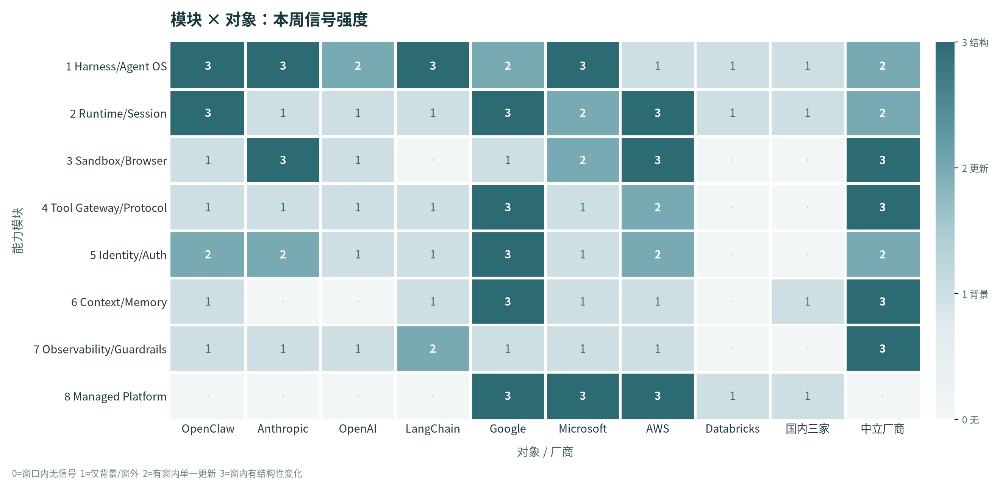

**本周的主线只有一句话：Agent 跑在哪里，不再决定它被信任多少；能不能出示证明，才决定。**

执行侧，AWS 把「每个 Pod 一个独立内核」做成一行 `runtimeClassName`，并用硬件度量决定密钥释放给谁；治理侧，Google 把 Agent 网关推到 EKS、AKS、OpenShift 和裸金属，控制面留在云上、数据面留在客户集群；凭证侧，Claude Code 把「等人批准」改成「直接拒绝」，OpenClaw 把插件缓存按连接凭证切开。三条线指向同一个假设：**Agent 是默认不可信的租户，信任要靠证明换取，而不是靠它恰好跑在你的网络里。**

## 本期要点

### 1. AWS 把「不可信代码」的边界从容器推到内核

[AWS Nitro Sandboxes](https://aws.amazon.com/blogs/containers/aws-nitro-sandboxes-hardware-enforced-workload-isolation-on-amazon-eks/) 在 11 月 9 日发布，给每个 Pod 一台自带 guest OS 与内核的轻量 VM。接入方式是把 `runtimeClassName` 设成 `isolated-sandbox` 或 `confidential-sandbox`，前提是 Kubernetes 1.36 以上；镜像、entrypoint、Helm chart 和流水线都不用改。底层不是嵌套虚拟化，而是一个新的 EC2 原语 **Nitro Partition**：Nitro Hypervisor 从一台运行中的实例里切出硬件隔离的 CPU 与内存切片，Pod 的 VM 直接跑在切片上，因此没有「VM 里再跑一个 hypervisor」的双层开销。

真正让这条发布越过「又一个沙箱」的，是 confidential 模式的信任链：沙箱内的 Nitro Security Module 度量启动镜像、启动设置、虚拟设备和 parent 实例身份，签出 parent 无法伪造的证明；AWS KMS 只在证明匹配 key policy 时才释放密钥，EKS 还要求用 `kms:RecipientAttestation:PCR<PCR_ID>` 绑定具体度量值。更关键的是，Pod 的 Cedar 策略本身也被度量进证明寄存器——被攻陷的 parent 换不掉策略而不改变度量值。代价同样明确：不支持 flex 实例与 GPU 透传，不能 snapshot/pause/live migration，parent 能读它呈现给沙箱的每个块设备，所以机密数据必须在沙箱内先加密。密度上每 vCPU 最多 5 个沙箱、单实例最多 896 个，「跑不可信代码」第一次可以在共享集群上做，而不必开专用节点池。

### 2. Google 把 Agent 治理的控制面搬出了云

11 月 11 日，Google 以 Limited Preview 发布 [Agent Gateway for cross-cloud](https://docs.cloud.google.com/gemini-enterprise-agent-platform/release-notes)：治理范围扩到 EKS、AKS、OpenShift 和裸金属 K8s，Agent 留在原地，只把身份、注册表和 LLM/MCP/A2A 流量交给集中控制面。数据面是客户集群里的 Envoy 代理，每个代理带一个 AIR（Agent Identity Runtime）sidecar；工作负载用 projected KSA token 换 Workload Identity Federation 身份，再换成短期证书。策略求值也在本地：`GCPExtensionBinding` 把云端的 Model Armor 模板与 IAP 策略绑到网关上，连不上 Google Cloud 时一律阻断——即使 `failOpen: true` 也不放行。

前一天发布的[跨项目治理](https://docs.cloud.google.com/gemini-enterprise-agent-platform/govern/policies/configure-semantic-governance.md.txt)把同一套机制做成 hub-and-spoke：一个管理项目用 `AGENT_MANAGEMENT` 边界发现成员项目的 Agent，发现时**保留其 `RuntimeIdentity`（`principal://…`）不变**，只有管理项目里定义的策略生效。这条设计比「统一控制台」重要得多——身份不被代持，审计链才不会断。两个限制要一起读：语义策略引擎**只评估模型推理路径，明确不评估 MCP 工具调用**；本地根 CA 的私钥存在 `geap-system` 的 Secret 里，能读它的人可以冒充外部端点。

### 3. Claude Code 把「等人批准」改成「直接拒绝」，OpenClaw 把凭证钉在作用域上

[Claude Code v2.1.319](https://github.com/anthropics/claude-code/releases) 新增 `permissions.denyInsteadOfPrompting`：本该弹窗等待的工具调用直接判 deny，turn 继续跑。这不是小开关，而是把人工审批从「必经路径」降级为「可选路径」——无人值守的 CI、子代理、teammate 编排终于不会因为一个没人回答的弹窗挂死，代价是原来靠「反正会弹窗」兜底的危险工具，升级后会直接失败。同版本把 MCP 长任务自动后台化，并给出 `CLAUDE_CODE_DISABLE_MCP_TASK_BACKGROUND` 退回同步等待；[v2.1.321](https://raw.githubusercontent.com/anthropics/claude-code/main/CHANGELOG.md) 则修了一个更险的问题：MCP OAuth 在服务端重定向时，会把 refresh token 等秘密发到另一台主机。

OpenClaw [v2026.11.3](https://github.com/openclaw/openclaw/releases) 从另一端补同一类漏洞：复用与缓存的插件结果按连接凭证隔离，其他插件的 transport hook 钉在 provider 的 origin 上，Firecrawl key 绑定各自的 scoped endpoint，配置读取与错误回显里的凭证做脱敏。两件事合起来说明「凭证作用域」仍是当前最薄弱的一环——Claude Code 的问题是凭证跟错了 host，OpenClaw 的问题是结果跟错了凭证。两者都不是密码学问题，而是**作用域绑定**问题。

### 4. MCP 第一次承认：工具调用有 JSON-RPC 之外的数据面

11 月 10 日的[文件上传/下载扩展草案](https://raw.githubusercontent.com/modelcontextprotocol/modelcontextprotocol/main/blog/content/posts/exploring-file-uploads-and-downloads-in-mcp.md)把文件字节从 JSON-RPC 消息体里剥出去：服务端在参数上标 `x-mcp-file`，客户端先只发元数据，拿到 `upload_required`、目标 URL 和不透明的 `requestState`，再用 HTTPS PUT 直连上传，2xx 后带同一个 `requestState` 重试原调用。下载方向相反，内容不进入模型上下文。

最值得架构师注意的是凭证字段：每个 target 带 `credentials: omit|include`。`omit` 表示不附带任何 MCP token/cookie，目标必须自带授权（例如预签名 URL）；`include` 只在目标位于 MCP 服务地址之下或同源时才附带 MCP 凭证；客户端必须拒绝重定向、拒收自带 `Authorization` 头的 target。这等于给「网关把 MCP 凭证转发给第三方存储」划了红线。同周还有两个小但硬的变化：[MCP Registry v1.8.8](https://github.com/modelcontextprotocol/registry/releases) 允许不同 server name 共享同一 remote URL，条目身份改成 (name, version)——以 URL 做去重键的镜像网关会把两个 server 合并成一个；A2A 在 11 月 5 日把 OAuth Client ID Metadata Document 发到站点根目录，`client_id` 直接等于文档 URL，客户端身份从「注册表里的一条记录」变成「一个可验证的 URL」。

### 5. AgentCore Runtime V2：会话取代实例，冷启动变成可承诺项

[AWS AgentCore Runtime V2](https://aws.amazon.com/blogs/aws/aws-weekly-roundup-agentcore-runtime-v2-amazon-dynamodb-bulk-put-items-and-more-november-9-2026/) 把「每会话独占一份预热环境」换成「先打快照、新实例从快照恢复」：200MB–2GB 镜像的 P75 冷启动压到约 2 秒，而旧 runtime 在同一区间从 5.4 秒恶化到接近 30 秒；单会话并发连接从 16 提到 250，新增 `OverheadLatency` 指标把平台开销从 agent 开销里减出来。设置 `platformVersion=V2` 即可加入，新增法兰克福、斯德哥尔摩、孟买、新加坡、悉尼五个区域，合计 10 个。官方 release notes 只给到「November 2026」，具体日期由 11 月 9 日的 Weekly Roundup 旁证。

迁移的真正门槛不是版本号，而是 `GET /ping`：V2 要求 MCP server 在服务端口实现健康端点，否则平台只能识别「停止响应」，无法区分错误类型。同一周还有两处在重画「执行单位」：[browser-use 1.0](https://github.com/browser-use/browser-use/releases) 把浏览器 agent 从「每步选一个 DOM 动作」换成「模型写 Python 进常驻 REPL、直接打 CDP」，Python 代码量从 68,815 行降到 13,154 行；[OTel GenAI 语义约定](https://github.com/open-telemetry/semantic-conventions-genai)整体拆仓，窗内 19 个提交重排了 `invoke_agent`、`execute_tool` 等信号，但仓库没有 Release、CHANGELOG 只有 `Unreleased`、Schema URL 还是 `TODO`。

## 执行侧：隔离开始按「代码是谁写的」分层

Nitro Sandboxes 不是孤立事件，它把一条本来模糊的分界线画清楚了。同一家 AWS 在 AgentCore 里提供 Browser 与 Code Interpreter，仍是容器化、会话制、默认 15 分钟、最长 8 小时、每次会话重置；Nitro Sandboxes 则给每个 Pod 独立内核。分界不是产品线，而是**代码可信度**：模型生成的半可信代码用容器换密度，完全不可信的代码用 VM 换边界。

浏览器侧的选择更分散。[browser-use 1.0](https://github.com/browser-use/browser-use/releases) 把动作空间交给 Python 本身，代价是执行面变大，于是同版补了域名限制、密钥脱敏、`DevToolsActivePort` 校验、`file:` URL 阻断与反馈离机前擦除；[Browserbase](https://www.browserbase.com/changelog) 走相反方向，Stagehand 4.4 让 `browser.disconnect()` 断开控制连接但不销毁浏览器，crash-safe 由浏览器扩展检测 SDK 进程死亡，Navigation Policies 则在页面加载、iframe、弹窗和每一跳重定向上都做检查。[agent-browser 0.42](https://github.com/vercel-labs/agent-browser/releases) 用 saved flows 把重复任务降级成「一次录制、多次回放」，按直连 HTTP → 页面内请求 → 录制命令三层降级，保存实际成功的那一层。

三条路线没有汇合，但共同点很清楚：浏览器正在从「调用栈的一部分」变成「可长期持有、可治理的资源」。托管平台的 8 小时上限因此成为一个真实约束——超过 8 小时的 always-on agent 必须把状态外置到 context 或文件，再开新会话。

## 治理侧：跨云的不是算力，是策略

Google 的跨云网关把「控制面 / 数据面分离」落到了产品层，但它不是唯一的动作。AWS 在 11 月 6 日让 Agent Registry 进入 GovCloud，发布与发现 agents、tools、MCP servers、skills，审批流控制可见性，CloudTrail 记录；11 月 9 日 STS 支持跨 partition 联邦，用 `GetWebIdentityToken` 与 `AssumeRoleWithWebIdentity` 在 partition 之间换临时凭证，不再共享长期 access key。微软则把 harness 产品化：Foundry 的 Copilot harness 提供 managed loop 与 sandbox，**创建 agent 时选定、之后不支持切换**，沙箱的 CPU、内存、空闲策略由平台托管。

三家落在不同位置：AWS 落在目录与审计，Google 落在网络代理，微软落在执行环境。对企业来说，这意味着「多云执行、单点治理」第一次可选，但也意味着锁定点从算力变成了策略层。采购时要问的不再是「你支持哪些云」，而是「同一套策略能不能同时描述 LLM、MCP、A2A 三类流量，跨项目时身份会不会被换掉」。

## 凭证侧：能用的凭证，和能看见的凭证，正在分开

这一周最密集的修复都在「凭证跟着谁走」。Claude Code 修的是凭证跟错了 host，OpenClaw 修的是缓存结果跟错了凭证，Arcade 的 [#996](https://github.com/ArcadeAI/arcade-ai/commits) 修的是「拿不到 `client_id` 就回落到共享 `"unknown"`」——三处独立修复，同一个病灶：**缺失或歧义时回落到一个所有人共享的桶**。

正面设计也有样本。MCP 文件扩展把 `credentials: omit|include` 写成字段；Nango v0.72.3 支持 OAuth2 public client，把安全前提明确转到 PKCE 与精确 redirect URI，并允许关掉平台托管的共享 OAuth app；Composio 用 audit logs 记录「哪个凭证执行了哪个工具」，再用 Approvals/Firewall 在调用前加一道策略。求值时机各不相同——Arcade 在运行时按 claim 隔离，Nango 在连接建立时确定凭证域，Composio 在调用前审批——但方向一致：凭证属于哪个主体，必须显式写下来。

## 协议侧：规范静默，扩展在动

MCP 规范本周仍是 `2026-07-28`，没有新修订，窗内提交全部是文档、社区治理与 SEP 自动化。真正的变化来自扩展与生态：文件扩展把数据面拆出去，Registry 把身份键从 URL 改成 (name, version)，A2A 把客户端身份改成可解引用 URL。三件事的共同点是「不要再假设一次调用只有一条 JSON-RPC 消息」——审计、DLP、配额都必须同时覆盖控制面与数据面，否则会出现「日志里有调用、没有内容」的盲区。

工具网关的形态也在分岔。Composio beta.536 让 custom toolkit 支持 `mcpUrl`（`feat(core)!` 破坏性），把 custom tools 改名 `localTools`：前者指向远端 MCP server，只做注册、鉴权注入与审计；后者在调用方进程内跑。AWS 则把检索做成三层——Web Answer 一次调用返回带引用的合成答案，Web Search API 返回排序结果集并按 **$7 / 1,000 次查询**计价，MCP 工具是给 agent 的协议化入口。

## 记忆与观测：上下文成为资源，语义层失去稳定版本

记忆层的本周主线不是「又一个框架发版」，而是上下文的形态在变。[OpenViking v0.5.4](https://github.com/volcengine/OpenViking/releases) 把 MCP 工具挂成 `viking://` 下的可读 Markdown 节点，读实时节点只透明调用「符合只读要求」的工具，显式声明为非只读的工具必须走 `ov mcps invoke`——读写分权不是调用点判定，而是预声明。同版锁租约协议变更，共享存储不能新旧混跑，滚动升级不被支持。Google 11 月 6 日把 Memory Bank 做成独立控制台：Unstructured / Structured 双视图、`key:value` scope、revision history，配置切成 Details / Generation / Retrieval / Retention / Schemas 五段，抽取从固定 pipeline 变成 schema 驱动。

观测层的关键词是「不许猜」。OTel GenAI 约定拆仓后没有稳定版本，行业正在用的 `gen_ai.*` 属性此刻没有权威定义；Langfuse 在 11 月 6 日退役 automatic tokenization，宁可把「usage 缺失」显式暴露，也不再估算成本；Phoenix 的 `phoenix-otel@3.0.0` 迁到 OTel JS 3 后，`register()` 不再应用 `OTEL_TRACES_SAMPLER`、`OTEL_BSP_*` 等环境变量——靠环境变量控制采样率的部署，升级后采样率会静默回默认。护栏层则完成了一轮出清：Guardrails AI 已被 Harvey 收购且窗内零提交，Helicone、AgentOps 停更一年以上，开源护栏只剩 NeMo Guardrails 一条主线，而它在换判定模型。

## 升级成本：默认更严的一周

这一周几乎所有框架的破坏性变更都指向同一个方向——默认更严。Microsoft Agent Framework 的 python-1.25.0 与 dotnet-1.28.0 把 live workflow-agent executor 绑死单一授权作用域，跨作用域在模型调用前拒绝；declarative workflow HTTP 改为必须显式 host/port allowlist，**空 allowlist 拒绝所有请求**；A2A 改成 message-only，`as_tool()` 在 AG-UI 端点被拒。Google ADK 2.14 把 Environment/Daytona/E2B 转 stable，同时让枚举类型工具参数收到 enum 成员而非字符串，并把 `RunSkillScriptTool` 从「拼 shell 命令」改成结构化 argv，官方原话是这关闭了一条提示注入到任意 shell 执行的路径。LangGraph 1.2.20 给每个 `interrupt()` 独立 id，并新增 strict resume 拒绝陈旧的 interrupt 答案。

这些变更不会在测试里报错，会在无人值守的凌晨暴露。升级评估要新增一栏：「哪些原本靠人工兜底的路径，现在会确定性失败」。

*图 1：8 个能力模块与 10 类对象的本周信号强度（0=窗口内无信号，1=仅背景/窗外，2=有窗内单一更新，3=窗内有结构性变化）。国内三家在多数模块为空或 1，是公开信号缺失，不是能力判断。数据来源：本报告各模块状态表。*

## 本周 vs 上周

| 主线 | 上周（第 19 期，10-22~10-28） | 本周（11-05~11-11） | 走向 |
|---|---|---|---|
| 核心问题 | 恢复与重试时，副作用不再发生第二次 | 这次调用凭什么被允许 | 从「状态对不对」到「身份是不是真的」 |
| 策略执行点 | 下沉到工具网关，网关是单点 | 网关离开云，控制面与数据面分离 | 从「在哪执行」到「凭什么信这个点」 |
| 沙箱 | 重试幂等 + 凭证隔离 | 硬件强制隔离，每 Pod 独立内核 | 从协议契约上移到信任基座 |
| 凭证 | 凭证不进模型 | 凭证按调用作用域绑定 | 从「看不见」到「不串味」 |
| 会话 | 会话能否可靠恢复 | 会话成为计价与隔离单位 | 从「恢复」到「重建」 |
| 协议 | Skills over MCP 开始分发 | 数据面与客户端身份从 JSON-RPC 拆出 | 从「分发什么」到「数据走哪」 |
| 观测 | 成本与安全事件进同一条 trace | `gen_ai.*` 失去稳定版本 | 从「看得见」到「对齐不了」 |
| 国内云 | 零散动态 | 百炼零条目、方舟不可读、腾讯仅标题 | 公开面收窄，情报缺口扩大 |

上周的答案是「把策略放进网关」，本周的答案是「网关本身也要被证明」。两者合起来才完整：恢复不重放解决的是「重试之后状态对不对」，默认不可信解决的是「这次调用凭什么被允许」；而它们最终都落在凭证上——要证明「这是同一次请求」，前提是能证明「这是同一个主体」。

## 对你意味着什么

**编辑建议，按优先级排序：**

1. **如果你的 Agent 会跑模型生成的代码，先做隔离分级。** 可信代码用容器，不可信代码用独立内核；Nitro Sandboxes 的前置是 K8s 1.36+ 与 sandbox-enabled AMI，迁移动作只是改一个 `runtimeClassName`，但要把「无 GPU 透传、不能 snapshot、parent 能读块设备」写进架构约束。
2. **把客户端版本下限抬到 Claude Code 2.1.321**，并自查自研 MCP 客户端：跟随 3xx 到异源时是否剥离 `Authorization` 与 `refresh_token`。这是凭证外泄，不是功能缺陷。
3. **升级前先跑一遍「拒绝路径」回归。** `denyInsteadOfPrompting`、MAF 的空 allowlist、ADK 的 `INVALID_ARGUMENTS`、LangGraph 的 strict resume，都会把原来「会弹窗/会放行」的路径改成失败。列出所有无人值守任务，确认它们在失败时能重试或告警，而不是静默卡住。
4. **存量 MCP server 补 `GET /ping`。** 不补，AgentCore Runtime V2 只能看到「停止响应」，无法区分错误类型；这是升级 V2 的前置代码，不是可选项。
5. **重新算检索成本。** Web Search 按 $7/1,000 次查询计价，一个每天 10 万次检索的 agent 仅检索成本就是 $700/天。采购口径从「每百万 token」改成「每完成任务成本」，否则会低估检索密集 agent。
6. **多租户平台检查「缺失时的默认值」。** 问三个问题：缓存键是否含凭证身份？拿不到 `client_id` 时是失败还是回落到公共桶？跨项目治理时身份是被保留还是被代签？这三条比任何隔离技术都更早决定会不会串租户。
7. **锁定稳定线，不追 latest。** OpenClaw 的 `extended-stable`（9.37）与主线的双轨已经成形；高频迭代的 harness 已进入安全债偿还阶段，追最新版本的收益低于回归成本。

## 来源

- **AWS**：[What's New feed](https://aws.amazon.com/about-aws/whats-new/recent/feed/)｜[Nitro Sandboxes 博客](https://aws.amazon.com/blogs/containers/aws-nitro-sandboxes-hardware-enforced-workload-isolation-on-amazon-eks/)｜[AgentCore Release Notes](https://docs.aws.amazon.com/bedrock-agentcore/latest/devguide/release-notes.html)｜[AgentCore Runtime V2（Weekly Roundup）](https://aws.amazon.com/blogs/aws/aws-weekly-roundup-agentcore-runtime-v2-amazon-dynamodb-bulk-put-items-and-more-november-9-2026/)
- **Google**：[Agent Platform Release Notes](https://docs.cloud.google.com/gemini-enterprise-agent-platform/release-notes)｜[语义治理机制](https://docs.cloud.google.com/gemini-enterprise-agent-platform/govern/policies/configure-semantic-governance.md.txt)｜[跨云网关 overview](https://docs.cloud.google.com/gemini-enterprise-agent-platform/agents/governance/agent-gateway-cross-cloud/overview.md.txt)
- **Microsoft**：[Foundry Blog](https://devblogs.microsoft.com/foundry/feed/)｜[Entra what's new](https://learn.microsoft.com/en-us/entra/fundamentals/whats-new)
- **Anthropic**：[Claude Code Releases](https://github.com/anthropics/claude-code/releases)｜[CHANGELOG](https://raw.githubusercontent.com/anthropics/claude-code/main/CHANGELOG.md)｜[Platform Release Notes](https://platform.claude.com/docs/en/release-notes/overview)
- **OpenAI**：[Agents SDK Python](https://github.com/openai/openai-agents-python/releases)｜[Agents SDK JS](https://github.com/openai/openai-agents-js/releases)｜[API Changelog](https://developers.openai.com/api/docs/changelog)
- **OpenClaw**：[Releases](https://github.com/openclaw/openclaw/releases)｜[2026.11.2 notes](https://docs.openclaw.ai/releases/2026.11.2)
- **MCP / A2A**：[规范 changelog](https://modelcontextprotocol.io/specification/2026-07-28/changelog)｜[文件扩展草案](https://raw.githubusercontent.com/modelcontextprotocol/modelcontextprotocol/main/blog/content/posts/exploring-file-uploads-and-downloads-in-mcp.md)｜[Registry](https://github.com/modelcontextprotocol/registry/releases)｜[A2A](https://github.com/a2aproject/A2A/commits)
- **框架**：[LangGraph](https://github.com/langchain-ai/langgraph/releases)｜[LangChain](https://github.com/langchain-ai/langchain/releases)｜[LangSmith](https://docs.langchain.com/langsmith/changelog)｜[Google ADK](https://github.com/google/adk-python/releases/tag/v2.14.0)｜[Agent Framework](https://github.com/microsoft/agent-framework/releases)｜[CrewAI](https://github.com/crewAIInc/crewAI/releases)｜[pydantic-ai](https://github.com/pydantic/pydantic-ai/releases)
- **沙箱 / 浏览器**：[browser-use](https://github.com/browser-use/browser-use/releases)｜[Browserbase](https://www.browserbase.com/changelog)｜[agent-browser](https://github.com/vercel-labs/agent-browser/releases)｜[E2B](https://github.com/e2b-dev/E2B/releases)｜[Modal](https://modal.com/changelog)｜[Daytona](https://www.daytona.io/changelog)
- **记忆 / 观测**：[OpenViking](https://github.com/volcengine/OpenViking/releases)｜[Cognee](https://github.com/topoteretes/cognee/releases)｜[Zep](https://help.getzep.com/changelog)｜[Firecrawl](https://www.firecrawl.dev/changelog)｜[OTel GenAI](https://github.com/open-telemetry/semantic-conventions-genai)｜[Langfuse](https://github.com/langfuse/langfuse/releases)｜[Phoenix](https://github.com/Arize-ai/phoenix/releases)
- **国内云**：[百炼发布记录](https://help.aliyun.com/zh/model-studio/application-release-notes)｜[腾讯云公告](https://cloud.tencent.com/announce)｜[火山方舟文档](https://docs.volcengine.com/docs/82379)
