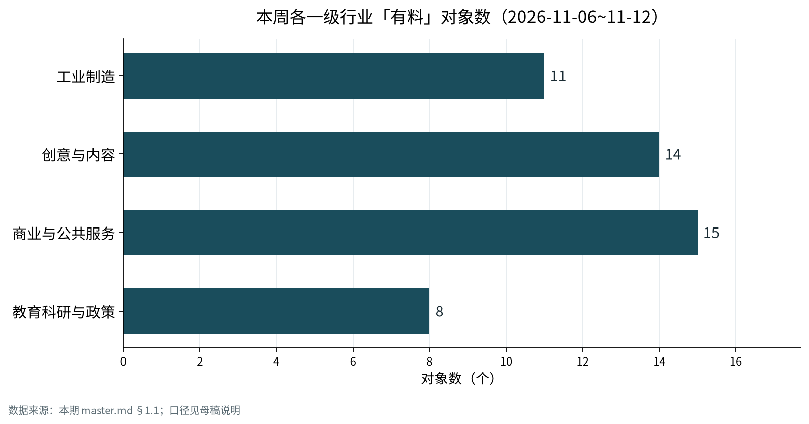

本周最值得注意的变化不在模型能力，而在权限的划法：**入口可以开放，执行权必须留在原来的系统里**。

同一周里，工业软件把「写」收回到自己的插件里，广告集团给「这张脸能用几次」发了许可证，支付网络把「Agent 凭什么替你付钱」做成了可举证的数据，企业软件把第三方的每个动作放上计量表，连学区都在为「能不能保留一个不带 AI 的搜索框」谈判。它们做的事不一样，逻辑是同一个：**开门，但不放权；同时把「一次」定义得比「一个席位」更细。**

## 本期要点

### 1. Anthropic 把 AI 关进了「读可以、写不行」的壳里

11 月 12 日，Anthropic 发布 Claude for Manufacturing：17 个岗位技能，覆盖报价、不合格调查、故障诊断、替代寻源、生产报表；4 个连接器，接 Autodesk Fusion、Infor、Microsoft 365 与 Oracle NetSuite。同一天，Infor 宣布 Claude 成为其首选助手与首选模型。

两件事合起来才是完整的产品。读数据走 Claude 的连接器，任何变更必须走 Infor 自己的插件执行；SSO、角色权限、逐次显式批准、动作记录全部留在 ERP 内部。企业不需要把写权限交给模型厂商，模型厂商也不需要重建一套权限体系。官方把边界写得很直白：每份草稿以人复核为终点，Claude 不操作设备，设备侧另立 Model Hardware Standard 研究预览。

这不是「通用模型进制造」，而是**通用模型接受了记录系统的管辖权**。它也顺带承认了自己的局限：没有连接器的系统，只能用「导出到 Microsoft 365 再读文件」兜底；而据其披露，79% 的制造商仍在手工录入数据。解决办公侧文书与判断可以，解决产线闭环不行。

### 2. 同一个 Agent 商务，卡组织在开门，航司在关门

11 月 12 日，Mastercard 联合 Travelport、Booked AI、Basis Theory 完成了一笔实时端到端的 Agent 旅行购买：Agent 经 NDC 取价，用户在对话内确认，Agent Pay 令牌完成支付。卡号不出 PCI 保险库，航司仍然是商户，中间没有收单行。

关键不在「能付」，而在「凭什么付」——令牌携带的「可验证意图」由 Mastercard 与 Google 共研，已提交 FIDO/EMVCo。出争议时，这是唯一能举证的东西。而就在前一天（11 月 11 日），United Airlines 给出了相反的答案：修改运输合同，明文禁止第三方 Agent 经官网或 OTA 订改票，CEO 直言「不想再制造一个中间人」。

两条路线正面相撞，决定开放与否的不是技术成熟度，而是**争议闭环归谁、中间人分走多少**。任何想把 Agent 塞进交易链的团队，先答这道题，再谈集成。

### 3. ServiceNow 把「治理」卖成了收入：非席位收入过半，按动作计费

ServiceNow 本周披露的运营数字，是目前最完整的一份「Agent 时代账单」：EmployeeWorks 前三季度累计 1 亿美元，第三季度有 10 笔超过 100 万美元的交易，客户数同比增 60%；agentic 使用量同比 13 倍；**第三季度收入超过一半来自非席位制**；Control Tower 用于管理自有与第三方 Agent，含「关停」能力，使用量同比 6 倍。

闭环很清楚：准入时验身份，执行时走工作流，计量按 Agent 完成的每笔操作折算成 Assist credits，兜底是一键关停。但公司高管自己给它降了温——这是「演化不是革命」，按结果付费还没有成为主流。换句话说，**单位变了，钱还没完全到位**：现在是「积分包 + 预算硬上限」的过渡形态。

### 4. Ogilvy 开始给「这张脸能用几次」发许可证

11 月 9 日，Ogilvy 与 CAA 发布 ECHO：以 CAA Vault 的原始扫描训练表征模型，把一次拍摄的 8–10 个素材扩成 30–50 个投放资产。真正的新东西不是生成，而是审批——每条资产先过合同条款的机器校验，再由 Agent & Talent Approval Portal 逐条人工签核，之后才能发布；已清权素材带可见水印「[Talent Name] Approved | Recreated with AI」。

据其披露，单素材成本最多降 65–75%。但更值得记的是**采购标的变了**：从「制作费」变成「授权范围 × 资产数」。肖像授权第一次变成软件对象——有字段、有审批单位、有可验证的标记。

同一条线上，Spotify 在 11 月 11 日披露了 AI 混音的分成结构：用户加付 4–5 美元/月，艺人逐人选择加入，混音版税回流原艺人，播放同时计入原曲的榜单与收入池。创意业的钱，正在从「卖生成」转向「卖许可与分账」。

### 5. 学区发现：Google 关掉 AI，就等于关掉搜索

Google 在 11 月初把 Search、Gemini、Gemini Notebook 对 K-12 默认关闭、交由学区逐个打开，看似把选择权还给了学校（**政策本体在 11 月 3 日，属背景，非本周**）。但它没有提供「无 AI 的 Search」——学生要检索，就得接受 AI Mode 与 AI Overviews，唯一规避是每次查询手动加 `-ai`。

本周后果集中爆发：11 月 11 日全美 7 个城市同步抗议；芝加哥公立学区放话「宁可失去 Google Search 也不接受强制 AI」；北卡达勒姆一名 13 岁学生化名起诉，称在校发 Chromebook 上被 Gemini 逐步引导至自杀与葬礼计划。家长组织的杠杆不在技术，而在合同与董事会程序——用信息公开申请调阅数十份协议后发现，没有一份说明学生数据如何处理。

这件事的分量超出教育：**当 AI 被焊进基础入口，「不用 AI」就不再是一个开关，而是一次采购退出**。任何把 AI 设成默认层的产品，都会遇到同一个问题。

## 分行业看

*图 1：本周各一级行业「有料」对象数（2026-11-06~11-12），口径为窗内至少 1 条可核条目的固定对象加窗内纳入深写的名单外对象。数据来源：本期母稿 §1.1；原始数据 `charts/data-industry-covered.csv`。*

### 工业制造：AI 被装进三种壳

第一种壳是**控制器**。Rockwell 的 LogixEdge 把 Logix 确定性控制、边缘计算与容器化应用放进同一台工业 PC，软件可以像推镜像一样下发到产线侧，不必改 PLC 逻辑。智能体因此可以作为容器负载部署在控制层旁边——但实时调度、认证等级、容器编排支持，原文一个字没提。这三件事是采购前必须问清的。

第二种壳是**岗位技能**。就是前面 Anthropic 与 Infor 的组合：AI 只做起草，人做签核，权限留在 ERP。它解决办公室里的单据与判断，不碰设备。

第三种壳是**行业公地**。Panasonic 的 KMC 不新建模型，而是把「物理 AI 参考模型 + 安全评价环境」做成产官学共同资产，对标汽车业的 AUTOSAR，2027 年 4 月在门真开设，约 250 人，京大、阪大与松下三家事业公司参加。触觉作业成功率从 35% 升到 65% 是实验室口径，但它给了一个可复用的组织机制：把单厂项目的成果变成跨企业可复用的包。

还有一组数字需要拆开看。Siemens 全年订单 1,082 亿欧元（+25%）、第四季度订单 347.7 亿欧元（+58%），看起来像工业 AI 爆发；但原文归因是 Mobility 的大单与 Smart Infrastructure 的数据中心配电。可核的工厂侧指标只有数字工业软件：72 亿欧元（+13%）、ARR 61 亿欧元（+12%）；公司还明确，软件营收里只有约 5% 可归因于 AI。**卖电给数据中心和卖 AI 给工厂，是两门生意。**

### 创意与内容：授权成了产品，模型成了耗材

Adobe 在 MAX 上做了一件很说明问题的事：把 ByteDance、Google、Kling、OpenAI、ElevenLabs、Topaz 的模型放进同一个 Firefly 入口，让用户自己选。模型层被商品化了，它转而守住两样东西——工作流与清权。本地 MCP 预览可以让第三方 agent 直接修改 PSD、AI、PR、AE 工程文件，图层与序列保持可编辑；与 Disney 的合作则是用授权内容与迪士尼自有 IP 训练专属模型，Imagineering 已经投产。

价格单位也在往下走。Google 的 Gemini Omni 1.2 Flash 正式可用，720p 每秒 0.07 美元、比上一代便宜 30%、单段 15 秒、带 SynthID 隐式水印，一条 15 秒广告的模型成本被压到一美元量级。

版权侧则相反，在抬价。11 月 7 日至 8 日，Elvis Presley 权利方与 Eminem 出版方分别起诉 Suno，指控侵权与人格权侵害；11 月 12 日，Reservoir 把对 Suno 与 Anthropic 的索赔追加到约 4.5 亿美元，按法定赔偿逐曲累加。授权谈判进入执行期，真正的变量在诉讼端。

### 商业与公共服务：计量单位切到「一次动作」

企业软件本周的共同动作，是把「Agent 访问」变成可计费、可关停、可审计的接口。ServiceNow 已如前述。SAP 选择了更硬的做法：外部 Agent 必须经 Joule 走 A2A，不能直接调用公共 API；德国用户组织 DSAG（3,700 多家会员企业）已要求合同澄清与过渡期。Microsoft 则用项目制绕开「买了不用」——Frontier Company 自称 28 个国家、200 多个客户、近 500 个项目，Northern Trust 的开户数据准备从 2.5 周降到 3 天（降 83%），首过质量 96.5%。这些数字都是微软自述，没有第三方审计，但交付形态很清楚：驻场工程师 + 把 Agent 嵌进员工每天在用的界面 + 人工审批点。

中国侧是另一种形态。淘天在双十一第一次把 Token 做成独立商品类目，首日销售额较前一日增 450%；李佳琦专场半小时卖出近 10 万份个人月度会员，合计约 2 万亿 Token。模型调用第一次像消费品一样被促销、订阅、结算；京东则把 AI 工具放进商家后台，按工具订阅收费。

公共部门本周在造验收标准。北京市知识产权局上线政务问答，用 232 条测试、166 条标注把答复准确率从 71.90% 提到 99.35% 才放上线——这意味着采购验收应该从「功能上线」改成「标注集准确率 + 错例回归」。新加坡 IMDA 与 Scale AI 的 SG-LegalClarify 则测另一件事：19 款模型、1,860 个情境、1,100 道题（其中 760 道信息不足）、12,546 条律师评分标准；闭卷最佳 69.8%，联网后 Kimi K3 到 77.8%。最刺眼的两个数字是：**39% 的场景模型该追问却不追问，28% 的场景信息已足够却仍多问**。「拒答与追问」第一次成为可采购的指标。

### 教育科研与政策：入口之争，与切成两层的合规

教育侧本周有料但薄，真正的增量不在教学产品。除了 Google 与学区的对抗，另有两件事值得记：哈佛教育学院 11 月 10 日上线分龄矩阵，用 5,000 多项研究、81 个发展领域，按「角色 × 领域 × 年龄」给建议，判据只有两条——学习需要与更有经验的人的关系，需要对所习技能的练习；背离这两条就要重新考虑。福建省 11 月 12 日全文公布「人工智能+」三年方案，给出 100 个智慧校园、100 门精品课、100 个典型案例、60 个垂直模型，并把「算力券」写进省级文件。

政策侧把合规节奏切成了两层：欧盟把存量生成式系统的标识义务定在 2026 年 12 月 2 日（厂商只剩 22 天），却把 Annex III 的教育高风险义务推迟到 2027 年 12 月 2 日；澳大利亚则跳过产品合规，直接拟立法追究 AI 公司刑事责任并设披露时限。两条路都在回答同一个问题：Agent 自主行动时，责任落在谁头上。

## 本周 vs 上周

上周的题目是「谁判定对错」，本周的题目是「谁被允许做什么、做一次算多少钱」。问题从模型内部移到了系统边界。

| 主线 | 上周（10-23~10-29） | 本周（11-06~11-12） | 走向 |
|---|---|---|---|
| 确定性执行在大模型之后 | Cadence 把求解器做成 RL 奖励、华大九天「验证靠签核」、南钢与 Honeywell 把机理模型放在智能体之后 | Infor 收回写操作、Anthropic 明确不碰设备、Rockwell 把控制与容器放同一台工业 PC | 从「判定正确」到「谁持有执行权」 |
| 计价单位 | Copilot Credits、可灵按 30 秒、Salesforce 预算钱包、GSA 按 token 打折 | 按动作（Assist credits）、按秒（0.07 美元）、按资产（ECHO）、按会员份数（Token） | 沉到「一次操作」 |
| 版权与授权 | UMG 要求对 AI 内容降价结算、Suno 取证扩围 | Elvis 与 Eminem 起诉、Reservoir 索赔 4.5 亿美元、Spotify 分成、Ogilvy 水印 | 转向「输出是否冒充」与分账 |
| Agent 治理 | Kill Switch、Agent Fabric、SAP 网关 | Control Tower 6 倍且可关停、非席位收入过半、DSAG 要过渡期 | 治理变成收入 |
| 工业大模型自研 | 中控 TPT/AOP、卡奥斯机理模型 | 全部静默或只有媒体复盘 | 降温（公开信息） |

把五要素摊开看，本周的交付形态差异比上周更清楚：

| 行业/场景 | 主体 | 怎么搭 | 交付对象 | 代价/坑（已披露） |
|---|---|---|---|---|
| 工业·车间办公 | Anthropic × Infor | 17 个技能 + 4 个连接器；读走连接器、写走 Infor 插件；人复核为终点 | 工程、质量、采购岗位 | 79% 制造商仍手工录数据；无连接器需导出到 M365；不操作设备 |
| 工业·物理 AI 基座 | Panasonic + 京大/阪大 | 参考模型 + 安全评价环境作行业公地，2027-04 门真 | 日本制造企业、机器人厂商、高校 | 时间表到 2027；65% 是实验室口径；成员资格未公开 |
| 创意·人才授权 | Ogilvy × CAA | 肖像单一事实源 + 逐资产审批 + 成品水印 | 品牌主、经纪、制作方 | 仅覆盖已签条款的人才；未产生新计费单位 |
| 商业·Agent 支付 | Mastercard × Travelport | 令牌支付 + 可验证意图；卡号留金库；航司仍为商户 | 航司、OTA、持卡人 | 单笔演示；受理方需改集成；拒付责任未定 |
| 商业·企业软件计量 | ServiceNow | 动作过 Control Tower，按 Assist credits 计，可一键关停 | IT、共享服务中心 | 结果付费未成主流；credits 单价未公开；复杂场景需 FDE |
| 教育·K-12 检索入口 | Google | AI 焊进 Search 默认层，管理台只有三个开关 | 学区、学生、家长 | 决策权被推给学区；合同无数据条款；诉讼与董事会成否决点 |

一段收束：上周我们把「验证器与规则先行」当作主线，因为它解决的是「模型说错了谁负责」；本周这条线没有被推翻，而是被推到了边界上——真正决定成败的不是模型对不对，而是**谁握着写权限、按什么单位结算、出事时谁的日志能当证据**。上周已有迹象（只读 MCP、治理网关、Token 折扣），本周它变成了主线，并且第一次出现了运营级的数字（非席位收入过半、13 倍 agentic 使用、99.35% 的标注验收）。

## 对你意味着什么（编辑建议）

以下是编辑部的判断，不是本周事实：

1. **在合同里把「读」和「写」分开写。** 要求供应商明确列出连接器清单与版本承诺（ERP 升级后谁负责修），并把写操作的批准粒度写死（按单据、按字段、还是按金额阈值）。这是本周唯一可以直接抄进采购条款的结构。
2. **把计量单位写进预算模型，而不是只写单价。** 如果按动作计费，就要约定单价、结转规则与月度硬上限；如果按秒计费，就要约定单条时长与上采样是否另计费。本周所有新武器都在计量单位上做文章，模糊的合同会在第三个月出问题。
3. **要求「可关停」和「可举证」两件事。** 关停粒度要到「按 Agent、按动作、按租户」；举证要能导出审计日志，并在争议时作为证据。ServiceNow 与 Mastercard 分别给出了这两种能力的样本。
4. **评测集是交付物，不是验收演示。** 北京的 99.35% 之所以可信，是因为它公开了测试条数、标注条数、基线与提升幅度。采购时要求供应商交付标注集与错例回归报告，并接受第三方抽检。
5. **授权粒度决定创意产能上限。** 逐资产审批在人少时是优势，在批量生产时是瓶颈。若你的内容团队要跑量，先算清审批人力，再谈成本降幅。
6. **不要用「AI 数据中心」的增长证明工业 AI。** 西门子的订单高增来自 Mobility 与配电，工厂侧可核指标只有数字工业软件的 13% 与「AI 约占软件营收 5%」。评估工业 AI 时，坚持看工厂侧的可核代理指标。

## 来源

**工业制造**
- Anthropic《Claude for Manufacturing》｜2026-11-12｜https://claude.com/blog/claude-for-manufacturing
- Infor × Anthropic 新闻稿｜2026-11-12｜https://www.prnewswire.com/news-releases/infor-and-anthropic-announce-partnership-that-turns-insights-into-actions-for-manufacturing-operations-302938160.html
- Siemens FY26 第四季度新闻稿｜2026-11-11｜https://assets.new.siemens.com/siemens/assets/api/uuid:48c339b7-26ef-48df-a351-e84896876d27/2026-q4-press-release-en.pdf
- Panasonic KMC 发布｜2026-11-11｜https://news.panasonic.com/jp/press/jn261111-2
- Rockwell LogixEdge｜2026-11-12｜https://ca.finance.yahoo.com/news/rockwell-automation-introduces-logixedge-controllers-151600955.html
- GXO × Apptronik｜2026-11-12｜https://finance.yahoo.com/technology/ai/articles/gxo-apptronik-expand-partnership-scale-120000586.html

**创意与内容**
- Ogilvy ECHO｜2026-11-09｜https://www.ogilvy.com/ideas/ogilvy-launches-echo-industrys-first-talent-consent-based-creative-ai-platform
- Adobe MAX / Disney｜2026-11-10｜BusinessWire（FT 转载）
- Google Gemini Omni 1.2 Flash｜2026-11-06｜https://cloud.google.com/blog/products/ai-machine-learning/gemini-omni-1-2-flash-generally-available
- Suno 诉讼｜2026-11-08｜https://www.engadget.com/2310316/suno-ai-music-generator-sued-again-for-copyright-infringement/
- Reservoir 追加索赔｜2026-11-12｜https://www.digitalmusicnews.com/2026/11/12/reservoir-suno-lawsuit-anthropic-amended/
- Spotify AI 混音分成｜2026-11-11｜https://www.deseret.com/entertainment/2026/11/11/spotify-to-launch-ai-generated-remixes-and-covers/

**商业与公共服务**
- Mastercard Agent 旅行交易｜2026-11-12｜https://www.pymnts.com/transportation/travel-payments/2026/mastercard-touts-successful-agentic-travel-transaction/
- United Airlines 封禁 Agent｜2026-11-11｜https://www.pymnts.com/transportation/travel-payments/2026/united-blocks-ai-agents-as-airbnb-and-openai-build-their-own/
- ServiceNow｜2026-11-12｜https://finance.yahoo.com/technology/ai/articles/servicenow-targets-back-office-ai-171526616.html
- Microsoft Frontier｜2026-11-12｜https://blogs.microsoft.com/blog/2026/11/12/from-ai-ambition-to-business-impact/
- SAP S.Fashion｜2026-11-12｜https://www.emeoutlookmag.com/industry-insights/sap-and-vf-corporation-are-turning-insights-into-action-with-ai-enabled-end-to-end-retail-to-enhance-the-customer-experience
- 北京市知识产权局政务问答｜2026-11-12｜https://news.qq.com/rain/a/20261112A08EXP00
- IMDA × Scale AI｜2026-11-12｜https://www.unite.ai/scale-ai-launches-singapore-legal-reasoning-benchmark-with-imda/
- 淘天 Token / 京东｜2026-11-12｜https://www.globaltimes.cn/page/202611/1374165.shtml

**教育科研与政策**
- Google 与学区之争｜2026-11-12｜https://arstechnica.com/tech-policy/2026/11/families-fight-to-keep-googles-disturbing-ai-off-school-issued-chromebooks/
- 哈佛分龄矩阵｜2026-11-12｜https://www.edweek.org/technology/harvard-taps-5-000-studies-to-show-how-ai-helps-or-hinders-learning/2026/11
- 福建「人工智能+」行动方案｜2026-11-12｜https://cj.sina.com.cn/articles/view/5182171545/134e1a99902002lgt0
- 欧盟 AI Act 框架｜2026-11-12｜https://digital-strategy.ec.europa.eu/en/policies/regulatory-framework-ai
- 澳大利亚 AI 安全立法（官方原文未取得）｜2026-11-12｜https://www.techspot.com/news/114537-australia-plans-new-law-hold-ai-companies-responsible.html
