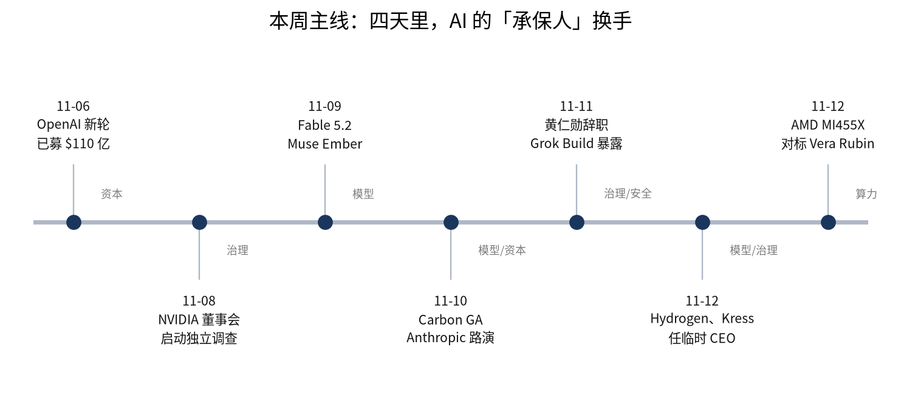
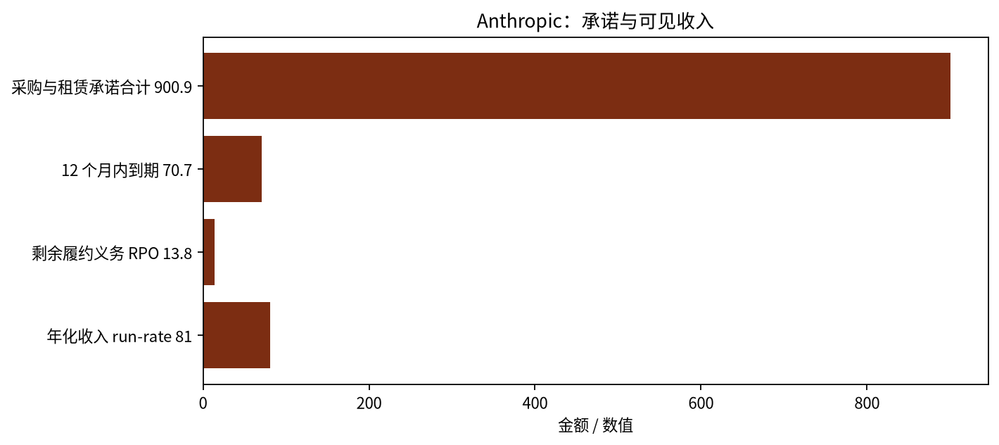
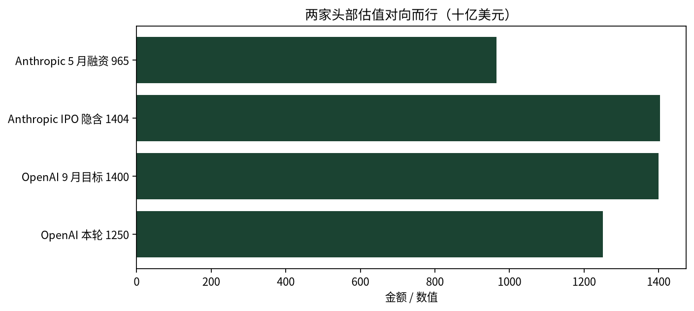

英伟达董事会在四天里完成了从「对创始人有信心」到「即刻接受辞呈」的转向，同一周 Anthropic 把公司按 $1.404T 写进招股书：AI 的信用基础，正从创始人叙事移交给董事会、供应商股东与公开市场。

这两件事放在一起才看得懂。过去两年，AI 的资本开支靠的是几个人的信用——黄仁勋在国会山和客户面前担保算力，奥特曼在私募市场担保需求，Amodei 在公开信里担保安全。这一周，第一个担保人被董事会请走，第二个担保人的融资目标被下调，第三个担保人则把自己的账本交给公开市场逐页核对。本周没有「更大的模型」决定行业走向，决定走向的是谁有资格签字。

*图 1：本周关键节点。11-08 董事会启动独立调查，11-11 接受辞呈，11-12 公布临时管理层；同期模型与资本动作密集。来源：NVIDIA 新闻稿与 8-K、各公司公告、TechCrunch。*

## 本期要点

### 英伟达：四天，从「有信心」到「即刻接受辞呈」

压垮董事会的不是尚未完成的间谍调查，而是「CEO 与直接汇报者的关系」——这类问题董事会不必等外部结论就能判断。11-08 的声明还是「支持 + 调查」的组合：就「创始人兼 CEO 成为外国情报活动目标」的报道启动独立调查，同时明确「对 Jensen 及其领导团队有信心」。11-10，独立董事聘请前纽约南区代理联邦检察官 Joon H. Kim 与 Wachtell, Lipton, Rosen & Katz 主持调查。11-11，在《纽约时报》报道第二段关系涉及一名直接向其汇报的高管后，董事会当日接受黄仁勋辞去总裁、CEO 与董事职务，即刻生效——8-K 的事件日期就是 11-11（Item 5.02）。11-12 公告：CFO Colette Kress 兼任临时 CEO，1993 年起任董事的 Harvey C. Jones 出任公司史上首位董事会主席，启动内外部搜寻，Q3 FY2027 财报仍按原计划 11-17 发布。

处置方式暴露了接班结构。据 TechCrunch 引述黄仁勋本人说法，他直接管理约 60 名汇报者、极少授权，公司没有公开的继任计划。于是只能「临时 CEO + 首任董事长 + 外部搜寻」三件套；临时人选是财务背景的 Kress 而不是产品/工程负责人，这是稳住资产负债表与客户承诺的信号，不是延续创始人路线的信号。把董事长职位从 CEO 手里分离，则是对「创始人中心制」的结构性修正。

英伟达早已不只是卖芯片。据 TechCrunch 汇总，截至 7 月公司约有 **$750B** 循环交易承诺、8 月为 OpenAI 俄亥俄数据中心 **$105B** 融资兜底，并说服 Apollo、BlackRock、Blackstone、Brookfield、Goldman、KKR 承诺至多 **$500B** 用于数据中心建设，抵押逻辑是 GPU 保值（媒体汇总，未独立核实）。这套「以算力为抵押」的结构，信用基础很大程度上是创始人本人持续在场。市场给的即时定价是 11-11 盘后跌约 **8%**、五日累计约 **-11%**（媒体口径）。在英伟达公布临时管理层的同一天，AMD 发布 MI455X 对 Vera Rubin 的「领先」推理成绩，第二供应商的叙事恰好赶上窗口。（[NVIDIA 公告](https://nvidianews.nvidia.com/news/nvidia-announces-ceo-transition)、[8-K](https://www.sec.gov/Archives/edgar/data/1045810/000104581026000082/0001045810-26-000082-index.htm)）

### Anthropic：先给能力定价，再给公司定价

11-09 的 Fable 5.2 与 Mythos 5.2 是同一个底层模型的两个分发版本：Fable 带网络安全与生物安全护栏、面向所有用户，Mythos 只发给通过审核的网络安全与生命科学研究方。定价 **$8 / 百万输入、$40 / 百万输出**，低于 5.1；可选 fast mode **$16 / $80**，速度至多 **2.5 倍**。厂商标称 FrontierCode 2.0 **49.1%**、OSWorld 2.1 **89.3%**、Humanity's Last Exam（带工具）**74.2%**；并称 Anthropic 核心代码库中超过 **90%** 的合并改动由 Claude 撰写，一名工程师让模型协调 **1,000+** 子代理、连续 8 天从空目录造出可在笔记本启动的操作系统。这些成绩是厂商自测，不与别家同机对比。

11-10 的招股书修正案把公司价格写清楚了：**825,000,000 股** Class A、区间 **$70–78**，募资 **$57.75B–64.35B**，净募资 **$84.6B–93.7B**（含同步私募）。按上限、完全摊薄，TechCrunch 算出隐含估值 **$1.404T**——5 月融资时是 **$965B**。同步以 IPO 价向七家战略方私募 **$26.0B** 无投票权 Class N 股：Google 与英伟达各 **$10B**，AMD **$2.5B**，Broadcom、Micron、Microsoft 各 **$1B**，TSMC **$0.5B**。创始人持有的 Class F 股占 **50.1%** 投票权，Long-Term Benefit Trust 通过 Class T 股选出董事会多数——公开股东买到的是经济份额，不是控制权。预计 11-19 前后在纳斯达克挂牌，代码 **ANT**。（[Fable 5.2 发布](https://www.anthropic.com/news/claude-fable-and-mythos-5-2)、[路演稿](https://www.anthropic.com/news/roadshow-launch)）

账本比估值更值得看。前九个月收入 **$33.2B**、Q3 单季 **$17.0B**、净亏损 **$104B**（其中大部分是可转换证券等融资工具的公允价值变动，不是现金流出）、现金及短期投资约 **$132B**；截至 10-31 的 run-rate 收入约 **$81B**，比 9 月底增加 **$10B**。采购承诺与租赁合计 **$900.9B**，其中 **$451.6B** 在 2030 年底前发生、**$70.7B** 在 12 个月内到期；而剩余履约义务（已签约未确认收入）只有 **$13.8B**。按本报计算，承诺约为 RPO 的 **65 倍**；IPO 净募资中位约覆盖 12 个月内到期承诺的 **1.2 倍**。

*图 2：Anthropic 采购与租赁承诺、12 个月内到期额、RPO 与年化收入（十亿美元）。来源：Anthropic S-1/A-2；run-rate 为截至 10-31 的公司口径。*

公开市场买的不是已签约收入，而是「消费型收入继续陡增」的假设。而 Ramp 的数据显示，企业 token 支出在 8–9 月只增 **1.5%**（7 月为 **42%**），10 月回升 **8.9%**（媒体引 Ramp）。模型降价与 IPO 定价因此是同一件事的两面：能力越便宜，越要靠规模与资本市场补足单位价格的下行；而供应商用股权锁定客户，等于把「卖铲子的人」变成「矿的股东」。

### Google：两天两个模型，把「每任务成本」做成产品参数

11-10，Gemini 4 Carbon 正式可用，API 导入价与 Argon 相同（**$2 / 百万输入、$10 / 百万输出**）。Google 称它在 CursorBench 4.0、Perplexity WANDR、Zapier AutomationBench 三个独立基准上排名第一，且每任务成本比次优外部模型低 **2 倍以上**；Antigravity 预览 **/swarm**，把一条提示词拆成可实时追踪的 agent 团队，Carbon 做架构、协调与审计。11-12，Gemini 4 Hydrogen 接棒，取代 3.8 Flash：100 万 token 上下文**统一定价 $1.50 / 百万输入、$7.50 / 百万输出**，Artificial Analysis 智能指数 **51**（Argon 为 50），Terminal-Bench 4.1 从 **18.2%** 升到 **57%**，任务完成速度快 **2.5 倍**；同日它成为 Search 迄今最大的一次模型升级，全球全量用户可用。

配套的 Antigravity Orchestrator 在同一会话内自动在 Carbon 与 Hydrogen 之间切换，Terminal-Bench 4.0 上接近 Carbon 的成功率，平均少用 **24%** 配额、快 **19%**。11-11 还有 Gemini Decisions API：一次前向对最多 **1,000 个**候选打分，输入 **$0.10/百万**、输出不计费，端到端 **150–250ms**。

Google 这周没有发布「更大的模型」，而是把模型做成分层定价的算力产品：Carbon 卖「最难的任务」，Hydrogen 卖「每 token 最便宜的可用智能」，Orchestrator 卖「自动选择」。这直接压向同一天降价的 Anthropic——两家在「前沿能力」与「日常执行」两个价位同时挤压。对企业的含义是：模型选型从「选最强」变成「选路由」。（[Carbon](https://deepmind.google/blog/gemini-4-carbon-is-now-available/)、[Hydrogen](https://blog.google/innovation-and-ai/models-and-research/gemini-models/introducing-gemini-4-hydrogen/)）

### OpenAI：估值回落到 $1.25T，收入首次单季破 $10B

11-06 据 Bloomberg，OpenAI 新一轮已募 **$11B**、估值 **$1.25T**，本轮尚未关闭、预计总额约 **$20B**——9 月的目标是 $30B @ $1.4T。11-11 据 Bloomberg，Q3 收入首次单季超过 **$10B**（Q2 为 $6.7B，环比约 **+50%**），年化 run-rate **$50B**，调整后经营利润率从 **-150%** 收窄至 **-109%**。

产品侧是分发周：11-10 ChatGPT Enterprise 上架 AWS Marketplace，企业可用既有的 AWS 采购与账单关系完成采购；同日推出 Businesses in ChatGPT，商家可创建并验证企业档案、上线专用 business agent、获得曝光与点击洞察；另据 TechCrunch，11-10 收购 AI 旅行 agent 公司 Odessia，属 acqui-hire，产品已关停、条款未披露。OpenAI 这一周的关键词不是模型，是渠道与单位经济。与 Anthropic 的对比很清楚：Anthropic 用「供应商入股 + 公开市场」融资，OpenAI 用「云市场分销 + 私募」融资——两条路都在回答同一个问题：当收入增速开始被价格战侵蚀，钱和渠道哪个更稀缺。（[融资](https://techcrunch.com/2026/11/06/openai-reportedly-raises-an-additional-11-billion-at-a-1-25-trillion-valuation/)、[季度营收](https://techcrunch.com/2026/11/11/openais-quarterly-revenue-reportedly-crosses-10b-for-the-first-time/)）

### AMD：在英伟达换帅同一天，给出「性能 + 供给」的替代叙事

11-12，AMD 更新 Instinct MI400 系列：MI455X 在 Helios 机柜上跑 DeepSeek-R1，MLPerf Inference Offline 达 **21,333 tokens/s/GPU**，AMD 称比英伟达 Vera Rubin 最新公开 MLPerf 成绩高至多 **30%**，Helios 的 HBM 带宽高至多 **20%**（均为 AMD 基于公开规格的自算/自测）；新增 MI450X（**288GB** HBM4，与 MI455X 同计算、同带宽、同互联）；MI430X 面向科学计算，**432GB** HBM4、**23.3TB/s** 带宽、原生 FP64。11-09 另披露第五代 EPYC 为 Google Cloud TPU 8tx 的主机基础设施供电，并把 SEV 机密计算从 CPU 延伸到加速器——即使加速器输了，CPU 侧的收入也不绑定在这场胜负上。

时点比数字更值得记：AMD 选择在黄仁勋辞职公告同日发布对 Vera Rubin 的对比成绩。对客户而言，这提供了「治理风险对冲」的现成话术——不是换供应商因为性能更好，而是因为不想把 2027 年的产能押在一家正在换 CEO 的公司上。需要克制的是：21,333 tok/s 与 +30% 均为 AMD 自测，对比的是英伟达「已公开」的 MLPerf 条目，不是同一台机器的 head-to-head。（[AMD 公告](https://newsroom.amd.com/news/amd-advances-instinct-mi400-series-ai-scientific-computing/)）

## 承保层：钱开始按「项目」而不是「故事」定价

Anthropic 的 **$26.0B** 无投票权股是本周结构上最新的事：七家芯片与云厂商按 IPO 价入股，采购关系被提前折成股权。好处是供给确定性与估值背书；代价是「中立云」需要重新解释——客户会问，我的推理跑在「我的供应商的股东」的云上，2027 年的产能优先级怎么排。

另一侧是私募资金的边际承接力在下降。OpenAI 估值从 $1.4T 目标回落到 $1.25T，募资目标从 $30B 砍到约 $20B；Anthropic 则从 $965B 跳到 $1.404T 并转向公开市场。两家对向而行，说明下一段资本开支要靠公开市场与项目融资接棒：Nebius 用客户预付款加贷款支撑 **$40B** 扩张，今年约 **$80B** 数据中心债券中近半为高收益级，SoftBank 因预订燃气轮机损失超过 **$30 亿**。

*图 3：Anthropic 与 OpenAI 的估值变化（十亿美元）。来源：Anthropic S-1/A-2 与 TechCrunch 计算；OpenAI 为 Bloomberg 经 TechCrunch 报道的口径。*

债务侧的信号已经进了财报。CoreWeave 三季度营收 **$3.661B**（同比 **+168%**）、净亏损 **$709M**，但当季净利息支出 **$846M**——利息比亏损还大；它的 backlog 是 **$132.5B**，全年 capex 指引 **$37–39B**，靠可转债、ATM 和客户预付款支撑。当算力扩张从「股权故事」变成「项目融资」，利率与预付款条款就成了比 GPU 供应更紧的约束。

并购也在退潮。本周唯一的并购是 OpenAI 对 Odessia 的 acqui-hire，以及 Oura 以 **$6.25 亿**收购 AI 原生初级诊疗公司 Counsel Health——买的是团队与持照医生网络，不是入口。相比上周三笔平台型收购，资本这周更愿意买「资质」，不愿意买「流量」。

## 定价层：从「每 token」到「每任务」

本周三家美国实验室各自换了一种计价方式。Google 用三层编队加自动路由，把「贵模型做判断、便宜模型做量」变成平台默认；Anthropic 用同一权重的双型号加五档 effort 与 fast mode，卖「更少 token 达到同等分」；Meta 在 11-09 补上最轻一档 Muse Ember，输入 **$0.10/百万**，官方口径是「Wonder 规划、Ember 跑量」，Muse 家族形成 Spark、Glimmer、Wonder、Ember 四层。Google 的 Decisions API 更彻底：把「生成」换成「对闭集候选打分」，一次前向出概率分布，输出 token 不计费，成本不再随答案长度增长。

结论是模型竞争的主战场从「榜单第一」转为「同一预算下完成多少任务」。这对按 token 计收的厂商是结构性降价压力；对采购方意味着招标口径要改成「每完成任务成本 + 人工复核率」，而不是「每百万 token 单价」。

## 分发层：模型进别人的入口，平台做被调用的那一层

Databricks 的选择最清楚：11-11 把 Genie 插件原生塞进 ChatGPT、Claude、Copilot Cowork 与 Grok Bot，11-12 Genie in Slack 正式可用，权限随提问者、MCP 动作需审批。它不做入口，做「被四个入口调用的企业上下文层」。Adobe 在 MAX 上做的是同一件事的两面：自家应用里做常驻 agent，同时发布 MCP 让 ChatGPT、Claude、Gemini 调用 Adobe 能力——既做入口，也做被调用方。

OpenAI 走的是采购路径：ChatGPT Enterprise 上 AWS Marketplace，把采购动作放进客户已有的合同与账单；Businesses in ChatGPT 则把「模型回答里顺带提到你」变成「可运营的发现入口」，有档案、有 agent、有曝光洞察。但 3 月关停的「ChatGPT 内直接下单 + 抽佣」说明转化链仍是短板。Google 的优势最直接：Hydrogen 当天全量进入 Search，是它首次把前沿模型同步到 Search 的全球流量。

企业侧的对应变化是「agent 有了系统身份」。Glean 的 Release 568 让 agent 用共享服务账号访问 Atlassian、Linear、Zendesk 等工具，不再依赖每个用户各自授权——agent 从「个人助手」变成「有凭据的系统账户」，这既是效率，也是新的权限边界。

## Agent 落地：渠道开始关门，身份成为瓶颈

11-12，United Airlines 修改预订、出票与分销政策，禁止第三方个人 AI agent 代订机票与操作里程，并同步约束旅行社与聚合商；理由是凭据共享的泄露风险，以及「必须由人完成」的合规动作（值机时的危险品申报）。同一天，Meta 的 Muse 向美国付费订阅用户开放「代打电话」，$20/月起，但报道指出不少商家一听出是 AI 就挂断。

两件事指向同一个缺口：agent 没有可验证的身份。United 用条款把「代客操作」定义成未授权访问，商家用挂断来拒绝——渠道方不认 agent，技术上也分不清人与代理，因为服务端看到的只是合法凭据。更极端的例子是 11-12 曝出的 Grok Build：43,551 个应用地址中 37,571 个仍在线，**94.7%** 无需登录即可打开，估计 **650–800 个**含私密数据；成因是随机词域名可被被动 DNS 枚举，而发布面板默认「任何持有链接的人」（中文媒体引安全公司，属有限佐证）。

对 agent 厂商，这意味着竞争焦点从能力转向授权：官方 API 与付费通道、浏览器侧「用户在场」的代理模式、可验证的去电签名。谁先补上身份层，谁才拿得到交易类场景的入场券。

## 算力与具身：替代供给在同一周集体到位

AMD 的三档 MI400 覆盖推理、通用与科学计算，EPYC 进入 Google TPU 8tx 的主机侧——第二供应商从「有芯片」走到「有机柜、有主机」。Google 的第八代 TPU 分成两个变体：TPU 8tx 与 AMD 合作、面向机密训练与推理，TPU 8i Max 双芯合封、内存/算力/带宽翻倍（媒体引 Google 博文）。

电力开始比芯片更硬。Anthropic 购入 **$3.4B** 燃气轮机，SoftBank 因轮机预订损失超过 **$30 亿**，X-energy 获准建造首批小型模块化核反应堆——算力扩张的瓶颈正从「能不能买到 GPU」转向「能不能拿到电」。

具身智能这周出现了「开放权重 + 硬件伙伴」的组合：Google 的 Gemini Robotics 2.5 在 200 项任务上成功率较前代提升 **30%–100%**，与 Apptronik、Mercedes-Benz 在匈牙利与德国产线做概念验证，Apollo 2 人形做汽车零件 kitting 达 **96%**；Tesla 的 Musk 在 11-06 的投资会议上说，Optimus 未来「大概率出租」、单台成本 **$20,000–30,000**（媒体转述，无条款与时间表）；Runway 则以 Apache 2.0 开放 **27B** MoE 世界动作模型 Praxis-1，RoboLab-120 成功率 **46.2%**，超过 FLUX 3 Action 的 42.9%、Cosmos3 Nano 的 36.8% 与 π0.5 的 28.0%（厂商自测）。本体侧，优必选在 11-12 获永达汽车首批 **400 台** U1 Pro 采购，宇树获均胜电子交付「机器人高算力大脑背包」，Figure 则放出数十台 F.03 从 BotQ 工厂列队出厂的视频——本体厂商开始拼交付，而不只是拼演示。

## 中国头部：一条路开源放量，一条路把旗舰藏进订阅

这周中国头部没有一家发布「更大的通用旗舰」，动作分成两条路，而且方向相反。开源一侧，MiniMax 在 11-11 开放 **MiniMax-H3-Image** 权重：33.1B 的扩散 Transformer、原生 4K 直出、采样蒸馏到 6 步，官方示例价 4K 约 **$0.06879/张**、发布周五折约 **$0.03439/张**（约两毛人民币）；字节 Seed 在 11-06 开源 **Cola2**——连续潜空间语言模型，训练用 **346.03B** source tokens，8 项评测均值 **60.10**。两家都在用「开放权重」换生态与部署量。

订阅一侧，阿里把新一代旗舰 qwen4-max-preview 放在 11-11 上线阿里云百炼，但**只开 Token Plan 订阅通道**、不走按量计费，同时兼容 OpenAI 与 Anthropic 协议以降低迁移成本；百度在 11-11 发布文心 5.5 Flash Preview，总参 **2800 亿**、单次激活 **140 亿**、**100 万 token** 上下文、生成速度 **>200 token/s**，官方口径是「即将开源」（据量子位，截至 11-13 Hugging Face 尚无对应权重）；腾讯在 11-12 把元宝搜索做成独立网页版 **so.qq.com**，可设为 QQ 浏览器默认搜索引擎，底座已支撑 50 多个业务。

两条路的共同点是不按「每百万 token」卖智能：开源用权重把边际成本压到按张、按次；订阅用额度把价格从用量里剥离。对企业采购，这意味着比价基准分裂成两套——闭源旗舰比「每席位/每额度」，开源比「每张图/每千次推理 + 自建运维」。DeepSeek、月之暗面与智谱本周官方静默（API 更新日志、博客与 release notes 均停在窗外），华为的发布页为前端渲染、窗内条目无法定位，本报告不据此推断其动作。

## 本周 vs 上周

上周的主线是「买下 Agent 的存储、调度与登录」：OpenAI 买 Pierre，Meta 收 Conductor，Sierra 买 Anon，加上 Anthropic 递交 S-1/A 与 AMD 亮出 Helios。那一周的钱在补 agent 的零件。

| 主线 | 上周（第 24 期） | 本周（第 25 期） | 走向 |
|---|---|---|---|
| Agent 基础设施 | 三笔并购：存储审阅、并发调度、浏览器登录 | 仅 Odessia acqui-hire、Oura×Counsel Health | 降温 |
| 资本与上市 | Anthropic 递交 S-1/A，未定价 | 定价 $70–78、隐含 $1.404T、$26.0B 供应商私募 | 延续并升级 |
| 算力供给 | AMD Helios 机柜亮相 | MI455X 对 Vera Rubin 的对比成绩；TPU 8tx/8i Max | 延续 |
| 模型竞争 | 旗舰能力迭代 | 分层定价 + 自动路由（Carbon/Hydrogen/Ember/Orchestrator） | 新出现 |
| 公司治理 | 创始人作为叙事中心 | 创始人关键人风险被公开定价（四天换帅） | 新出现 |
| Agent 商业化 | 能力演示 | 渠道反制（United）、身份缺口（Grok Build 默认公开） | 新出现 |
| 中国头部 | 腾讯 Hy4 开源、旗舰能力迭代 | MiniMax H3-Image 开源（4K、约 2 毛/张）、阿里 qwen4-max 仅订阅、文心 5.5 Flash 预告开源 | 延续（路线分化） |
| 资本结构 | 股权故事 | 债务、预付款与电力约束（junk 债、轮机、SMR） | 转向 |

重心迁移一句话：上周在买入口，本周在给信用定价。上周用并购把 agent 的零件买齐，本周用董事会与招股书把 AI 的担保人换掉。

## 对你意味着什么

{: .notice--info}
**编辑建议**：以下动作由本期事实推导，不构成投资建议。

- **采购与架构**：把「关键人风险」写进 2027 年的算力与模型合同——双源或多源、权重与源代码托管、关键人离职的供应连续性条款。英伟达的 -11% 说明市场已经在给治理折价，合同条款只是把这一定价落到纸面。
- **模型招标**：把口径从「每百万 token 单价」改成「每完成任务成本 + 人工复核率」。Carbon 与 Hydrogen 的价差、Orchestrator 省的 24% 配额、Decisions 的输出免费，都会让 token 单价失真。
- **预算与融资**：如果你在采购侧，注意 Anthropic 的 $70.7B 12 个月内到期承诺与 $13.8B RPO 之间的缺口——供应商的履约能力取决于它能否持续融资，而不只是模型好不好。预付长约换折扣时，把「融资中断」写进退出条款。
- **Agent 上线**：先解决身份与授权，再谈能力。面向交易类平台（航空、银行、保险）的 agent，走官方 API 或平台授权通道；「共享用户密码」这条路正在被系统性堵死。

## 来源

- NVIDIA：董事会声明（11-08）、独立董事声明（11-10）、CEO Transition 新闻稿（11-12）、Form 8-K（Acc-no 0001045810-26-000082）。
- Anthropic：Fable 5.2 / Mythos 5.2 发布页（11-09）、IPO 路演稿（11-10）、S-1/A-2（SEC EDGAR）。
- Google：Gemini 4 Carbon（11-10）、Gemini 4 Hydrogen（11-12）、Search 升级、Gemini Decisions API（11-11）、AlphaProof Code（11-10）、Gemini Robotics 2.5（11-10）。
- OpenAI：News RSS（11-06~11-12）；Bloomberg 经 TechCrunch 转述的融资与营收口径。
- AWS、Meta、Microsoft：官方新闻室与 RSS；Microsoft 365 Status。
- 应用层：Databricks 博客、Glean release notes、Harvey newsroom、Runway、Cursor、Devin、Scale、Cohere、Perplexity 文档 changelog、Sierra blog。
- 中国头部：阿里云百炼「模型上架与更新」、MiniMax 官方博客与定价页、Hugging Face 模型卡与 API、36氪与量子位。
- 媒体：TechCrunch（按日归档 11-06~11-12）、The Verge、Ars Technica；中文媒体量子位、36氪。
- 图：数据见图注，CSV 存于 `charts/`。
