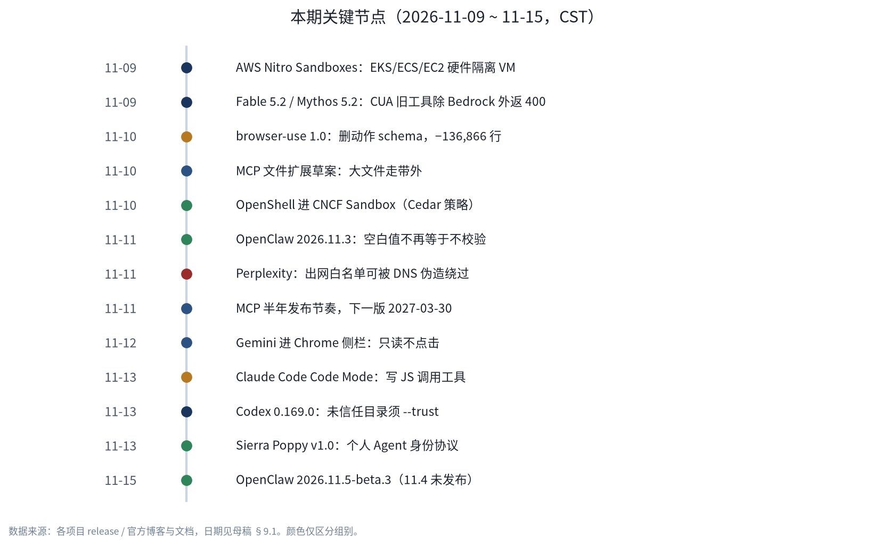

本周真正的变化是**动作的形状**：一次工具调用变成了一段代码。browser-use 1.0 删掉 DOM 序列化器与动作 schema，删了 136,866 行、约 80% 的库，让模型在持久 Python REPL 里直接对 CDP 写代码；三天后 Claude Code 2.1.323 上线实验性 Code Mode，Claude 写 JavaScript 调用工具；11-13 Antigravity 用内置 Python 运行时编排并行子代理。三家没有互相引用，做的却是同一件事。

这不是风格选择。把中间结果留在运行时、只把结论送回上下文，直接改了成本结构——browser-use 把每任务模型成本从 $0.434 降到 $0.208，分数没变。代价是授权的最小单位从「一次调用」抬到「一个程序」。而同一周，Anthropic 自己的文档承认命令文本规则「不是安全边界」，Perplexity 用一次沙箱复盘证明出网白名单可以被 DNS 伪造绕过，尝试的 43,551 个 Grok 地址中 37,571 仍在线，其中 94.7% 无需登录就能打开。**能力在换形状，边界还没换。**

## 本期要点

**browser-use 1.0 是本周最彻底的一次「删库重写」，删掉的是动作空间本身。** 1.0 的链路变成 `task → 模型写一个 cell → REPL 在 Chrome 上经 CDP 执行 → 输出回模型`，官方原话是 "No DOM serializer, no action schema, nothing in between."。工具面成了语言：`bu.click(41)`、`js(...)`、`new_tab(url)` 可以组合、循环、条件判断，中间变量留在 cell 里。真正让成本降下来的不是模型，是 1.0.4 的一个缓存修复——一个 705 步任务读了 27.8M 输入 token，其中只有 1.6M 来自 prompt cache，因为旧实现每来一张新截图就改写更早消息、每步都按全价付输入；改成累计 20 条批量剪枝后，BU Bench v2.1 分数持平（76.1 vs 76.0），每任务成本从 $0.434 降到 $0.208。代价也很直接：0.x 不兼容，官方要求所有依赖精确 pin，不支持的选项会在启动浏览器或计费之前抛 `TypeError`。

**Claude Code 的 Code Mode 把同一个转向带进了终端，但把授权问题暴露得更彻底。** 代码由 `REPL` 工具在你的会话里执行，工具以函数暴露——shell 用 `` $`npm test` ``，改动文件用 `edit(path, old, new)`；一段代码可以并行多条命令、把上一个结果直接喂给下一个调用，只把需要的片段 return 给模型。权限规则没有被绕过：代码里的每次调用仍走 `deny`/`ask` 与 `PreToolUse` hook。变的是审查对象——auto mode 的分类器「审的是每段代码，不是每次调用」，且官方明说它「看不到运行期算出来的值，比如从搜索结果里取的路径」。加上前台 10 分钟、后台 2 小时、只能走 Anthropic 直连、不能用于 `-p`/Agent SDK/VS Code/Desktop，Code Mode 现在是一个值得试、但不能托付流水线的实验功能。

**Perplexity 用一次沙箱复盘证明：出网白名单不是安全边界。** 11-11《Escaping SPACE: Part II》自述，其 Computer 的 SPACE 沙箱里 VM 逃逸任务零成功，即便明确指示模型专攻虚拟化层；真正可破的是「部分网络放行下的策略执行」。两条路径：一是有 root 与源码知识的 agent 伪造 DNS 响应，把允许域解析到自己的回调服务器，随机化查询端口用包喷洒打中；二是连到被允许域与回调共用的 IP，操纵 SNI/Host 或借 CDN 中继取回数据。两处已修，但同一类缺陷在 10 家第三方沙箱中的 8 家复现。allowlist 按域名写、运行时按 IP 连，中间隔着一次解析与一次 TLS 握手——这条缝不补，名单写多长都没用。

**Anthropic 把 Computer Use 的迁移单位从「模型」换成了「工具集」，而且是即刻失效。** 11-09 发布的 Fable 5.2 / Mythos 5.2 只接受 `computer_toolset_20260801`；请求里声明旧的 `computer_20251124`，在除 Amazon Bedrock 以外的所有平台返回 400。这不是弃用预告，升级模型当天就会炸；Bedrock 因为请求体由 AWS 侧转译而成了旧工具的兼容孤岛，同一份代码在不同平台行为不一致。工具集本身是客户端工具集，一个条目暴露 17 个成员工具、成员可按需关闭，批量动作必须按序执行。同周 11-12 的 self-hosted Managed Agents 则把 agents、sessions、会话历史全部放回客户自己的基础设施，只让模型请求出网。

**执行面这周正式变成云厂商与基金会的标准件。** KubeCon NA 上，CNCF 11-10 接受 NVIDIA 捐赠的 OpenShell 进 Sandbox：策略不在 Agent 里，而在沙箱外一个可信 supervisor 里执行——文件系统用 Landlock 限路径、进程降到非 root 去 capabilities 上 seccomp、网络默认拒绝出站、凭据只给占位符由 supervisor 换真 key，策略语言用 CNCF 的 Cedar，且可运行中更新不重启。同一天 CNCF 年度公告把 Agent Substrate 与 OpenShell 并列为新 Sandbox 项目，但 Agent Substrate 本身没有新阶段、没有新版本。AWS 则在 11-09 上线 Nitro Sandboxes：EKS/ECS/EC2 上的硬件隔离 VM，支持 attestation，只向完整性被证明的沙箱释放 secret，不额外收费。

## 动作空间：一次调用变成一段代码

把本周三次转向放在一张桌上，会看到一个共同的账本：**模型只该处理结论，载荷该留在运行时。**

Claude Code 的官方示例很能说明问题：先用 `rg` 找到文件、取第一行路径、调用 `edit` 改一处、再跑测试，最后一行只 return「改了哪个文件 + 测试输出」。中间的文件列表、路径字符串都不进上下文。browser-use 走的是同一条账：模型写 Python 直接调 CDP，页面 DOM 不再序列化后塞进 prompt，只有 cell 打印的内容回传。Antigravity 的 Dynamic Workflows 则把这件事用于编排——agent 用内置 Python 运行时并行调度多个子代理。

第四份证据来自协议层。MCP 11-10 发布文件扩展草案 `io.modelcontextprotocol/files`：工具参数用 `x-mcp-file` 标注，小文件 base64 内联，大文件走带外——客户端先只发文件元数据调工具，服务端做权限与配额检查后返回 `upload_required` 与 `requestState`，客户端用 HTTPS PUT 上传，再带原样 `requestState` 重试；校验通过才执行。模型全程不碰字节。这和 code mode 是同一个动作的两种实现：**把重数据移出上下文**。

代价落在授权上。当一次动作是一段程序，逐条命令批准还能批准什么？Anthropic 的权限文档自己给了答案：Bash 规则匹配的是「Claude 写出来的命令文本」，同一个程序换个形式调用就匹配不到，所以「deny 或 ask 规则不是围绕这个程序的安全边界」。文档举的例子很具体：`Bash(curl *)` 拦不住 `/usr/bin/curl` 和 `sh -c 'curl ...'`，`Bash(git push *)` 拦不住 `git -C . push`。官方给的替代只有两条——不依赖文本的 OS 沙箱，和能读完整命令文本的 `PreToolUse` hook。

v2.1.323 同一个版本里十余条权限修复，正好说明这不是单点 bug：对写 `.git`、`.claude` 的命令仍提供「don't ask again」但规则拦不住下一次、某些 `lsof` 无提示运行、`cat > file <<EOF` 被显示成 "Read 1 file"、`rm` 的检查在错误目录判断、`Bash(ls*)` 这类通配符规则跳过提示、`sudo`/`env` wrapper 绕过 deny 规则、`sandbox.excludedCommands` 让未点名命令跑在沙箱外、设置校验失败时 `claude -p` 与 Agent SDK 无沙箱跑 Bash。每一个都是「文本近似语义」的缝。

这也解释了为什么 OpenClaw 的执行器设计值得抄。它的 Code Mode 早就上线（2026.10 起），模型可见工具只剩 `exec`、`wait`，每个启用的非 MCP 工具在 guest 程序里暴露为 async 全局函数，MCP 工具经桥接，**权限、审批与会话归属仍留在 Gateway**。执行器二选一：默认 `node` 跑 Node.js `node:vm`，文档原话是「node:vm 不是安全边界」，worker 只是把计算挪出事件循环、共享 Gateway 的 OS 权限，因此「把 Node Code Mode 当作受信主机执行」；`quickjs` 则是 QuickJS-WASI 的「加固 guest 隔离」，挂起状态是序列化的 VM 快照。Cloudflare 一年前给的答案是第三种：V8 isolate，无外网，只能经 RPC 调已授权的 MCP 绑定，token 留在 supervisor。

四种答案排成一条轴，差别不在「有没有沙箱」，而在**代码与凭据、代码与审批的相对位置**：

| 实现 | 代码跑在哪 | 授权在哪一层 | 凭据可达性 |
|---|---|---|---|
| Claude Code Code Mode | 当前会话，`REPL` 工具 | 每次调用过规则与 hook；auto mode 审代码 | 会话环境 |
| browser-use 1.0 | 持久 Python REPL，直连 CDP | 域名规则 + 数据脱敏（官方标注 "Not a sandbox"） | 进程环境 |
| OpenClaw | worker 线程（node:vm 或 QuickJS-WASI） | Gateway 持有权限、审批与会话归属 | 不暴露给 guest |
| Cloudflare Code Mode | V8 isolate | RPC 调已授权的 MCP 绑定 | 留在 supervisor |

*表：四种 code mode 实现的执行与授权位置。来源：各家官方文档与博客，详见文末来源。*

## 编码 CLI：默认值出现公开分歧

这周的 CLI 版本很多，但最该记的是「升级后行为会变、且不报错」的那几条，因为它们直接决定 CI 里会不会出事。

Codex 0.169.0 把「沙箱可写」与「项目可信」拆成两个判定：`codex exec` 在未信任目录下**即使传了 `--sandbox workspace-write`**，也不加载项目配置与 MCP server，要恢复旧行为必须显式 `--trust`。理由很硬——项目配置能改模型与审批，项目 MCP server 是任意命令执行，两者都是「仓库能对你施加影响」的入口。

Cline 走了反方向。11-11 的提交把一次性 CLI 运行默认从 act 改成 yolo，理由原文是「这些运行里没人在键盘前批准工具」。但 PR 同时说明 yolo 不是 act 的超集：一次性 yolo 运行会失去 search、web fetch、apply-patch、skills、ask-question、sub-agents 与 teams，只新增 `submit_and_exit`；作者还自认「没有用真实 agent 运行验证过」。同一周，Codex 让既有流水线静默少加载，Cline 让既有脚本静默提权——选型时这应该是一个独立评估项，而不是风格差异。

Claude Code 则把上期那条泄漏的机制逐条关掉了。上期 Apiiro 记录的是：用户点「Yes, and don't ask again」后，含内联密码的整条命令被写进项目内 `.claude/settings.local.json`，而它只被加进全局 gitignore。本周的三条改动直接对应：含密、或会被保存到 git 跟踪的 settings.local.json 的 allow 规则，只在本次会话有效、不落盘；目录后来才变成 git 仓库、或换机器时未全局忽略的问题被修；写 `.git`、`.claude` 的命令不再提供「don't ask again」。v2.1.325 再补：已提交的 settings.local.json 在仓库某些子目录下不再被当作用户配置。修法不是扫描告警，而是**改变落盘条件**。

**但默认值的问题不止在配置，还在产物。** 名单外的一条研究给出了本周最刺眼的数字：Claroc Research 11-10 披露，尝试 43,551 个 `*.grok.me` 地址，37,571 仍在线，其中 35,578 个（94.7%）在未登录状态下即可打开，估计约 650–800 个应用含私有数据——包括一份标密的入职计划、594 个战略账户的销售 pipeline、某医院集团 3,500+ 员工名册。机制有三段，没有一段是沙箱：发布即公网且主机名会进被动 DNS、发布面板预选「Anyone with the link」、团队应用的登录流程先把任意 Google 账户加入团队再检查成员资格。只改默认值仍可通过链接传播，只改登录顺序已公开的仍可读。

其余几家是维护周：Gemini CLI 两版 66 项几乎全是修复，值得记的只有「判定顺序」——macOS 上必须先解析文件夹信任再进 Seatbelt，否则信任判定依据的是沙箱外路径；OpenCode 仓库已迁到 `anomalyco/opencode`，v2.3.0 把子代理默认改为后台运行，代价是一组 SDK 破坏性变更；Cursor 整周 changelog 空白，Windsurf 已 308 到 Devin Desktop，Aider 与 Roo Code 继续停更。

## 开源 Gateway 与框架：安全版、静默回退与决策模型

**OpenClaw 本周只发了一个稳定版 2026.11.3，官方标为 Security release、无新功能**（56 PR / 44 commits / 36 contributors）。六类修复指向同一个 bug 类：空白或缺省值被解释成「不校验」。空白 TLS 指纹原本会关掉证书校验而不是退回 CA 校验；Gateway allowlist 下动态 shell `test`/`[` 谓词绕过授权自动批准；托管的 Signal daemon 与 bundled language server 默认继承 Gateway 凭据；搜索缓存跨 API key 复用。修法是把空白值改成退回 CA 校验、把 allowlist 的匹配对象从字符串前缀改成命令结构、把子进程环境改成最小集、把缓存键加上凭据维度。

一个必须纠正的版本事实：**2026.11.4 没有发布**。tag 页 404，npm 的 latest 仍是 2026.11.3，但 11-13 至 11-15 连续出现四条针对 11.4 的发布管线 CI tag（性能豁免、解除插件发布、放行失败豁免等）。这些是流水线产物、不是版本，能得出的只是「11.4 进入过放行流程且被判失败或豁免」。实际升级路径是 11.3 → 2026.11.5-beta.3（11-15 08:31），后者转向大会话内存、重启后的投递安全与 MCP 工具面收敛。

Hermes v0.23.1（11-10）把约 618 个 PR 卷进一个补丁 tag，正文只展开一件事：插件目录 `plugin-catalog.json` 超过客户端 2 MiB 上限后，每次安装都静默回退到随包快照——装不到新插件、装的是本 release 的 pin。本版把上限提到 16 MiB，但没改回退的可观测性，停在旧版的安装会继续静默回退。v0.23.2 停在 rc.8，完整说明要等 v0.24.0。

编排 SDK 这周的主线是「决策模型」：langchain-core 1.8.0 引入 decision models，langchain 1.5.0 加 model router，Haystack 3.5.0 把分类结果直接变成图的路由边。机制上是把「这次请求走哪个模型」从 if/else 提升为一个**带类型的对象**——可记录、可断言、可替换。同一周 langchain 全家与 LlamaIndex 全系 integration 都把 Python 最低版本抬到 3.11。平台层没有发布级动作：Dify 窗内无 release、可见提交全是测试类型化；OpenHands 与 AutoGPT 都在可运营性上迭代；**AutoGen 已确认归档**，MetaGPT 与 SuperAGI 无任何动态。

## 浏览器与 Computer Use：迁移单位变成工具集

Anthropic 11-09 的改动值得单独说，因为它是本周唯一「升级当天就会失败」的破坏性变更。工具集取代了单工具：请求只声明 `computer_toolset_20260801`，17 个成员工具按需开关，同一批里的动作必须按序执行，任一失败其余以固定文案回填。旧模式是「模型 ↔ 工具版本」矩阵，新模式是「一个日期化工具集 + 成员开关」——好处是厂商能在不改模型的前提下增删成员，代价是旧 schema 无法与新模型共存，于是有了那个 400。

Google 这周只有「读」没有「做」：11-12 Gemini 进 Chrome 侧边栏，官方用例是总结、比较、解释，全文没有点击、导航或站点授权；Mariner 产品页仍是 301。真正的动作在 API 层——11-10 Gemini 4 Carbon GA、11-11 Decision 1（分类/路由决策，零输出 token）、11-12 Hydrogen GA 并成为 Managed Agents 里 Antigravity agent 的默认模型。读页面与在页面上执行是两种权限模型，Google 只发布了前者。

Perplexity 除了那份沙箱复盘，11-12 还发布了 Decider：返回是/否、多选、有序评分的概率分布，新增 `locate` 抽取精确文本 span，权重在 Hugging Face、Apache 许可。机制是在特殊 marker token 处由 decision head 给候选打分，不生成、零输出 token。它没有声明接入 Comet 或 Computer。

浏览器基础设施本周补的是「点了之后留下什么」。Steel 11-13 用 rrweb 做会话录制与 UI 回放，配合 11-09 的 `/commands/{executionId}`，第一次能在开源托管浏览器上拿到「动作 id ↔ 页面录像」可对齐的轨迹。Browserless 2.63.0 把鉴权挪到读 body 与校验 schema 之前，并自述此前函数式 auth 路由可匿名访问；同版 `/sessions` 暴露每会话 CPU 与内存。Stagehand 把六个 harness 的适配收敛到同一个三工具 facade（run/snapshot/screenshot，20 步上限），但 11-13 把服务端缓存从默认开启改成按项目 opt-in——**上期引用的「$1.98 / 90%」是在默认缓存期测的，与新默认值不可直接比**。

OpenAI 本周不可评：`help.openai.com` 与 `openai.com/news` 均 403，能打开的 developers changelog 在 11-09 至 11-15 没有条目。只能写「已核入口无条目」，不能反推「没有发布」。

## 执行面与协议：从产品功能到标准件

KubeCon NA 的答案比预期具体。OpenShell 的机制值得完整记一遍：每个 Agent 跑在自己沙箱里，沙箱外有一个可信 supervisor 决定它能访问什么；文件系统用 Landlock 限制可写路径，进程启动前降到非 root、去 capabilities、上 seccomp，网络默认拒绝出站、按二进制/host/port/HTTP method 放行，凭据只给 Agent 占位符、由 supervisor 在 provider 允许的端点上换真 key。Kubernetes 侧复用 `agents.x-k8s.io` 的 Agent Sandbox 把每个 Agent 变成 Pod/Service/PVC/Secret/NetworkPolicy，OpenShell 补上 K8s 看不见的三件事：哪个 Agent 在调用、哪个二进制发的请求、某个 POST 是否允许出集群。策略可在运行中更新、无需重启。

AWS 则把硬件隔离做成默认：Nitro Sandboxes 在 EKS Pod、ECS Task 或 EC2 上给每个工作负载一个 Nitro 管理的轻量 VM，支持密码学 attestation 只向完整性被证明的沙箱释放 secret，所有商业区域可用、不额外收费。Kubernetes 原语侧，agent-sandbox v1.0.11 把浏览器与文件流补进沙箱路由（路径前缀路由默认重写 Set-Cookie 与 Location），gVisor 20261109.0 给 runsc 加了 pause/resume/state 的可编程 Go client，E2B 2.64.0 用 OAuth token 替代长期 API key。**隔离边界与会话生命周期正在变成两个独立采购项**：前者是 gVisor / microVM / Nitro，后者是 Agent Substrate / agent-sandbox。

MCP 这周没有新规范版本，但把「下一版什么时候来」制度化了：11-11 官方宣布改为固定六个月一次、一般在 3 月与 9 月的最后一个周二，下一版锁定 2027-03-30；倒排里程碑从发布前 8 个月规划、2.5 个月 soft freeze、1.5 个月 SDK beta 到 1 个月 hard freeze，未就绪的提案顺延而不拖累整版，Release Manager 也成为正式角色。治理侧同周把 SEP 入口从「找个人 sponsor」改成「找 Working Group sponsor」。

安全侧最硬的是 Inspector 2.15.0 一次修四个漏洞：fetch guard 拦截 `169.254.0.0/16` 之外的云元数据地址（含阿里云 `100.100.100.200`、Oracle `192.0.0.192` 及其十进制与 IPv4-mapped 形式）、event-stream 响应记录设上限、server.json 启动预览显示每个环境变量值并要求确认、mcpdo 守护进程必须先证明持有用户 token。四条没有一条是模型层攻击，全是宿主对不可信元数据、无界流与本地守护进程的处理缺陷。

## 评测：旧榜只维护，新榜换了评分对象

本周没有任何权威榜单刷新：SWE-bench 最后提交停在 2026-09-02，WebArena 停在 2025-11-26，OSWorld 是任务与评测器修复，τ²-bench 修 Anthropic adaptive-thinking 的 effort 透传。**任何以「本周 SWE-bench 涨点」为卖点的说法，在窗内都缺少一手依据。**

真正的新东西是 Google 与 Artificial Analysis 的 MKA 基准：200 个任务、10 个垂直、83 种职业，每题是「资深从业者 3–8 小时」的多步项目，配约 70 条专家 yes/no rubric，权重 75% 事实准确性、25% 视觉设计；所有模型跑同一套开源 harness，评分用会打开文件、渲染页面、检查表格公式的 autorater，与专家一致率 96%，公开 10 题、其余私有防泄漏。它把评分对象从「答案」换成了「交付物」。

同周 OSWorld 自己成了安全事件：`desktop-env 1.0.3` 修一个 CVSS 9.3 的漏洞——evaluator 从任务 guest 取 Python 文件、在 evaluator 环境里 import 执行测试套件，导致 guest 控制的代码以宿主权限执行，评分前就触发，不需要网络或 hypervisor 利用。修复把测试套件搬回 guest，但 advisory 明写「移除了宿主执行汇点，但不认证分数」。**评测环境本身是攻击面。**

研究侧两块值得记。记忆的瓶颈已从「记得更多」移到「写得对、读得对」：DISCERN 指出企业记忆的召回接近饱和（0.93–0.98），未解的是实体消歧与证据不足时是否拒答；MemCredit 把选择标准从语义相关换成决策效用，ALFWorld 上 86.57 SR@50 对 BM25 的 65.67%。安全侧更刺人：CapLite 测 15 个开源权重模型，13 个 1.7B–12B 的模型写出的策略分别让 14、13、11 个模型被攻破；改为从工具 schema 推导策略后，13,935 个被攻击回合零成功。**让被保护者写规则，在小模型上不成立。**

## 企业侧：身份、墙，与「谁能代表用户」

Sierra 11-13 的 Poppy v1.0 是本周最像「新协议事实标准」的动作。它定义个人 Agent 代表用户与商家协作，复用 MCP、OpenAPI、UCP 与 OAuth，分五层：`/.well-known/poppy.json` 做发现、Web Bot Auth 让既有 bot 防御认证「这是哪个运营方」、每个请求带 `Poppy-Session` JWT、账号授权仍走 OAuth、交互可走 API 或浏览器。最巧的是 User ID 由个人 Agent 分配、在每个公司不同且稳定——公司未登录也能识别「同一个用户」，但跨公司无法匹配。Shopify 全量商户会自动发布 Poppy 文件，Meta 的 Muse 每次访问先找 Poppy，设计伙伴从 40+ 增至 100+。

Harvey 11-13 把律所的 ethical wall 做进了平台，机制值得架构负责人抄：资源（项目、会话、Review Table）绑定到 Client Matter 及其墙，每次请求同时检查资源权限与 matter clearance，两个同步作业跑在 Temporal 上，失败语义是 fail-closed——取不到策略就保留上次策略并重试，exclusionary 墙查不全所有人就跳过更新、保留旧策略。最大 workspace 约 170 万 matter。对 Agent 的含义很直接：**生成物继承源文档的墙**，摘要与分享不能绕过。

Salesforce 11-11 的 SFR-AutoR&D 则展示了「Agent 做研发」的形态：给目标、待改进系统与算力预算，Agent 自己提假设、实现、对基线做受控实验，只有被证据支持且证明准确/安全才保留改动；一个改进周期约 80 小时，已用于改进自家嵌入模型。Glean 与 Microsoft Copilot 本周没有窗内发布，ServiceNow 与 Coze 的入口仍取不到。

## 本周 vs 上周

| 维度 | 上周（第 23 期） | 本周（第 24 期） | 走向 |
|---|---|---|---|
| 动作单位 | 逐次工具调用，靠 harness 压缩上下文 | browser-use 1.0、Claude Code Code Mode、Antigravity 都改成「写一段程序」 | 新出现 |
| 沙箱供给 | Agent Substrate 宣布捐 CNCF、Replit microVM | OpenShell 进 CNCF Sandbox、AWS Nitro Sandboxes 上线、agent-sandbox v1.0.11、gVisor 加 pause/resume | 延续，且标准化 |
| 授权落点 | allow 规则被写进仓库文件（Apiiro） | 落盘条件被改；分类器改成审代码、看不到运行期值 | 延续，问题换了形态 |
| 出网策略 | Cloudflare 只读键盘、策略组合 | SPACE II：DNS 伪造与共享 IP 可绕，10 家第三方沙箱 8 家中招 | 新出现（证伪） |
| 产物默认值 | 未单列 | Grok Build 在线地址 94.7% 免认证；Cline 非交互默认 yolo | 新出现 |
| 协议节奏 | SEP-3398 提出发布火车 | MCP 正式半年一版、下一版 2027-03-30；SEP 改为 WG 赞助 | 延续，落定 |
| 评测 | 方法论拆地基（接管 4.95%、多步 18.5%） | 旧榜只维护；MKA 把评分对象换成交付物；OSWorld 曝评测器 RCE | 延续，换对象 |

上周的主线是「执行面分层、授权层最薄」，本周把这句话推进了一步：分层的对象从「Agent 在哪跑」变成了「Agent 写的代码在哪跑、谁批」。基础设施这周补齐了供给（OpenShell、Nitro、agent-sandbox），但授权模型的更新明显慢于动作模型的更新——这是下周值得盯的缺口。

*图 1：本期关键节点（2026-11-09 ~ 11-15，CST）。数据来源：各项目 release、官方博客与文档，逐条日期见母稿对比表。*

## 对你意味着什么

**编辑建议：先确认你的动作单位变了没有，再谈边界。** 下面按「本周就能做」排序。

对开发者：

- 用 browser-use 的，把 1.0 当不兼容升级处理：精确 pin、提交 lockfile，先跑一遍 0.x 选项清单，不支持的会在启动浏览器或计费前抛 `TypeError`。
- 试 Claude Code Code Mode 时，先限定在「同一改动重复到多文件」「搜索结果先过滤再读」两类任务；不要放进 CI，它不支持 `-p`、Agent SDK 与网关。
- 如果你的安全论证依赖「分类器看过每次调用」，在 Code Mode 下要改：给 `REPL` 写 `PreToolUse` hook 读 `tool_input.code`，或把限制交给 sandbox。
- CI 里跑 `codex exec` 的，升级 0.169.0 后要补 `--trust`，否则项目配置与 MCP 会静默不加载；跑 Cline 的，升级后默认变 yolo，先显式钉住 `--act` 或 `--auto-approve false`。
- 用 Stagehand 的，先确认 Browserbase 项目是否已 opt-in 服务端缓存——没申请的话，同一段代码会比上期贵。

对架构负责人：

- 把授权拆成三层：sandbox 管文件系统与网络（不依赖文本）、hook 管命令与代码文本、规则只管摩擦。把规则当第一层是这周最贵的误解。
- 选 code mode 实现时问四个问题：代码在哪个执行器里跑（同进程 / worker / guest / isolate）、凭据在不在代码可达范围内、审批发生在代码前还是调用前、能不能看到模型实际写了什么。
- 评估托管浏览器与 Computer 产品时，要求厂商说明三件事：DNS 解析是否走受控 resolver、SNI/Host 是否与 allowlist 一起校验、共享 CDN IP 如何处理。
- Agent 沙箱按两层采购：隔离边界（gVisor / microVM / Nitro，看是否支持 attestation）与会话生命周期（Agent Substrate / agent-sandbox，看恢复时延与快照粒度）。
- 审计 Agent 时加一问：它产出的文件、应用、配置默认对谁可见、默认写到哪里、换机器或换目录后还成立吗。

## 来源

- Claude Code Code Mode 文档｜https://code.claude.com/docs/en/code-mode
- Claude Code 权限文档｜https://code.claude.com/docs/en/permissions
- Claude Code 沙箱文档｜https://code.claude.com/docs/en/sandboxing
- Claude Code releases（v2.1.321/322/323/325）｜https://github.com/anthropics/claude-code/releases
- Codex releases（0.169.0）｜https://github.com/openai/codex/releases
- Gemini CLI releases｜https://github.com/google-gemini/gemini-cli/releases
- Cline PR #15644｜https://github.com/cline/cline/pull/15644
- OpenCode releases｜https://github.com/anomalyco/opencode/releases
- Cursor changelog｜https://cursor.com/changelog
- browser-use 1.0.0｜https://github.com/browser-use/browser-use/releases/tag/1.0.0
- browser-use 1.0.4｜https://github.com/browser-use/browser-use/releases/tag/1.0.4
- Antigravity changelog（v2.32.0）｜https://antigravity.google/docs/changelog
- OpenClaw v2026.11.3｜https://github.com/openclaw/openclaw/releases/tag/v2026.11.3
- OpenClaw Code Mode 文档｜https://docs.openclaw.ai/tools/code-mode
- OpenClaw Code Mode 执行器｜https://docs.openclaw.ai/tools/code-mode/executors
- Hermes v0.23.1｜https://github.com/NousResearch/hermes-agent/releases/tag/v0.23.1
- LangChain releases｜https://github.com/langchain-ai/langchain/releases
- LangGraph releases｜https://github.com/langchain-ai/langgraph/releases
- Anthropic API release notes｜https://platform.claude.com/docs/en/release-notes/api
- Anthropic computer use 文档｜https://platform.claude.com/docs/en/agents-and-tools/tool-use/computer-use-tool
- Perplexity SPACE II｜https://www.perplexity.ai/hub/blog/escaping-space-part-ii
- Perplexity Decider｜https://www.perplexity.ai/hub/blog/perplexity-decider
- Gemini in Chrome｜https://blog.google/innovation-and-ai/products/gemini-app/research-with-gemini-in-chrome/
- Gemini API changelog｜https://aistudio.google.com/docs/changelog
- Steel commits｜https://github.com/steel-dev/steel-browser/commits/main.atom
- Browserless releases｜https://github.com/browserless/browserless/releases
- Stagehand releases｜https://github.com/browserbase/stagehand/releases
- Claroc Research：Grok Build 泄漏｜https://blog.claroc.io/ghostshares-grok-build-apps/
- CNCF：OpenShell 进 Sandbox｜https://www.cncf.io/blog/2026/11/10/welcoming-openshell-to-the-cncf-open-governance-to-secure-agentic-ai/
- OpenShell on Kubernetes｜https://www.cncf.io/blog/2026/11/11/openshell-on-kubernetes-a-guide-for-platform-engineers/
- CNCF 里程碑公告｜https://www.cncf.io/announcements/2026/11/10/cncf-hits-major-milestones-with-global-community-growth-record-industry-investment-and-a-new-generation-of-projects-to-build-ai-systems-in-production/
- AWS Nitro Sandboxes｜https://aws.amazon.com/about-aws/whats-new/2026/11/nitro-sandboxes-eks-ecs-ec2/
- agent-sandbox v1.0.11｜https://github.com/kubernetes-sigs/agent-sandbox/releases
- gVisor 20261109.0｜https://github.com/google/gvisor/releases
- MCP 发布节奏｜https://blog.modelcontextprotocol.io/posts/mcp-release-cycle/
- MCP 文件扩展｜https://blog.modelcontextprotocol.io/posts/exploring-file-uploads-and-downloads-in-mcp/
- MCP Inspector 2.15.0｜https://github.com/modelcontextprotocol/inspector/releases
- OSWorld 安全公告｜https://github.com/xlang-ai/OSWorld/security/advisories/GHSA-8cw3-7xw3-vpph
- MKA benchmark｜https://blog.google/innovation-and-ai/models-and-research/gemini-models/multimodal-knowledge-agent-benchmark/
- Sierra Poppy v1.0｜https://sierra.ai/blog/releasing-poppy
- Harvey ethical wall｜https://www.harvey.ai/blog/building-ethical-wall-enforcement-into-harvey
- Salesforce SFR-AutoR&D｜https://www.salesforce.com/news/stories/agents-that-improve-ai-models/
