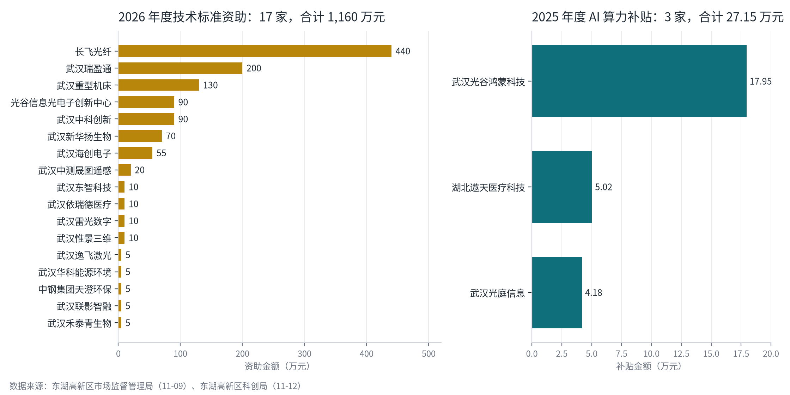

光谷这一周做的不是招商，是定价：给产业一个可跟踪的价格（指数）、给研发失败一个可承保的价格（共保体）、给「投早」一个可容亏的价格（科技金融特区）。三件事在 11 月 13 日同一天落地。

同一周里还有另一条线：四家上市公司的资本动作——回购注销、大股东定增补流、对外担保、现金分红——没有一笔是扩产。制度在替企业降低「敢不敢投」的成本，企业还在补「能不能扛」的现金流。这个时间差，是理解本周所有数字的钥匙。

## 本期要点

**1. 中证光谷指数、光电子信息共保体、科技金融「特区」在同一天落地，光谷第一次有了自己的价格、风险与资金刻度（11-13）。** 上午的科技保险投资生态大会上，中证光谷指数（代码 932776）发布，33 只注册地在东湖高新区的上市公司成为样本，开盘报 3358.41 点、开盘一小时成交超 93 亿元，编制方案以 2012 年 12 月 31 日为基日、1000 点为基点；原文点名长飞光纤、烽火通信、光迅科技、华工科技、联特科技、锐科激光、帝尔激光、华中数控、精测电子、达梦数据、高德红外、信科移动，并明确光谷正「积极谋划」配套 ETF。同场落地全国首个光电子信息产业共保体：人保财险牵头联合 9 家头部财险共 10 家，为 20 家链主提供财产、责任、研发、信用、人才、出海六大类定制保障，为 3 家湖北实验室定制科研仪器共享损失等专项，面向 111 家专精特新配套企业推出基础保费 2000~5000 元的普惠产品。同日下午，省政府新闻办发布会推出七部门联合印发的 12 条科技金融措施，在光谷构建科技金融「特区」：统筹不少于 200 亿元央行再贷款再贴现、三年力争科技贷款余额突破 2000 亿元惠及 1 万户以上、单个科创项目「先补后股」最高 300 万元、种子基金容亏 80%、天使基金容亏 50%、单个项目最高容亏 100%，并先行设立 10 亿元以上规模 S 基金。（[指数](https://www.wuhan.gov.cn/sy/whyw/202611/t20261114_2879848.shtml)｜[共保体](https://www.wuhan.gov.cn/sy/whyw/202611/t20261114_2879850.shtml)｜[12 条](https://www.wuhan.gov.cn/sy/whyw/202611/t20261114_2879851.shtml)）

这三件事互为条件，缺一件另两件都转不起来：没有指数，ETF 无处跟踪，被动资金不会来；没有共保体，光芯片研发失败的相关性风险只能留在企业报表里，险资不敢把光谷当资产类别配置；没有容亏条款，国资的考核约束让 200 亿元再贷款也流不到天使轮。所以真正值得记住的不是三个数字，而是它们被放在同一天发布——这是一次有设计的制度交付，而不是三次巧合。

**2. 长飞联合中国电信研究院、中兴通讯完成全球首次千公里空芯光纤双向实时传输，1007.48 公里刷新纪录（11-09 披露）。** 在 1007.48 公里空芯光纤链路上，实现扩展 C+L 波段单波 800Gb/s（PCS-16QAM 调制）单纤双向传输，总容量 128Tb/s，双向各 64Tb/s 同步传输，千公里单程传输 3.43 毫秒；比当前性能最好的实芯光纤容量提升一倍、传输距离提升 60%，比同类空芯光纤试验距离提升 50 倍，时延降低 30%。长飞首席科学家王瑞春的解释把机制说清楚了：光在石英玻璃里约 20 万公里/秒，在空气中接近真空的 30 万公里/秒，端到端时延自然更小；中国电信首席专家霍晓莉补上了工程意义——这次验证的是空芯光纤**可以复用现有传输设备**，从而形成长距离、大容量、低时延的传输能力，「为算力网的建设储备下关键的技术」。这项指标之所以重要，是因为它把「空芯光纤能长距离实用」从实验室判断变成了工程验证，而 AI 数据中心的跨中心组网，最缺的正是时延预算。（[区官网转央视](https://www.wehdz.gov.cn/2022/ggxw_68627/cydt_68630/202611/t20261109_2875994.shtml)）

**3. 国光量子 1 亿元华中研发总部落户光谷，带的是量子芯片中试线而不只是办公室（11-11）。** 湖北中科国光量子科技与光谷现代服务业园签约，投资约 1 亿元建设华中研发总部，布局量子芯片中试线、整机装配线以及区域运维、人才孵化，选址保利光谷中心。母体国光量子 2021 年由中科大博士团队创立，做的是光子集成量子芯片全栈方案；落地节奏很实——2026 年 2 月在光谷设全资子公司，6 月联合华中科技大学网络空间安全学院、湖北楚天智能技术揭牌两大量子联合实验室。企业给出的选址理由不是土地和税收，而是「光子集成量子芯片对上下游配套要求极高」加上光谷在芯片设计、化合物半导体、光器件、封装测试的完整链条，以及湖北作为电力、能源、化工大省提供的量子精密测量真实场景（高压设备带电巡检、电缆故障排查、储能电池安全预警）。1 亿元不算大钱，但中试线是稀缺资产：它决定这家企业后续能不能承接湖北 20 亿元省级量子科技产业投资基金的产业化项目。（[区官网](https://www.wehdz.gov.cn/2022/ggxw_68627/cydt_68630/202611/t20261111_2877903.shtml)）

**4. AI 算力补贴第一次发到名单上：3 家企业、27.15 万元，而条款写的是「最高 50%、单户 100 万元」（11-12）。** 区科创局公示的 2025 年人工智能算力补贴拟奖补名单只有三行：武汉光庭信息 4.18 万元、湖北遨天医疗 5.02 万元、武汉光谷鸿蒙科技 17.95 万元，合计 27.15 万元，公示至 11 月 18 日。条款本体在 10 月 13 日的申报通知里写得很清楚：对租用智能算力、云算力且年度算力使用费**首次**超过 10 万元的企业，分别按实际支付费用最高 50%、20% 支持，金额不超过 100 万元；算力调度平台以 Token 形式输出算力，最高 200 万元，但须自有可调度算力不少于 500P。名单之所以短，链条上有三个卡口：入口设在「年度算力使用费首次超过 10 万元」的那一年，此后年度要「保持增长」才可按同力度续享，早已跨过门槛的存量大户进不来；只能在 6 家经认定的服务商处采购；申报窗口只有 10 月 13 日到 20 日七天，且要备齐合同、发票、银行回单、算力使用明细四类凭证。与之对照，市级层面 11 月 10 日公布了算力券 22 家供给方（智谱华章、商汤、云从、百度、阿里云、腾讯云、华为云、金山云均在列），11 月 9 日又采购第三方审计，现场核查比例不低于 50%、对智算/超算/量子/Token 四类做价格审计——市级在管价格，区级才刚发出第一笔钱。（[公示](https://www.wehdz.gov.cn/2022/ggxw_68627/tz_68628/202611/t20261112_2879085.shtml)｜[审计采购](https://whsj.wuhan.gov.cn/tzgg_93641/202611/t20261109_2876173.shtml)）

**5. 特色产业园区一次认定 14 家、入库 13 家，湖北首批软件名园光谷占 5 家：载体从「空间」变成「身份」（11-13）。** 区发改局依据《东湖高新区特色产业园区认定和管理办法》公示 2026 年拟认定名单，流程要过运营主体申报、属地园区服务中心初审推荐、形式审查、现场核查、专家评审、联席会联合评审六道；认定 14 家分两类，生产制造型 6 家（光谷生物产业园→精准医疗、存算一体双创园→存算一体、武汉芯光产业园→存储器产业、高农生物园→生物农业、综保区移动终端配套产业园→智能终端、光谷新型显示产业研发生产基地一期→新型显示），研发办公型 8 家（龙山创新园→芯智融合、武汉金山软件园→软件信息、万企利科创中心→数字文创、东湖网谷产业园→数字经济、高科孵化器→光电科技孵化、光谷上市加速器→科技金融、光谷交通大厦→数字文化、金宇保税物流园→保税物流），另有 13 家进入创建培育库。同一周，湖北首批软件名园授牌，全省 11 家光谷占 5 家——武汉软件新城、武汉光谷软件园、光谷企业天地（AI Park）、光谷梦工场 4 号楼、湖北青创园（光谷）示范园，覆盖综合型园区、特色型园区、特色型楼宇和 OPC（一人公司）生态社区四类；一尧科技在现场签约入驻 AI Park 7 号独栋，做玻璃多维光存储。这类政策不给钱，给的是身份：冠名是后续申报上级园区、承载专项政策、招商时定位标签的凭证。（[特色园区](https://www.wehdz.gov.cn/2022/ggxw_68627/tz_68628/202611/t20261113_2879637.shtml)｜[软件名园](https://www.wehdz.gov.cn/2022/ggxw_68627/cydt_68630/202611/t20261113_2879195.shtml)）

## 资本与企业：制度在进攻，报表在防守

把本周的资本动作排在一起，方向非常一致。精测电子董事会 11 月 9 日通过 1~2 亿元回购方案，价格上限 210 元/股，**用途是全部注销并减少注册资本**，按上限测算约 952,380 股、占总股本 0.34%——注销减资不形成库存股，是永久性缩表，净利润不变时直接抬升每股收益。它同时在推进另一件事：以发行股份、可转债加现金的方式收购上海精测半导体 41.17% 少数股权，预计构成重大资产重组，但截至 11 月 14 日审计、评估、法律尽调都还没完成。「回购注销缩股本 + 可转债缓摊薄」，短期托住估值，中期换回资产完整性。（[2026-125](https://static.cninfo.com.cn/finalpage/2026-11-10/1225664304.PDF)｜[2026-128](https://static.cninfo.com.cn/finalpage/2026-11-14/1225670576.PDF)）

华灿光电是另一种写法：控股股东京东方以现金认购不超过 9.98 亿元、不超过 97,939,156 股，锁定 36 个月，扣除费用后**全部补充流动资金**——资产负债率三期分别是 45.23%、52.98%、56.69%，这笔钱用来修表不是用来扩产。光迅科技把半年度 3.06 亿元分红落地（每 10 股派 3.7 元，登记日 11 月 18 日）；三安光电为厦门三安集成担保 2.4 亿元，对外担保总额 112.47 亿元、占净资产 32.24%。加上精测的回购，四笔里三笔指向资产负债表。（[华灿 2026-091](https://static.cninfo.com.cn/finalpage/2026-11-10/1225664949.PDF)｜[光迅 (2026)069](https://static.cninfo.com.cn/finalpage/2026-11-11/1225665597.PDF)｜[三安 临 2026-099](https://static.cninfo.com.cn/finalpage/2026-11-14/1225670257.PDF)）

唯一带扩张意味的是光庭信息的三连击：2650 万元买下凤凰园三路的房屋、设备与土地（关联交易，理由直接写「落实『人工智能+汽车软件』战略」），5000 万元增资全资投资平台，再以 2000 万元做 LP 认购武汉首义广济天使基金 38.46% 的首期份额。值得注意的是基金注册地与投资方向在武昌区，GP 是武昌区国资（持股 65%）——光谷上市公司的产业基金，并没有绑定在本区。（[2026-054](https://static.cninfo.com.cn/finalpage/2026-11-12/1225667417.PDF)）

一级市场仍然没有声音。窗口内区政务网产业动态、光谷要闻、通知公告与市政府「武汉动态」逐条翻过，没有一条天使/A/B/C 轮融资稿，最近一条同类稿停在 10 月 15 日——这已经是连续第三期空白。更可能的解释是渠道迁移而非没有交易：区网已不再是融资信息的主要出口。**本周的资本供给由制度工具承担，而不是市场化 VC 定价。**

两条容易写错的，先说清楚。「21 家集成电路企业集中签约落户」在**洪山区**的环大学创新发展带，不在光谷——原文的表述是洪山「繁芯计划」定位为「光谷链主企业上下游配套制造基地」，8 月 22 日那批 17 家才落户光谷；这 21 家不能计入光谷的项目统计。而 11 月 9 日区官网那篇华科企业家大会（第十八届）报道，事件发生在 11 月 7 日，是上周的滞后披露，本期只取它新增的可核项：市人才工作局发布「校友聚汉全城礼遇服务平台」、华科大五大研究院推介、企业家协会机器人与智能制造分会成立。（[洪山 21 家](https://www.wuhan.gov.cn/sy/whyw/202611/t20261109_2875959.shtml)）

产业项目的政府侧动作是督进度而非新开工。11 月 6 日省长李殿勋调研奕斯伟硅材料基地、光谷存算一体产业园、华大智造（11 月 9 日披露），对存算一体产业园的要求被概括成四个方向：存算一体化、研发国际化、资产证券化和产业生态化，并要「以超常举措加快建设世界级存算一体产业基地」。把「资产证券化」写进省级要求，与三天后中证光谷指数的发布，是同一条思路的两个截面。（[区官网](https://www.wehdz.gov.cn/2022/ggxw_68627/ggxw_68629/202611/t20261109_2875984.shtml)）

## 政策与人才：本周的关键词是「公示」，不是「发文」

窗内六件实质文件里，四件是公示或评审结果，只有一件新开申报通道。所有公示的异议窗口都只有 5 到 7 天：算力补贴 11-12 至 11-18、技术标准资助 11-09 至 11-13、特色园区 11-13 至 11-19、生物医药示范园 11-11 至 11-17。**看到公示的当周就得决定要不要提异议，跨周即失效。**

两笔「发钱」的名单放在一起看，落差很直白。技术标准资助 17 家企业、合计 1160 万元，长飞光纤一家 440 万元、占 37.9%，瑞盈通 200 万元、武汉重型机床 130 万元，其余多在 5 到 90 万元之间——这是「成果已发生才兑现」的事后奖励，金额阶梯对应标准层级与主导程度。AI 算力补贴是 3 家、27.15 万元。两者相差约 42.7 倍，但不是同一条政策线（一个是 2026 年度的标准化奖励，一个是 2025 年度的算力使用费补贴），能比的只有量级：**光谷的产业资金仍主要流向已经跑熟的标准化与制造升级，AI 算力这类新工具还在试第一年。**

*图 1：本周两份政策兑现名单的金额对比（万元）。技术标准资助 17 家、合计 1160 万元；AI 算力补贴 3 家、合计 27.15 万元。数据来源：东湖高新区市场监督管理局《2026年度技术标准资助项目资助企业名单及资金的公示》（11-09）、区科创局《2025年人工智能算力补贴的公示》（11-12）。*

人工智能这条线上，钱则以另一种形式出现。市科创局 11 月 12 日公示 2026 年人工智能 OPC 生态社区绩效评价拟支持名单，8 家合计 1800 万元，其中唯一可确认落在光谷的是华中科技大学科技园（武汉华工大学科技园发展有限公司）300 万元。机制是「补载体不补个人」——不直接补贴一人公司，而是按社区的服务绩效给钱，由载体去承载「一人公司 + 智能体」这种新组织形态；这与区级把湖北青创园（光谷）示范园作为 OPC 生态社区送进省级软件名园，正好是一套组合：省级给名分、市级给绩效资金、区级给空间。（[市科创局](https://kjj.wuhan.gov.cn/wmfw/tzgg/gsxx/202611/t20261112_2878285.html)）

申报窗口有三个正在走或即将开：第九批湖北省专精特新 11 月 23 日至 29 日线上申报（工信部梯度培育平台），区级纸质材料 11 月 30 日 12:00 前，系统按填报自动算分、**首次填报即锁定得分上限**、得分不低于 50 才达标，2025 年度审计报告须是财政部统一监管平台赋码版；独角兽培育申报区级已于 11 月 13 日收口（市级口径上周记为 11-16，本期按区转发件更正为 11-13，市级原文未取得）；省工业软件券兑付要求合同期在 2026 年 1 月 1 日至 10 月 31 日之间、执行完毕并开具全额发票，市州经信局 11 月 20 日 17:30 前汇总上报。

人才这条线本周是空窗，不是漏报。3551 光谷人才计划、光博 300、优秀青年人才认定在窗口内零条目——区政务网通知公告翻到第 12 页（覆盖 2026 年 6 月起），「3551」只命中三条且全部在窗外。落地的只有两个正在关闭的职称窗口：区工程技术职称评前公示（11-09 至 11-13，发文主体是区里的高级职称评审委员会办公室，说明光谷拥有工程系列高级职称自主评审权）；市专精特新企业工程系列副高职称，个人网上填报 11 月 10 日至 14 日已关、纸质受理 11 月 16 日至 21 日。引才计划静默的时候，岗位供给由项目自己承担——省「专精特新」线上招聘专场 57 家企业 1766 个岗位，国光量子则把「人才孵化」直接写进了华中研发总部的四项布局。

## 土地、营商与城建：营富强、城建空、工业地仍无终态

土地这周只开了一扇窗。81 号公告的 3 宗工业地（合计约 14.59 万平方米）连续第二期拿不到终态：本期新试的湖北省公共资源交易电子服务系统成交公示库拉了 500 条（时间跨度 2026-06-03 至 11-16），东湖高新区「工DK」系列 14 条里没有这三宗，更关键的是该库「武工告字」最新只到 79 号、81 号公告本身不在库内——**这只能证明「该库没有」，不能证明「未成交」**。所以关于 81 号，本期一个字都不写成交。另有五个入口同样落空（whtdsc 交易接口 401、详情页 500、市局出让公告栏止于 9 月 15 日、东湖分局转让公示止于 10 月 23 日、中国土地市场网 WAF 拦截）。

经营性用地倒是有终态：11 月 13 日，P(2026)133 号（关山大道以西、珞喻路以南，汽发社区片）成交 14.854 亿元，受让人武汉致徽房地产开发有限公司。按上期起始价 9.154 亿元的口径推算，溢价约 62%、成交楼面约 1.65 万元/平方米——这是推算，起始价本期未在原始公告复核。

营商是强周，四件事都在 11 月 10 日至 13 日：三件套、企业座谈会、生物医药示范园 4 家获评、两张申报与补贴公告。11 月 10 日的座谈会请了 9 家企业与商会——帝尔激光、吉奥时空、立得空间、恒立钻具、高德红外、小米之家、特斯拉、长江科服、武汉互联网产业商会，市委常委、党工委书记沈悦主持，逐项研究解决办法，会上提出的要求是「有呼必应、无事不扰」与对标一流营商环境。会上透出的两条经营口径值得记下：帝尔激光在「稳步推进港股上市」，高德红外营收及利润创历史新高（企业口径，未独立核实）。

城建则是彻底的空窗。地铁 11 号线、13 号线，光谷长江大桥，光谷空轨，武鄂黄黄与市「十五五」交通规划里的光谷项目，以及医院、学校、文体设施、人才公寓，窗口内可核节点为零；能看到的最新节点都在窗外（10 月 14 日光谷智能终端产业园开工、10 月 10 日高端微电子器件产业园一期建成）。核验范围是市交通局政务动态 11 月 9 日至 15 日全量 20 条、市政府「武汉动态」全量约 40 条、区三栏全量。

## 三专项雷达：Agent 在车间和制度里，大模型没有模型周，具身定了路线

**AI Agent：本周没有一家光谷企业发布产品。** 真增量在两个非典型位置。一是武汉经开区一家铜合金厂的「AI 读单员」——把工业大模型做成非标订单解析智能体，单份订单处理从 1.5 小时压到 1 分钟内、效率 90 倍、提取准确率 100%、图纸识别超 95%，入选 2025 年全国中小企业人工智能典型应用场景；价值不在模型能力，而在把老师傅读图、拆 BOM、核价的判断变成可复用的字段规则（这家在经开区，不计入光谷）。二是前面说的 AI OPC 社区 1800 万元——这是本周唯一直接以「一人公司 + 智能体」为对象的财政工具。光谷侧的动作停在载体与场景：光庭把「人工智能+汽车软件」写进 2650 万元资产购买的理由；灏存科技（机器人动作数据采集与运动控制）、巨量引擎（数字营销与推荐算法）、一尧科技（玻璃多维光存储）以 AI Park 入驻团队的身份被官方点名。需要说清的是，本周没有任何一条公开信息能证明某家光谷企业的 Agent 产品签约了客户或产生了收入。

**大模型：没有模型周，只有算力账。** 窗口内无模型发布、无版本迭代、无新增生成式 AI 备案。可核的增量全在政策侧面：智谱华章、商汤、云从、百度这批模型公司进入了武汉算力券 22 家供给方名单——算力券的钱补给需求方，需求方只能在名单内消费，于是「进名单」等于获得被财政补贴的需求侧流量，而审计公告把「词元 Token 服务」单列为比价对象，说明官方已承认「算力+模型」打包计价的形态。另一条是本地算力支出的第一次公开量化：光庭、遨天医疗、光谷鸿蒙三家分别拿到 4.18、5.02、17.95 万元补贴，金额虽小，但把「谁在用量、量级多少」变成了可追踪的名单。

**具身智能：定的是路线，不是产品。** 11 月 14 日省委省政府在华中科技大学办第二场科创沙龙，专场聚焦具身智能；11 月 15 日成文，标题就是结论——《具身智能新赛道，武汉不拼整机做专才》。武汉选择不在整机竞赛里硬拼，而是在精密零部件配套、数据服务与细分场景中做专才。上周「零部件层无窗内新增」的缺口，这周以另一种方式补上了：报道首次系统点名华威科（为灵巧手提供毫米级触觉感知电子皮肤，国内市占率超过 70%，「一片羽毛落在掌心也能即时感知」）、华中数控（多轴运动控制器，多关节毫秒级协同与力矩闭环）、诚芯智联（全身运动闭环调度，适配室内与地下复杂工况），并给出「光谷企业占关键环节超七成」的表述。更值得记的是对湖北人形机器人创新中心价值的重述——「核心价值其实不是造机器人，而是产数据」：自动驾驶头部企业有百亿小时量级数据，具身机器人的训练数据只在几十万小时量级，相差上万倍；武汉的口径是到 2028 年累计建成行业高质量数据集 200 个以上。上期说「数据层静默」，这周才看清：它本来就不以产品发布的形式出现。（[长江日报](https://www.wuhan.gov.cn/sy/whyw/202611/t20261115_2879888.shtml)）

## 本周 vs 上周

| 主线 | 上周（第 23 期） | 本周（第 24 期） | 走向 |
|---|---|---|---|
| 资本定价 | 中信科移动 70 亿元定增用途明细；三只种子基金签意向 | 中证光谷指数 932776、光电子共保体、科技金融「特区」同日落地 | 新出现 |
| 企业资本动作 | 70 亿元定增（扩张）、种子基金（意向） | 回购注销 1~2 亿元、定增 9.98 亿元全补流、担保 2.4 亿元、分红 3.06 亿元 | 转向（扩张→修复） |
| AI 算力制度 | 算力券 22 家供给方公示、委托第三方审计 | 22 家正式公告、审计细则落地、区级首年兑现 3 家 27.15 万元 | 延续（进入兑现） |
| 光通信 | 9M 三季报：长飞归母 +1204.63%、光迅 +78.65% | 空芯光纤 1007.48 公里世界纪录；光迅分红落地 | 延续（从利润到技术） |
| 半导体与存储 | 泛半导体园 6 项目 + 10 亿元基金「满园」 | 洪山 21 家签约（非光谷）；省长督存算一体园；存算一体双创园获授牌 | 外溢（项目落到区外） |
| 载体认定 | 泛半导体园满园；鸿蒙生态产业园选址 | 特色园区 14+13；省级软件名园 5 家；AI OPC 社区 1800 万元 | 新出现（名单化） |
| 具身 | 晴山进服务区/武商、中科预售 100 余台、创现海外 10 万台 | 省级沙龙定调「不拼整机做专才」；零部件层首次点名 | 延续（从订单到路线） |
| 人才 | AI 光博 300 首批 102 名博士签约 | 空窗：3551、光博 300、优秀青年人才零条目 | 降温 |
| 土地 | 81 号 3 宗工业地挂牌、结果未出 | 81 号仍无终态；P(2026)133 成交 14.854 亿元 | 新出现（另开一线） |
| 鸿蒙 | 办公峰会（企业版 + 台式机 + 伙伴计划 2.0） | 无增量；奖补申报通知仍未取得 | 降温 |

上周看的是「生态有没有闭环」，本周换成「资本愿不愿意给光谷定价」。迁移的落点很清楚：从产业叙事转向资本叙事，从「谁签了项目」转向「谁能定价格」。但同一张表里有两处反向信号——人才计划静默、城建零节点——提醒这条转向还没走完：制度工具已经就位，人和空间还没跟上。

## 对你意味着什么

> 以下为编辑建议，均可由本期事实推导。

**如果你是招商或产业从业者**：本周最好用的不是补贴，是共保体。111 家专精特新配套企业的基础保费 2000~5000 元，叠加企业最高 80% 的保费补贴，实际自付可低至数百元，这是唯一不需要等子基金设立、当月就能签单的金融工具。谈判桌上还可以多用两张牌：14 家特色产业园区的授牌名本身就是一张产业空间地图（存算一体、存储器、新型显示、软件信息、数字文创、科技金融、保税物流），按企业属性直接对位；「入指」也可以作为隐性对价——72 家上市公司里 33 只入样，剩下 39 家有预期空间。

**如果你是本地 AI 或软件企业**：算力补贴的口子是真的，但要按三个前提准备——年度算力使用费首次超过 10 万元（此后须逐年保持增长才可续享）、必须在 6 家认定服务商处采购、申报窗口只有 7 天且四类凭证要互相对齐。2026 年度若沿用同一细则，现在就该把合同、发票、银行回单、使用明细按月归档。另一条更轻的路是载体：AI OPC 社区与省级软件名园都在扩容，落在「名园内」开始有政策含义（项目、人才倾斜随载体走）。

**如果你在做早期项目**：容亏 80% 是本周最实质的一句话——它把国资 LP 的尽职免责写进制度，直接提高国资基金的风险偏好。但工具已出、产品未出：窗口内没有任何子基金设立公告，先补后股（单项目最高 300 万元）也要等项目库落地。真正能马上用的仍是共保体与银行端的科技贷款（三年 2000 亿元、1 万户，户均约 2000 万元，指向成长期）。

**如果你是投资人**：区域 beta 与个股 alpha 第一次可以分开看了，但要注意两点——指数本身不带资金，ETF 获批前它只是标尺；且样本高度集中于光电子信息一条主赛道，波动率会高于综合指数。本周企业侧的四个动作（回购注销、定增补流、担保、分红）说明管理层普遍认为当前该修表而不是扩产，这与制度端的进取形成时间差，机会可能出现在这个差里。

## 来源

- **武汉市人民政府（武汉动态，均长江日报稿）**：[中证光谷指数发布](https://www.wuhan.gov.cn/sy/whyw/202611/t20261114_2879848.shtml)（11-14）｜[光电子信息产业共保体落地](https://www.wuhan.gov.cn/sy/whyw/202611/t20261114_2879850.shtml)（11-14）｜[湖北 12 条科技金融、光谷「特区」](https://www.wuhan.gov.cn/sy/whyw/202611/t20261114_2879851.shtml)（11-14）｜[具身智能不拼整机做专才](https://www.wuhan.gov.cn/sy/whyw/202611/t20261115_2879888.shtml)（11-15）｜[21 家集成电路签约落户洪山](https://www.wuhan.gov.cn/sy/whyw/202611/t20261109_2875959.shtml)（11-09）
- **东湖高新区政务网**：[2025 年人工智能算力补贴公示](https://www.wehdz.gov.cn/2022/ggxw_68627/tz_68628/202611/t20261112_2879085.shtml)（11-12）｜[2026 年度技术标准资助公示](https://www.wehdz.gov.cn/2022/ggxw_68627/tz_68628/202611/t20261109_2876118.shtml)（11-09）｜[特色产业园区拟认定名单](https://www.wehdz.gov.cn/2022/ggxw_68627/tz_68628/202611/t20261113_2879637.shtml)（11-13）｜[第九批专精特新认定](https://www.wehdz.gov.cn/2022/ggxw_68627/tz_68628/202611/t20261112_2878733.shtml)（11-12）｜[独角兽培育申报转发](https://www.wehdz.gov.cn/2022/ggxw_68627/tz_68628/202611/t20261109_2876572.shtml)（11-09）｜[湖北首批软件名园光谷 5 家](https://www.wehdz.gov.cn/2022/ggxw_68627/cydt_68630/202611/t20261113_2879195.shtml)（11-13）｜[千公里空芯光纤双向实时传输](https://www.wehdz.gov.cn/2022/ggxw_68627/cydt_68630/202611/t20261109_2875994.shtml)（11-09）｜[国光量子华中研发总部](https://www.wehdz.gov.cn/2022/ggxw_68627/cydt_68630/202611/t20261111_2877903.shtml)（11-11）｜[企业座谈会](https://www.wehdz.gov.cn/2022/ggxw_68627/ggxw_68629/202611/t20261111_2878040.shtml)（11-11）｜[省长调研重大产业项目](https://www.wehdz.gov.cn/2022/ggxw_68627/ggxw_68629/202611/t20261109_2875984.shtml)（11-09）｜[生物医药示范园区评审结果](https://www.wehdz.gov.cn/2022/ggxw_68627/tz_68628/202611/t20261111_2878052.shtml)（11-11）
- **市直与省直**：[市数据局算力券供给方遴选结果](https://whsj.wuhan.gov.cn/tzgg_93641/202611/t20261110_2877414.shtml)（11-10）｜[算力券发放审计采购](https://whsj.wuhan.gov.cn/tzgg_93641/202611/t20261109_2876173.shtml)（11-09）｜[市科创局 AI OPC 生态社区绩效评价](https://kjj.wuhan.gov.cn/wmfw/tzgg/gsxx/202611/t20261112_2878285.html)（11-12）｜[市经信局第九批创新型中小企业](https://jxj.wuhan.gov.cn/xwzx_9/tztg/202611/t20261109_2875976.html)（11-09）｜[省经信厅工业软件券兑付](https://jxt.hubei.gov.cn/fbjd/zc/qtzdgkwj/gwfb/202611/t20261113_6085318.shtml)（11-12）
- **上市公司公告**：[精测电子 2026-125 回购方案](https://static.cninfo.com.cn/finalpage/2026-11-10/1225664304.PDF)（11-10）｜[精测电子 2026-128 重组进展](https://static.cninfo.com.cn/finalpage/2026-11-14/1225670576.PDF)（11-14）｜[华灿光电 2026-091](https://static.cninfo.com.cn/finalpage/2026-11-10/1225664949.PDF)（11-10）｜[光庭信息 2026-054](https://static.cninfo.com.cn/finalpage/2026-11-12/1225667417.PDF)（11-12）｜[光迅科技 (2026)069](https://static.cninfo.com.cn/finalpage/2026-11-11/1225665597.PDF)（11-11）｜[三安光电 临 2026-099](https://static.cninfo.com.cn/finalpage/2026-11-14/1225670257.PDF)（11-14）
- **说明**：本期窗口为 2026-11-09 00:00 至 2026-11-16 00:00（Asia/Shanghai）。算力补贴的条款、服务商名单（9-24）与申报通知（10-13）均发布于窗外，文中仅作机制背景引用；P(2026)133 号成交的溢价比率为按上期起始价推算，非原始公告口径；81 号 3 宗工业地本期仍未取得成交终态，文中未作任何成交量表述。
