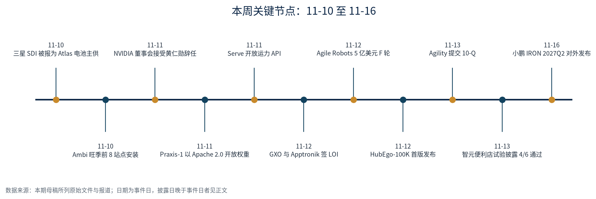
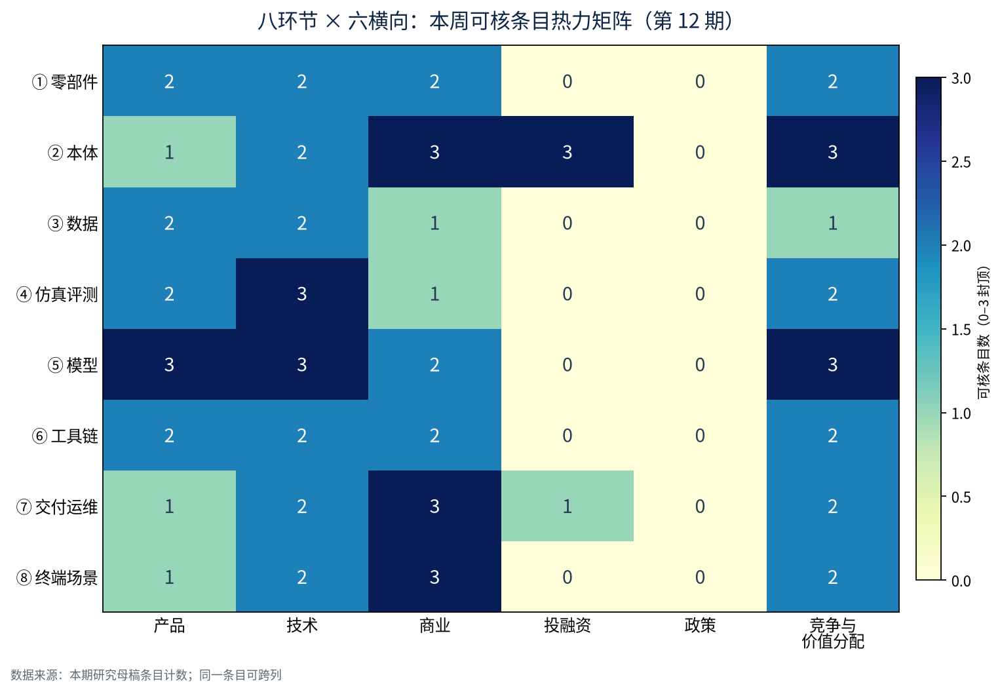
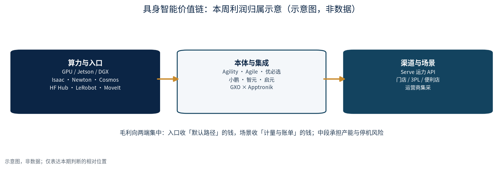

本周同时发生了两件方向相反的事：模型与数据在加速开放，而模型社区与机器人中间件这些「入口」在被算力厂商收购。当权重变成公共品，价值就迁移到「谁维护默认路径」；偏偏这条路径的最大买家，本周进入治理空窗。

开放侧的证据很硬：Runway 用 Apache 2.0 放出 27B 世界动作模型 Praxis-1，RoboLab-120 成功率 46.2%，高于 π0.5 的 28.0%；Hugging Face 以 CC-BY-4.0 放出首版 10,124 小时第一视角数据；Newton v1.8.0 把接触求解做成可复现的开源路径。集中侧同样清楚：Hugging Face 待并入 NVIDIA（约 129 亿美元，2027 年上半年交割）、MoveIt 维护方 PickNik 已被 Qualcomm 宣布收购（待交割）、NVIDIA 董事会 11 月 11 日接受黄仁勋辞任。下游则第一次把 RaaS 写成可审计的合同与报表——GXO 签下 4 年最多 1,000 台的 LOI，Serve 把运力做成按次计价的 API，Agility 的三季报显示 9 个月收入 36.1 万美元、净亏 4.587 亿美元。

## 本期要点

**一、NVIDIA 在发布新一代机器人栈不到一周后换掉 CEO，关键人风险第一次进入物理 AI 的定价。** 11 月 11 日，董事会接受黄仁勋辞去总裁、CEO 与董事职务，立即生效；执行副总裁兼 CFO Colette Kress 兼任临时 CEO，同时继续担任 CFO，董事会启动内外部同时考虑的正式 CEO 搜寻；Harvey Jones 出任公司史上首任董事长。8-K 只走 Item 5.02，新闻稿不写原因，但明确「产品路线图不中断」「客户承诺不变」，并确认 Q3 FY2027 财报仍按原计划在 11 月 17 日发布。The Robot Report 同日给出了另一面：辞职前一周股价跌约 18.5%，黄在 11 月 8 日声明中承认婚外情，并称董事会已就「新闻报道中的国家安全关切」启动独立调查、本人将配合；报道还称与 Hugging Face 的 129 亿美元交易将受更严审查，AMD、Qualcomm、Arm、Intel 可能以「更可靠的西方供应商」定位抢位。公司文件与媒体叙述要分开看——辞职与人事安排是可核事实，原因与股价是单篇报道——但对产业链的影响路径是真实的：算力供给、软件版本节奏、开源治理、CVC 投资，四条管道都会经过这次治理变更。

**二、GXO 把「1,000 台人形」写成 LOI 与 KPI 门控，而不是采购订单。** 11 月 12 日，全球最大纯合同物流商 GXO 与 Apptronik 签署意向书：扩大 Apollo 在真实仓库的联合试验，覆盖 goods-to-person 与 person-to-goods 拣选、箱与周转箱搬运、打包、分拣；2027 年起按双方约定的生产力、安全与运营 KPI 逐项验证并排序；在达标前提下，计划未来四年全球推广最多 1,000 台，2027 年底先从北美开始，商业框架预计为 RaaS。这不是订单，而是一份可审计的采购模板：先定 KPI、再按用例排序、最后转服务合同，资产与停机风险留在本体厂，GXO 保留按站点扩展的弹性。对同行 3PL，它给出了参照结构；对本体厂，它意味着先垫资、后按服务收费。

**三、Agile Robots 以 85 亿美元投后估值完成 5 亿美元 F 轮，四类股东各买一层。** 11 月 12 日，思灵（Agile Robots）宣布 5 亿美元 F 轮、投后 85 亿美元、累计融资 20 亿美元；软银集团领投，NVIDIA、日立（含 Hitachi Ventures）、T.Capital 参投。钱用于美国扩张与德国产能：慕尼黑附近 Fürstenfeldbruck 基地 2026 年初启用，设计年产最多 1 万台足式与轮式人形；公司累计部署 2 万台工业机器人、3,500 名员工、650 多项专利，子公司含 Franka Robotics 与收购自蒂森克虏伯的 Krause Automation。四类股东分别对应资本、算力、制造与渠道、欧洲运营商场景——任何一方都不足以单独撑起 85 亿美元，合起来才构成「可交付的工业物理 AI」叙事。对照 Agility 约 27.8 亿美元市值与 9 个月 36.1 万美元收入，一级与二级对「人形」的出价逻辑已经分叉：有工业装机与集成收入的贵得有理，没有收入的贵得靠稀缺性。

**四、Agility 的三季报把 RaaS 的会计真相摊开：收入要等机器人跑起来才确认。** 11 月 13 日提交的 10-Q 显示，2026 年前 9 个月净销售 36.1 万美元（上年同期 173.9 万，下降 79%），销货成本 578.3 万美元、毛利为负 542.2 万美元，SG&A 1.947 亿美元（增 468%）、研发 2.447 亿美元（增 292%），经营亏损 4.449 亿美元、净亏损 4.587 亿美元。交割净募资 3.341 亿美元，总股本 242,089,880 股。MD&A 明确写清 deployment 模式：公司保留机器人所有权，按合同服务期匀速确认收入，机器人预计 5 年可用寿命；另一条线是整机销售，控制权转移、客户验收后时点确认。这套会计的含义是：资本开支留在自己表内，收入要等机器人可运行之后才开始摊，所以「订单簿」与「收入表」会长期背离。按 9 个月经营亏损的速度，3.341 亿美元净募资约覆盖 7 个月经营亏损（本刊估算，未计资本开支）——扩张速度受现金而非订单约束。

**五、Runway 把 27B 世界动作模型开源，模型层的价格锚被重新设定。** 11 月 11 日，Runway 发布 Praxis-1 并以 Apache 2.0 开放权重、推理与微调代码，支持全参微调与 LoRA、允许商用；模型是 27B 参数的 MoE 扩散 Transformer，同时预测视频与动作，训练全程保留视频预测目标。官方口径：RoboLab-120（1,200 条 episode）成功率 46.2%，对比 FLUX 3 Action 42.9%、Cosmos3 Nano 36.8%、π0.5 28.0%，总榜第五；在 Noble Machines 的码木板任务上，半小时示例学会、15 次全对，换成未见过的杂乱堆，10 次清空 6 次；微调 RT-1 后在 SimplerEnv 达到 80.0%，原 RT-1 为 52.4%。它可跑 H100/B200、RTX 5090/RTX PRO 6000 与 Jetson Thor，分发含 GitHub、Hugging Face（原生 LeRobot 支持）与 vLLM-Omni。对采购方，世界动作模型第一次可以「自托管 + 可 LoRA + 可复现评测」，闭源 API 出现了替代，比较维度从模型能力转向推理成本与适配工时。

*图 1：本周关键节点（事件日）。数据来源：本期母稿所列原始文件与报道；披露日晚于事件日者已在正文标注。*

## 开放的一侧：权重、数据、引擎同时降价

**当模型、数据与引擎同时开源，稀缺的就不再是能力，而是失败数据与部署调试。**

数据层本周出现了一个规模跳变。Hugging Face 上 `HubLabs/HubEgo-100K` 首版放出 10,124 小时第一人称熟练劳动视频，12,227 名贡献者，RGB 与 IMU 同步，LeRobot 与 MCAP 双格式，CC-BY-4.0 许可。它的意义不在「又多了一个数据集」，而在格式：直接对齐主流训练栈，不需要自写 loader，MCAP 又保留原始多模态时序——一次采集可以同时用于策略、世界模型与状态估计。这会抬高「人类视频预训练」的公共基线，也让靠独家第一视角数据讲故事的数据商议价空间变窄。

数据管线本身也在标准化。Memories.ai 用模块化相机与统一采集流程消除设备与机位差异，再用两个模型分工标注——Memories-H0 标手部位姿、EgoAction 做动作分段——最后用 Cosmos 解读进入数据湖，后训练成客户任务模型。Rhoda AI 则把「预测下一帧」直接放进策略：以视频帧历史、action token 与 language token 为上下文，预测未来约 0.5 秒的视频，再由 action converter 转成动作，执行后重新观测、重新预测；预训练用互联网级视频，后训练每个任务只要 10 到 20 小时。代价是每 0.5 秒一次视频生成的推理成本，这也是为什么「推理调度」开始变成独立指标。

仿真层的进展更像基础设施。Newton v1.8.0 在 11 月 11 日打 tag、12 日更新日志，新增实验性 `SolverSteel`：把 Featherstone 铰接体动力学与投影 Gauss-Seidel 接触、Coulomb 摩擦放在同一个迭代里，矩阵无关，CPU 与 CUDA 都能跑；`deterministic=RUN_TO_RUN` 固定约束行顺序，同构建下可做到 bitwise 一致，并支持 CUDA graph 捕获。工程含义是显存随接触数而不是自由度平方增长，单卡能跑数千并行 world；确定性则让仿真可以进训练回路做回归，而不只是生成数据。需要注意版本错位：Isaac Lab 3.0.0 的目标是 Newton 1.6.1，而 Newton 已到 1.8.0，采用新求解器要自行对齐。

模型侧的本周信号是「后训练取代预训练成为差异化环节」。大晓的 ACE-CaP-0 在 8 项精细真机任务上做了 240 次评测、成功 221 次（92.1%），7 项超过 90%、插充电器 100%，平均执行时间从小时级压到 1 分钟内。机制不是更大的模型，而是把技能开发当成资源调度：agent 在真实执行中失败后先判断缺口——「不知道怎么动」就请求人类示范，「不知道边界」就开仿真批量试——结果回灌成代码策略，真机验证后固化为可复用 Skill。冻结为代码而不是蒸馏进权重，对工业客户更可审计，也意味着部分价值从权重转移到技能库与调度器。同一周的 arXiv 上，Agentic-Teacher 做失败驱动的数据引擎、ESI 把模块化 agent 整体作为后训练单元、TouchTwin 量化了「力缺口」（纯位姿模仿只使出记录力的 0.31 倍，物理回放可达 1.55 倍）、XInfer 把「一张卡带几台机器人」做成指标（有效机器人容量为 SOTA 的 1.26 到 3.75 倍）——方向一致：谁能在真实失败上高效生成监督，谁掌握边际能力。

## 集中的一侧：入口被买走，买家在换帅

**被收购的不是技术，是默认路径；而默认路径的价值，取决于运营它的公司有多稳定。**

NVIDIA 收购 Hugging Face 的条款写在事件日为 9 月 2 日的 8-K 里：约 119 亿美元购买价付给股东（可调整），外加最多约 10 亿美元的员工股权保留计划，合计约 129 亿美元；预计 2027 年上半年交割，条件是包括监管批准在内的惯常条件。同一份文件写入了承诺：保持平台开放，继续允许模型方、开发者与用户上传下载自选模型与数据集，并支持其他芯片厂商。Hugging Face 首页标着「2M+ models」，它同时维护 LeRobot——上期刚发布 v0.7.0，本期没有新版本。买下这个位置，等于买下开发者默认从哪找模型、默认在谁的芯片上跑训练与推理。

同样的模式在另外两家身上已经发生过。Qualcomm 在 9 月宣布收购 MoveIt 与 MoveIt Pro 的维护方 PickNik（交割待惯常条件），承诺 MoveIt 1 与 2 继续以现有许可证开源、继续支持第三方硬件，并与 Dragonwing、Arduino VENTUNO Q 集成；同一篇报道还提到 SoftBank 拟收购 Robotics and AI Institute（报道口径）、Google Intrinsic 发布 ROS 兼容能力。开放承诺的措辞越具体，越说明它是对价的一部分——用来换监管批准与社区不迁移。

然后是本期的变量：11 月 11 日，NVIDIA 董事会接受黄仁勋辞任，CFO 兼任临时 CEO，首设董事长，启动正式搜寻。三条治理事实值得记住：辞职而非解职，8-K 只走 Item 5.02、没有触发 Item 8.01 或新增风险因素；CEO 与 CFO 由同一人兼任，是典型的过渡期安排，避免两套口径；首设董事长且由独立身份的人担任，让调查与继任程序由董事会而非管理层主导。这不能读成「公司承认丑闻」，但也不能忽略：如果入口的价值来自默认路径的稳定性，那么入口买家的治理稳定性就是入口价值的一部分。模型开源降低了切换成本，入口集中却提高了单点治理风险的杠杆。

替代是存在的，只是还接不住「默认值」。Qualcomm 的 Dragonwing 加 MoveIt 覆盖边缘算力与规划中间件，但机器人出货基数远小于 Jetson；AMD、Intel、Arm 的硬件可用，机器人软件栈弱于 CUDA 与 Isaac；ROS 2 与 OSRA 跨硬件、跨厂商，工程化与支持偏弱；开放权重模型本周明显加速；中国开源栈单点可用，生态与数据规模仍小，且本周没有国家级新发布（政策空窗）。所以短期改变的是风险溢价，不是份额。

## 合同的一侧：RaaS 的三种写法

**三种合同指向同一条会计规则：收入确认的起点是「机器人可运行」，不是「签约」。**

第一种是 KPI 门控的项目制。GXO 的 LOI 不承诺采购量，把安全、安保与技术验收放在 2027 年，按用例排序，达标后才转 RaaS 服务合同。这套结构把「人形进 3PL」拆成可审计的阶段门，适合高货值、多工位、需要安全认证的场景。

第二种是按次计价的运力 API。Serve Robotics 在 11 月 11 日上线开发者门户，官方文档写明三个调用：Quote 传入取送点、返回美分计价与 ETA，不锁资源也不扣费；Create 用 quote_id 转成真实任务；Track 轮询到送达完成，可取规划路线。约束写得比宣传更清楚——报价 5 分钟过期且只能用一次，复用会返回 409；`couriers_busy` 属正常态，需要接入方自己决定重试、排队还是换渠道；重试必须带幂等键；限流 600 次/分钟；真实调度需要服务区、生产 key 与共享机队访问权，签约不是自助。这把机器人运力抽象成云服务：接入方只买结果，调度、路径与远程监督留在 Serve 侧。适合标准化、低货值、短距的场景。

第三种是自营场景先行的整机路径。小鹏在 11 月 16 日的 Q3 电话会上说，2027 年一季度首批量产 IRON 进入小鹏部分门店试用，二季度面向外部商业客户正式发布，科技日与广州车展将亮相新版本。门店既是零获客成本的验证场，也是首批交付客户与展示厅；这是管理层目标，不是交付数字，但它给供应链提供了一个可以被招标引用的时点。

三种写法之外，还有一组必须打折看的数字。优必选 11 月 11 日与永达汽车签约，永达采购 400 台 U1 Pro、年内交付，按 16.98 万元/台计超过 6,700 万元，首批用于体验、销售与客服，并计划在上海共建体验中心；永达有 203 个网点、豪华品牌占 59.1%。但公司此前称全渠道订单 13,361 台，8 月底又把年内实际交付下调到 1,500 到 2,000 台，U1 Pro 从 9 月 16 日延到 11 月 30 日才有货。渠道可以复制，履约不能复制——这是本周最清楚的「订单不等于收入」案例。

## 部件与场景：本周真正在动的地方

**约束从「关节」移到「能量包」与「足底触觉」，而场景排序第一次可以由连续运行小时数与失败率决定。**

电池正在变成整车级供应链。三星 SDI 被报为 Atlas 初期主供，70 节 2170 电芯、单节 5,000mAh、成包约 1.3kWh；LG 新能源是二供，但产能受限，初期份额让给三星。Atlas 计划 2028 年或之后量产，现代把 Atlas 相关业务交给现代摩比斯承接 pack 与系统集成。按 3.6V 标称反推，70 节 5Ah 约 1.26kWh，与 1.3kWh 吻合；1.3kWh 支撑约 4 小时，对应整机平均功耗约 325 瓦（本刊估算，非厂商数据）。另一条路是标准化：京东京造与欣旺达合作的「锂电 3 号」48V30Ah（约 1.54kWh），双包并联、热插拔、10 秒换电不断电、统一尺寸接口与通信协议，每包带数字身份证，11 月 15 日在 APEC 现场亮相。它把电池从定制件推向标准件，但 48V、1.54kWh 只覆盖中小型与陪伴类，高功率人形仍要高压平台。

触觉从手扩到脚。帕西尼的 PX-FOOTRIX 做 6D 阵列、200Hz 采样、IP67/68、出厂预标定，配套 Feelix World 足底仿真；清华的 TactileStep 在 Unitree G1 足部部署压力鞋垫，把足底压力作为闭环观测引入运动策略，真机上平台落地冲击最高降 48.8%、下楼梯峰值噪声最高降 30.1dB，消融实验切断实时触觉输入后收益明显回落。机制不是「加传感器」，而是分阶段奖励的强化学习：触地前控制下落速度、着陆时缓冲、支撑阶段优化受力分布。对本体厂，这是把步态从视觉预判升级为接触闭环的低成本路径；对传感器厂，单卖器件越来越难，能提供 sim-real 对齐的才拿得到订单。

场景排序可以按证据强度排：物流与仓储最厚——GXO 的 LOI、Serve 的 2,000 多台与 20 城 150 多个社区、Ambi 在 8 个设施的旺季前安装；其次是汽车线边——Gemini Robotics 2.5 与 Apptronik Apollo 2 在奔驰匈牙利与德国两座在用工厂做金属支架拣配与排序，成功率 96%，速度提升 20% 到 30%，但这仍是概念验证，不等于产线编制替换；再是零售便利店——智元 6 台 G2 在上海一家在营便利店连续 24 小时完成 1,730 项任务（顾客互动 683、取送 369、咖啡 147、早餐 126、巡检补货 277、清洁 128），6 台中 4 台通过最终考核，67% 的通过率说明离无人值守还有距离；会展服务次之——智平方 7 台人形在 APEC 新闻中心服务 5,000 多名记者，直接用人类咖啡机与冰淇淋机，入场前约 2,000 名志愿者做了压力与红队测试；家庭陪伴最后——启元的 1 万台是下线量、优必选的 400 台来自汽车经销商渠道，产品仍是固定站位陪伴机。

*图 2：本期八环节 × 六横向可核条目计数（同一条目可跨列，0–3 封顶）。材料最厚的是本体、模型、交付与场景；政策列全周为 0。数据来源：本期研究母稿条目计数。*

*图 3：本周利润归属示意（示意图，非数据）。入口收「默认路径」的钱，场景收「计量与账单」的钱，中段承担产能与停机风险。*

减速器、丝杠、电机这一侧本周安静：绿的谐波、来福谐波、双环传动、中大力德、三花智控、拓普集团、鸣志电器等均无窗内公开动态。标准侧更值得注意——GB/T 12601-2026、GB/T 14118-2026、工信部机器人产品标识码征求意见稿、ISO 21423:2026 四条，三个入口都没取到原文（openstd 报错、工信部检索是 JS 空壳、搜索引擎无有效结果）。这意味着本周无法评估「国标宣贯带动二供」，零部件竞争仍由客户定点而非标准决定。

## 本周 vs 上周

| 主线 | 上周（第 11 期） | 本周（第 12 期） | 走向 |
|---|---|---|---|
| 计价单位 | Agility 价目表、Tesla 只租不售、电信集采目标 | GXO 的 LOI + KPI、Serve 按次 API、小鹏门店自营 | 延续并分叉成三种合同 |
| 公开市场 | AGLT 首日 11.49 美元、市值约 27.8 亿美元 | Agility 三季报：收入 36.1 万美元、净亏 4.587 亿美元 | 从上市定价进入财报检验 |
| 产能叙事 | 启元 1 万台、Agility 1 万台/年 | Agile Robots 5 亿美元 F、85 亿美元估值、德国 1 万台/年 | 产能被一级资本定价 |
| 数据供给 | 10 万小时第一视角、合成数据 | HubEgo 10,124 小时、CC-BY-4.0、LeRobot 格式 | 从规模转向 schema 与许可 |
| 仿真与模型 | Cosmos 3、Isaac 3.0、GR00T 2 | Newton 1.8.0、Praxis-1 开放权重、ACE-CaP-0 92.1% | 确定性与开放权重成卖点 |
| 平台与入口 | NVIDIA 发布训练栈、LeRobot v0.7.0 | NVIDIA 换帅、HF 交易待审、MoveIt 维护方被 Qualcomm 收购（待交割） | 治理与所有权成为变量 |
| 零部件 | 灵巧手 2.5 万台、谐波国标 | Atlas 电池主供、帕西尼足底、京造换电包 | 从关节转向能量包与触觉 |
| 中国场景 | 小米 8 小时、智元便利店、启元万台 | 智元 4/6 通过、智平方 APEC、优必选订单落差 | 从单点验收转向履约口径 |

上周建立的三张表——市值、租金、工时——本周开始互相校验：公开市场给出 Agility 的亏损与现金，一级市场给 Agile 85 亿美元，合同侧给出 GXO 的 KPI 与 Serve 的按次报价。降温的是软银收购 ABB（窗内无新披露）、上海方案细则（无）、四条标准（未取得）、Figure 与 1X（静默）；升温的是「入口所有权」与「RaaS 合同结构」。

## 对你意味着什么

{: .notice--info}
**编辑建议**：以下为基于本期母稿事实的编辑建议，不构成投资建议。

**产业链从业者/战略负责人。** 如果做本体，把「连续性条款」写进平台采购：版本锁定、离线推理、权重与数据可导出、六个月内可切换的备份栈；同时把验收从「任务总数」改成「连续运行小时数 + 通过率 + 未达标项 + 接管次数」。如果做部件，本周的增量在能量包与足底触觉，不在减速器价格，争取进入「整包/阵列」级 BOM，而不是单件送样。如果做集成或交付，先问「按次还是按 KPI」，再谈单价：标准化、低货值、短距选按次 API；高货值、多工位、需安全认证选 KPI 门控加服务合同。如果做模型或数据，护城河在数据 schema、失败日志与后训练，合同里要写清场景数据与失败日志归谁。

**投资人。** 用「可计费产出 × 单位价格」而不是「规划产能」做估值起点；对只有下线台数、没有在线时长与通过率的标的给产能折扣。两个估值锚同时存在：Agile Robots 的 85 亿美元有 2 万台工业装机与集成收入支撑，Agility 的约 27.8 亿美元对应 9 个月 36.1 万美元收入——要问标的「凭什么享受另一个的倍数」。现金覆盖期比订单簿更重要：Agility 的 3.341 亿美元净募资对 9 个月 4.449 亿美元经营亏损，约 7 个月（估算）。平台层看两个时间点：NVIDIA 永久 CEO 的任命，以及 Hugging Face 交割的监管节点（至 2027 年上半年）。

**政策/标准关注者。** 本周没有国家级机器人新政，支持仍将以「十五五」项目、平台与标准落地，申报窗口比口号重要。跟踪三条线：工信部机器人产品标识码（原文仍未取得）、谐波两项国标（2027 年 4 月 1 日实施）、ISO 21423:2026 互操作。它们决定招标文件怎么写，也决定差异化还能不能留在交付层。

{: .notice--warning}
本周最容易被误读的三个数字：GXO 的「最多 1,000 台」是 LOI 意向上限，2027 年底才首个落地；Agile Robots 的「1 万台/年」是德国工厂的设计产能，不是产量；Agility 的「3.341 亿美元净募资」按当前亏损速度约覆盖 7 个月（本刊估算），不是五年。

## 来源

- NVIDIA 治理：[8-K（事件 11-11）](https://www.sec.gov/Archives/edgar/data/1045810/000104581026000082/nvda-20261111.htm)、[Ex-99.1 新闻稿](https://www.sec.gov/Archives/edgar/data/1045810/000104581026000082/nvidiaannouncesceotransiti.htm)、[The Robot Report](https://www.therobotreport.com/nvidia-replaces-ceo-amid-china-ai-and-robotics-concerns/)
- Hugging Face 交易与平台：[NVIDIA 8-K（2026-09-02）](https://www.sec.gov/Archives/edgar/data/1045810/000104581026000078/nvda-20260902.htm)、[Hugging Face](https://huggingface.co/)、[LeRobot releases](https://github.com/huggingface/lerobot/releases)、[Qualcomm×PickNik（TRR）](https://www.therobotreport.com/qualcomm-acquires-picknik-robotics-keep-moveit-open-source/)
- 模型与数据：[Praxis-1（TRR）](https://www.therobotreport.com/runways-praxis-1-world-action-model-for-robotics-is-now-available/)、[HubEgo-100K](https://huggingface.co/datasets/HubLabs/HubEgo-100K)、[ACE-CaP-0（中国机器人网）](https://www.robot-china.com/news/202611/13/97429.html)、[Memories.ai](https://www.therobotreport.com/memories-ai-builds-standardized-egocentric-video-pipeline/)、[Rhoda AI](https://www.therobotreport.com/how-rhoda-ai-is-using-video-data-to-create-generalized-ai-models-for-robots/)
- 仿真：[Newton v1.8.0](https://github.com/newton-physics/newton/releases/tag/v1.8.0)、[VABAR/GaP（TRR）](https://www.therobotreport.com/can-ai-agents-program-industrial-robots-without-training-data-berkeley-says-yes/)
- 交付与合同：[GXO 新闻稿](https://gxo.com/news_article/gxo-apptronik-expand-humanoid-robotics-partnership/)、[Serve 开发者文档](https://developer.serverobotics.com/docs/getting-started.md)、[Serve（TRR）](https://www.therobotreport.com/serve-robotics-opens-robot-delivery-network-for-others-to-build-on/)、[Viam（TRR）](https://www.therobotreport.com/viam-launchpad-aims-to-accelerate-robotics-deployments/)
- 本体与融资：[Agile Robots 新闻稿](https://www.agile-robots.com/en/news/detail/physical-ai-leader-agile-robots-raises-500-million-series-f-funding/)、[TRR](https://www.therobotreport.com/agile-robots-raises-500m-to-increase-production-capacity/)、[Agility 10-Q](https://www.sec.gov/Archives/edgar/data/2074973/000121390026119801/ea0311936-10q_agility.htm)、[Agility Ex-99.4 MD&A](https://www.sec.gov/Archives/edgar/data/2074973/000121390026119809/ea031195901ex99-4.htm)、[小鹏 IRON（IT之家）](https://www.ithome.com/1/027/964.htm)、[优必选×永达（中国机器人网）](https://www.robot-china.com/news/202611/13/97418.html)
- 部件与场景：[三星 SDI×Atlas](https://www.robot-china.com/news/202611/10/97367.html)、[帕西尼足底触觉](https://www.robot-china.com/news/202611/13/97435.html)、[京造电池](https://www.robot-china.com/news/202611/16/97448.html)、[智元便利店（TRR）](https://www.therobotreport.com/six-agibot-g2-robots-complete-1730-tasks-in-24-hour-shanghai-convenience-store-trial/)、[智平方 APEC（IT之家）](https://www.ithome.com/1/027/735.htm)、[Gemini 2.5×奔驰（IT之家）](https://www.ithome.com/1/025/188.htm)

*本周报为产业链研究，不构成投资建议。所有数字均标注口径；厂商自述、媒体转述与监管原文在正文中已区分。*
