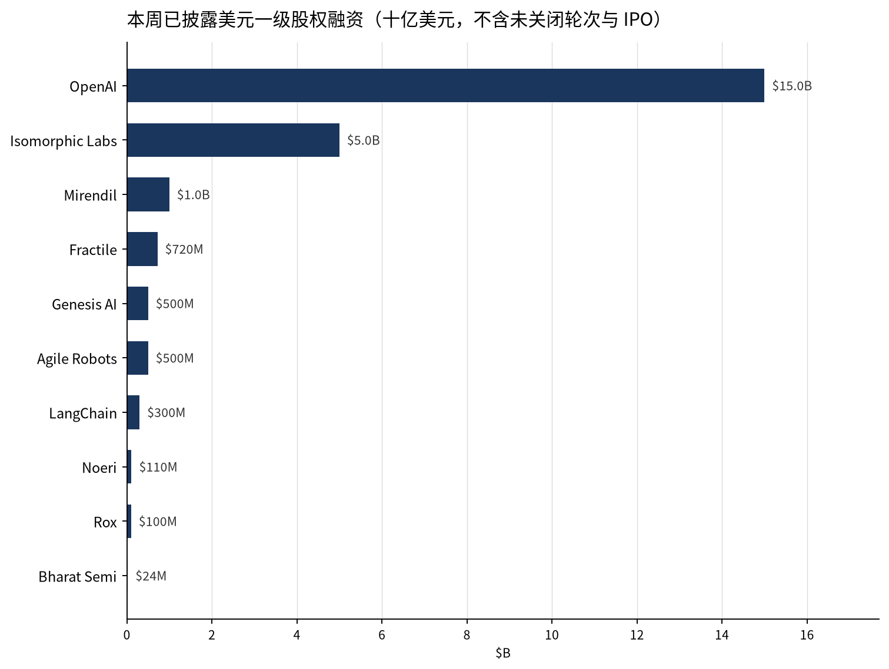
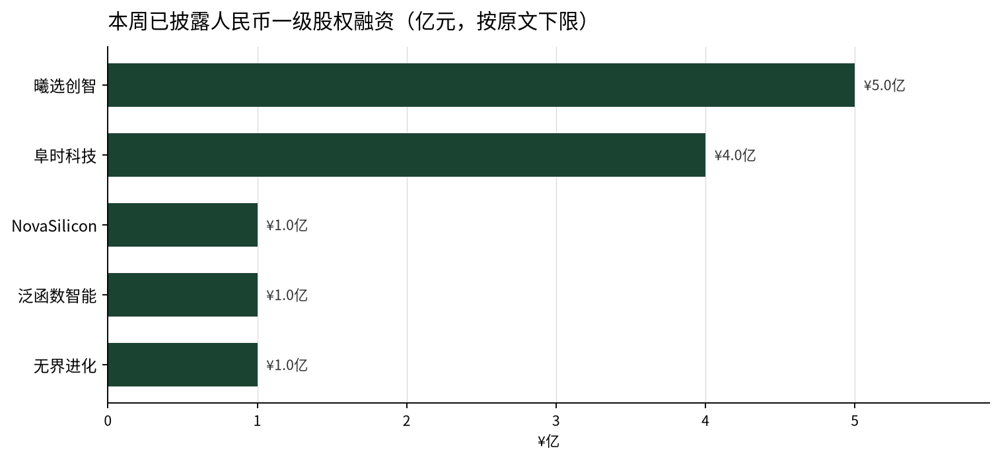

AI 的最后担保人在本周退场，信用层先于股权层被重新定价。黄仁勋 11 月 11 日辞任英伟达 CEO，留下一张 1,180 亿美元的担保表；美联储 11 月 13 日把「租约 + 残值担保 + 股权」的循环融资写成约 3 万亿美元的表外义务；同周 Anthropic 的 IPO 簿记仍被超额认购、预计定价高于 70—78 美元，OpenAI 却只募到原目标的一半。

这四件事放在一起，才是本周真正的故事。上期是公开市场在 IPO 门口把股权分母往下写；本期是信用市场在担保层把风险折价往上写，而股权层还没跟上。**价格没有跌，支撑价格的担保正在被折价——这是本期最该记住的背离。**

## 本期要点

**一、英伟达从「AI 的央行」变回一家公司，兜底没有跟着走。** 11 月 11 日，董事会接受黄仁勋辞任总裁、CEO 与董事，即刻生效；CFO Colette Kress 代任临时 CEO 并保留 CFO 职务，Harvey C. Jones 出任公司史上首位董事长。11 月 12 日递交的 8-K 只有人事与附件两项，没有任何一条解除融资或担保安排——签字的人走了，担保还在表上。市场先给了判断：股价从 10 月 14 日的 221.30 美元跌到 11 月 13 日的 162.85 美元，一个月 -26.4%。真正的敞口在季报里：截至 10 月 25 日，公司担保的最大总敞口 **1,180 亿美元**，其中 1,050 亿是 SB Energy 的信用支持担保，对应俄亥俄 PORTS-Pike 园区 9 栋楼、约 4.25GW、20 年独家租给 OpenAI 的租约；另有 320 亿美元的 neocloud 剩余承诺，生效条件是对方先拿到融资买设备、容量投运并被英伟达接受。公司同时写明「迄今未就任何担保发生付款」——这 1,180 亿不是损失，是「如果伙伴付不出钱，英伟达替它付」的或有承诺。（季报于 11 月 18 日凌晨披露，属窗口外补证；窗口内可核的是路透 11-12 报道的 1,645 亿美元财务承诺。）

**二、美联储把这套结构写成了官方语言，信用市场随即开始压价。** 11 月 13 日发布的《金融稳定报告》用一整页拆解「循环融资」：超大规模厂商与开发商签长期租约，开发商拿租约抵押融资，GPU 厂商为 GPU 抵押物提供残值担保，双方再追加股权投资。报告给出的量级是——先进计算相关债务发行到 10 月已超 **6,800 亿美元**（2023 年全年的五倍），占非金融投资级公司债发行约 **31%**；尚未开始的租约未折现超 **1 万亿美元**，take-or-pay 与残值担保未折现超 **2 万亿美元**；最大几家美国银行的相关敞口接近 **1 万亿美元**。报告发布后的 72 小时里，黑石旗下 QTS 把 AI 数据中心债务发售规模削减 60%，AI 数据中心垃圾债被统计至 370 亿美元；更早的 11 月 9—10 日，软银已录得约 70 亿美元季度净亏损。**债券投资者先看到担保人的空缺，股票投资者后看到。**

**三、Anthropic 的簿记超额，但它卖的是一份「同价不同权」的结构。** 11 月 17 日美东下午 4 点，Anthropic 关闭 IPO 订单簿；据 CNBC 报道，公司预计定价**高于** 70—78 美元的初步区间。同日它递交 8-A12B（注册生效，文件号 333-299633）与 S-1/A No.3，价格区间逐字维持「between $70.00 and $78.00」，招股书日期栏留空——**获批上市不等于完成定价**，最终定价在 11 月 18 日、挂牌在 11 月 19 日、代码 ANT。发行 8.25 亿股 Class A，其中公司卖 801,351,354 股、老股东只卖 23,648,646 股（2.9%，不是退出型 IPO）；按 74 美元中点，公开发行加同步私募的净募资约 **846 亿美元**。更值得看的是同步私募：七家供应商——AMD、Broadcom、Google、Micron、Microsoft、NVIDIA、TSMC Partners——按 IPO 价认购合计 **260 亿美元** Class N，其中 Google 与 NVIDIA 各约 100 亿美元。这批股票**无投票权、不注册、不受 180 天锁定**，转让时转 Class A。**这不是战略控制，是以股权形式预付算力采购款：供应商把 Anthropic 的算力账单，变成了自家可流通的资产。**

**四、OpenAI 只募到目标的一半，收入却在加速。** 据 CNBC 11 月 12 日报道，OpenAI 本轮募资 **150 亿美元、投前估值 1.25 万亿美元**：是原目标 300 亿美元的一半，也低于此前向投资人报的 1.4 万亿；相对 3 月一轮（1,220 亿美元 @ 8,520 亿估值）仍高约 47%。同一周 CNBC 报道其三季度收入环比增长约 50%。CNBC 的 David Faber 称，英伟达已向 OpenAI 投入约 300 亿美元、软银约 650 亿美元，公司仍在融资是因为烧钱速度没有因为收入增长而下降。**收入在加速、融资额在腰斩，这是本周股权层最直白的一组反向数字。**

**五、中国把算力资产装进了 A 股，而不是继续留在一级市场。** 11 月 12 日深夜，深交所上市委通过超聚变的创业板 IPO 申请——从受理到过会不到半年，**拟募资 80 亿元，为创业板年内最大 IPO**。公司 2021 年从华为 X86 服务器业务分拆、落户郑州、由河南国资接手；招股书披露 2023/2024/2025 年及 2026 年上半年营收约 250.92 亿、442.67 亿、582.46 亿、372.86 亿元，归母净利润约 5.07 亿、7.22 亿、10.3 亿、21.08 亿元；IDC 口径中国市场占有率从 2022 年 11.7% 升至 2025 年 14.2%、出货量第二。同周国星宇航在港交所上市首日跌 1.37%、登临科技 11 月 16 日单日反弹 23.52%，三件事拼出的图景是：**国产算力的退出通道正在从「芯片设计公司上科创板」扩展到「系统集成商上创业板」，而港股只给能算清现金流的那部分资产付钱。**

## 担保怎么变成分母

把英伟达的担保表拆开看，会发现它从来不是「财务投资」，而是一套让整条产业链能借到钱的结构。

第一层是租约。超大规模厂商与第三方数据中心开发商签 20 年长约，开发商拿这份租约去抵押建设——租约越长约稳，能借到的钱越多。第二层是残值担保：GPU 厂商为 GPU 抵押物承诺一个残值，银行才愿意把 GPU 当成合格抵押品，而不是快速折旧的设备。第三层是股权：厂商再给采购方一笔股权投资，补足项目资本金。三层叠起来，一份远期租约就变成了当期融资能力，模型公司才敢签更长的算力承诺，估值里的远期现金流才敢往前折。

英伟达在这套结构里的位置，是「最后担保人」。它给出的不只是钱，是信用：当它在 cap table 上，其他投资人就敢按高估值进场。TechCrunch 引一位投资人的原话——「When Nvidia was on the cap table, everyone felt safe」。过去一年它在 105 轮融资里出手，常常是最大投资方；它今年花 130 亿美元买下 Hugging Face（预计 2027 年交割），投过 Mistral、Lambda、Black Forest Labs、CoreWeave、Crusoe，还曾在一轮 20 亿美元的 Series B 里给 Reflection AI 写 8 亿美元支票。

所以当担保人换人，变的不是「有没有钱」，是「这份担保值多少钱」。临时 CEO 的签字、一个刚成立的董事会委员会、一份应收账款 810 亿美元、DSO 从 60 天升到 64 天的财报——这些都不影响担保的法律效力，但影响市场愿意给它打的折。**折价率一变，同一个项目的 IRR 就变，订单节奏就变，最后才轮到估值倍数变。** 这就是为什么信用层的反应比股权层快一个季度。

美联储的报告把这套结构称为「circular financing」，并给了一个很少出现在官方文件里的判断：这些公司的经济敞口「may be substantially larger than suggested by their on-balance-sheet liabilities」。报告同时指出，这些担保与租约主要装在共同基金、养老金、保险公司，次级档则在高收益债基金、寿险、BDC 与私募信贷手里——**风险没有消失，它被分层卖给了不同的资产负债表。**

## 股权层的两把尺子

同一条供应链上，Anthropic 和 OpenAI 这周拿到了两个不同的价格。

Anthropic 拿到的是「超额认购 + 高于区间」。它的招股书里有一个容易被忽略的数字：前九个月营收 332 亿美元，营业亏损只有 13 亿美元，调整后营业利润 41 亿美元；净亏损 1,040 亿美元里，943 亿来自可转换票据、衍生负债与 SAFE 的公允价值变动——**估值越涨，账面亏损越大，这是会计，不是经营**。它也解释了为什么公开市场愿意在 70—78 美元之上继续加价：这家公司卖的是可兑现的收入，不是叙事。

OpenAI 拿到的是「目标腰斩」。1.25 万亿美元的投前估值仍比 3 月高 47%，但相比它自己向投资人报的 1.4 万亿，已经下修；300 亿美元的目标只完成一半。收入环比 +50% 是真的，烧钱没有减速也是真的。**同一个买家群体，对两家公司给出了两种耐心：对已经能算清营业利润的，愿意付溢价；对还在用融资补现金流的，只愿意付「上一轮的加价」。**

把这两笔放在一起，股权层的分化就清楚了：**头部模型公司的估值还在涨，但涨的是「已经证明收入」的那一档。**

## 中国的钱在买 BOM

本周中国一级市场最清楚的变化，不是钱变多，是钱换了一种排队方式：从「整机/本体」换成了「系统缺口」。

互联层最集中。沐创 11 月 12 日完成新一轮，力合算芯基金与百敖软件入局、老股东力合泓鑫追投，金额未披露；它用「时分复用 + 空间并行」的可重构架构降低对 12nm 以下先进工艺的依赖，Scale-up 侧与本土 GPU 厂商联合研发对标 NVLink/NVSwitch 的方案。英伟芯 11 月 16 日宣布分阶段完成 Pre-A/Pre-A+、累计数亿元，Pre-A 由上海科创集团与上海未来产业基金领投、浦东天使基金跟投，Pre-A+ 由经纬创投与中金资本旗下基金领投；产品从 1.6T DR8 硅光芯片到 3.2T NPO、6.4T CPO 光引擎，核心是用晶圆级异质集成在国产晶圆与先进封装产线上做硅光 PDK。

端侧具身芯片出现了一笔产业方合资的定价。曦选创智 11 月 12 日宣布 5 亿元天使轮、投后估值 40 亿元，纪源资本与经纬创投联合领投，和利、鼎晖龙芯、上汽恒旭、耀途、正轩等跟投；公司 2026 年 5 月由优必选、沐曦股份、锋龙股份共同出资成立，首颗芯片定位「大小脑一体」机器人 SoC，研发目标写「全面超越 NVIDIA Thor」，计划 2027 年给产业伙伴开发验证平台、2028 年推出首款 SoC。这是本周唯一一笔 5 亿元级的人民币融资，定价锚不是收入，是优必选的场景与沐曦的 GPU 架构。

AI 设计芯片成了可独立融资的赛道。泛函数智能 11 月 11 日完成近亿元天使轮，上海未来产业基金领投，上海信投、上海科创集团、富海重产基金、徐汇资本等联合投资；它做的是从自然语言需求到 GDS 的全链路，已协助客户完成商业化流片并一次性点亮，收费为订阅制加项目制。NovaSilicon 11 月 17 日完成近亿元 Pre-A+，顺为资本领投、纪源与经纬跟投，提出对照晶圆厂 PDK 的 CDK（电路设计套件），让芯片公司只定义规格、把实现交给 CDK，并强调本地部署、设计数据不出域。

更上游的「确定性部件」比整机更容易拿到钱。阜时科技 11 月 12 日完成超 4 亿元 C4 轮，投资方包括信通电子、精测电子、华睿投资、汇宁投资、兴银资产等；它的全固态 SPAD 激光雷达接收芯片已在主流车企车规前装量产、累计出货突破百万颗，单芯片 RGBD 计划 2027 年产业化。蓝点触控 11 月 17 日完成数亿元 D3 轮，14 家机构联合投资，近半年累计融资超 10 亿元；六维力传感器与关节力矩传感器占人形机器人 BOM 约 15%，江门基地设计年产能关节力传感器 100 万套、末端六维 20 万套，交付周期从海外厂商的 8—12 周压到 2—3 周。

AI 生命科学出现了一笔纪录级早期融资。无界进化 11 月 16 日完成超亿元 Pre-A，星连资本、Prosperity7、华盖资本、华控基金、德同资本联合投资，老股东顺为、红杉中国、松禾追加；公司由晶泰科技孵化，2026 年 6 月才完成数千万元天使轮，五个月内第二轮，资金用于基础大模型 OCOO、高通量自动化干湿闭环与「递归科学发现」体系。同周英国的 Isomorphic Labs 拿了 50 亿美元 C 轮——同一方向的两端，一端在买闭环基础设施，一端在买平台级叙事。

还有两笔来自名单外的融资，说明「基础模型」在中国正在分裂成两条路。灵睿智芯 11 月 13 日完成数亿元 Pre-A+，美团战投领投，京东关联基金、力合算芯、商汤国香、尚颀、琥珀跟投；它做的是「智能体原生」服务器 CPU 内核 P100，用动态同时多线程把智能体负载的 I/O 等待转成有效算力，股东名单本身就是一张场景清单。稳准智能 11 月 15 日连续完成数亿元 A 与 A+，A+ 由鼎晖投资、上海国投先导、徐汇科创投出资；它做的是面向表格、传感器时序、工艺台账的数据大模型，底座是清华崔鹏团队自 2016 年发展的「因果启发的稳定学习」。**一条往语言与多模态，一条往结构化数据与智能体负载——后者才是工业客户今天愿意付钱的那条。**

外部约束也在同周收紧。11 月 16 日，美国商务部把「第三国数据中心向中国提供先进算力」纳入许可管理，点名印尼、马来西亚、新加坡、泰国、巴西，规则在《联邦公报》公示 90 天后生效；这与中国本周「整机降温、部件拿钱」是同一件事的两面——**海外算力租赁从商业合约变成需许可的行为，国产算力资产的稀缺性因此被制度性强化**（此条为多家媒体一致报道，未取得规则原文）。

## 退出：谁在买资产

本周的「退出」主要是并购，不是 IPO。AMD 在 11 月 13 日完成对 World Labs 的收购，总对价约 82 亿美元、全部以股票支付，交割时发行 14,978,322 股；8-K/A 在 11 月 16 日递交。用股票而非现金，意味着 AMD 把收购成本转成股东稀释，而不是商誉；在一个信用层已经开始给 AI 资产打折的星期，**用高估值股票去买信用层还没定价的资产，是一种时间差**。同周 SoftBank 用 5 亿美元现金领投 Agile Robots（投后 85 亿美元）、TSMC 董事会批准最高 10 亿美元投资 Anthropic 与 OpenAI——股票、现金、战略投资，三种支付方式对应三种对自身估值的判断。

一级市场这一侧，钱在往「能算清现金流」的地方集中。Fractile 7.2 亿美元 C 轮、估值 70 亿美元，四家美国基金共同领投，英国主权 AI 基金与英国商业银行同框出资，而公司 2022 年成立、尚无商用芯片出货、首款产品要到 2027 年；Agile Robots 5 亿美元 F 轮、投后 85 亿美元，SoftBank 领投，NVIDIA、Hitachi、T.Capital 跟投，支撑估值的是 20,000 台套工业装机与慕尼黑 10,000 台年产能，不是人形机器人出货；法国的 Genesis AI 同周拿 5 亿美元 A 轮、估值 35 亿美元，T. Rowe Price、NVIDIA、Khosla 入股，卖的是机器人基础模型 GENE 加轮式双臂本体 Eno。**同一周，欧洲给零出货的芯片公司 70 亿美元，给有存量现金流的机器人公司 85 亿美元，给只有模型与本体的机器人公司 35 亿美元——三种叙事，三个分母，而 NVIDIA 在三笔里都在。**

基金端则在往「基础设施资产」走。窗口内 1,165 份 Form D 里 AI 相关 38 家，没有一家是本周新完成的轮次（Form D 相对成交滞后 2—3 周）；金额最大的是 Brookfield AI Infrastructure Fund-A，11 月 13 日递交 D/A、已售 50 亿美元、20 名投资者，首次销售日在 2025 年 11 月——既有基金的后续募集，不是本周新 close。**机构资金正在以「基金份额」而不是「公司股权」的形式进入 AI 基础设施。**

## 本周融资表

*图 1：本周已披露美元一级股权融资（十亿美元），不含 Anthropic IPO 与未关闭轮次。数据来源：本期冻结母稿已核披露。*

| 公司 | 轮次 | 金额 | 投资方 | 赛道 | 地区 |
|---|---|---|---|---|---|
| OpenAI | 新一轮 | 150 亿美元 | 未披露（英伟达累计约 300 亿、软银累计约 650 亿） | S2 基础模型 | 美国 |
| Fractile | Series C | 7.2 亿美元 | Thrive、Founders Fund、Lightspeed、Redpoint 共同领投；英国主权 AI 基金、英国商业银行 | S1 算力 | 英国 |
| Agile Robots | Series F | 5 亿美元 | SoftBank 领投；NVIDIA、Hitachi、T.Capital | S7 具身 | 德国 |
| Genesis AI | Series A | 5 亿美元 | T. Rowe Price、NVIDIA、Khosla Ventures | S7 具身 | 法国 |
| Isomorphic Labs | Series C | 50 亿美元 | Greenoaks、Sequoia 领投 | S6 垂直 | 英国 |
| LangChain | Series C | 3 亿美元 | CapitalG 领投；GIC、DFJ Growth | S4 Agent 基础设施 | 美国 |
| Mirendil | Series A | 10 亿美元 | Kleiner Perkins、Clearlake 共同领投；估值未披露 | S3 AI 原生基础设施 | 美国 |
| Noeri | 首轮外部融资 | 1.1 亿美元 | Menlo Ventures 领投；Madrona、Kindred、Wing、NEA；Cisco、NVIDIA、Snowflake 战略投资 | S2 基础模型 | 美国 |
| Rox | Series B | 1 亿美元 | 未披露 | S5 横向应用 | 美国 |
| Bharat Semi | 种子 | 2,400 万美元 | 未披露 | S1 算力 | 印度 |

*图 2：本周已披露人民币一级股权融资（亿元），仅取原文给出金额下限的 5 笔（「超/近」按原文下限绘制）；另有 8 笔为「数亿/数千万」或未披露，未入图。数据来源：本期冻结母稿已核披露。*

| 公司 | 轮次 | 金额 | 投资方 | 赛道 | 地区 |
|---|---|---|---|---|---|
| 曦选创智 | 天使 | 5 亿元（投后 40 亿元） | 纪源资本、经纬创投联合领投 | S1 算力 | 中国 |
| 阜时科技 | C4 | 超 4 亿元 | 信通电子、精测电子、华睿投资等 | S1 算力 | 中国 |
| 蓝点触控 | D3 | 数亿元 | 洪泰基金、中关村科学城、弘毅投资等 14 家 | S7 具身 | 中国 |
| 英伟芯 | Pre-A/Pre-A+ | 累计数亿元 | 上海科创集团、上海未来产业基金、经纬创投、中金资本 | S1 算力 | 中国 |
| 无界进化 | Pre-A | 超 1 亿元 | 星连资本、Prosperity7、华盖资本、华控基金、德同资本 | S6 垂直 | 中国 |
| 泛函数智能 | 天使 | 近 1 亿元 | 上海未来产业基金领投 | S1 算力 | 中国 |
| NovaSilicon | Pre-A+ | 近 1 亿元 | 顺为资本领投 | S1 算力 | 中国 |
| 通芯智能 | 种子+天使 | 数亿元 | 清华校友种子基金、北京通用人工智能研究院等 | S1 算力 | 中国 |
| 灵睿智芯 | Pre-A+ | 数亿元 | 美团战投领投；京东关联基金、力合算芯、商汤国香、尚颀、琥珀 | S1 算力 | 中国 |
| 稳准智能 | A/A+ | 数亿元 | 鼎晖投资、上海国投先导、徐汇科创投；国科投资、和玉资本 | S2 基础模型 | 中国 |
| 沐创 | 新一轮 | 未披露 | 力合算芯基金、百敖软件 | S1 算力 | 中国 |
| 云脉芯联 | 新一轮 | 未披露 | 字节跳动领投 | S1 算力 | 中国 |

> 未披露金额：人民币侧 2 笔（沐创、云脉芯联，另有多笔小额未计入本表）；美元侧 0 笔（OpenAI 投资方名单未披露，金额已披露）。人民币与美元分列，不折算、不相加。Mercor（7.5 亿美元 @ 200 亿美元）、Nominal（2.4 亿美元 @ 30 亿美元）、Blue J（1.76 亿美元）、Oura 收购 Counsel Health（6.25 亿美元）均发生在 11 月 10 日及以前，属窗外背景，不列入本表；ChemLex 的 4,500 万美元为 2025 年 12 月旧事，本周被重新索引，同样不列入。

## 本周 vs 上周

| 主线 | 上周（11-04—11-10） | 本周（11-11—11-17） | 走向 |
|---|---|---|---|
| 估值分母由谁书写 | 公开市场接过书写权，Anthropic 用 70—78 美元把价格往下写 | 书写权再换手：信用层先定价，股权层仍在高位 | 延续并升级 |
| 英伟达的角色 | 隐性地为生态提供信用，黄仁勋个人判断即背书 | 11-11 辞任；1,180 亿美元担保与 320 亿美元承诺留在表上；美联储点名循环融资 | 新出现 |
| Anthropic IPO | 定价区间与两套股本口径 | 簿记关闭、8-A12B 生效、S-1/A No.3 维持区间、预计高于区间 | 延续 |
| OpenAI 融资 | 已募 110 亿美元、未关闭、低于 300 亿目标 | 150 亿美元 @ 1.25 万亿，仍为原目标一半 | 延续（缩水确认） |
| 中国一级的钱 | 从模型层挪到卖铲层 | 卖铲层再分层：互联、光互连、端侧 SoC、设计、力觉拿钱 | 延续并深化 |
| 中国 IPO | 燧原科创板、登临港股定价下限、平头哥分拆公告 | 超聚变创业板过会（拟募 80 亿元）；国星宇航首日破发 | 新出现 |
| 具身智能 | 整机与世界模型大额融资 | 整机降温、零部件与工业存量拿钱 | 降温 |
| 并购 | 入口与底座 | 产业方买模型能力（AMD/World Labs 82 亿美元） | 新出现 |
| 基金 | Sequoia 收缩组织；中国诚通五年 1,500 亿 | 美元侧 Norwest 40 亿、Plural 11 亿；中国侧武汉 180 亿母基金选 GP | 延续 |

上期与本期最大的不同，不是价格跌了，是**定价权又换了一层**：上期公开市场在 IPO 门口压股权分母，本期信用市场在担保层抬风险折价，而股权层还没跟上。两个方向相反、时间错开，这才解释了为什么「Anthropic 超额认购」与「英伟达一个月 -26%」可以同时成立。

## 对你意味着什么

{: .notice--info}
**编辑建议**：以下动作均可由本期已核事实推导，不构成投资建议。

- **看 AI 基础设施项目，先看担保人，再看估值。** 问三个问题：租约由谁担保、担保人最近一季的 DSO 与担保表怎么变、担保是否按里程碑分阶段生效。英伟达的 1,050 亿美元 SB Energy 担保按楼分阶段生效、首笔预计 FY2029——这类时间表决定了项目什么时候真正拿到钱。
- **把「供应商在 cap table 上」当成一个新的风险因子，而不是安全信号。** Anthropic 的 260 亿美元 Class N 让七家供应商同价入股、无投票权、无锁定；这意味着上市首日就可能有变现压力，也意味着供应商的资产负债表与它的估值绑在一起。
- **在一级市场，用「可计价单元」筛项目。** 本周中国拿钱的标的有共同点：单价可算（力传感器占 BOM 15%）、客户可点名（车规前装、云厂商）、产能可验收（百万套/年）。整机叙事在降温，能按件计价的零部件在拿钱。
- **关注 11 月 18 日的 Anthropic 定价与 11 月 19 日的挂牌。** 它不只是一笔 IPO 的价格，也是七家供应商 260 亿美元私募的成本，以及 2027 年一批中国大模型公司赴港的估值锚。
- **把 Form D 当披露时点，不当成交时点。** 本周 38 家 AI 相关 Form D 的首次销售日全部早于 11 月 11 日；「本周递交」不等于「本周募完」。

## 来源

- 英伟达 8-K（人事，2026-11-12）：<https://www.sec.gov/Archives/edgar/data/1045810/000104581026000082/nvda-20261111.htm>
- 英伟达 8-K EX-99.1（CEO 交接新闻稿）：<https://www.sec.gov/Archives/edgar/data/1045810/000104581026000082/nvidiaannouncesceotransiti.htm>
- 英伟达 Q3 FY27 业绩 8-K 与 EX-99.1（2026-11-17，窗口外）：<https://www.sec.gov/Archives/edgar/data/1045810/000104581026000088/q3fy27pr.htm>
- 美联储《金融稳定报告》Box 2.2（2026-11-13）：<https://www.federalreserve.gov/publications/files/financial-stability-report-20261113.pdf>
- Ars Technica，美国收紧对华远程算力（2026-11-16）：<https://arstechnica.com/tech-policy/2026/11/us-moves-to-cut-chinas-remote-access-to-ai-chips/>
- Anthropic S-1/A No.3（2026-11-17）：<https://www.sec.gov/Archives/edgar/data/2130357/000162828026074338/anthropicpbc-sx1ax3.htm>
- Anthropic 8-A12B（2026-11-17）：<https://www.sec.gov/Archives/edgar/data/2130357/000162828026074342/anthropic-8xa12b.htm>
- AMD 8-K/A（World Labs 交割，2026-11-16）：<https://www.sec.gov/Archives/edgar/data/2488/000119312526462340/d105780d8ka.htm>
- TechCrunch，黄仁勋离任后的融资缺口（2026-11-13）：<https://techcrunch.com/2026/11/13/jensen-huangs-departure-blasts-big-hole-in-ai-startup-funding-vcs-and-founders-say/>
- CNBC via Yahoo，OpenAI 150 亿美元 @ 1.25 万亿（2026-11-12）：<https://finance.yahoo.com/markets/stocks/articles/openai-reportedly-raises-15b-1-192622324.html>
- Fed 报道，数据中心的金融稳定风险（2026-11-13）：<https://finance.yahoo.com/economy/policy/article/fed-says-its-monitoring-the-data-center-build-out-for-risks-to-the-financial-system-224116947.html>
- 「Bank of Nvidia」1,645 亿美元承诺（2026-11-14）：<https://finance.yahoo.com/technology/ai/articles/bank-nvidia-164-5-billion-163725598.html>
- 投资界，超聚变过会（2026-11-18 报道，事件日 11-12）：<https://news.pedaily.cn/202611/571789.shtml>
- 投资界，曦选创智 5 亿元天使轮（2026-11-12）：<https://news.qq.com/rain/a/20261112A0804M00>
- 投资界，沐创新一轮（2026-11-12）：<https://news.pedaily.cn/202611/571726.shtml>
- 投资界，英伟芯累计数亿元（2026-11-16）：<https://news.pedaily.cn/202611/571900.shtml>
- 投资界，无界进化超亿元 Pre-A（2026-11-16）：<https://news.pedaily.cn/202611/571905.shtml>
- 投资界，蓝点触控 D3（2026-11-17）：<https://news.pedaily.cn/202611/571956.shtml>
- 投资界，泛函数智能近亿元天使（2026-11-11）：<https://news.pedaily.cn/202611/571696.shtml>
- 投资界，NovaSilicon 近亿元 Pre-A+（2026-11-17）：<https://news.pedaily.cn/202611/571973.shtml>
- 澎湃新闻，国星宇航上市首日（2026-11-13）：<https://www.thepaper.cn/newsDetail_forward_34467707>
- GOV.UK，Fractile 获主权 AI 基金投资（2026-11-11）：<https://www.gov.uk/government/news/sovereign-ai-and-british-business-bank-invest-in-british-firm-developing-the-next-generation-of-ai-hardware>
- Agile Robots，5 亿美元 F 轮（2026-11-12）：<https://www.agile-robots.com/en/news/detail/physical-ai-leader-agile-robots-raises-500-million-series-f-funding/>
- Genesis AI，5 亿美元 A 轮（2026-11-17）：<https://www.unite.ai/genesis-ai-raises-500m-series-a-to-accelerate-robot-deployment/>
- TechCrunch，LangChain 30 亿美元估值（2026-11-13）：<https://techcrunch.com/2026/11/13/ai-agent-startup-langchain-hits-3b-valuation/>
