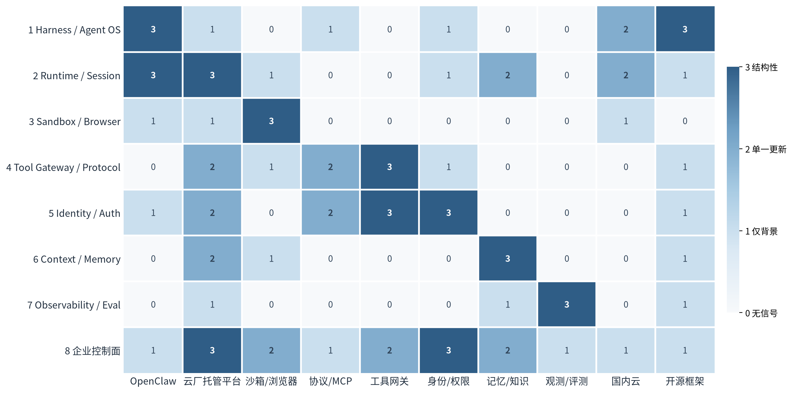

**本周的主线只有一句话：平台开始卖「Agent 能跑很久」，但卖的是档期、检查点和档案，没有一家承诺替你保存进度。**

Google 把延迟容忍的 agent 作业排到非高峰，模型推理打五折；AWS 让 Lambda 从最后一个检查点续跑、把会话记忆保留拉到十年；阿里云百炼的沙箱持久化只保存文件系统、明确不保留进程。再加上 Anthropic 把整套会话存储搬进客户的 PostgreSQL、OpenClaw 把排队消息做成跨重启保留——同一周里，五家都在回答「长跑之后状态放哪」，答案一致：**放在进程外面**。

## 本期要点

### 1. Google 把「排队」做成了产品

11 月 16 日，Gemini Enterprise Agent Platform 把两条 deferred 能力同时转 GA：面向自主 agent 调度的 deferred tier，以及 Interactions API 上异步模型调用的 deferred tier。定价是标准按需的**五折**，官方目标是 95% 的任务在 24 小时内完成，超时即失败，**不回退**到标准档。提交时 API 异步受理并立即返回 interaction ID，作业走 `queued → in_progress → 终态`；ADK 侧通过 `RunConfig(service_tier=ServiceTier.DEFERRED)` 按次生效，前提是模型走 Interactions API，否则 ADK 忽略该档位、只记一条警告。

真正决定能不能用的是四条边界。延迟型作业**不能用 SSE 流式**，传 `"streaming": true` 直接 422；多轮工具工作流里**每个模型轮各提交一次 interaction**，每一轮都要各自排队，所谓「一个 agent 作业」在队列与计费上是「N 个排队请求」；ADK **不跨重启保留 in-flight 的 interaction ID**，客户端停了轮询就断了，而客户端超时只停轮询、后端仍在跑仍在计费；运行环境的请求上限还各不相同——Cloud Run 服务在排队期间保持 HTTP 连接但上限 60 分钟，Agent Runtime 与 Cloud Run jobs 允许 168 小时但每个模型轮仍是 24 小时，GKE 没有平台超时。省钱的代价是把同步语义换成队列语义：调用方要自己持有 interaction ID、自己轮询、自己决定超时后是否重投。agent 的 SLA 因此从「请求延迟」变成「作业完成率」。

### 2. AWS 把「记录」和「检查点」做成了原语

11 月 17 日，AgentCore Memory 的短时记忆保留上限从 1 年提到**最长 10 年**，且策略是**事件级**的：设在 memory 资源上、在每条事件创建时套用，改配置不会追溯改写历史数据。同日上线的全量会话摘要挂在 summary strategy 下、无需额外配置，每个会话一条记录、随新事件更新，与细节摘要 chunk 并存，检索时可按 record type 只取全量摘要。同一天，Lambda 的 durable functions 支持暂停与恢复：从**最后一个检查点**在同一 function version 续跑，暂停时间不计入执行超时。

两件事要一起读，因为它们的分工比听起来更窄。持久化的对象是磁盘、数据库和检查点，**不是进程**——Lambda 的 pause 是「冻结检查点指针 + 停止计时」，进程内没有 checkpoint 的状态会丢；AgentCore 的十年保留是「档案」不是「恢复点」，它回答「当时说过什么」，不回答「当时算到哪一步」。同周还有一条配套的价格动作：AgentCore 每月给组织 5,000 次免费 web search（跨区域、跨账号共享、按月重置），检索从按量能力变成带额度的基础件。

### 3. 状态所有权开始搬家：Anthropic 交给客户，阿里只存磁盘

11 月 12 日，Anthropic 上线 self-hosted Claude Managed Agents：客户运行整套服务，`cma-server` 提供 API、跑 agent loop、存 agents/sessions/history，但**从不执行 agent 的 shell/文件工具**；数据库要求 PostgreSQL 16+，没有数据库就是内存态、重启即失；worker 从 server 取任务、在客户沙箱里执行。模型请求发给客户选择的 provider——默认 Anthropic，也可以换 Bedrock、Google Cloud、Microsoft Foundry 或自建网关。即使控制面被攻破，攻击者也不能直接在客户环境执行命令，代价是客户要自己安装每个 release、运维数据库与 worker 池。

阿里云百炼的动作更朴素，但把边界写得很清楚。11 月 8 日上线的沙箱持久化（本周才出现在发布记录索引里）会在会话空闲回收时保存**文件系统快照**并释放沙箱，保留期内再次运行时从当前快照恢复一个新沙箱；保留期默认 3 天、支持 1–30 天，按快照存在时长计费。保存范围明确排除：上传文件、未同步产物、Memory、Skills 和**运行中的进程**。新快照会删除上一份并从新快照时间重算保留期，所以它是单点恢复位，不是版本链——回不到更早的状态。

### 4. Claude Code 把「一次工具调用」换成「一段代码」

2.1.323 上线实验性 Code Mode：Claude 写 JavaScript，经名为 `REPL` 的工具执行，一次往返里完成「搜索→筛→改→测」；代码内每次工具调用仍按原名（如 `Bash`）过 deny/ask 规则与 `PreToolUse` hook，但 auto 模式的分类器审的是**整段代码**，而且官方文档明说它「看不见运行期才算出来的值」——比如从搜索结果里取到的路径。想审代码本身，得写匹配 `REPL` 的 hook 去读 `tool_input.code`。

限制同样具体：仅终端交互会话与原生安装，不能用于 `-p`、Agent SDK、VS Code、Desktop 和 cloud 会话，**不能经 gateway、Bedrock、Google Cloud Agent Platform 或 Microsoft Foundry 使用**，HIPAA 或零数据留存组织不可用，前台代码 10 分钟、后台最长 2 小时；组织只能通过 managed settings 设 `0` 关闭，不能强制开启。同一周的 2.1.325 把「沙箱内 Bash 免询问」翻转为默认走正常权限流（旧行为要显式开 `sandbox.autoAllowBashIfSandboxed`），并拒绝沙箱内写 `.claude` 的 settings/skills/agents/commands/hooks；2.1.327 增加 managed settings 校验头，并让 `/status` 列出「被忽略的权限设置」和「永远不会匹配的 hook matcher」。

### 5. OpenClaw 把会话所有权上收到宿主

11 月 17 日的 2026.11.5 做了两件相反方向的事。对用户，它让队列中的消息、发送权限、最终聊天写入**跨 Gateway 重启保留**——机制是先落库再投递、按幂等键重放，而不是持久化进程内存；cron 侧把账号选择、重试截止时间、完成运行身份都随 job 持久化。对第三方 harness 与插件，它是破坏性的：每个物理 session 由一个 controller 独占准入、排队、steering 和 Stop，第三方 harness 必须在宿主的 `runAttempt` 回调内注册「按会话键的活跃运行」并保留返回的清理函数，否则抛 `AgentHarnessPreflightError`；插件不得再直接操作 `chatAbortControllers`/`chatQueuedTurns`，必须走 Gateway 的授权方法分发。

11 月 18 日的 2026.10.33 则是另一条线：gateway-only 的 extended-stable 以 10 月底代码为基线叠加关键修复，并保留 2026.11.4 的签名源码作为「兼容身份」，显示版本仍是 10.33。版本号从此不再唯一决定兼容性——升级判定必须读 release notes 里声明的兼容基线，不能按 semver 推断。

## 运行时：计价从一维变三维

「一个实例规格覆盖全部流量」在本周正式过时。AWS AgentCore V2 新增 resource configuration：承诺 0.25 vCPU / 1 GB 到 2 vCPU / 8 GB 的基线，峰值可突发到基线 4 倍（单会话上限 8 vCPU / 32 GB），基线单价低于按量；Modal 用一篇工程博客给出反面论证——典型沙箱一生中超过一半时间使用不到峰值的 6%，于是默认 0.125 核 / 128 MiB 起步、CPU 可突发 +16 核、内存默认不设上限，按秒取「request 与实际用量的较大者」，并对 8 GiB 以下的突发沙箱给出 0.0001%/分钟 的 OOM SLO（约 694 沙箱日一次）。Google 卖的是第三种：延迟。

三种模式不可互相替代，而是同一份负载的不同切片。交互式走基线 + 突发，离线可延迟走 deferred，长跑批处理走检查点续跑。采购时只问「每小时多少钱」会同时低估峰值账单和高估保障；报价单至少要拆成基线单价、突发单价、突发上限、以及突发不保证时的行为四项。AWS 没有披露突发争用策略，这一项本身就是风险。

配套的还有两个小但硬的变化：AgentCore 的 V2 镜像上限从 2 GB 提到 10 GB，并要求超过 2 GB 时设置 `minimumMemoryInMiB` 以提供构建磁盘；新增的 build warmup hook 会在平台准备 agent 时**调用容器两次**，一次载入「每个会话都要用的东西」、一次读取「会话启动时要读的文件」，把进程内初始化提前到准备阶段。

## 沙箱与浏览器：单位任务成本成为主轴

browser-use 一周连发四版，最重要的两条都是成本项。1.0.4 把「每来一张截图就重写历史消息」改成每 20 条工具结果批量裁剪，恢复了 provider 的 prompt cache：同一 BU Bench v2.1（200 任务）分数 76.1 对 76.0，**单任务模型成本从 $0.434 降到 $0.208**。1.0.5 把运行评判做成内置 judge，输出成功与否、失败原因、是否检测到提示注入、是否被 bot 拦截或 CAPTCHA、以及 gotchas。1.0.6 则把默认模型切到 BU 4.0——$1.80/$9.00 per 1M token，是 `bu-fast` 的 15 倍，想保留旧价要显式传 `llm='bu-fast'`。这是一次默认成本上调，升级即账单变化。

E2B 2.64.0 把规格和身份都变成参数：模板声明最大可分配核数（`maxCpuCount`）、创建沙箱时再定实际核数（`cpuCount`），同一模板可服务轻/重两类任务；API client 接受 `Authorization` 头替代 API key，并用 `X-Team-ID` 选团队，企业可以用自己的 IdP 发短期 token，不必把长期 key 嵌进创建方。Browserbase 同周上线 session labels，把「找一次运行」从 session ID 变成按 workflow / 环境 / 版本过滤——这是成本归因与回归对比的前置条件；agent-browser 0.43.0 修了「tab 关闭后命令挂到超时」，并给可访问名为空或重复的控件加 snapshot hint。

云厂内置浏览器本周没有新条目：AgentCore Browser / Code Interpreter 的 11 月 release notes 零条，Google 的 computer use 走 Gemini 4 Hydrogen 的模型能力而非托管浏览器。企业网络边界那组能力（VNet 注入、自有代理、Web Bot Auth）随 Microsoft Ignite 发布，但博客时间戳比窗口终点晚一小时，本期只作背景。

## 协议与网关：规范不动，扩展与错误面在动

MCP 本周没有新协议修订。官方在 11 月 11 日（窗口开始前 7 小时）宣布把规范发布固定为每年两次、下一次是 2027-03-30，原定 2026-12 的版本取消——这条按纪律算背景，但它解释了窗内所有动作：实质变化都在扩展层。SEP-3392 的扩展生命周期落到 Final，规则是扩展标识符固定为 `{vendor}/{name}`、阶段由目录承载（experimental / beta / stable）、破坏性变更递增 `revision`、**收到未知 revision 的对端不应启用该扩展**；协商是逐请求的，客户端在每个请求的 `_meta` 里声明扩展能力，而不是握手时一次谈完。TS SDK 的对应 `{ id, setup(ctx) }` API 在 main 分支推进中，但尚未发版。Registry 同周把「只取第一条 proof record」改成遍历全部记录逐一验签，并明确「删除记录只阻止新登录，已签发 token 仍有效至过期」——吊销不是删 key，而是清记录加等过期。

网关的形态在合流。Google 11 月 12 日把 Agent Gateway 推到 GKE Preview（要求 GKE 1.37.2-gke.1042000 以上，只开 europe-west1 与 us-central1），定位是管控「到 agent、从 agent 出、agent 之间」三类流量；AWS 的 AgentCore Gateway 则做双边界认证——入站用 JWT authorizer 校验调用方的 workload identity，出站由 credential provider 在调用瞬间注入目标凭证并负责刷新，凭证不进入 agent 进程。两家差异在控制点位置：Google 压到 service mesh（agent 不动、流量绕行），AWS 压到运行时与桌面。

工具网关的竞争点已经从「接了多少 SaaS」转向「schema 与错误的可编程性」。Composio 的 0.30.0 / 0.33.0 做的是把一份 JSON Schema 有损但语义保持地投影到 Gemini 与 Vertex 的子集（`oneOf` 放宽成 `anyOf`、`null` 成员变 `nullable`、字符串 `const` 变单值 `enum`），并把失败改成结构化信封（`statusCode`、`apiErrorCode`、`suggested_fix`），让 agent 能按状态码分支重建连接，而不是做字符串匹配。Nango 走的是另一条：installation token 由自托管安装用自己的私钥签 JWT，claims 里带请求体摘要 `body_sha256`，寿命 5 分钟、允许 15 分钟时钟偏移，token 因此无法被挪用到另一个请求。一个优化「调用成功率」，一个优化「凭证可控性」。

## 身份：从「发身份」转到「怎么撤销」

本周身份层最值得读的不是产品发布，而是 IETF OAuth 工作组在 11 月 15 至 17 日的 10 余份 agent 相关草案：authority epoch 给委托链一个单调递增的纪元号，撤销即推进纪元、旧凭证自动失效；revocation closure 要求撤销一个授权时把派生出的子授权一并关闭；还有用 DNS 记录把 agent 名与其 OAuth client 绑定、免去先建联邦的跨组织校验。三条都还在草案，不能写成产品能力，但它们定义了下一个要问供应商的问题：撤销一个用户之后，派生出来的 agent 凭证多久失效。

落地侧的动作都在缩短凭证寿命与扩大审计面。AWS WorkSpaces for AI agents 支持任意 OIDC IdP、管理员可把登录直接路由到企业 IdP，on-behalf-of 登录让 agent 以登录用户身份行动并继承其目录身份、权限与桌面组策略——权限模型从「给 agent 授权」变成「agent 借人的授权」，代价是权限放大，必须用会话回放（截图转视频 + 自然语言记录，存客户自有 S3、客户自有密钥）做补偿控制。Nango 把控制面与数据面的凭证读取都做成可审计事件，并给自托管安装发了上面那种请求体绑定的短时 token。反面例子也有：Nango 同版对 teamviewer 去掉了 PKCE，属单个 provider 的安全姿态回退，需要单独核实上游约束。

云厂的身份产品本周没有新版本，只有接入面扩张。Entra Agent ID 的 what's-new 最新日期化条目停在 10 月 23 日；AWS AgentCore Identity 没有独立发版；Google 只在跨云网关条目里提到「可验证身份」。但 Entra 有一条约束值得提前决定：blueprint 的单实例 / 多实例拓扑里 `isSingleInstance` 不可变——单实例让同一 agent 跨租户共用 client ID 便于识别，多实例让每个 Agent ID 独立 client ID 便于隔离与单独吊销，选错只能重建。

## 记忆与观测：写入正确性，以及默认值就是安全策略

记忆层的竞争点从「召回质量」移到了「多主机写入」。OpenViking v0.5.5 用 pgvector 向量后端加 PostgreSQL PathLock，把路径锁从进程内锁变成数据库行上的租约，多主机靠数据库原子更新竞争，`coordination` 负责 Watch 选主与语义任务版本（版本号单调递增，只有已持久化的任务版本能覆盖旧版本，避免旧 worker 的迟到结果回写），因此多主机部署不再硬依赖 Redis。Graphiti 用 change set + lease + fence 给「同一张图并发摄取」加乐观并发控制：提交时校验 fence，不是当前值就抛 `StaleCommitError`，租约默认 60 秒且要求写入余量小于租约的三分之一。Cognee 一周三版，把 embedding 搬到 RabbitMQ worker（主服务只写任务消息），并新增 5 个连接器，同时**移除旧的 Slack 历史导入**。

需要单独标红的是 OpenViking 的默认值：Gateway 把 `disabled_tools` 默认改为空，8 个写工具（remember/write/edit/add_resource/add_skill/forget/set_acl/cancel_watch）默认开放，而 `PUT /admin/policies/{id}` 是全量替换——漏传字段会把写工具全部打开。默认值在这里不是体验问题，而是安全边界。

观测层的关键词是「归因」。LangSmith 的周档给出 `langsmith investigate`（按 step/error 聚合失败并附证据 trace）与 `langsmith verify --since`（对比修复前后失败率），把「人肉翻 trace」固化成 `investigate → fix → verify` 闭环；Phoenix 的 `px prompt tag` 是指针语义，tag 名在 prompt 维度唯一，再打一次即移动指针，所以「production」永远只指一个版本；Braintrust 让 LLM-as-judge 走 Decisions API，模型返回结构化选项与概率分布，消掉「输出格式漂移导致解析失败」这类评测噪声。OTel GenAI 仍无版本，两个语义澄清提交（`gen_ai.tool.definitions` 的作用域、共用属性抽成公共组）落在窗口结束之后，按背景处理——行业此刻用的 `gen_ai.*` 依然没有权威版本。护栏侧继续收缩：Guardrails AI 自 8 月 26 日起无提交，NeMo Guardrails 本周只有文档快照、没有 0.25.0 的代码发布。

## 控制面：Ignite 的信号，与「可核验性」这道分水岭

Microsoft 在 Ignite 2026 给 Foundry Hosted Agents 补齐了长跑所需的一组能力：long-running resiliency 转 GA（work identity + input identity + 租约 + handler 重入，恢复是从 handler 开头重入、不是确定性重放）、可配置 idle timeout（2 分钟到 4 小时，默认 15 分钟）、memory snapshots 进入 preview（官方定义为「就绪态起点，不是运行中会话的检查点」，`$HOME` 与进程内存不跨空闲保留）、网络出口规则在 agent 沙箱之外求值、BYO-AKS 目标 12 月初预览。这套机制与本周主线完全同构，但**博客发布于 11 月 18 日 17:00Z，折合北京时间 11 月 19 日 01:00，比窗口终点晚一小时**，按纪律只能作背景，不计入本周判断。

窗口内 Azure 另有四条可核到日期的 preview（来自其 RSS）：Agent Grid 做「基于身份的零信任网络」治理 agent 与模型、工具、外部服务之间的通信；Agent Sandbox cluster extension 在 Kubernetes 上为执行不可信模型生成代码的 agent 提供每会话隔离环境，替团队接管沙箱生命周期、存储与预热；Azure SRE Agent 支持 Entra Agent ID 与 Agent 365，并支持 A2A 交接任务且各自保留本团队权限。四条详情页依赖 JS 渲染，正文未取得，本期只记「有动态」。

这一周最实际的分水岭不是能力，而是可核验性。AWS、Google、Anthropic 的 release notes 有精确时间戳、可机读；Azure 的详情页抓不到正文，Databricks 只有月档，Microsoft Agent Framework 的 GitHub 主仓在运行日直接 404——而它的 PyPI 1.26.0（11 月 12 日）与 NuGet 1.28.0（11 月 6 日）仍在发版。一个刚被官方称为 Semantic Kernel 与 AutoGen 直接继任者的框架，变更说明的公开入口消失，这是供应链可见性问题，不是发布节奏问题。

*图 1：8 个能力模块与 10 类对象的本周信号强度。0 = 窗口内无信号，1 = 仅背景或单一非结构性条目，2 = 窗内单一实质更新，3 = 窗内有结构性变化。评分为编辑判断，依据为本报告各模块状态表，仅用于横向比较，不是能力评分。数据来源：本报告 §1–§8 状态表。*

## 本周 vs 上周

| 主线 | 上周（第 21 期，11-05~11-11） | 本周（11-12~11-18） | 走向 |
|---|---|---|---|
| 核心问题 | 这次调用凭什么被允许 | 跑了很久、断过一次之后，还算不算同一次作业 | 从「证明位置」到「状态归属」 |
| 长时执行 | 会话成为计价与隔离单位 | 档期（五折排队）、检查点（从 checkpoint 续跑）、档案（十年保留）三件套 | 新出现：作业化 |
| 沙箱状态 | 重试幂等 + 凭证隔离 | 只存磁盘不存进程；快照是单点恢复位 | 从「能恢复」到「恢复到哪」 |
| 计价 | 每会话并发、按量 | 基线 + 突发 + 延迟三档并行 | 从一维到三维 |
| 执行单位 | 一次工具调用 | 一段代码（Code Mode）、一个可重入作业 | 单位变大，判定粒度错位 |
| 协议 | 数据面从 JSON-RPC 拆出 | 规范半年一版；扩展靠 revision 判稳 | 从「改协议」到「改扩展」 |
| 身份 | 凭证按调用作用域绑定 | 请求体绑定 token；撤销谱系进草案 | 从「绑定」到「撤销」 |
| 国内云 | 百炼零条目、火山不可读 | 百炼晚披露 11-08 能力、腾讯公告错位、火山仍停 10 月 | 从「读不到」到「读到但时间错位」 |

上周的答案是「把策略放进网关、把身份绑到每次调用」；本周的答案变成「把状态放进程外面，并接受平台只保证续命与留档」。两者接续在同一点上：上期要证明「这是同一个主体」，本期要证明「这是同一次作业」——而后者平台帮不了你，只能靠外部检查点。

## 对你意味着什么

**编辑建议，按优先级排序：**

1. **先给长任务做一次「状态在哪」的盘点。** 按四种资产分开看：磁盘文件、进程内存、会话历史、检索记忆。阿里明确不保留进程、AWS Lambda 明确未 checkpoint 的进程内状态会丢、Foundry 的快照只是启动基线——凡是把进度放在进程里的 agent，换任何一家托管运行时都不可恢复。
2. **把可延迟流量单独分池。** Google 的五折只对能等 24 小时的作业成立，且要求不开流式、按模型轮排队、客户端自己持有 interaction ID。先按「可延迟性」切流量，再谈单价，否则会把折扣算进交互式路径的预算。
3. **升级前跑一遍「默认值变更」回归。** 本周至少五处默认值变更（多数是收紧）：Claude Code 沙箱 Bash 走正常权限流、OpenAI 网络规则禁裸 `*`、OpenClaw 委托变更必须审批、OpenViking 八个写工具默认开放（这是反向的，默认更宽）、browser-use 默认模型涨价 15 倍。列出所有无人值守任务，确认它们在「开始询问」或「开始计费更多」时能告警而不是静默卡住。
4. **自研 harness 与插件按破坏性升级排期。** OpenClaw 11.5 要求 active run 走 `runAttempt` 注册、插件 RPC 走 Gateway 授权分发；Claude Code 的 `engines` 版本闸、hook 参数数组化、agent 级 `createSdkMcpServer` 弃用，都是安装期就会失败的契约变更。顺序必须是宿主先升、插件后改。
5. **把「撤销」写进身份设计。** 短时 token、请求体绑定、按 issuer 键控凭据三件套现在就能做；IETF 的 authority epoch 与 revocation closure 还在草案，不要等标准，但要让自己的授权模型能表达「关闭一条委托谱系」。
6. **采购表新增一栏：release notes 是否可机读、是否带精确时间戳。** 本周 AWS、Google、Anthropic 能在一小时内完成可审计核对，Azure 详情页抓不到正文、Databricks 只有月档、Agent Framework 主仓 404。这一栏决定了你能否在一周内完成一次合规升级。

## 来源

- **Google**：[Agent Platform Release Notes](https://docs.cloud.google.com/gemini-enterprise-agent-platform/release-notes)｜[自主调度机制](https://docs.cloud.google.com/gemini-enterprise-agent-platform/scale/efficiency/autonomous-scheduling.md.txt)｜[Deferred tier](https://docs.cloud.google.com/gemini-enterprise-agent-platform/models/deferred-tier)
- **AWS**：[What's New feed](https://aws.amazon.com/about-aws/whats-new/recent/feed/)｜[AgentCore Release Notes](https://docs.aws.amazon.com/bedrock-agentcore/latest/devguide/release-notes.html)｜[Memory 十年保留](https://aws.amazon.com/about-aws/whats-new/2026/11/amazon-bedrock-agentcore-memory-10-year-retention)｜[全量会话摘要](https://aws.amazon.com/about-aws/whats-new/2026/11/amazon-bedrock-agentcore-memory-full-session-summaries)｜[agentic 开户](https://aws.amazon.com/about-aws/whats-new/2026/11/agentic-account-creation/)｜[WorkSpaces 接入与治理](https://aws.amazon.com/about-aws/whats-new/2026/11/amazon-workspaces-AI-agents-connect-govern)
- **Anthropic**：[Claude Code CHANGELOG](https://raw.githubusercontent.com/anthropics/claude-code/main/CHANGELOG.md)｜[Code Mode 文档](https://code.claude.com/docs/en/code-mode)｜[Platform Release Notes](https://platform.claude.com/docs/en/release-notes/overview)｜[Self-hosted Managed Agents](https://platform.claude.com/docs/en/managed-agents/self-hosted)
- **Microsoft**：[Foundry 博客](https://devblogs.microsoft.com/foundry/feed/)｜[长跑韧性](https://learn.microsoft.com/azure/foundry/agents/concepts/long-running-agent-resilience)｜[Memory snapshots](https://learn.microsoft.com/azure/foundry/agents/how-to/use-hosted-agent-memory-snapshots)｜[Azure Updates RSS](https://www.microsoft.com/releasecommunications/api/v2/azure/rss)
- **OpenClaw**：[Releases](https://github.com/openclaw/openclaw/releases)｜[2026.11.4 notes](https://docs.openclaw.ai/releases/2026.11.4)
- **MCP / A2A**：[发布节律公告](https://blog.modelcontextprotocol.io/posts/mcp-release-cycle/)｜[SEP-3392](https://modelcontextprotocol.io/seps/3392-extension-lifecycle)｜[Extensions 总览](https://modelcontextprotocol.io/extensions/overview.md)｜[Registry](https://github.com/modelcontextprotocol/registry/releases)｜[A2A](https://github.com/a2aproject/A2A/releases)
- **框架**：[LangGraph](https://github.com/langchain-ai/langgraph/releases)｜[Google ADK](https://github.com/google/adk-python/releases)｜[Dify 1.20.0](https://github.com/langgenius/dify/releases/tag/1.20.0)｜[pydantic-ai](https://github.com/pydantic/pydantic-ai/releases)
- **工具网关 / 身份**：[Composio changelog](https://docs.composio.dev/changelog)｜[Nango](https://github.com/NangoHQ/nango/releases)｜[Arcade](https://github.com/ArcadeAI/arcade-mcp/commits/main)｜[IETF Datatracker](https://datatracker.ietf.org/)
- **沙箱 / 浏览器**：[Modal burst 博客](https://modal.com/blog/sandbox-bursting)｜[E2B 2.64.0](https://github.com/e2b-dev/E2B/releases)｜[browser-use](https://github.com/browser-use/browser-use/releases)｜[Browserbase changelog](https://www.browserbase.com/changelog)｜[agent-browser](https://github.com/vercel-labs/agent-browser/releases)
- **记忆 / 观测**：[OpenViking](https://github.com/volcengine/OpenViking/releases)｜[Cognee](https://github.com/topoteretes/cognee/releases)｜[Graphiti](https://github.com/getzep/graphiti)｜[Firecrawl changelog](https://www.firecrawl.dev/changelog)｜[OTel GenAI](https://github.com/open-telemetry/semantic-conventions-genai)｜[LangSmith changelog](https://docs.langchain.com/langsmith/changelog)｜[Langfuse](https://github.com/langfuse/langfuse/releases)｜[Phoenix](https://github.com/Arize-ai/phoenix/releases)
- **国内云**：[百炼发布记录](https://help.aliyun.com/zh/model-studio/application-release-notes)｜[百炼沙箱持久化](https://help.aliyun.com/zh/model-studio/managed-agents-session-operations)｜[腾讯云公告](https://cloud.tencent.com/announce)｜[火山方舟产品公告](https://www.volcengine.com/docs/82379/1159177)
