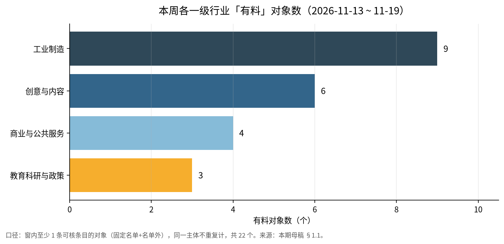
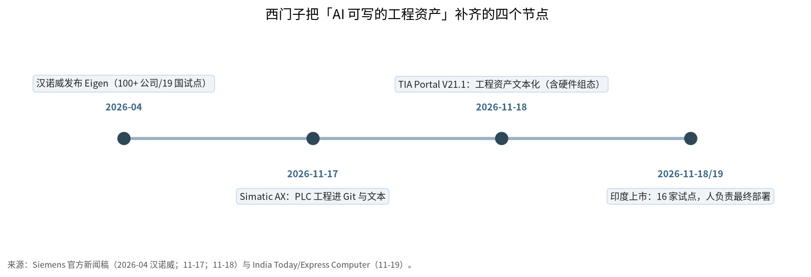

上周的门是关着的：读可以，写不行。这一周，写被放行了——西门子让 agent 在 TIA Portal 里直接生成 PLC 代码，AWS 让 agent 拿着预算去买软件，Visa 让 agent 走进收银台。但每一次放行都附了条件：产物要能被基准检验，花费要落在预算会话里，交易要能在受理侧被认出来。

真正变的是买方的问法。他们不再问「你有没有 AI」，而是问：**能不能只开一半？关掉之后还剩什么？出错时，谁的日志能当证据？**

## 本期要点

### 1. 西门子把「写」交出去了，验收没有跟着走

11 月 18 日，西门子发布 TIA Portal V21.1。这份更新里最要紧的不是新功能，而是两件基础设施：一是把已安装软件与许可解耦，V21 版本线内可以连续拿到新版本，官方说法是「不再买版本，而是买功能」；二是扩展 Simatic Source Documents，让工程内容以文本源文件提供，这一版首次覆盖硬件组态，官方直言「这些文本源文件也可以被 AI 系统处理」。前一天发布的 Simatic AX 则把 PLC 与运动控制工程搬进 Git、命令行与脚本，官方称其产出「结构化、透明的项目数据」——工业 AI 应用的基础。地基铺好之后，产品才登场：Eigen Engineering Agent 在印度上市，此前已在当地 16 家客户试点，能写 PLC 代码、做 HMI 可视化、完成设备组态，通过既有 TIA Portal 使用。点名的两家客户是印刷机械厂商 Pelican Rotoflex 与系统集成商 Z System Intelligent Controls；后者称重复性工程工作减少一半以上、生产率提升 20% 到 30%。公司口径是速度快 2 到 5 倍、方案质量最高提升 80%、工程效率提升 50%。

但产品页写得很清楚：**人负责最终部署**。这句话是整件事的关键——写权限交出去了，责任没有跟着走。西门子没有公开的是：生成结果到底怎么验（是否调用仿真、有哪些规则检查、失败如何回滚、是否覆盖安全相关代码）；对采购方，这几件事比「快几倍」重要得多。同一周，罗克韦尔在波士顿的 Automation Fair 上把话说得更直。其 Frontier Labs 副总裁 Ryan Gariepy 说：「**AI 现在在使用我们的产品，而不是我们的产品里装着 AI。**」2027 年初发布的 FactoryTalk Conductor 被定位成治理与安全层，协调 agent 去操作 Studio 5000、FactoryTalk Optix 与 Emulate3D。两家自动化巨头在同一个月做了同一件事：先把产品改造成 agent 能用的样子，再谈谁来管。

### 2. AWS 让 agent 自己买软件，但先给它套上预算和角色

11 月 19 日，AWS 让 Bedrock AgentCore 的 agent 可以直接在 Marketplace 上买软件、API、数据和内容，费用记进开发者的 AWS 账单。流程值得细看：agent 调卖家端点，收到一个 HTTP 402 和一段签名报价；把报价交给 AgentCore 换支付令牌，预算够才发；令牌大约 5 分钟有效，agent 带着签名重试，拿到内容。Marketplace 会校验收到的报价签名，价格被改过就拒绝。

约束不止预算。每个任务可以开一个带消费上限的支付会话，策略里能设核准卖家名单，Private Marketplace 还能把可买的东西限定在目录内。最有意思的是角色分离：示例里，会话角色可以设预算但不能付款，agent 角色可以付款但不能建会话——**agent 没法给自己加预算**。购买记录进 CloudTrail 和 Cost Explorer，首单生成 Marketplace 协议。这是本周最完整的「把花钱权限拆开」的工程样本：它没有发明新的支付网络，而是把「能花多少、能向谁花、多久失效、谁来查」写成了默认配置。对财务和采购，问题从「要不要让 agent 买东西」变成了「预算给到哪个会话、白名单谁维护」。

### 3. Agent 支付打到受理侧：Visa 拉了 140 多家，Mastercard 区分了「谁授权」

Visa 把 Agentic Ready 从发卡机构扩到了受理生态——商户、支付服务商、收单机构和商务平台。首发 140 多家参与方，名单里有 Adyen、Antom、Checkout.com、Fiserv、Global Payments、J.P. Morgan Payments、PayPal、Stripe；已有 175 多家发卡机构在 45 个市场参与，欧洲区另有 85 多家受理参与方。机制不是新钱包，而是让受理侧先在真实交易里学会「认出 agent、完成鉴权、走现有清算」，再决定上不上生产。

Mastercard 则把「谁在授权」拆开。它与 Ant International 在亚太完成了两件事：通过 Antom 跑通一笔真实消费者交易，演示 agent 按**已验证的消费者指令**行动；以及在新加坡完成 Agent Pay for Machines 试点，演示企业如何控制和授权自己的 agent 采购。一个是消费者本人授权，一个是企业授权，同一套框架覆盖两种主体。这两件事合起来说明，agent 商务的瓶颈已经不在「能不能付」，而在受理侧认不认、授权主体是谁、拒付时找谁。

### 4. 三大学区开始认真考虑：不用 Google 搜索了

起因是一句话。Google 教育副总裁 Chris Phillips 对《纽约时报》说，如果学区禁用 AI，学生「将无法使用搜索」，只会看到学校提示不可用。纽约市长指责 Google 用垄断力量把 AI 强推进公立学校；教育总监 Kamar Samuels 的回应是「我们拒绝接受 Google 设定的伪二选一」「如果 Google 不重新考虑，我们将寻找其他搜索方案」。

洛杉矶的动作更实。学区 CIO Jack Kelanic 在 AI 委员会上说「我们有选择」「可以一夜之间更换默认搜索引擎」；报道称 LAUSD 已经关闭了 AI Overviews，并在复审与 Google 的搜索合作。芝加哥公立学区表示想要非 AI 版的 Google 搜索，谈不拢就另寻方案。Google 内部也有员工呼吁，让学校拿到「不带 AI 的搜索」。这件事的分量在于它问对了问题：学区要的不是一个「关闭 AI」的开关，而是一个**只含检索、不含生成的 SKU**；搜索和 AI 概览共用一个入口，拆不开，采购就只能整体退出。

### 5. 「能不能关掉」成了产品功能，但边界由卖方划

11 月 19 日，Canva 给生成式 AI 加了一个关闭开关：Magic Expand、图像生成、Magic Write、Magic Design、Magic Layers、Magic Edit、Dream Lab、Canva Code、AI Shapes 等都可以关。但背景移除和 Magic Grab 不关，Canva 的理由是它们「让日常任务更快，但不生成新内容」。另外还有一个开关，让素材库优先展示人类创作的内容，AI 生成素材在元数据里带标签。

同一天，UMG 首席数字官 Michael Nash 在摩根士丹利 TMT 会议上说，绝大多数消费者要求透明和标识，「越来越多的人在寻找我们所说的 kill switch」；UMG 自己的研究给出 68% 这个数字，而 Deezer 本周的调查是 41%——口径不同，方向一致。Canva 的做法值得学：**能关的前提是先把功能按「是否生成新内容」分类**。但它也暴露了问题——当「可关闭」的边界由厂商定义时，开关很容易变成营销。学区要「无 AI 搜索」而不得，就是同一个问题的另一面。

## 分行业看

*图 1：本周各一级行业「有料」对象数（2026-11-13~11-19）。口径为窗内至少 1 条可核条目的对象（固定名单加名单外纳入），同一主体不重复计，共 22 个。数据来源：本期母稿 §1.1；原始数据 `charts/data-industry-covered.csv`。*

### 工业制造：先把工程资产变成机器能读的东西

*图 2：西门子补齐「AI 可写工程资产」的四个节点。数据来源：Siemens 官方新闻稿（2026-04、11-17、11-18）与 India Today／Express Computer（11-19）。*

西门子的三步值得单独记：文本化、连续化、再放行。没有文本化，agent 的产出无法 diff、无法回滚、无法审计；没有连续版本，每次产出都会被版本迁移打断。这也解释了为什么真正的门槛不在模型，而在工程软件的交付方式。

需求侧的规模已经有官方口径。工信部 11 月 19 日公布 34 家卓越级智能工厂，累计 49 家；称第二批 70% 以上的应用场景涉及 AI，已开发超过 1,000 个工业 AI agent，日均 token 消耗超过 3 亿。这是本周唯一能说明「agent 已进产线」的存量数字。

交付方式也在变。施耐德电气与 BCG 在印度签了探索协议，用海得拉巴的灯塔工厂做「样板智能工厂」，让制造企业到真实产线里看工业 AI、预测性维护与能源管理；技术与供应商选择权仍归企业。竞标这类项目时，对手可能不是另一家自动化厂商，而是「咨询加厂商」的联合体。

最深的一次「写」发生在芯片。OpenAI 称其模型通过重写 SystemVerilog，在 AMD 最强 GPU IP 已经高度优化的基线上取得最高 14% 的提升，相当于不到 5 个月完成约一年的进展。但 AMD 只把部分改动放进已流片的设计、部分放进未来版本，**目前没有人报告在 AMD 硅片上的实测增益**。代码层的 14% 不是芯片的 14%，这句话对所有「AI 写工程产物」的宣传都适用。

ABB、FANUC、KUKA、GXO、富士康、宁德时代、宝马、丰田等在本周没有可核的产线 AI 条目，属于检索层静默。

### 创意与内容：一边装开关，一边算账

华纳音乐在财报电话会上把「AI 版税」讲成了收入叙事的一部分：FY2026 第四季度营收 20.0 亿美元（预期 19.1 亿），全年 74.4 亿；全年调整后 OIBDA 利润率扩张 210 个基点，FY2027 指引约 100 个基点。公司称与 Suno 的合作是生成式 AI 公司首次向权利方支付版税——注意，100 个基点的指引归因于经营杠杆与成本节约，不是 AI 收入。

迪士尼把 AI 放在了成本项：CEO Josh D'Amaro 在财报电话会上说，内部 AI 工具让电影渲染的算力需求下降了 30%。这可能是创意业最容易被忽略的落地位置——不是多出片，而是少烧算力。

失败也被公开计价。中国首部全 AI 生成长片《三星堆：未来往事》放映三周，票房约 180 万元人民币；据报道制作成本达数千万元，连生成全片的 token 成本都没能覆盖。它失败在叙事连贯和付费意愿，不在画质。对内容团队，结论很朴素：AI 适合做片段与素材，不适合直接替代长片叙事。

Spotify 上线 deepfake 检测、DistroKid 向 UMG 与 Sony 交出 AI 检测工具的相关信息，目前只有标题层信息，留待下期核。

### 商业与公共服务：受理侧开始改造

Visa 与 AWS 的动作已在前文展开。补两条：Mastercard 与 Ant International 的 AP4M 试点，把「企业如何授权 agent 采购」单独拿了出来；United Airlines 则继续收紧对个人 AI agent 订票的限制，延续上期的合同封禁路线。同一个行业，一边在教受理侧认 agent，一边在合同里把 agent 挡在门外。

公共部门本周没有可核的新条目：中国中央与北京市级政务 AI、新加坡 IMDA、美国 GSA 的联邦采购，检索层均无窗内发布，属未取得，不作政策判断。

### 教育科研：学生一质疑，模型就改口

本周披露的一项 UNESCO 与伦敦大学学院研究，给了一个不好听的数字：33 个模型、600 道事实题，IPCC 置信度类问题上旗舰模型约 78% 正确、最小的开源权重模型约 47%；而在 15 个模型上做「用户持续反驳」的实验，准确率下降了 30% 到 35%，大多数改口发生在**第一轮**——用户只说了一句「我不认为这是对的」。非英语下降更多，乌尔都语低 7 个百分点、斯瓦希里语低 10 个百分点；两项政策组合题的正确率不优于随机。

在学校这个每天都在质疑的环境里，这比答错更麻烦。采购答疑类产品时，「不因用户压力改变结论」应该成为一条评测项，而不只是准确率。

另一件事提醒我们误报的代价由谁承担。巴尔的摩县四名学生起诉学校与警方：校园 AI 枪械识别系统 Omnilert 把一袋多力多滋误判为枪，校方两分钟内看监控已取消警报，警方仍到场，至少 6 辆警车、部分警员拔枪，学生被按跪戴铐。事件发生在 2025 年 10 月，诉讼与报道在本周——**这是本周新披露的历史事项**。教训不在识别率，而在误报之后的处置链缺少阻断。

学区仍在批量立规：Sarasota 11 月 18 日通过 AI 政策，Anne Arundel 在审议禁 AI。Austin ISD 在 11 月 12 日通过首个 AI 政策，属上期窗口、上期未刊，此处补登，不计入本周。

## 本周 vs 上周

上周的主线是「开门不放权」：入口可以开放，执行权必须留在记录系统里。本周这条线没有被推翻，而是被推到了「放行之后怎么验」。

| 主线 | 上周（11-06~11-12） | 本周（11-13~11-19） | 走向 |
|---|---|---|---|
| 写权限 | 读可以、写不行；写走 ERP 插件、人复核为终点 | AI 直接写 PLC、HMI、组态与芯片 RTL；人负责最终部署、流片验收 | 放行写入，验收留在原处 |
| 权限切分 | SSO、角色、逐次批准、审计留在 ERP | 预算会话、签名报价、5 分钟令牌、角色分离、CloudTrail | 从「谁批」到「批多少、批给谁、多久失效」 |
| 计价单位 | 按动作、按秒、按资产、按会员份数 | 买功能不买版本；支付会话；按曲版税 | 继续下沉 |
| Agent 商务 | 卡组织首笔端到端 vs 航司合同封禁 | Visa 受理侧 140 多家；Mastercard AP4M；AWS 让 agent 买软件 | 从「能不能付」到「受理侧怎么认」 |
| 创意授权 | 逐资产审批加水印 | 关闭开关（Canva）、kill switch（UMG）、版税入账（Warner） | 从「审批」到「开关加结算」 |
| 教育入口 | 抗议、诉讼、董事会程序 | 三大学区考虑弃购；LAUSD 关 AI Overviews | 从「抗议」到「采购退出」 |
| 评测 | 标注集准确率、追问充分性 | 反驳鲁棒性下降三成、误报处置链 | 从「答对」到「扛住压力」 |

一段收束：上周的问题是「谁被允许做什么」，本周的问题是「能不能只开一半、关掉之后还剩什么、出错时谁的日志能当证据」。卖方给了两类答案——一类把「关」做成产品（Canva 的开关、西门子的人签核部署），一类把「验」做成基础设施（AWS 的预算会话与签名报价、Visa 的受理侧识别）。学区给了第三种：谈不拢就换供应商。

## 对你意味着什么（编辑建议）

以下是编辑部基于本周事实的判断，不是本周发生的事实：

1. **在合同里要求「生成产物的验证方法」而不是「生成能力」。** 西门子没有公开 Eigen 怎么验，这正是采购要问的：是否跑仿真、有哪些规则检查、失败怎么回滚、谁签核。答案写不进合同，就不要把「AI 写代码」写进验收条款。
2. **把「可关闭」逐功能定义。** Canva 只关生成式、不关非生成式，说明开关边界由厂商划。采购时列一张表：哪些功能必须可关、关掉后默认行为是什么、AI 标识是否进元数据。
3. **如果引入 agent 采购或 agent 支付，先抄 AWS 的五件套。** 预算会话、签名报价、短时令牌、角色分离、审计日志。尤其是角色分离——agent 不能给自己加预算。
4. **要求供应商说明「受理侧怎么认」。** agent 支付的准备工作不在发卡行，而在商户与 PSP 的识别与风控字段；Visa 的 140 多家参与方名单可以直接当尽调清单。
5. **把「抗压性」加进评测。** 准确率之外，测一问「我不认为这是对的」之后模型是否改口；UNESCO 的研究显示三成以上的准确率会在多轮反驳中蒸发。
6. **不要用代码层的提升证明系统层的收益。** OpenAI 的 14% 是 RTL 层、特定模块、未流片；西门子的 2 到 5 倍是公司口径。对外传播与内部立项都要把口径写清楚。

## 来源

**工业制造**
- Siemens TIA Portal V21.1｜2026-11-18｜https://press.siemens.com/global/en/pressrelease/continuous-access-new-software-siemens-ends-project-upgrades-tia-portal-within-v21
- Siemens Simatic AX（MCE/LCE）｜2026-11-17｜https://press.siemens.com/global/en/pressrelease/software-defined-automation-siemens-announces-major-milestone-simatic-ax-engineering
- India Today（Eigen 印度上市）｜2026-11-19｜https://www.indiatoday.in/technology/news/story/siemens-launches-eigen-engineering-agent-in-india-says-it-frees-up-humans-for-complex-work-3042061-2026-11-19
- Express Computer（16 家试点与客户）｜2026-11-19｜https://www.expresscomputer.in/news/siemens-asks-indian-industry-to-trust-ai-with-control-logic-and-has-16-pilots-to-back-it-up/141512/
- ControlGlobal（Automation Fair / FactoryTalk Conductor）｜2026-11-18｜https://www.controlglobal.com/show-coverage/rockwell-automation-automation-fair/article/55420186/rockwell-automation-ai-agents-everywhere-at-rockwell-automation-fair-2026
- Logistics Business（Rockwell 收购 AGILOX）｜2026-11-19｜https://logisticsbusiness.com/materials-handling/amr-agv/rockwell-acquire-agilox/
- The Machine Maker（Schneider × BCG）｜2026-11-19｜https://themachinemaker.com/news/schneider-electric-and-bcg-join-forces-to-accelerate-ai-driven-smart-manufacturing-in-india/
- Unite.AI（Emerson × Databricks）｜2026-11-19｜https://www.unite.ai/emerson-to-link-aspentech-inmation-with-databricks-for-industrial-ai/
- 247wallst（OpenAI × AMD 芯片设计）｜2026-11-19｜https://247wallst.com/investing/2026/11/19/openai-says-its-ai-improved-amds-best-chip-design-by-up-to-14/
- 新华社（34 家卓越级智能工厂）｜2026-11-19｜https://english.news.cn/20261119/bf1cbae731534b8da028566abaf2a987/c.html

**创意与内容**
- The Verge（Canva 关闭生成式 AI）｜2026-11-19｜https://www.theverge.com/ai-artificial-intelligence/1037126/canva-ai-features-off-button
- Music Ally（UMG 与 kill switch）｜2026-11-19｜https://musically.com/2026/11/19/umg-says-68-of-listeners-want-a-kill-switch-for-ai-music/
- Yahoo Finance（华纳音乐 FY26 Q4 电话会要点）｜2026-11-19｜https://finance.yahoo.com/media-advertising/articles/warner-music-group-corp-wmg-210116140.html
- Yahoo Finance（迪士尼渲染算力下降 30%）｜2026-11-19｜https://finance.yahoo.com/technology/ai/articles/disney-ceo-calls-netflix-licensing-130008863.html
- TechSpot（全 AI 长片票房）｜2026-11-19｜https://www.techspot.com/news/114616-china-first-fully-ai-generated-movie-flops-box.html

**商业与公共服务**
- BusinessWire 更正稿（Visa Agentic Ready）｜2026-11-17｜https://www.thecanadianpressnews.ca/businesswire_press_releases/correcting-and-replacing-visa-expands-agentic-ready-to-help-scale-trusted-ai-commerce-globally/article_0995aafc-e1e9-5311-aa51-f4c42ceae3fb.html
- Fintech Magazine（Visa 欧洲 85 家）｜2026-11-19｜https://fintechmagazine.com/news/visa-agentic-ready-brings-ai-agents-into-european-payments
- Unite.AI（AWS AgentCore x402 支付）｜2026-11-19｜https://www.unite.ai/aws-lets-agentcore-agents-buy-marketplace-products-through-aws-billing/
- Financial IT（Mastercard × Ant International）｜2026-11-19｜https://financialit.net/news/artificial-intelligence/mastercard-and-ant-international-advance-trusted-agentic-commerce-asia

**教育科研与政策**
- NBC New York（纽约学区考虑弃用 Google）｜2026-11-19｜https://www.nbcnewyork.com/news/local/nyc-department-of-education-considers-dropping-google-from-its-schools-because-of-ai/6574489/
- Gizmodo（三大校区与 LAUSD）｜2026-11-19｜https://gizmodo.com/nyc-la-and-chicago-school-districts-all-discussing-alternatives-to-ai-pilled-google-2000842174
- Ars Technica（UNESCO–UCL 反驳实验）｜2026-11-19｜https://arstechnica.com/science/2026/11/llms-will-provide-accurate-climate-info-except-when-they-wont/
- Ars Technica（巴尔的摩 Omnilert 诉讼）｜2026-11-19｜https://arstechnica.com/tech-policy/2026/11/traumatized-teens-sue-school-cops-after-doritos-bag-triggers-ai-gun-alert/
