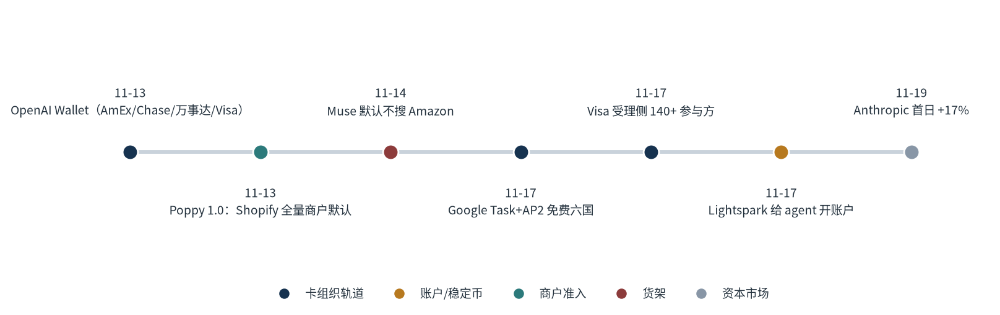
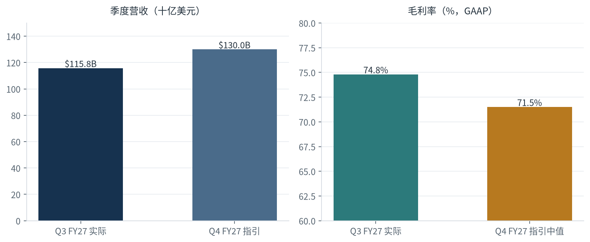
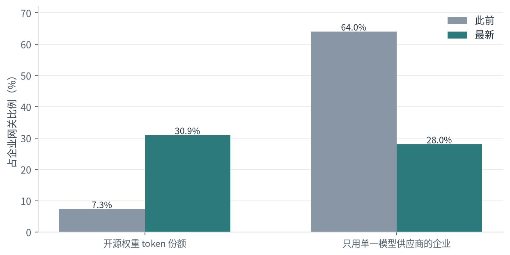

这一周，agent 第一次同时拿到了钱包、门牌和账单，也第一次撞上一扇明确关着的门：结算层在五天内铺出三条轨道、窗口刚关又补上第四条，商户准入出现了平台级默认值，而美国最大的电商平台把 agent 挡在外面。

过去两年，agent 的进展都用「能做什么」来衡量——能不能写代码、能不能订票、能不能自己跑几个小时。本周的进展换了一个衡量方式：**谁授权它花钱，出了事谁举证，成交之后谁开票**。这三件事一旦有答案，agent 就从演示变成渠道；没有答案，再强的能力也只能停在演示里。四条轨道给出的答案互不相同，这正是本周值得看的地方。

*图 1：本周 agent 支付与准入的关键节点。来源：OpenAI、Sierra、Google、Visa、Lightspark、AWS 官方公告；Amazon 与 Meta 的货架冲突据 GeekWire 与 Reuters 报道。*

## 本期要点

### agent 拿到了钱包，货架却关了门

OpenAI 在 11-13 发布 ChatGPT Wallet，把「授权」拆成两次：用户一次性绑卡，之后每次购买前在对话里复核商品、金额和卡种，用 Face ID 或指纹批准，支付网络返回一个**支付代币**——它有独立的卡号、安全码和有效期，商户按现有收单流程扣款，agent 和商户都拿不到真实卡信息。合作方是 American Express、Chase、Mastercard 和 Visa，首发只在美国、只对 ChatGPT Pro、只通过 dots 常驻 agent。四天后，Google 把 Gemini 的 Task 模式免费开放给六个国家，支付走 Agent Payments Protocol（AP2）；同日 Visa 把 Agentic Ready 从发卡侧扩到**受理侧**，140 多个受理参与方与 175 多家发卡机构、45 个市场对接。准入侧则出现另一种打法：Sierra 的 Poppy 协议让 Shopify 为平台上每个商户自动发布「agent 门牌」、让 Muse 默认先找 Poppy。还有一条绕开卡组织的路线——Lightspark 让 agent 持有资金账户，走稳定币与 65 国本地轨道。几条轨道的差别不在速度，在**风险落在谁身上**——卡组织把拒付留在旧链路，所以银行愿意签；Lightspark 把风险移到平台，代价是牌照与 KYC。（[OpenAI](https://openai.com/index/introducing-chatgpt-wallet/)、[Google](https://blog.google/innovation-and-ai/products/gemini-app/tasks-in-gemini-free-new-features/)、[Visa](https://usa.visa.com/about-visa/newsroom/press-releases.releaseId.22986.html)、[Sierra](https://sierra.ai/blog/releasing-poppy)、[Lightspark](https://www.lightspark.com/news/lightspark/introducing-lightspark-agent-accounts)）

同一天，最大的货架把门关上了。Amazon 从 9 月起就用《使用条件》挡住 Muse，理由是它浏览时没有表明身份、且看起来在抓取并保存客户凭证——去年 Amazon 起诉 Perplexity 的购物 agent，用的也是同一条款。本周的变化在另一侧：Marketplace Pulse 对比前后版本发现，Muse 的购物技能在 11-13 前后被改成「除非用户要求，否则不要搜 Amazon」，连举例都不许提，一般商品导流到 Walmart 和 Target。这不是意气之争：Amazon 去年广告收入超过 680 亿美元，其中 sponsored products 依赖用户在站内浏览；如果搜索发生在 agent 里，这部分库存就卖不出去。Zuckerberg 说 Muse 会从经手的交易里抽一小笔，Amazon 的反制则是自建覆盖全球商品的目录——从「被绕过的货架」变成「所有货架的供货商」。（[GeekWire](https://www.geekwire.com/2026/do-not-search-amazon-metas-muse-now-shops-elsewhere-by-default/)）

### 史上最大 IPO 上市，算力股却在跌

Anthropic 11-18 定价：每股 83 美元、发行 9.8 亿股，募资约 813 亿美元，超过 SpaceX 成为史上最大 IPO。11-19 在纳斯达克挂牌，开盘 111.50 美元、收 97.17 美元，较发行价涨 17%，成交 8.46 亿股，超过 SpaceX 首日的 5.22 亿股；收盘完全摊薄市值约 1.8 万亿美元（CNBC 口径；另有媒体按不同股本算法给出约 1.3 万亿，本报不取单一数值作结论）。招股书披露截至 9 月 30 日九个月收入 332.4 亿美元、同比增长 1,200%；发行后 Amazon 持 14.7%、Google 持 13.7%，均为无投票权股，NVIDIA 在发行完成后以私募买入约 100 亿美元。（[Anthropic](https://www.anthropic.com/news/anthropic-prices-initial-public-offering)、[CNBC](https://www.cnbc.com/2026/11/19/anthropic-ipo-ant-live-updates.html)）

同一天，纳斯达克与标普 500 均跌约 2%，NVIDIA 跌 3.3%、连续第六个交易日下跌，自黄仁勋辞职以来累计约 -16%。而 NVIDIA 11-17 的财报本身很漂亮：季度营收 1,158 亿美元、同比 +103%，数据中心 1,076 亿美元、+110%，毛利率 74.8%，Vera Rubin NVL72 已出货，回购授权增加 1,500 亿美元。问题出在指引——下季营收 1,300 亿美元，但毛利率降到 71%–72%，而且**指引不含来自中国的任何数据中心计算收入**。同日董事会新设「国家安全与出口管制监督委员会」，把原本依赖创始人的对华与出口议题，改成「委员会 + 临时 CEO」双线汇报。（[NVIDIA](https://nvidianews.nvidia.com/news/nvidia-announces-financial-results-for-third-quarter-fiscal-2027)）

一级市场用创纪录的募资额给前沿实验室定价，二级市场同一天给算力硬件重新定价。两者并不矛盾：IPO 回答的是「收入能不能继续陡增」，股价回答的是「这份收入的成本结构会不会恶化」。

### GPT-6.2：把「同任务成本」写成价格表

11-17，OpenAI 发布 GPT-6.2 Astra 与 Sol。Astra 定价为每百万 token 输入 8 美元、缓存输入 0.40 美元、输出 40 美元，比上一代输入输出各低 20%；Sol 沿用上一代的 2 美元、0.10 美元、10 美元。卖点不是单价，而是同任务口径：官方称 Astra 在 Agents' Last Exam 上比 GPT-6 Astra 高 5.2 分、成本不到三分之一，比 Claude Fable 5.2 高 5.5 分、成本约 5%；Sol 在 Cognition 的 FrontierCode 2.0 上只比 Astra 低 0.5 分，成本约五分之一。（[OpenAI](https://openai.com/index/introducing-gpt-6-2-astra-sol/)）

安全侧有一个值得单独记的刻度：Astra 是 OpenAI 首个对外发布即达到「AI 自我改进」High 档的模型，官方定义是「相当于给每位研究员配一名 2024 年基线之上的高能力研究工程师」。同周加州以公共妨害起诉 OpenAI，俄勒冈索赔逾 20 亿美元——能力刻度与法律责任在同一个月被推高，这不是巧合。

### 微软给 agent 发工牌，用「96% 性能、5% 成本」打前沿实验室

Ignite 2026 上，微软把 Copilot 拆成四种形态（入口、写应用、Office 内协作、7×24 常驻），底层是理解组织上下文的 Work IQ，并外置成 Microsoft IQ 平台。治理侧推出 Agent 365，给 agent 发身份、套既有安全策略、再用一层分析把 AI 花费对到产出，官方称已管理 5,000 万个 agent。模型侧推出 MAI Code 2，官方口径是达到 GPT-6.1 Sol 的 98% 性能、40% 成本，以及 Claude Opus 5.5 的 96% 性能、5% 成本——并明确「刻意没有针对基础科学与超长时程任务调优」。（[Microsoft](https://blogs.microsoft.com/blog/2026/11/17/ignite-2026-building-the-frontier-ecosystem/)）

这句话的潜台词是：微软不争最强，争「够用的那 96%」。对一个已经把模型分销做成主业的公司来说，这是它第一次站到前沿实验室的同价位对面。Nadella 同周解释 6 万人自愿离职时给了个细节：做 Cowork 的团队只有 11 名开发者——「他们造的是造软件的工厂，不是软件本身」。

### 中国两家，把「开源」切成两层

腾讯 11-16 发布 Hy4 flash：224B 总参、每 token 激活 12B、100 万 token 上下文，定价每百万 token 输入 0.5 元、输出 2 元；11-18 开放权重，许可证里写明——如果拿它做对外 MaaS 且年营收超过 5,000 万美元或月活超过 1 亿，需要另签许可。官方称上线首日处理超过 50 万亿 token。阿里 11-16 把 Qwen4-Max 正式商用：2.4 万亿总参、激活 71B、100 万上下文，每百万 token 输入 1.50 美元、输出 4.50 美元；与过去不同，**旗舰不再开放权重**，只承诺后续开源更小的版本，并称内部基准上单任务成本下降 62%。（[Hugging Face](https://huggingface.co/tencent/Hy4-flash)、[TechNode](https://technode.com/2026/11/16/alibaba-launches-qwen4-max-with-lower-api-prices-and-a-million-token-context-window/)）

同一天，两家把「开源」从价值观问题变成了定价策略问题：腾讯用权重免费换采用率、用许可证闸口收 MaaS 的钱；阿里收起旗舰、用小模型维持开发者入口。两家 Q3 财报也给出同一个背景——腾讯资本开支同比 +527%、自由现金流为 -691 亿元，阿里资本开支 +60%、AI 云收入 +53%。用资产负债表换推理份额，是这一轮中国厂商的共同选择。

## 结算与准入：四条轨道，一道门

把本周的四条轨道放在一张表里，差别一目了然。

| 轨道 | 代表 | 怎么授权 | 风险落在谁 | 商户要做什么 |
|---|---|---|---|---|
| 卡组织代币 | OpenAI Wallet、Google AP2 | 网络令牌代替卡号，逐笔生物识别或确认 | 发卡行与持卡人，拒付走旧链路 | 认领商家、上传 feed、放行签名请求 |
| 卡组织受理 | Visa Agentic Ready | 发卡侧与收单侧共同测试 agent 网络代币 | 卡组织与收单方 | 加入项目、支持 agent 身份标准 |
| 账户与稳定币 | Lightspark | agent 持有账户，稳定币与本地轨道结算 | 平台，承担牌照与 KYC | 卡轨道无需改造 |
| 云账单 | AWS AgentCore payments | HTTP 402 签名报价 + 五分钟支付令牌 | 开发者，会话预算封顶 | 注册 x402 端点、验签 |

四条轨道解决的是同一个技术难题——**让 agent 能付钱，但拿不走凭证**。OpenAI 的做法是发一个只对一笔交易有效的网络令牌；Lightspark 的做法是让 agent 面对账户对象而不是卡号，卡轨道上用一次性虚拟卡；AWS 的做法更彻底，干脆不发卡，用签名报价加支付令牌，把结算变成云账单上的一行。

真正的分歧在责任。卡组织的方案之所以能在一周内拉到 140 多个受理方，是因为它没有改变任何一方的责任边界：拒付还是拒付，争议还是争议，积分和购物保护照旧。Lightspark 的模式更快更便宜，但账户持有余额会引入类似货币传输的义务，跨境多轨意味着要在每个辖区拿牌照——这是它真正的成本项，也是卡组织短期不会被替代的原因。

准入侧则是另一种打法。Poppy 的聪明之处在于不要求商户开发任何东西：Shopify 把 Poppy 文件做成平台默认产物，商户零改动就进入「agent 可读」状态；Meta 把「先找 Poppy」做成客户端默认行为，等于替所有接入的商户做了导流。协议采纳从「说服每一家商户」变成「两家平台各改一次默认值」。这与 Amazon 的做法构成两种治理范式：一个用文件和 OAuth 声明权限，一个用《使用条件》单方面许可。

被忽略的一点是：**结算层已经通了，商品目录反而更集中**。Amazon 自建全球商品库、Shopify 把商户目录标准化、Google 与 OpenAI 各自要求商家上传 feed——三件事都在做同一件事，把散落在各站点的商品信息收拢成机器可读的结构。谁掌握这份结构，谁就能在 agent 时代收「被发现」的钱。这比交换费更值钱，也更难被监管拆开。

## 资本层：给收入定价，给成本结构重新定价

Anthropic 的招股书数字值得单独看。九个月收入 332.4 亿美元、同比 +1,200%，这是公开市场愿意付 1.8 万亿美元市值的基础。发行结构也说明了它想要什么：股数从 8.25 亿股上调到 9.8 亿股（+18.8%），价格从区间上限 78 美元抬到 83 美元（+6.4%）——在需求没有走平的情况下选择「多卖股、少溢价」，把首日上涨空间留给了公开市场，实际留下 17%。战略方拿的全是无投票权股，创始人通过 Class F 与 Long-Term Benefit Trust 保留控制权。

NVIDIA 的指引则提供了另一半信息。营收环比还能再 +12%，但毛利率从 74.8% 降到 71%–72%，中国数据中心收入直接设为零。这不是需求问题，是产品组合与合规成本问题：新一代平台首年出货要经历良率爬坡，HBM 与封装成本前置，而中国市场在出口管制下已无法进入预测。**增长靠量、不靠价**，对硬件公司来说是最难被原谅的一种增长。

*图 2：NVIDIA Q3 FY2027 实际与 Q4 指引（营收十亿美元；毛利率为 GAAP 口径区间中值）。来源：NVIDIA 2026-11-17 财报新闻稿。*

债务侧的信号比股价更早。本周出现的线索包括：HSBC 折价出售 3 亿美元问题 AI 数据中心贷款、Blackstone 旗下 QTS 把发债规模削减约 60%、做空 AI 债务的产品可能被打包成 ETF。这些都不是崩塌的证据，但它们说明信用市场已经开始给「能不能建成」单独定价，而不是跟着股权市场的叙事走。

一个值得记住的对照：上周市场在给「谁来签字」定价，本周在给「签完字能不能兑现」定价。Anthropic 拿到了钱，NVIDIA 拿到了订单，但两家都要在 2027 年证明同一件事——毛利和现金流能跟上承诺。

## 模型层：三种计价语言，一个不可比的分母

本周五家公司用五种口径说了同一句话：别比单价，比完成一个任务的成本。

- Google 的 Gemini 4 Neon 定价为每百万 token 输入 3 美元、缓存 0.15 美元、输出 15 美元，官方称默认档每任务成本比上一代低 32%，并在两个第三方榜单上处于 Pareto 前沿。
- OpenAI 用 Agents' Last Exam 与 Harvey 的法律基准，强调「同任务成本只有对手的 5%」。
- 微软用四项基准平均，给出「96% 性能、5% 成本」。
- 阿里用内部 Work360，称单任务成本下降 62%。
- 腾讯用内部 WorkIndex，称单任务成本是上一代的二十分之一。

问题在于分母。每家的「一个任务」都来自自家的任务分布，Work360 的 721 个细项与 Agents' Last Exam 的多步专业工作不是一回事。采购方若按单一「每任务成本」横向比较，会系统性高估报价更低的一方。

Databricks 同周发布的 AI Index 提供了另一个角度：基于一万多家企业真实网关数据，开源权重的 token 份额从 7.3% 升到 30.9%，只用单一模型供应商的企业从 64% 降到 28%，而同一评分档的模型单任务成本可以相差 32 倍（0.05 美元对 1.62 美元）。还有一个反直觉的发现：某低价模型因为每个任务平均要跑 140 轮，最终单任务成本反而到了 11.97 美元。

*图 3：企业 AI 网关中的结构变化（%）。来源：Databricks AI Index，2026-11-16，基于 10,000+ 企业网关数据。*

这组数字的含义是：多模型已经是既成事实，成本优势取决于「轮数 × 单价 × 缓存命中」，而不是价目表上的第一行。选型时按「任务类型 + 轮数」做小规模实测，比按单价排序更可靠。

## 企业 agent：从能力转向控制面

企业不放行 agent 的原因，本周被三家公司用三种方式回答了同一个答案：不是能力不够，是没人能回答「谁负责、怎么审计、花在哪」。

微软的答案是 Agent 365：给 agent 发身份、套既有安全策略、再用分析把花费对到产出。Glean 的答案是与 Onyx Security 集成，把 agent 清点、风险分级和运行时拦截做进平台。Sierra 的答案是让商户用一份文件声明「这个 agent 能做什么」。三家都在做同一件事——把 agent 变成可管理的对象，而不是一个黑箱进程。

垂直行业的进展也遵循同一逻辑：签字资格比模型分数更重要。Harvey 拿下温网首个「官方法律助理合作伙伴」（2027 年起）并让 SK 集团 20 多家关联公司全员部署；Cohere 完成对 AISLE 的收购、收编代码审查团队 cubic，年内第四笔并购，并把 HCLTech 变成加拿大与德国的首选系统集成商；Scale 推出面向医院运营的 agent，部署在院内环境。这些单子没有一个是靠跑分拿到的。

Cohere 的路径值得单独看：它买的不是模型能力，是「能在气隙环境里做漏洞发现、代码审查、修复与审计」的交付能力，再用系统集成商去接政府与受监管行业的单。这与云端按 token 计费的代码 agent 不在同一个采购通道里。

## 中国：卖产能，卖结构

除了腾讯与阿里的分层开放，本周中国还有四条线。

华为把算力做成「出口商品」：11-18 汕头一个 10 亿元级 Ascend 950DT 集群，以「token 出口」的方式服务海外客户——竞争单位从卖卡变成卖 token 产能。同周开源了昇腾原生的具身世界模型 CloudRobo-WM1.2。

月之暗面在 11-13 被 WSJ 报道拆除开曼架构，为最早 2027 年港股 IPO 铺路，拟募至多 50 亿美元、pre-IPO 估值约 500 亿美元。DeepSeek 则因容量限制对消费端限流（7 天会话、约 4 万字、日额度），同周取消联网与抓网页的单独计费。

商汤在 11-18 发布 Loop-9B：用层参数复用把 32 个物理层跑成 56 层计算，4-bit 权重约 4.9GB、10GB 显存可部署，512K 上下文，官方称对标 270 亿参数的模型；同日披露九个月营收 37.9 亿元、同比 +30.4%，日均 token 从 7 月的 2.4 万亿增至 10 月的 6 万亿。燧原科技则在三日跌超 30% 后澄清「订单充足、生产正常」。

这些线索指向同一个判断：在国内价格战与芯片约束下，**商业模式创新比能力跃迁更能决定谁能活到 2027**。

## 算力与具身：订单先落在展厅

AMD 一周内完成两笔收购：World Labs（李飞飞出任执行副总裁兼首席科学家）与 Taalas，同时把橡树岭国家实验室的 Lux 超算开放给科学用户（当日 TOP500 第 14）；11-19 遭做空机构指控其固件多次出现在被列入黑名单的中国公司，股价跌逾 8%。把模型团队放进中枢，意味着 Instinct、ROCm 与 Helios 的路线图开始由「模型需要什么」反向定义，而不只是「芯片能跑什么」。

CoreWeave 交付了首个多机架 Vera Rubin 的 MLPerf Training v6.1 成绩：256 张 GPU 跑 DeepSeek-V3 用 17.65 分钟，比自家 GB200 快 2.7 倍，且是在生产集群上跑的。这类成绩的意义不在于排名，而在于证明新平台的互联与调度已经可用。

具身侧的顺序被本周的事实钉住了：优必选拿到永达汽车 400 台 U1 Pro（年内交付）与中国电信三年百万台的目标（后者不是订单），场景是汽车展厅；Figure 官方静默，只有夜班协调员 40–45 美元时薪的招聘启事；宇树三个官方入口在窗口内没有内容，媒体侧只有集群控制与「大脑背包」的报道。**人形机器人的第一批可验证规模订单落在展厅，不在产线。**

## 本周 vs 上周

| 主线 | 上周（11-06 ~ 11-12） | 本周（11-13 ~ 11-19） | 走向 |
|---|---|---|---|
| Anthropic 的资本进程 | 路演定价区间 70–78 美元、隐含 1.404 万亿美元 | 定价 83 美元、募资 813 亿美元、首日 +17% | 延续并落地 |
| 英伟达的治理与经营 | 四天换帅、临时 CEO、首位董事长 | 首份无黄财报 1,158 亿美元；毛利率指引降至 71%–72%、中国归零；设国家安全委员会 | 延续但焦点转移 |
| agent 商业化 | 身份缺口与渠道反制 | 四条支付轨道 + 平台级准入默认值 + 货架关门 | 新出现 |
| 模型定价 | 每 token 转向每任务 | 每任务转向每档位（Astra/Sol、Neon、Code 2） | 延续并细化 |
| 中国厂商 | 开源放量（MiniMax 图像模型） | 分层开放（腾讯开权重、阿里收旗舰）+ 产能出口 | 分叉 |
| 并购 | 平台型并购降温 | 技术/资质型并购（AMD、Cohere） | 延续低位 |

上周的关键词是「签」——谁有资格为 AI 的资本开支签字；本周的关键词是「收」——谁能在每一笔成交上开票。签字的人已经定了：董事会、承销商、公开市场。能不能收到钱，取决于本周铺出的四条轨道，和那扇还没打开的门。

## 对你意味着什么

> 以下为编辑建议，均从本期已核事实推导，不构成投资建议。

**如果你在企业里负责 AI 采购**：把「每任务成本」的对比改成自家任务集上的小规模实测，至少覆盖轮数与缓存命中两个变量；Databricks 的数据显示同分模型成本可差 32 倍，而低价模型可能因为轮数多而更贵。同时把「agent 的身份与授权」写进 RFP：能否被 Poppy 或同类协议识别、能否在气隙环境交付、出事时谁举证。

**如果你在评估 agent 产品的商业化**：本周给出的估值线索是「谁能在每笔交易上开票」。卡组织与云厂商的收费权已经明确，货架的收费权正在被重写；模型公司的抽佣要同时过卡组织和商户两关，短期收入增量大概率小于叙事增量。

**如果你是投资人**：把「毛利率指引」放在「营收增速」前面看。NVIDIA 的 Q4 指引是一个样本——营收还能环比 +12%，毛利率却下移 3 个百分点。同样的检验适用于所有靠资本开支驱动的公司：收入是订单的函数，毛利是产能、良率与合规的函数，后者更早反映真实约束。

**如果你在关注中国厂商**：区分「开源」与「开放」。腾讯开的是权重、收的是 MaaS 许可费；阿里收的是旗舰、开的是小模型。前者的风险在许可证条款，后者的风险在供应商锁定。两者都不等于「可以自建」。

## 来源

1. [OpenAI：Introducing ChatGPT Wallet](https://openai.com/index/introducing-chatgpt-wallet/)（2026-11-13）
2. [OpenAI：Introducing GPT-6.2 Astra and Sol](https://openai.com/index/introducing-gpt-6-2-astra-sol/)（2026-11-17）
3. [Sierra：Releasing Personal Agent Protocol 1.0](https://sierra.ai/blog/releasing-poppy)（2026-11-13）
4. [Google：Put Gemini to work for you](https://blog.google/innovation-and-ai/products/gemini-app/tasks-in-gemini-free-new-features/)（2026-11-17）
5. [Visa：Visa Expands Agentic Ready](https://usa.visa.com/about-visa/newsroom/press-releases.releaseId.22986.html)（2026-11-17/18）
6. [Lightspark：Introducing Agent Accounts](https://www.lightspark.com/news/lightspark/introducing-lightspark-agent-accounts)（2026-11-17）
7. [AWS：Enable AI agents to pay for AWS Marketplace x402 products](https://aws.amazon.com/blogs/machine-learning/enable-ai-agents-to-pay-for-aws-marketplace-x402-products-with-amazon-bedrock-agentcore-payments/)（2026-11-20 07:02 CST，晚于本期窗口）
8. [Anthropic：Anthropic prices initial public offering](https://www.anthropic.com/news/anthropic-prices-initial-public-offering)（2026-11-18）
9. [NVIDIA：Financial Results for Third Quarter Fiscal 2027](https://nvidianews.nvidia.com/news/nvidia-announces-financial-results-for-third-quarter-fiscal-2027)（2026-11-17）
10. [CNBC：Anthropic IPO live updates](https://www.cnbc.com/2026/11/19/anthropic-ipo-ant-live-updates.html)（2026-11-19）
11. [Microsoft：Ignite 2026](https://blogs.microsoft.com/blog/2026/11/17/ignite-2026-building-the-frontier-ecosystem/)（2026-11-17）
12. [Google：Introducing Gemini 4 Neon](https://blog.google/innovation-and-ai/models-and-research/gemini-models/introducing-gemini-4-neon/)（2026-11-18）
13. [GeekWire：'Do not search Amazon'](https://www.geekwire.com/2026/do-not-search-amazon-metas-muse-now-shops-elsewhere-by-default/)（2026-11-17）
14. [Hugging Face：tencent/Hy4-flash](https://huggingface.co/tencent/Hy4-flash)（2026-11-19 更新）
15. [TechNode：Alibaba launches Qwen4-Max](https://technode.com/2026/11/16/alibaba-launches-qwen4-max-with-lower-api-prices-and-a-million-token-context-window/)（2026-11-16）
16. [Databricks：Introducing the Databricks AI Index](https://www.databricks.com/blog/introducing-databricks-ai-index-state-enterprise-ai-tokenomics)（2026-11-16）
17. [Cohere：Cohere expands its sovereign AI platform with AISLE and cubic](https://cohere.com/blog/cohere-expands-its-sovereign-ai-platform-with-aisle-and-cubic)（2026-11-13）
