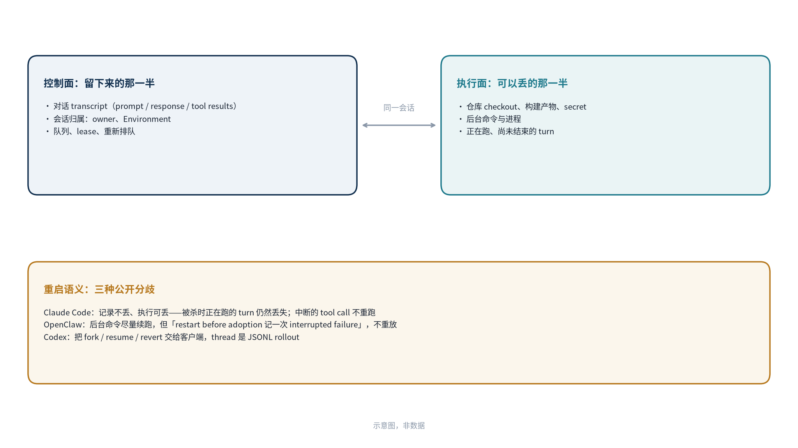
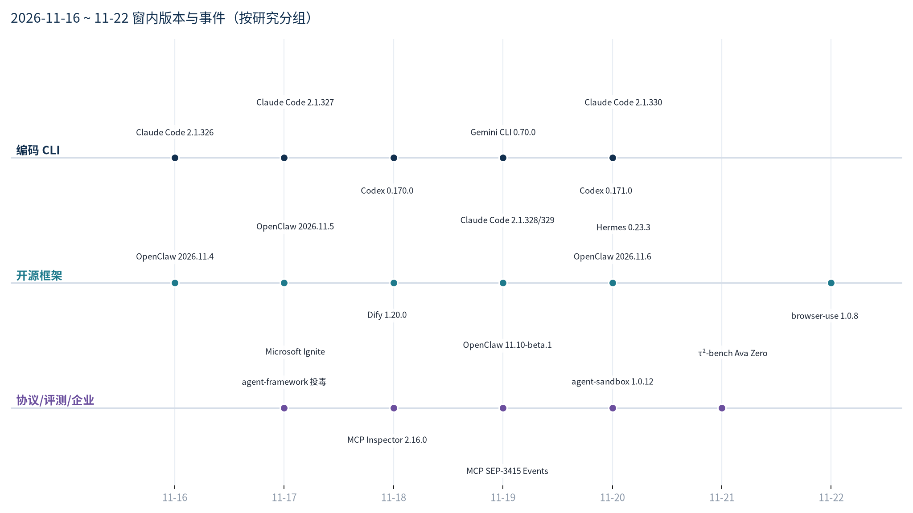

本周最一致的动作，是**不再相信「这个会话已经被授权过」**。MCP 的 Events 扩展把授权拆成订阅、投递、行动三个时点，并写明「事件到达不构成行动授权」；OpenClaw 的 21 条安全修复全部指向「动作发生前再校验」；Pulsar 把终端里打的那个「y」换成平台生物识别或 passkey；Dify 的审批带上了身份校验与投递记录。

与此同时，会话本身正在变长。Claude Code 的会话能按 transcript 路径恢复、跨设备继续，OpenClaw 让后台命令跨 Gateway 重启续跑，Codex 把 thread 做成 app-server 的协议对象，Windsurf 把本地 session 改成后台进程。**会话活得越久，一次性的授权就越不够用**——这是本周所有改动的共同背景。

## 本期要点

**MCP 第一次给「用户不在场」的 Agent 装了原语，而且把授权切成三段时间。** 11-19 合并、11-20 登记的 SEP-3415 定义了 `io.modelcontextprotocol/events` 扩展：五个 `events/*` 方法，Poll、Push、Webhook 三种投递模式按事件类型分别广告，没有一种是强制的。真正决定架构的是三条设计。第一，授权分三处校验——订阅时看 principal 对该事件类型的权限，投递时周期复核、撤权就发 `terminated`，**行动时事件到达不算授权**，后续工具调用仍走正常 MCP 授权。第二，`truncated: true` 表示事件流可能缺口，客户端应回到工具读权威状态，而不是重连。第三，交付语义不承诺 exactly-once：有持久上游时至少一次，emit-only 事件跨重启最多一次。扩展是 Beta，核心规范仍是 2026-07-28，下一版要等 2027-03-30。同期 TypeScript SDK 合入通用扩展运行时，`Protocol.use` 中间件能在参数校验之前拦截 `tools/call`——这是审计与策略的天然入口。

**Claude Code 一周五个版本，改的是权限默认值，翻的是失败语义。** 2.1.326 到 2.1.330 只加了三个真能力：Enterprise Admin Console 组织登录、内置 mod `easel`、Code Mode 与 agent teams 合流。其余是把默认值整体往「少授权」推：auto mode 停掉部分此前能跑的 shell 命令，`bypassPermissions` 下部分调用改为要审批、无人可问时拒绝，沙箱默认不写敏感 home 目录。但同一周里，2.1.329 让 Code Mode 中 `PreToolUse` hook 报错**不再拒绝**调用——默认从 fail-closed 变成 fail-open，守卫型 hook 必须显式写 `"onFailure": "block"`；2.1.327 还让 shell 启动文件可能在审批之前执行。`max_tokens` 超限重试在 326 加、329 删、330 恢复，三次反转说明这是故障驱动的快速回滚。采购上有一条容易漏：`stable` 通道整周停在 2.1.323，五个版本只进 `latest`。

**OpenClaw 的三连发里，11.6 是安全线，而且在同一条 bug 类上再犯一次。** 11.4（11-16）→ 11.5（11-17）→ 11.6（npm 11-19T16:52Z）构成窗内的稳定路径；11.10-beta.1 是并行的功能 beta。11.6 的 `Security and Privacy` 21 条几乎每一条都是「授权在动作发生前重新校验」：PostgreSQL 写入提交前校验 authority、排队中的 cloud-worker 删除在接受动作前校验权限、会话搜索在检索中被撤权后返回空。更值得记的是复发：上期修的是「TLS 指纹空白就关掉证书校验」，本周在 worker 工作区上传/下载上出现同一形状的「fingerprint 空白就不校验」，修法也一样——空白走 CA 校验，显式指纹无效就在发送凭据之前拒绝。11.10-beta.1 则给出 durable execution：后台命令跨 Gateway 重启继续跑（macOS），subagent 结果跨重启保留，状态升级改成启动时 copy-and-swap。

**AutoGen 的官方继任框架，本周成了供应链事件。** 11-17，PyPI 包 `agent-framework` 的 1.26.1 与 1.26.2 被投毒：`.pth` 启动钩子在 Python 启动时执行，收集凭据类环境变量、其他进程的 `/proc/*/environ`、`~/.azure/*.json` 与 Azure DevOps 的 `.credentials`，主动请求 Azure IMDS 托管身份 token，1.26.2 还加了 GitHub Actions OIDC。数据压缩、Base64 后 POST 到硬编码的 `webhook.site` 地址。第二版是刻意对抗扫描器：把合法的 `__init__.py` 逐字节还原，payload 挪到新的顶层模块与新的 `.pth`，只检查入口文件会漏掉。两版现已被移出 registry，`pypi.org` 上最新仍是 1.26.0（11-12），这一点已按 registry 元数据逐字核对。微软官方公告本次未取得（仓库、releases、advisories 三入口 404），机制细节来自 Socket 单方披露。

**Codex 把「会话」做成了协议对象。** 0.171.0（11-20）加了 `codex exec --remote`，可以在既有的 app server 上起或续非交互会话；app-server 用 JSON-RPC 2.0 暴露 `thread/start|resume|fork|read|archive|delete|compact|revert` 与 `turn/steer`，thread 的持久日志是 JSONL rollout，可按页读、可 fork 到指定 `lastTurnId`、可回退。同版把 GPT-6.2 Sol 设为模型目录默认、TUI workspace 默认开启。changelog 里还有两条基础设施项：agent-tree suspension and recovery、SPIFFE JWT-SVID 工作负载身份。

## 会话搬出了进程，也搬出了「一个 turn」

Claude Code 的 self-hosted environments 把这件事写到了最细：Environment 是命名目的地，Runner 是客户网络里的进程，Session 是开发者的任务。控制面把会话放进队列，runner 领走并持有租约；每次轮询刷新租约兼作心跳，租约约 60 秒失效后，服务端再花几分钟把会话重排给另一个 runner。状态是分区的——仓库 checkout、构建产物、secret 留在客户机器；对话本身发往 Anthropic，由它存 transcript，所以能从另一个 surface 恢复。代价只有一句：**跑得比 kill 更久的那个 turn 仍然会丢。**

本地后台会话却是另一套语义。agent view 由独立 supervisor 进程托管，机器睡眠后 supervisor 重连，正在回复中被睡断的会话会由 supervisor 重启进程、**从断点继续**。同一个产品，云端 runner 上被杀掉的 turn 直接丢，本地后台会话能续上。**会话的持久性不是产品级属性，是 surface 级属性**——这是选型时最该问清楚的一句。

会话对象自身还有一条硬规则：它是一份**单写者日志**。`claude --resume <transcript-path>` 可以按 `.jsonl` 路径恢复，恢复会还原历史、模型、agent 与 permission mode，但中断的 tool call 不会重跑，后台 subagent 与 background Bash 只在 transcript 里留一条「没跑完」的注记。同一个 session 在两个终端同时 resume，两边写同一个文件，之后再 resume 可能缺消息——官方要求用 `--fork-session`。

同一方向还有三家：OpenClaw 让 subagent 结果跨 Gateway 重启保留，但明确「不重放已被消费的结果」；Hermes 把存储层拆到 persistence 接口之后、SQLite 作为后端；Windsurf v3.13.4 把本地 session 改为后台进程运行，关掉客户端也不中断。

*图 1：会话状态的分区与三种重启语义。示意图，非数据；依据 Claude Code self-hosted environments 文档、OpenClaw automation 文档与 Codex app-server 协议整理。*

## 授权为什么必须退回每次动作

MCP 的三时点是最完整的协议级答案，但产品侧本周是六家在同时做同一件事。OpenClaw 的 trust model 写得很直白：**「Authority is checked when work starts. An admitted request may finish after a role, grant, or policy change.」** 排队、重试、重放、定时任务都在下一次请求开始时校验当前权限；已保存的工作标识的是**原始认证请求者**，不是 session owner，也不是调度器。这解释了 11.6 那 21 条修复为什么长这样——它们修的不是权限表，是「检查发生的时间」。

Pulsar 2.0（11-19）把确认从终端挪到了操作系统：变更需要 Touch ID、Windows Hello、polkit 或 passkey 确认，首个答案生效，重复拒绝会 backoff，每次检查进审计。原文那句「The word typed back in your own terminal is now only the last resort」说清了动机——常驻 daemon 一旦存在，终端里那个词就不再证明操作者是谁。

Dify 1.20.0（11-18）把审批做成了带身份的投递系统：渠道层是 IM 回调加签名，身份层是联系人目录或 Dify 登录/邮件验证码，投递层有模板、投递记录与测试发送，超时 7 天。审批从此是一个可重放的持久事件，不再是阻塞的 HTTP 请求。同一版把 `OPENAPI_ENABLED` 默认从 false 改成 true——升级时这一条比 HITL 更需要写进变更单。

名单外还有一个更彻底的形态：Coral 把授权粒度降到**一段代码**。agent 写短 TypeScript 程序调用工具，跑通后存成 custom tool；默认「读直接跑、其他要批」，而程序内部每次 provider 调用仍逐次过策略。它给出的理由是 MCP gateway 的通病：只决定 agent 能看到哪些工具，是 all-or-nothing——能调 `update_record` 就能以任何方式改任何记录。

## 第三只时钟：工具会静默变，经验不会失效

本周两篇预印本把这条讲清楚了。《Experience Rot》（arXiv 2611.20922）测试工具以 MCP 定义、发生**静默变更**之后的 Agent：有经验的 Agent 在多数任务上失败，新上手 Agent 多数成功；失败模式是「复制此前的调用，而不检查当前接口」，随后**自报成功**；公告更新与指向文档几乎无效，除非文档把答案写死。

另一篇（arXiv 2611.21577）给出攻击版本：不需要攻破宿主、模型、合法服务端或网络，只再跑一个 MCP server，广告选定的工具名、描述与 schema，就能让请求落到错误 provider；最强失败出现在**精确同名 + 任务对齐描述 + 兼容 schema** 三者叠加时。

供应链侧同一周也在补：MCP Inspector 2.16.0 / 1.0.6（11-18）给 SSE 单行、单事件设 16 MiB 上限，修无界流 DoS；Registry v1.8.12（11-22）把 OSV 恶意软件比对接进发布与每日巡检。两条都在补宿主与包，没有一条在补「经验失效」。

## 编码 CLI：默认值在收紧，路线在分叉

Gemini CLI 0.69.0 / 0.70.0（均 11-19）是一版策略引擎修正：`commandPrefix`/`commandRegex` 改为匹配**顶层命令参数**（堵 `cd x && git push` 这类包装绕过），`argsPattern` 改用 re2js 做线性时间评估（防正则回溯），shell 命令存在未解析展开时保持 `ASK_USER`，并跳过「命令权限不安全」的系统 MCP server。

Cline 走了反方向。CLI v3.0.75（11-21）把一次性运行默认从 act 改成 yolo，理由是「没人在键盘前批准工具」；yolo 没有 team 工具，需要时得显式 `--act`，而且 CLI 不再读启动目录的 `.env`。同一周，Claude Code 的选择是「无人可问时拒绝」。两条路线正面撞上，升级前值得先确认自己站在哪一边。

OpenCode v2.3.2 给出本周唯一可核的成本修复：GPT-6.2 不缓存放在 Responses `instructions` 字段里的 system prompt，导致每步都按未缓存输入计费；改成作为前置 developer 消息发送后，官方给的数字是每步未缓存输入从约 14,000 token 降到 3 token。browser-use 1.0.6 则把默认模型从 `bu-fast` 换成 `bu-4.0`，单价约 15 倍——两件事放一起看：**默认值是成本决策，不是技术细节**。

## Computer Use：这一周的关键词是「可交付」

OpenAI 11-16 的医疗长文是本周最完整的一条链。可核锚点包括：325 个受评任务中 99% 被判安全，646 次医生评估中 93% 选「很有帮助」，HealthAdminBench 上 GPT-6 Astra 94.3%、Luna 91.8% 而后者每任务 8.5 美分。更有用的是同时开源的 CVS `cua-agent-kit` 的三段式：Discover 用 CUA 探索并落盘截图、`events.jsonl`、Playwright trace；Codify 用一个 Codex skill 读证据，生成**语义 locator** 的 Playwright/pywinauto 代码；Run 执行确定性代码，**不调用模型、不需要 API key**。它的 README 同时自曝：`trace.zip` 可能含凭据、cookie、DOM 快照，开对象存储后端会上传整个 run 目录且不做额外脱敏。**录制既是原料，也是外流通道。**

Google 11-19 把 CUA 放进消费级客户端：Gemini app for Mac 在独立后台窗口里操作本地文件与桌面应用，聊天内实时预览，用户按应用授权、可随时暂停、关键动作前需批准，先以英语、美国上线。Project Mariner 的页面已经一次都不出现「Mariner」，这条叙事实际上被 Gemini app 取代了。

Anthropic 本周接口未变：窗内只有文本水印与 linked billing 两条，`computer_toolset_20260801` 仍是唯一工具集、17 个成员工具。两条稳定约束值得记住：工具集不接受 display 尺寸参数、API 不替你缩放，超限截图被拒绝而不是降采样——坐标系主权在集成方。

## 企业与协议：身份进了 IAM，评测开始看提交包

Microsoft Ignite（11-17）把 Agent 变成 IAM 对象：Autopilot 有**自己的 Entra Agent ID、具名经理、独立审计流**，登录与动作以 Agent 自己的名字记录；Entra 的管控范围扩到 **MCP servers、plugins、skills**。对采购的含义很直接：问题从「模型多强」变成「这个 Agent 有没有身份、能不能封禁、能不能限额」。

沙箱层有一个必须记住的区分：agent-sandbox v1.0.12 加了三套 SDK 的 `suspend()/resume()`，但 release notes 明写**运行中的进程、内存、emptyDir 不保留，除非配 pod snapshot——暂停不是快照**。同版发的 Ed25519 v2 scoped token 绑定 `(namespace, name, uid)`，升级时必须先升所有 sandbox-router 副本，否则旧副本会以 403 拒绝新 token。

评测侧，本周没有权威榜单刷新：SWE-bench 最后提交停在 2026-09-02，WebArena 停在 2025-11-26，OSWorld 最近一次在 11-12（窗外），GAIA 仓库 404。唯一新分数是 τ²-bench 的 Ava Zero voice-v2：900 trials、87.33%，但质量诊断显示 en-airline 的 `tool_misuse` 被 flag 34/50。这个提交包本身——逐 trial 指纹、逐语言 cell、质量 component——比总分更值得看。

## 本周 vs 上周

| 主线 | 上周（第 24 期） | 本周（第 25 期） | 走向 |
|---|---|---|---|
| 授权单位 | 从「一次调用」抬到「一段程序」 | 再抬到「一次动作 + 一个身份」：MCP 三时点、OpenClaw admission、Pulsar passkey | 延续，换了层 |
| 会话生命周期 | 会话仍在终端/进程里 | 出进程：self-hosted runner、app-server thread、后台 supervisor、durable execution | 新出现 |
| 供应链 | 发布管线放行失败、管线打补丁 | 包本身被投毒（agent-framework 1.26.1/1.26.2） | 升级 |
| 身份 | 个人 Agent ↔ 商家协议（Sierra Poppy） | 进 IAM：Entra Agent ID 管控 MCP servers/plugins/skills、SPIFFE、scoped token | 延续，制度化 |
| 默认值 | Codex `--trust`、Cline yolo | Dify OpenAPI 默认开、CrewAI 换向量库、browser-use 换贵模型、Cline 再收紧 | 延续，更集中 |
| 评测 | 旧榜只维护，MKA 换评分对象 | 旧榜仍无更新；τ² 把「提交包」做成可审计件 | 延续 |

上周的动作空间换成了代码，本周把「谁在什么时候批准这段代码」拆得更细：会话可以活得比进程久，但授权不能跟着会话一起续期。**能恢复的是记录，不能自动恢复的是许可。**

*图 2：本期关键节点（2026-11-16 ~ 11-22，CST）。数据来源：各项目 release、npm registry、SEP 与官方文档，逐条日期见资料库母稿覆盖表。*

## 对你意味着什么

**编辑建议：先把「会话」和「授权」当成两个不同的生命周期来设计。**

对开发者：

- 如果你的 Agent 依赖「重启后继续」，先分清哪一半会丢：Claude Code 云端 runner 上正在跑的 turn 会丢、本地后台会话会续；OpenClaw 的后台命令跨重启续跑但没 adoption 的 run 只记一次失败。把有副作用的步骤写成可重入的，比指望恢复更划算。
- 同一个 session 不要在两个终端同时 resume（单写者日志，会缺消息）；要并行就用 `--fork-session` 或 Codex 的 `thread/fork`。
- 用 Claude Code `latest` 的，升级后先跑一遍 `/status` 的坏文件与权限清单，并给所有守卫型 `PreToolUse` hook 补 `"onFailure": "block"`——329 之后默认是放行的。
- 用 Cline 的，一次性运行现在默认 yolo，CI 里要显式钉住 `--auto-approve false` 或模式旗标。
- 用 Dify 的，先确认 Langfuse 端点已迁（Cloud 11-16 退役旧摄取），再检查 `OPENAPI_ENABLED` 默认打开后的暴露面。

对架构负责人：

- 把授权拆成「准入」与「续跑」两件事：准入可以在动作开始时校验，续跑必须能重新校验。MCP 的订阅/投递/行动三时点是现成的模板。
- 事件驱动的 Agent 必须保留回读权威状态的路径。`truncated: true` 与 at-most-once 是协议明写的，不是实现缺陷。
- 工具列表要显示 provider 身份，不只工具名；同名/近名工具要有冲突提示。misbinding 的攻击成本极低。
- 供应链检查加两项：审计 `site-packages/*.pth`（安装即执行绕过了「我有没有调用它」），给云 OIDC 签发加 audience 白名单。
- 沙箱采购分两层问：隔离边界（gVisor / microVM）与会话生命周期（agent-sandbox / suspend vs snapshot）。「暂停」不等于「快照」，这一条会直接影响恢复语义。

## 来源

- MCP SEP-3415｜https://github.com/modelcontextprotocol/modelcontextprotocol/blob/main/seps/3415-events-extension.md
- MCP ext-events Beta 规范｜https://github.com/modelcontextprotocol/ext-events
- MCP Inspector releases｜https://github.com/modelcontextprotocol/inspector/releases
- MCP Registry releases｜https://github.com/modelcontextprotocol/registry/releases
- Claude Code releases｜https://github.com/anthropics/claude-code/releases
- Claude Code sessions｜https://code.claude.com/docs/en/sessions
- Claude Code self-hosted environments｜https://code.claude.com/docs/en/self-hosted-environments
- Claude Code agent view｜https://code.claude.com/docs/en/agent-view
- Codex releases｜https://github.com/openai/codex/releases
- Codex app-server｜https://learn.chatgpt.com/docs/app-server
- Gemini CLI releases｜https://github.com/google-gemini/gemini-cli/releases
- Cline releases｜https://github.com/cline/cline/releases
- OpenCode releases｜https://github.com/anomalyco/opencode/releases
- Devin release notes｜https://docs.devin.ai/release-notes
- Replit updates｜https://docs.replit.com/updates/2026/11/20/changelog
- OpenClaw releases｜https://github.com/openclaw/openclaw/releases
- OpenClaw 2026.11.6｜https://docs.openclaw.ai/releases/2026.11.6.md
- OpenClaw trust model｜https://docs.openclaw.ai/gateway/security/trust-model.md
- Socket：agent-framework 投毒｜https://socket.dev/blog/agent-framework-pypi-package-compromised-with-credential-stealer
- Hermes v0.23.3｜https://github.com/NousResearch/hermes-agent/releases/tag/v0.23.3
- Dify v1.20.0｜https://github.com/langgenius/dify/releases/tag/1.20.0
- CrewAI 1.15.42｜https://github.com/crewAIInc/crewAI/releases/tag/1.15.42
- browser-use releases｜https://github.com/browser-use/browser-use/releases
- OpenAI 医疗 computer use｜https://openai.com/index/advancing-computer-use-for-healthcare-teams
- CVS cua-agent-kit｜https://github.com/cvs-health/cua-agent-kit
- Gemini Mac computer use｜https://blog.google/innovation-and-ai/products/gemini-app/computer-use-mac/
- Anthropic computer use 工具｜https://platform.claude.com/docs/en/agents-and-tools/tool-use/computer-use-tool
- agent-sandbox releases｜https://github.com/kubernetes-sigs/agent-sandbox/releases
- gVisor releases｜https://github.com/google/gvisor/releases
- Microsoft Ignite｜https://www.microsoft.com/en-us/microsoft-365/blog/2026/11/17/copilot-at-microsoft-ignite-expanding-whats-possible-with-intelligence-built-for-work/
- Harvey 核验体系｜https://www.harvey.ai/blog/how-harvey-is-building-reviews-and-verification
- τ²-bench PR #771｜https://github.com/sierra-research/tau2-bench/pull/771
- Experience Rot｜https://arxiv.org/abs/2611.20922
- Provider misbinding｜https://arxiv.org/abs/2611.21577
