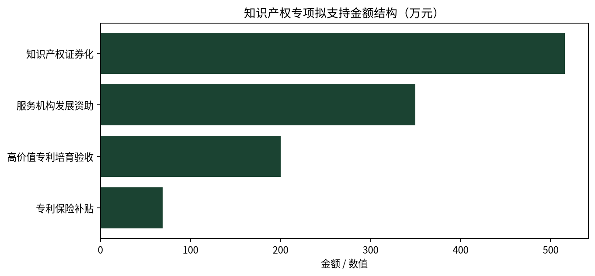
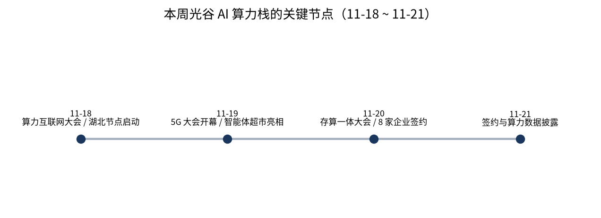

光谷这一周做的不是又办三场会，而是把 AI 算力栈的三层各钉下一个节点：11 月 18 日国家算力互联互通区域（湖北）节点启动，11 月 20 日 8 家存算链企业签约，11 月 19 日智能体超市把算力按词元摆上货架。网络、芯片、应用在同一周接上。

本周披露的两条线也值得记：TCL 华星把印刷 OLED 推进主流小批量，3551 大赛 19 个项目拿到 2.33 亿元投资意向；而土地面继续空窗，81 号 3 宗工业地仍是「库内无记录」。

## 本期要点

**1. 光谷在同一周把 AI 算力栈的三层各钉下一个节点（11-18~11-20）。** 芯片层，11-20 存算一体产业创新发展大会上，光谷与大普微、君正股份、华大九天、亿铸科技、微珩启元、梦忆科技、澜昆微、轲越智能 8 家企业集中签约，覆盖 EDA 工具、存算芯片设计、存储底座、高速互连；其中大普微（创业板 301666）已明确在武汉注册全资子公司、研发人员长期驻汉，到光谷产业链企业和华中科技大学约半小时，其 2026 前三季营收 98.35 亿元、同比 +678.13%，归母净利 25.43 亿元。载体光谷存算双创园位于未来二路以西、科技四路以北，177 亩、约 31.75 万平方米，「龙头企业的核心配套基地」「建设正酣」。网络层，11-18 算力互联网大会上，国家算力互联互通区域（湖北）节点正式启动——湖北是华中唯一入选省份，节点承担华中算力标识注册、资源汇聚、互联调度，会上还发布了首条长距 RDMA 安全训推线路、千公里商用验证结果与「两张清单」。应用层，11-19 武汉智能体超市在 5G 大会智能体供需对接专场首次亮相，阿里、腾讯、字节跳动、中国电信入驻，上线词元交易中心与多档词元套餐，企业可按需调用 200 余款认证模型；全市 2.2 万个智能体已在 5700 个场景落地。（[8 家签约](https://www.wuhan.gov.cn/sy/whyw/202611/t20261121_2883127.shtml)｜[算力互联网大会](https://jxt.hubei.gov.cn/bmdt/jxtyw/202611/t20261120_6128791.shtml)｜[智能体超市](https://www.wuhan.gov.cn/sy/whyw/202611/t20261120_2882577.shtml)）

三层互为条件，缺一层另两层都转不起来：没有跨域调度，本地算力卖不出省；没有存算一体，端侧推理的功耗与时延降不下来；没有词元计费，中小企业不知道该买什么。存算一体的原理并不玄——传统架构里数据要在计算与存储之间反复搬运，形成「存储墙」和「功耗墙」，把计算搬到存储旁边或内部、让数据少搬家，端侧才能在不联网、不背大电池的情况下跑实时推理。这也是为什么大会把「存算一体」与「具身智能」放在同一段讲：机器人需要的就是低时延、低功耗的本地算力。

**2. 印刷 OLED 在光谷从「能做」走到「能卖」：TCL 华星一次发布 5 款行业领先显示产品，t12 产线月产能从 3000 片提到 9000 片（事件 11-13 / 本周 11-17 披露）。** 11 月 13 日的 DTC 2026 在光谷发布 115 英寸 16K 2D/3D 兼容光场 TV、27 英寸印刷 OLED 氧化物内补 QHD 500Hz 电竞显示、6.36 英寸全球首款蓝磷光 OLED 手机显示、10.95 英寸全球首款全角度无损防窥 OLED 平板，以及全球首款显示研发设计全流程硅基员工；蓝磷光手机屏在相同亮度下 EL 功耗降低约 20%、发光效率提升 40%。更关键的产能数字是：t12 印刷 OLED 产线月产能由 3000 片提升至 9000 片，显示器、笔电等中尺寸产品陆续量产出货。TCL 华星 2014 年落户光谷，已在汉布局 4 条产线、累计投资超 800 亿元，接下来还将在武汉落地 TCL 人工智能实验室。（[区网](https://www.wehdz.gov.cn/2022/ggxw_68627/cydt_68630/202611/t20261117_2881201.shtml)）

印刷 OLED 把发光材料做成「墨水」，像印报纸一样喷印到玻璃基板上，比蒸镀更省材料，也更适合中尺寸混线；难点在墨滴铺展均匀性、干燥成膜控制与像素定义，这正是真空干燥设备成为关键设备的原因——此次发布的显示器，其真空干燥设备由武汉国创科与 TCL 华星联合开发定制。从 3000 片到 9000 片/月，说明良率与节拍已经支撑中尺寸量产，商业化拐点从「能做」变成「能卖」。

**3. 光谷的早期资本正在往上游「卡脖子」环节走：3551 大赛 19 个项目拿到 2.33 亿元投资意向，集成电路项目集中在先进封装 EDA、特种气体、晶圆缺陷检测（11-18）。** 总决赛前的闭门会为期 3 天，清控银杏、华工未来基金、中珈资本、聚华传新等 14 家机构现场投决，江城基金、光谷种子基金、交通银行等参加；生命健康 5 个项目单个最高意向超 3000 万元。集成电路成为热门赛道，项目集中在 2.5D/3D 先进封装 EDA、半导体特种气体、晶圆缺陷检测设备等上游环节——相比往年应用端扎堆，这一届的攻关重心明显上移。大赛已办 10 届，累计吸引全球 5600 余个项目、落地 430 个硬科技项目、培育 35 位 3551 创业人才。（[区网](https://www.wehdz.gov.cn/2022/ggxw_68627/cydt_68630/202611/t20261118_2881641.shtml)）

需要说清的是「意向」二字：闭门会加现场投决，是把投资决策前置到评审环节，项目方拿到的是可继续尽调的价格区间，不是到账资金。2.33 亿元应读作「管道里的潜在资金」，能不能转化，要看接下来的尽调和条款谈判。

**4. 央行回购增持再贷款工具落到了光谷的注销式回购上：精测电子拿到 1.8 亿元贷款承诺函，覆盖 2 亿元回购上限的 90%（11-21 披露）。** 精测电子 11 月 20 日董事会取得民生银行武汉分行《贷款承诺函》，最高限额 1.8 亿元、期限 3 年，专项用于回购或增持，资金通过专用证券账户封闭运行；公司援引的是央行、金融监管总局、证监会关于股票回购增持再贷款的通知。它的回购方案是 1~2 亿元、价格上限 210 元/股、全部注销并减少注册资本——1.8 亿元授信覆盖了 2 亿元回购上限的 90%，意味着回购资金几乎可以全部靠外部资金完成。同周光迅科技也通过股东大会决议，回购注销 3.57 万股限制性股票，注册资本由 827,716,738 元减至 827,681,038 元，进入 45 天债权人申报期。（[精测公告](https://static.cninfo.com.cn/finalpage/2026-11-21/1225680610.PDF)｜[光迅公告](https://static.cninfo.com.cn/finalpage/2026-11-17/1225673793.PDF)）

这条「央行再贷款—商业银行—上市公司」的传导链，比 1.8 亿元本身更重要：它说明这类工具已经下沉到光谷中型上市公司，后续同区域公司复制的门槛在降低。精测选择「全部注销」而不是用于员工激励，是对二级市场最友好的回购类型——直接减少总股本、抬升每股收益。

**5. 光谷正在把专利变成可融资资产：知识产权专项一次公示 22 家、1135.3 万元，其中 11 家走证券化（11-17）。** 区市监局公示的拟支持名单分四类：知识产权证券化 11 家、516 万元（单笔最高湖北云天建设 105 万元）、服务机构发展资助 6 家、350 万元、高价值专利培育验收 1 家、200 万元（精立电子）、专利保险补贴 4 家、69.3 万元；公示期到 11 月 23 日。依据是《关于促进知识产权保护与运用的若干措施》（武新管市监〔2025〕1 号）。（[区网](https://www.wehdz.gov.cn/2022/ggxw_68627/tz_68628/202611/t20261117_2881006.shtml)）

四个方向对应四种风险或成本的外部化：专利保险把「打不起官司」变成「保费可预算」；知识产权证券化把专利未来的许可或质押现金流打包成 ABS，财政补的是融资成本；服务机构资助补的是服务产能，连深圳紫藤的武汉分公司也拿到与本地机构同档的 100 万元；高价值专利培育是事后验收、达标才付。合起来，覆盖了确权—维权—融资—运营四段。这也是光谷这两年在做的一件事：让没有厂房抵押物的科技企业，用专利换现金流。

*图 1：本周知识产权专项拟支持金额结构（万元）。知识产权证券化 516 万元、服务机构发展资助 350 万元、高价值专利培育验收 200 万元、专利保险补贴 69.3 万元，合计 1135.3 万元。数据来源：东湖高新区市场监督管理局《关于知识产权专项拟支持企业名单公示的通知》（11-17），表内 22 行逐行汇总。*

## 算力与存算：把「底座」拆开看

8 家签约企业里，只有 4 家能补全画像。大普微做企业级 PCIe SSD 及主控，122TB QLC 已商用、245TB 送测、512TB 发布，PCIe 6.0 主控在研；华大九天是 EDA 全流程工具商（301269），产品线里包含存储电路设计全流程 EDA，与存算芯片的设计流程直接对应；君正股份按 A 股 300223 北京君正核对，做集成电路设计；亿铸科技在苏州，走的是「基于新型存储的全数字存算一体」路线，董事长熊大鹏 30 年前曾在华中科技大学任教。另外 4 家——微珩启元、梦忆科技、澜昆微、轲越智能——除签约事实外，主业、落地主体、融资状态都没有公开信息，本期不为它们编写画像。

*图 2：本周光谷 AI 算力栈的关键节点（11-18 ~ 11-21）。11-18 算力互联网大会与国家算力互联互通区域（湖北）节点启动；11-19 5G+工业互联网大会开幕、武汉智能体超市亮相；11-20 存算一体大会与 8 家企业签约；11-21 签约与算力数据披露。数据来源：省经信厅、市政府网、长江日报本周报道。*

把这条链摊开看，四段缺口很清楚：EDA 工具、存算芯片设计、存储底座、高速互连。缺任何一段，存算一体都只能停在实验室。光谷的底气在存储与封装：长江存储的介质、武汉新芯的 3D 封装，被亿铸董事长直接点名为选址理由；大普微董事长杨亚飞的说法更直白——「做半导体必须来武汉」，此前在武汉没有落脚点，研发人员从深圳往返不便，现在注册了全资子公司，到产业链企业和华科大约半小时。

载体也在同步推进。存算双创园 177 亩、31.75 万平方米，定位「龙头企业的核心配套基地」，11 月 21 日的现场描述是「建设正酣」。把土地台账翻出来看，2026 年光谷工业地成交 30 宗、300.46 万平方米、19.17 亿元，其中平台类主体拿地 10 宗、207.27 万平方米，占面积 69%——真实的供给结构是「平台先拿地、企业后入园」，存算双创园正是这条链条的下游。

算力侧的数字要带着日期读。11 月 19 日的大会稿说武汉高性能算力突破 5500P，11 月 21 日的推进会稿说累计建成 9852P、年内新增 4578P；数据集也有 204 个（平台上架）与 195 个（入库）两个口径。两组数字可能分别对应智算与高性能算力、上架与入库，原文没有解释，本期并列呈现，不做加减。可以确认的是平台层的变化：武汉算力公共服务平台 3.0 打通算力并网、智能调度、Token 计费、一站式交易，上架算力超 10000P、可调度 2100P、累计撮合交易 6240 万元，算力券实现免申即享。

5G 与 6G 是这张网的另一个截面。2026 中国 5G+工业互联网大会 11 月 19 日在武汉开幕，这是武汉第七次承办；全国口径建成工业 5G 专网 2.7 万个、5G 工厂 1260 家、卓越级智能工厂 750 余家、领航级 49 家；湖北建成 5G 基站 20 万个、5G-A 基站 2.9 万个、5G 工厂 480 个（含在建），其中 101 个入选全国 5G 工厂名录、数量全国第三。武汉还是全国首批 6G 开放实验装置的落地城市，并建了「1 毫秒城市圈、3 毫秒城市群、10 毫秒国家枢纽」三级时延体系。中国信科移动展出的通感算智 6G 云化基站原型样机，把通信、感知、算力、智能放进同一个基站——这是「算网融合」最直观的一个实物。

## 企业与资本：一条显示线、一笔回购贷款、一个「链在光谷」

显示线的外溢在设备与材料。TCL 华星在汉 4 条产线、累计投资超 800 亿元，印刷 OLED 的关键设备真空干燥设备由武汉国创科联合开发定制；供应链展区里，联想、微星、学而思展出了搭载华星屏的整机。TCL 华星印刷 OLED 中台总经理曹蔚然的说法是，印刷 OLED 消费产品从验证、原型下线到小批量量产，绝大部分落地光谷；接下来想把 AI 能力和定义能力也落到湖北，在武汉落地 TCL 人工智能实验室。光谷已是全国最大的中小尺寸显示面板研发生产基地，建成 6 条显示面板产线、集聚 50 多家新型显示产业链企业，产业规模占武汉近六成。

资本侧本周整体偏轻。19 家固定名单上市公司里只有 7 家有窗内公告，真正改变资本结构的只有精测的回购贷款和光迅的回购注销；其余是业绩说明会、经营范围、诉讼进展、独董培训等信息性披露。值得单独记一笔的是信科移动：子公司大唐移动与展讯通信一笔 6.805 亿元的技术合作开发合同纠纷，11 月 18 日披露已达成调解并收到民事调解书，公司称对当期及期后利润不构成负面影响——这是一笔或有负债的拆除，不是收益确认。兴图新科则在 11 月 16 日董事会通过增加「货物进出口、技术进出口」经营范围，理由是国际化战略；这不是一句口号，而是取得外贸经营资格的前置合规动作。

「链在光谷」的最好像素是脑机接口。11 月 19 日，华中科技大学同济医学院附属同济医院国家医学中心转化医学大楼正式启用，湖北省脑机接口技术创新中心与手术机器人培训中心在二楼同层布设；14—17 层的湖北省医疗健康前沿数智中心归集了超过 1 亿份脱敏病历、覆盖 1900 万名患者，是湖北首家完成医疗数据产权与产权凭证「双登记」的机构。**楼在同济，不在东湖高新区**；光谷的角色是产业链核心区——沿地铁 2 号线，金融港北站的衷华脑机做高通量植入式系统全链路国产化，光谷广场站周边的格林泰克供应国内 90% 非侵入脑机企业的脑电电极、配套过神舟十七号航天员脑电帽，佛祖岭的依瑞德把神经调控设备卖到全球 5000 多家医疗机构。武汉 20 家上下游企业「初步形成以东湖高新区为核心、多区协同」的格局，湖北的脑机接口临床试验超过 60 项，其中超六成是省外企业委托——对全国企业来说，武汉是一道绕不开的临床验证关口。

一级市场仍然没有可核的「完成 X 轮融资」稿。最近两条同类稿停在 10 月 15 日和 9 月 17 日；3551 的 2.33 亿元是意向，不是股权融资事件。更准确的判断是「无披露」而非「无事件」：闭门会形式的对接在发生，但条款、投资方、金额都没有公开。

## 政策与人才：短窗口、硬截止

本周区级政策的关键词不是「发文」，是「截止」。6 条实质通知里 4 条在发布后 3~7 天内截止，且都要求胶装纸质件、盖章、现场报送——真正筛掉申报者的不是政策门槛，而是能不能在几天内凑齐审计报告、发票、资金流水、测评报告这类长周期材料。

国家级首版次软件最典型。11 月 16 日转发、11 月 20 日 12:00 截止，方向只留工业软件，申报单位注册地必须在东湖高新区，产品须已市场化销售、三年内不停售；材料要销售合同、发票、资金流水三件套互证，还要附第三方测评报告。测评依据两份团体标准，手段写明「文档审核、工具扫描、指定功能代码现场修改」——第三项把「自主可控」从声明变成可验证动作：机构现场改一段指定功能代码，看产品是否按预期响应；被测源代码加密存在企业，机构与企业各持一把密钥，保存期不少于 3 年。这份通知全文没有资金额度，它是资格与目录类政策，不是补贴。

新能源汽车关键零部件量产产线的「揭榜挂帅」则相反：11 月 20 日发布、11 月 27 日 17:30 截止，不设投资额门槛，门槛换成了技术指标——混动/增程涡轮增压器最高总效率 >54%，超高速电驱转速 ≥20,000 r/min、功率密度 ≥5.0 kW/kg，电动冷却压缩机采用空气轴承、无油润滑、50,000 r/min 以上高速电机加离心叶轮；建设周期 ≤5 年，达产后增压器年产能 ≥100 万台、零排放产品线 ≥4 万台/年。能投标的玩家数量本身就很有限，真正的成本不是研发，而是联合体内部知识产权权属与收益分配的事前谈判。

2027 年度的入口也在同一周密集打开。省自然科学基金 11 月 19 日发布、12 月 21 日 12:00 截止，6 类项目全部前资助、包干制：青年 B 类与面上 10 万元/项、青年 A 类 30 万元、创新研究群体 50 万元、卓越研究群体 300~500 万元、非共识 20~30 万元；限额推荐，且已获国家或省级高层次人才项目者不得再申请青年 A 类。省预算内服务业专项要求项目总投资不低于 2000 万元，支持中试、概念验证、检验检测、技术转移等平台，园区报送 11 月 20 日截止。第九批省专精特新 11 月 16 日发布，线上申报 11 月 23 日至 29 日，市州推荐 12 月 7 日前。

人才侧，财政是静默的。3551 光谷人才计划、优秀青年人才认定、楚天英才、黄鹤英才、省双创团队在窗内都没有申报或公示公告；光博 300 的入口本次不可达，只能记「未取得」，不能记「无动态」；唯一的实质动作是 3551 大赛的资本对接。职称倒是有一条明确的截止线：11 月 20 日初级职称初定开网，网报至 12 月 3 日 17:00、纸质至 12 月 8 日 17:00，学历—资历对照、社保满 1 年、单位公示 5 个工作日是三道前置；有一条容易被忽略的规则——计算机技术与软件系列不能初定、只能以考代评，光谷数量最大的软件工程师群体，实际上被排除在这条快车道之外。2027 届管委会校招本期没有拿到：省人事考试网 500、武汉人事考试网 500、区「招考录用」栏 5 个路径均 404；能确认的只有省级侧面，2027 届事业单位招聘已在省内启动。

## 土地、营商与城建：零成交、存量载体、产业基础设施

土地这一周是空窗。省公共资源交易电子服务系统的成交公示库拉到东湖高新区「工DK」全量 168 条（2017 年至 2026-10-08），没有 2026-11 的记录；出让公告库已更新到武工告字（2026）87 号（11 月 19 日），但 80—85 号整段缺失，81 号公告本身仍不在库内。所以 81 号 3 宗（工DK(2026-06)04、工DK(2026-04)09、工DK(2026-06)03，合计约 14.59 万平方米）本期只能写「未取得」，不能写「未成交」——「库内无记录」和「事实不存在」是两件事。

窗内武汉有 2 宗成交、2 宗挂牌，全部在光谷之外：11 月 17 日蔡甸工CD(2026)16（36,921 平方米、1,275 万元、蔡甸智丰农业）、11 月 20 日经开区 P(2026)109（3,711 平方米、3,615 万元、湖北交投都市圈实业）；新挂牌的 86 号在新洲、87 号在黄陂。把 2026 年整年的台账拉出来，光谷工业地成交 30 宗、300.46 万平方米、19.17 亿元，平台类主体占面积 69%——这解释了为什么企业侧的土地新闻少、园区侧的开工与满园新闻多：增量靠平台，存量靠改造。

营商侧本周最实在的是「存量载体」这条线。11 月 19 日市长熊征宇走访中建三局，三个合作口都指向存量——智能建造产业链、五改四好城市更新、盘活存量做优增量；11 月 18 日披露的瑞启芯创（签约事件在 11 月 11 日），已经把 20 余人团队放在武汉高科大厦，明年年初入驻光谷科技成果转化中心。这个中心由 2004 年投用的烽火老厂房改造，总建筑面积近 11 万平方米，预计年底建成；瑞启芯创的选址理由不是租金，而是客户集中在转化中心为半径的 5 至 7 公里内。它卖的是厂务主系统与二次配的「工期与良率保险」，团队离客户越近，问题到现场越快。

城建的主线是产业基础设施，不是城市基础设施。本周唯一的实体工程增量是存算双创园「建设正酣」；其余是算力 9852P、平台 3.0、5 个具身智能数据训练场（总投资超 5 亿元、年量产超 20 亿条数据、服务 100 余家企业）。地铁 11 号线、13 号线、光谷长江大桥、光谷空轨窗内零节点；医院、学校、文体、人才公寓、公园、污水均为空窗或非光谷。这不是工程停滞，而是投资重心从「通车里程」转向「算力与载体」。

## 三专项雷达

**AI Agent：胜负手从模型能力转到场景密度。** 最强的信号不是某家企业的产品，而是市级数量级：截至 10 月，武汉 2.2 万个智能体在 5700 个场景落地，入库重点智能体 1489 个，覆盖 15 个行政区；前三季度 AI 产业规模 1360 亿元、同比 +44%，AI 企业超 1500 家。三个可复核的样本：格创东智的「章鱼智脑」服务武汉本地 800 余家企业、其中泛半导体 300 余家，累计 300 多个 AI 项目，与武汉新芯、东风共建数十项标杆数字化工厂——它走的是「平台 + 行业模板 + 驻场调参」，模板已收敛到可复制；长飞光纤把 AI 工业全光底座、长智远征 A3 人形机器人（分拣/质检/包装/上下料，与车间系统打通）和超百名数字员工放进同一条产线，先解决「采得到、传得稳」，再谈智能；武汉智能体超市则把 Agent 从买 License/买人天变成买 Token，做的是认证、计费、结算三层。需要保留的边界是：格创的「800 家」是服务企业数，不等于 800 家付费客户；长飞未披露节拍与替代人数；超市的词元实际单价与退订率未披露。

**大模型：冷周，动能来自立项而不是发布。** 窗内没有一家光谷企业发布新模型版本、披露新备案或公布客户签约。14 个候选里只有 3 个有窗内可核事件，其中只有中地软件是真正的项目增量：省科技厅 11 月 17 日拟立项公示里，「面向数智湖北『一张图』的地理时空智能体平台关键技术研发」由武汉中地软件承担，类别是重点研发（前沿领域）。它的产品机制值得记——五板块（工作台、空间技能体系、智能体执行流程、成果体系、可信机制），技能分「专业技能」与「场景技能」，场景技能是数据、专业能力、执行步骤、成果形式的预组合，把「做一张图」的自然语言目标落成任务流；可信机制里的来源追溯、过程记录、成果复核，才是政务场景的准入门槛。同批还有武汉大学 3 项时空大模型/智能体、微创光电 1 项无人侦测智能体网络。黑湖科技在 5G 大会讲的工业 Agent 是另一条参照：工业编译器读懂图纸表格、工厂上下文提供此刻的设备与产能、Runtime 提供工具权限与验证，产出是「可审核的业务结果」而不是一段文本。生成式 AI 备案的两条入口都失败，本期不作「无新增备案」的推断。

**具身智能：企业级增量空窗，底座在补课。** 13 个候选里只有奋进智能拿到窗内硬增量——11 月 17 日知识产权证券化拟支持 60 万元；整机、零部件、场景都没有新订单或新品。真正的增量在底座两层：存算一体被明确为具身智能的端侧算力底座，冯丹的说法是数据就地计算能破解端侧功耗与时延瓶颈；市级规划 5 个具身智能数据训练场、总投资超 5 亿元、年量产超 20 亿条多模态工业场景数据、服务 100 余家企业，已入库 195 个行业数据集、总规模超 10PB。陈学东给出的缺口是：全网可用于具身训练的有效数据不足 50 万小时，成熟大模型训练需要千万小时级，单小时采集成本最高可达千元。训练场是把「自采」变成「调用」的重资产基础设施，但 5 个训练场的选址没有点名光谷，本期不写「光谷建训练场」。5G 大会成果展上，电鹰科技的载人飞行汽车「电鹰飞车」（4 人、载重约 450 公斤）与湖北佩擎的人形机器人（导览、导购、迎宾）是展示层亮相，不是订单或量产节点。

## 本周 vs 上周

| 主线 | 上周（第 24 期） | 本周（第 25 期） | 走向 |
|---|---|---|---|
| AI 算力与存算 | 算力券 22 家、审计细则、区级兑现 3 家 27.15 万元 | 国家算力互联互通湖北节点启动；8 家存算链企业签约；算力平台 3.0 按 Token 计费 | 新出现（从补贴到栈） |
| 智能体 | AI OPC 社区 8 家 1800 万元、算力券 Token 审计 | 智能体超市上架 200 余款模型；2.2 万智能体/5700 场景；市级「十百千」 | 新出现（从载体补贴到交易市场） |
| 资本制度 | 中证光谷指数、共保体、科技金融 12 条同日落地 | 无 ETF 申报、共保体保单、12 条落地物的新增披露 | 降温（待落地） |
| 上市公司资本动作 | 回购注销、定增补流、担保、分红——四笔三防守 | 精测 1.8 亿元回购贷款承诺函；光迅回购注销 3.57 万股；信科 6.805 亿元诉讼调解 | 延续（工具变重） |
| 新型显示 | 无 | TCL 华星 5 款全球首创、印刷 OLED 商用、t12 9000 片/月 | 新出现 |
| 人才 | 空窗：3551/光博 300/优秀青年零条目 | 引才计划仍静默；3551 大赛 19 项目/2.33 亿元意向；职称正高 2/副高 11 | 回暖（资本对接，不是引才计划） |
| 具身 | 沙龙定调「不拼整机做专才」、4 家有增量 | 企业级空窗（仅奋进智能 60 万元）；底座层存算+数据训练场 | 降温（事件）/新增（底座） |
| 土地 | 81 号无终态；P(2026)133 成交 14.854 亿元 | 81 号仍无终态；光谷窗内零成交；平台拿地占 69% | 延续（空窗） |
| 一级市场 | 连续第三期空白 | 仍无 A~C 轮融资稿；3551 意向不是股权融资 | 延续（空白） |

重心迁移很清楚：上周是「给硬科技定价」——指数、共保体、科技金融特区在同一天落地，回答钱怎么定价；本周换成「给 AI 算力搭栈」——网络层国家节点、芯片层 8 家签约、应用层智能体超市在同一周落地，回答算力怎么连、怎么算、怎么卖。从资本叙事转向基础设施叙事，是这一期最大的变化。同一张表里还有两处反向信号：土地零成交、人才计划静默——栈搭起来了，空间和人还没跟上。

## 对你意味着什么

> 以下为编辑建议，均可由本期事实推导。

**如果你是招商或产业从业者**：本周最好用的不是补贴，是链条地图。8 家签约企业覆盖 EDA、存算设计、存储底座、高速互连四段，哪一段还缺、哪一段已有链主，一目了然；存算双创园 177 亩、31.75 万平方米是承接载体，谈判时可以直接按「半小时产业圈」讲配套。另一张牌是存量载体：光谷科技成果转化中心近 11 万平方米、年底建成，瑞启芯创的选址逻辑是「客户 5—7 公里内」，对生产性服务业企业比地价更有说服力。土地面本周零成交，招商话术应从「给地」转向「给载体 + 给场景」。

**如果你是本地 AI 或制造企业**：智能体超市值得先去试一次——200 余款认证模型、按词元套餐付费，试错成本从「几十万的项目」降到「几百元的套餐」；但要注意它卖的是标准化能力，懂工艺的定制部分仍然要自己或找格创东智这类交付方。政策侧有三个近期截止日：新能源汽车揭榜挂帅 11 月 27 日 17:30、初级职称网报 12 月 3 日 17:00、2027 省自然科学基金 12 月 21 日 12:00；首版次软件和知识产权专项本周已截止或进入公示最后一天，下一次要提前一个季度备材料。

**如果你在做早期项目**：3551 大赛的资本对接会把 14 家机构放进评审现场，2.33 亿元意向是管道而不是到账，但它确实把「获奖」和「拿到 TS」压进了同一场活动；集成电路项目往 2.5D/3D 先进封装 EDA、特种气体、晶圆缺陷检测走，说明资本和招商在同一周往上游卡脖子环节用力。具身方向，整机企业本周没有新订单，底座（存算、数据训练场）反而在补课——如果你做的是端侧算力或数据服务，现在的窗口比整机好。

**如果你是投资人**：区域 beta 和个股 alpha 要分开看。大普微前三季营收 98.35 亿元、同比 +678.13%，说明企业级 SSD 正处在 AI 推理驱动的景气周期，但它把研发前哨放到光谷，锁的是长江存储/武汉新芯的介质与封装能力，不是本地订单；8 家签约里只有它明确了法人实体，其余 7 家的落地形式仍未披露，跟踪要靠工商登记、招聘和专利，而不是等政府稿。精测的 1.8 亿元回购贷款是一个可复制的工具信号——如果未来一两个季度出现第二、三家跟进的回购贷款公告，可以判定为区域性制度红利，而不是个案。

## 来源

- **武汉市人民政府（武汉动态）**：[8 家集成电路企业签约落地武汉](https://www.wuhan.gov.cn/sy/whyw/202611/t20261121_2883127.shtml)（11-21）｜[6G 来了，算力与网络在武汉「握手」](https://www.wuhan.gov.cn/sy/whyw/202611/t20261119_2881897.shtml)（11-19）｜[武汉智能体超市亮相](https://www.wuhan.gov.cn/sy/whyw/202611/t20261120_2882577.shtml)（11-20）｜[超 2 万个智能体在 5700 个场景落地](https://www.wuhan.gov.cn/sy/whyw/202611/t20261121_2883124.shtml)（11-21）｜[武汉新增高性能算力超 4500P](https://www.wuhan.gov.cn/sy/whyw/202611/t20261121_2883123.shtml)（11-21）｜[195 个行业高质量数据集](https://www.wuhan.gov.cn/sy/whyw/202611/t20261121_2883122.shtml)（11-21）｜[全国首批 6G 开放实验装置](https://www.wuhan.gov.cn/sy/whyw/202611/t20261119_2882401.shtml)（11-19）｜[全市四季度数智经济推进会](https://www.wuhan.gov.cn/sy/whyw/202611/t20261120_2883115.shtml)（11-20）｜[一栋楼「跑通」脑机接口产业链](https://www.wuhan.gov.cn/sy/whyw/202611/t20261122_2883152.shtml)（11-22）｜[光谷科创「前哨站」落地深圳](https://www.wuhan.gov.cn/sy/whyw/202611/t20261118_2881297.shtml)（11-18）
- **湖北省经信厅 / 省政府**：[2026 算力互联网大会](https://jxt.hubei.gov.cn/bmdt/jxtyw/202611/t20261120_6128791.shtml)（11-19）｜[2026 中国 5G+工业互联网大会在汉开幕](https://jxt.hubei.gov.cn/bmdt/rdjj/202611/t20261119_6128658.shtml)（11-19）｜[我国将加快 5G 工厂建设](https://jxt.hubei.gov.cn/bmdt/rdjj/202611/t20261120_6129079.shtml)（11-20）｜[国家算力互联互通行业节点名单](https://jxt.hubei.gov.cn/bmdt/rdjj/202611/t20261123_6132155.shtml)（11-21）｜[飞行汽车、无人机、机器人集体亮相光谷](https://jxt.hubei.gov.cn/bmdt/rdjj/202611/t20261123_6132163.shtml)（11-21）｜[一台车身 87 秒下线](https://jxt.hubei.gov.cn/bmdt/rdjj/202611/t20261123_6132203.shtml)（11-22）
- **东湖高新区政务网**：[TCL 华星印刷 OLED](https://www.wehdz.gov.cn/2022/ggxw_68627/cydt_68630/202611/t20261117_2881201.shtml)（11-17）｜[3551 大赛资本对接](https://www.wehdz.gov.cn/2022/ggxw_68627/cydt_68630/202611/t20261118_2881641.shtml)（11-18）｜[瑞捷落子光谷](https://www.wehdz.gov.cn/2022/ggxw_68627/cydt_68630/202611/t20261118_2881630.shtml)（11-18）｜[知识产权专项公示](https://www.wehdz.gov.cn/2022/ggxw_68627/tz_68628/202611/t20261117_2881006.shtml)（11-17）｜[首版次软件申报](https://www.wehdz.gov.cn/2022/ggxw_68627/tz_68628/202611/t20261116_2880445.shtml)（11-16）｜[新能源汽车揭榜挂帅](https://www.wehdz.gov.cn/2022/ggxw_68627/tz_68628/202611/t20261120_2883064.shtml)（11-20）｜[2027 服务业专项](https://www.wehdz.gov.cn/2022/ggxw_68627/tz_68628/202611/t20261117_2881163.shtml)（11-17）｜[职称评审结果](https://www.wehdz.gov.cn/2022/ggxw_68627/tz_68628/202611/t20261116_2880127.shtml)（11-16）｜[初级职称初定](https://www.wehdz.gov.cn/2022/ggxw_68627/tz_68628/202611/t20261120_2882726.shtml)（11-20）｜[中建三局走访](https://www.wehdz.gov.cn/2022/ggxw_68627/ggxw_68629/202611/t20261120_2882655.shtml)（11-20）｜[5G 大会开幕](https://www.wehdz.gov.cn/2022/ggxw_68627/ggxw_68629/202611/t20261120_2882640.shtml)（11-20）
- **省科技厅 / 市局**：[2027 省自然科学基金](https://kjt.hubei.gov.cn/kjdt/tzgg/202611/t20261119_6128125.shtml)（11-19）｜[省科技计划拟立项公示](https://kjt.hubei.gov.cn/kjdt/tzgg/202611/t20261117_6123206.shtml)（11-17）｜[第九批专精特新](https://jxt.hubei.gov.cn/fbjd/zc/qtzdgkwj/gwfb/202611/t20261116_6086000.shtml)（11-16）｜[市「未来之鹰」60 家](https://jxj.wuhan.gov.cn/xwzx_9/tztg/202611/t20261120_2882952.html)（11-20）｜[市概念验证中心](https://kjj.wuhan.gov.cn/wmfw/tzgg/tzgg_18371/202611/t20261120_2882645.html)（11-20）
- **上市公司公告（巨潮）**：[精测电子 2026-129 回购贷款承诺函](https://static.cninfo.com.cn/finalpage/2026-11-21/1225680610.PDF)｜[光迅科技 (2026)071 回购注销减资](https://static.cninfo.com.cn/finalpage/2026-11-17/1225673793.PDF)｜[信科移动 2026-043 诉讼进展](https://static.cninfo.com.cn/finalpage/2026-11-18/1225676224.PDF)｜[兴图新科 2026-036 经营范围](https://static.cninfo.com.cn/finalpage/2026-11-18/1225676167.PDF)｜[联特科技 2026-066 工商变更](https://static.cninfo.com.cn/finalpage/2026-11-19/1225679324.PDF)｜[大普微 2026-060 经营情况](https://static.cninfo.com.cn/finalpage/2026-11-06/1225660604.PDF)
- **说明**：本期窗口为 2026-11-16 00:00 至 2026-11-23 00:00（Asia/Shanghai）。TCL 华星（事件 11-13）、瑞捷（事件 11-11）、湖北科投 E-LAKE（启动 9-29）、P(2026)133（11-13）为「本周新披露的历史事项」，文中已同时给事件日与披露日；11-23 当日条目未计入本周。81 号 3 宗工业地本期仍未取得成交终态，文中未作任何成交量表述；算力 5500P/9852P 与数据集 204/195 为不同日期、不同口径，文中并列呈现，未做加减。
