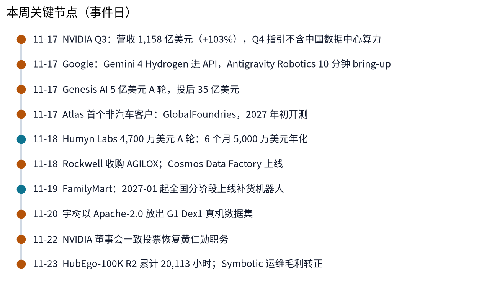
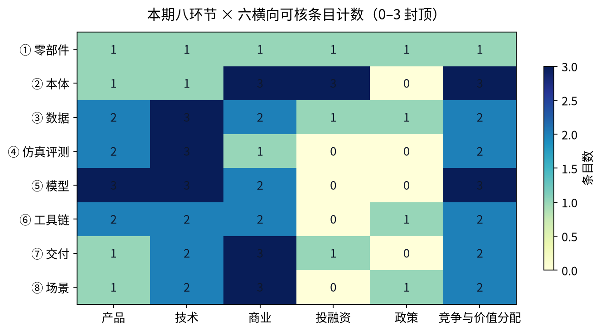
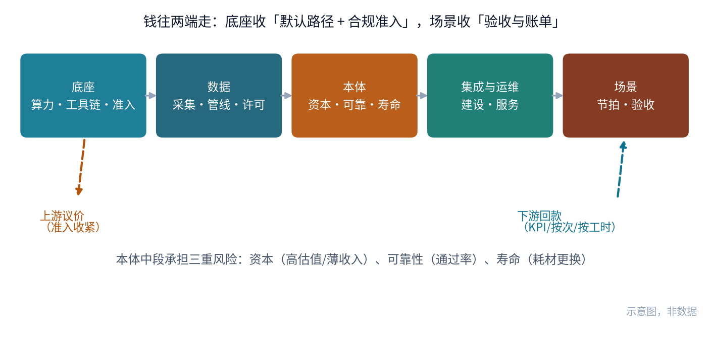

具身智能的公共底座，这一周被重新定价了两次：一次由董事会，一次由财报。NVIDIA 在 11 天里先接受黄仁勋辞任、再一致投票把他请回来，代价是三层合规架构；同一周它的季报把物理 AI 第一次写进可指认的收入行。底座的价格里，从此不只有技术和产能，还有政治与合规。

下游则用另一种方式投票：Genesis 用 5 亿美元押注「数据手套 + 自建本体」，Boston Dynamics 把 Atlas 第一次送进半导体厂，中国本体厂在物流枢纽与 3C 产线找到可复制的工序。而一条被公开承认的工程事实——灵巧手在常规工作下几周就要更换——把讨论从「智能水平」拉回「耗材与停机」。

## 本期要点

**一、11 天两次表决，方向相反，但都不是因为业务。** 11 月 11 日董事会接受黄仁勋辞去总裁、CEO 与董事职务，CFO Colette Kress 兼任临时 CEO，Harvey Jones 出任公司史上首任董事长并启动内外部并行的 CEO 搜寻；11 月 22 日，董事会一致投票恢复他的全部职务，Kress 回任 CFO。两次 8-K 都只走 Item 5.02，没有新增风险因素、没有改指引，季报照常在 11 月 17 日发布——业务口径从头到尾没变。真正的变化在复职公告里：独立董事调查委员会继续调查「外国情报机构针对黄仁勋」的报道并保留独立律师，新设全部由独立董事组成的国家安全与出口管制委员会，新设向提名与公司治理委员会汇报的首席合规官。董事会明确写了「征询美国联邦政府高层意见」，据此确信复职不构成国家安全风险。这不是一次人事反复，而是一次治理结构的加锁：**用经营连续性换合规约束**。

**二、Q3 财报把物理 AI 写进了「边缘计算」这一行，但只有一小格。** 营收 1,158 亿美元、同比 +103%，数据中心 1,076 亿、同比 +110%；边缘计算 82 亿美元、同比 +42%、环比 +14%，CFO 评论把增长归因于「Blackwell 工作站销售与物理 AI 应用的边缘算力」。Q4 指引 1,300 亿美元 ±3%、毛利率 71%–72%，并且明确**不假设来自中国的任何数据中心算力收入**；当季对华 Hopper 数据中心出货 24 亿美元。按 NVIDIA 对媒体的口径，物理 AI 全年有望超过 250 亿美元、约占其 4,000 亿美元以上年收入的 6%——这个数字财报没有单列，无法用 10-Q 复核，但它揭示了一个不对称：机器人产业对 NVIDIA 是期权，NVIDIA 对机器人产业是默认路径。还有一个口径变化值得记住：原来的「专业可视化」已被并入边缘计算，机器人不再单独列示，只在 CFO 评论与电话会出现。所以 82 亿美元不能直接读成机器人收入，它混着工作站、消费级 PC 与边缘推理；采购方应该把边缘算力成本与供货优先级当成独立采购项来谈。

**三、Genesis 用 5 亿美元买「数据手套 + 自建本体」，但手只能撑几周。** 5 亿美元 A 轮由 Khosla Ventures、Premji Invest、Eclipse 联合领投，据量子位投后估值 35 亿美元、NVIDIA 与 AMD 参投——若属实，将是两家芯片厂首次联合投资一家具身智能公司。路线是用人手 1:1 映射把采集成本转嫁给真实工作场景：100 多名工人戴触觉手套与头显干活，机器人戴同款手套；自研仿真 Genesis World 与模型 GENE-26.5，官方称仿真评测与真机测试相关系数 0.8996；已造 30–40 台 Eno，美国代工厂已定，计划 2026 年底开始生产与客户部署。创始人给的口径是「模型架构只贡献最终结果的约 10%」，真正重要的是训练与数据基础设施。但同一篇报道里的另一句话更值钱：灵巧手在常规工作下只能撑几周就要更换，单位经济未披露。**当寿命成为耗材，人形的账要先算更换周期，再算智能水平。**

**四、Atlas 第一次走出汽车，去的是半导体厂。** GlobalFoundries 成为 Atlas 在汽车业之外的首个公开客户：双方将识别半导体制造中的潜在应用、评估集成需求与客户准备度、开始训练，2027 年初开始测试，台数、厂区与初始任务均未披露。真正的铺垫是 Spot——自 2026 年 4 月起在新加坡厂 2 台累计行走近 900 公里、完成 9 万多次 sub-fab 巡检、任务成功率 99%，并将扩大到全球厂网。「先巡检、后人形」的路径说明，人形进厂靠的不是参数，而是同一厂区里已有的准入、保险、班次与异常处置记录。同一周，现代 Glovis 披露已买断软银手中 Boston Dynamics 剩余 9.65%，BD 前三季收入 1,360 亿韩元、同比 +29%，净亏损扩大到 6,266 亿韩元；现代目标 2028 年形成 3 万台/年 Atlas 产能。Atlas 的第一大客户仍是母公司，外部客户是第二曲线——这是多数创业公司没有的结构。

**五、Google 把机器人 bring-up 压到 10 分钟，模型竞争转向上手时长。** Gemini 4 Hydrogen 进入 Gemini API 与 AI Studio，Google Antigravity 的 Robotics 插件同日上线：从插 USB、装驱动、发现相机、标定机械臂到验证安全运动，YAM 臂约 10 分钟可用，同流程支持 SO-ARM101 与 FR3 Duo；MuJoCo 直接在 IDE 内跑，一个零食分拣传送带从白板到真机约 1 小时。能力口径上，Hydrogen 在 Artificial Analysis Robotics 0.1 上以真实六轴臂完成 8 个桌面任务得 58 分，接近 Argon 但每 token 成本更低，在 ERQA 的空间任务上超过 Gemini Robotics ER 2，Google 直接建议 ER 2 用户迁移。**这不是「更聪明的模型」，而是把模型放进开发者工作流的最前端**——谁定义默认路径，比谁多几个点更重要。

*图 1：本周关键节点（事件日）。披露日晚于事件日者已在正文标注。数据来源：本期母稿所列原始文件与报道。*

## 底座的一周：治理加锁，收入露头

**这两件事放在一起看，才构成对「公共底座」的完整定价：治理决定准入，财报决定依赖。**

先看治理的机制。第一次表决把风险归到「个人」而不是「公司」——只走 Item 5.02、不改指引、把财报日期钉死，等于告诉市场：问题在个人的适任性。这个归因决定了后面 11 天的定价方式：如果换掉个人就能消除风险，那么替代者出现即可；但客户怕路线图中断、员工怕组织动荡、政府怕出口管制执行不力，三类人的偏好都能通过非股东渠道传到董事会。于是撤回的合法性来源被写成「征询联邦政府高层意见」，撤回的对价被写成三项制度安排。

三项安排各自解决一个问题。独立调查委员会把个人风险制度化地悬置——复职不等于结案，黄本人将于 12 月 1 日赴国会作证，SEC 也已就「是否误导投资者」立案调查（据 WSJ 转述）；国家安全与出口管制委员会把原本属于管理层的出口管制执行升格为董事会直属职能；首席合规官向董事会委员会而非 CEO 汇报，把合规线的汇报关系从管理层移走。对一家向全球机器人厂商出售算力与工具链的公司，这把锁的方向很清楚：出口管制与终端用途审查会更硬，而不是更软。Q4 指引假设中国数据中心算力为零，是同一个方向的财务表达。同一周还有一条侧证：据 Semafor 报道，美国商务部拟将新加坡云商 Megaspeed 列入 Entity List，出口管制正从「芯片型号与目的地」延伸到「最终用户与云中转」。

再看收入的结构。1,158 亿美元营收里，数据中心 1,076 亿；边缘计算 82 亿。即使物理 AI 全部归零，NVIDIA 的收入结构仍然成立；但如果 Isaac、GR00T、Jetson 这条默认路径中断，绝大多数机器人公司没有等价的替代栈。这种不对称解释了为什么「250 亿美元、占 6%」值得写，也解释了为什么它不该被当成机器人产业的收入——它是平台从机器人身上收到的过路费，而不是机器人产业自己的营收。

值得注意的是，11 天里业务没有停：季报按期发布并超预期，Isaac 平台更新、Cosmos 扩展，Agile Robots 基于 Jetson Thor 与 Isaac GR00T 的参考人形被写进季度亮点（产品发布于 10 月 21 日，背景）。这说明默认路径的连续性由组织、生态与已签合同维持，个人不是单点故障。但 The Robot Report 采访的机器人公司高管给出了另一面：倡导、主题演讲曝光、早期风险投资与高层优先级，是「一个人走了就带走」的部分。复职把这些软性资产还回来了，却没有任何制度安排能保证它们在下一次变动中继续存在。

## 数据：从卖小时，到卖管线与 ARR

**当数据开始按格式、许可与年化收入定价，纯众包视频的溢价就消失了。**

最硬的一条是 HubEgo-100K 的 Release 2：11 月 23 日新增 9,990 小时，累计 **20,113 小时、124,991 集**，来自 21,259 名贡献者、28,104 个贡献者环境；11 类场景、30 个工作类别、56 种任务、35 个动作族；1920×1080、30fps、100Hz IMU 与每帧对齐；LeRobot v3 + MCAP + catalog/annotations parquet 三件套，CC BY 4.0 含商用。它是追加式的——旧 episode id 与文件不变，旧代码与切分继续可用。机制上不是众包拍视频，而是把采集协议嵌进贡献者的自有工位，因此环境数远大于任何其他维度；两层分类法让同一动作在不同工具、材料、视角下重复出现，直接对应「泛化随环境与物体多样性增长快于每环境示教数」的结论。局限同样明确：只有 IMU 作为 state，没有关节或末端位姿，不能直接当动作监督用。

第二条是 Humyn Labs：4,700 万美元 A 轮＝2,600 万美元股权（Accel 领投）+ 2,100 万美元风险债，公司称运营 6 个月年化收入超过 5,000 万美元，在 20 多个国家用自有设备采视觉、声音、触觉、运动四模态，按实验室规格录制「人做特定工作」，再转成带 provenance 的数据集。它把采集从项目制外包变成有 ARR 的基础设施，估值锚从「小时单价」转向「年化收入 + 国别覆盖」。

第三条是工具化。NVIDIA 的 Cosmos Data Factory 用 5 个 blueprint 与 6 个可组合 skill，把「检索—生成—评估—自动标注」串成两条 prompt 就能跑的产线；官方在 8 张 RTX PRO 6000 Blackwell 上测得数据集组装最高快 60 倍、AV 场景生成便宜 45 倍（厂商自测）。关键设计是 Cosmos Evaluator 在回路里校验物理合理性，不合格重试——合成数据的门槛从「能不能生成」变成「敢不敢用」。

第四条是本体厂自己下场。宇树 11 月 20 日起在 Hugging Face 以 Apache-2.0、LeRobot v3.0 放出 G1 Dex1 多任务真机数据（如 Assemble_Stool：1k episodes、30fps、4 路相机、640×480），观测含 state 与 eef_pose。它的官方文档写明「因无法精确描述空间位置，部署时需把场景调到与数据集首帧一致」——这是场景绑定的基线复现包，不是泛化数据；但 Apache-2.0 加 LeRobot 格式意味着可以直接进 GR00T/π 系管线微调，不用谈授权。数据开源正在成为硬件销售的前置动作。

最后是一条容易被忽略的需求侧证据：Manufacturing Leadership Council 的 2026 调研里，37% 的制造商把「缺乏数据互操作性」列为智能工厂战略的主要障碍，2025 年这个数字是 22%。缺口不在采集量，而在工序参数与质检结果从未成对记录。这决定了未来一年的钱会流向数字线程与 outcome 标注，而不是更多采集工时。

## 场景：节拍与寿命开始投票

**能切分的工序在开线，切不动的产线在退坡——分水岭是可测的节拍、成功率与单件成本。**

本体侧的路线也在本周公开分叉。傅利叶顾捷明确「不做大脑」：大脑需要大规模算力、数据与「几个真正的技术英雄」，商业模型可能不同，傅利叶只做身体与医院→养老院→家的康复场景，全球客户约 2,000 家、估值约 80 亿元。特斯拉则相反，把 AI5 专属给 Optimus、AI4 留在车上，AI5 约 10 倍算力、2nm、约 96GB 内存，2026 年 4 月 tape-out。Genesis 走第三条：数据手套与本体垂直整合。三条路线对应三种价值分配——身体标准化、全栈赢家通吃、数据闭环自持。

半导体与 3C 在同一周开了三条线。蓝思科技在手机测试产线部署数十台智元 G2（11 月 20 日披露，21 日公布战略合作），做测试工位自动上下料与设备交互，覆盖 MMI、ANT、CAM、CAMCV 等工序；蓝思 2026 上半年智能手机与电脑类收入 223.82 亿元、同比 −17.67%、占总收入 77.54%，主业承压是引入机器人的直接背景。长电科技上海临港汽车电子工厂迎来首批 G2 并线试运行，承担待测料盘上料、已测料盘下料、良品/不良品自动分道。两条都还停在「试运行」或「数十台」，合同结构未披露，但工序特征是共同的：节拍固定、动作重复、精度可测、机型迭代快。

便利店出现了第一个全国分阶段的具名部署。FamilyMart 宣布 2027 年 1 月起在东京圈、关西、东海分阶段上线 TX GHOST 饮料补货机器人与数字货架，单店每日补货工时降约 70%，单机每天可补约 1,800 瓶；AI 按销售记录优先补畅销品，员工只保留首次扫码上架。复制单位是「门店」而不是「仓库」。值得注意的是它选的是专用补货机器人而非人形——对照 11 月 9 日智元 G2 在上海便利店 6 台 24 小时、1,730 项任务的公开试验（报道称 2/6 台出现失败），这是对当前通用本体可靠性的一次投票。

汽车侧分化为三种合同，没有一种是「产线换人」。现代是 captive：买断软银持股、2028 年 3 万台/年产能、先在 Metaplant America 做分拣搬运。小鹏是自营门店：IRON 计划 2027 年 1 月 1 日启动量产、Q1 进门店、Q2 对外交付，何小鹏明确不希望长期依赖高度定制，目标客户是中小企业。永达是经销商渠道：400 台优必选 U1 Pro、年内交付、用于体验销售与客服，按 16.98 万元/台测算超 6,700 万元（媒体测算，非公司披露）；同在 11 月 21 日，优必选被纳入恒生科技指数、12 月 7 日生效，把「订单叙事」短期换成了被动资金。三者都不是生产力订单，但都能养活产能。

中国本体厂还在物流枢纽上找到了「一省多城」的复制样本：星动纪元与中国邮政广东邮区网络的合作本周被集中披露（部署早于本周），落地 8 城 11 个枢纽，效率超 1,500 件/小时。台数与合同未披露，但复制单位从「单店」变成「枢纽」，这是可复制性提升的信号。

政策侧同步把场景清单化。工信部与农业农村部 11 月 19 日公布 55 个农业机器人典型应用场景（工信厅联通装函〔2026〕541 号），要求地方加强政策支持与推广；11 月 20 日又公示 157 项行业标准制修订计划、截止 12 月 19 日反馈。清单本身不直接给钱，但它决定地方示范项目、农机补贴与招标文件怎么写——农业也因此成为继汽车、3C 之后第三个被官方清单化的机器人场景。

至于降温，本周只有标题级证据：多家媒体转述宝马、吉利、小米、长安撤下人形产线试点、转向人机协同。正文未取得，无法确认是正式撤出还是自媒体演绎，本期不据此下结论——但它与「节拍固定才开线」的判断方向一致：汽车整线装配是当前胜率最低的场景之一。

## 评测与模型：成功率被高估，能力改从外壳来

**三条独立结果证明，基准分数高不等于指令被遵循；而三条「不改权重」的路径，正好是对应的解。**

感知层，Ai2 的 RoboTrack 发现通用点跟踪器在真实操作视频上系统性掉分：最强的 CoWTracker 从 RoboTAP 的 70.5 AJ 降到 63.9，四个跟踪器普遍低 3.0–6.6 AJ；它用 MolmoSpaces 的几何与位姿反算 1,500 万条合成轨迹把分数补回来，但也给出反例——用真实视频继续训练后，真实基准涨 5.1 AJ，纯仿真基准反而掉 9.5 AJ。

执行层，ROSWorld 把物理工作站接到活的 OSWorld 桌面，用同一套评测器：桌面端能完成 31–39 个任务的模型，用刚性探针最多 23 个、用双臂灵巧手最多 28 个（共 40 个任务）。难点不在识别而在接触——把 GUI 知识落到物理按键需要毫米级定位与力控。

语义层，ManipScope 的数字最刺眼：12 个策略检查点、13,200 集里，84.6% 的失败是「把干扰物移走」；把目标在相同初始状态间重指派后，只有 **3.9%** 完全遵循指令，低于「完全不看指令随机选」的 16%，而作为正对照的 GPT-6 agent 达 88%。同一批数据训练的两个检查点却能遵循颜色指令——不是能力缺失，是指令无关的偏好。

对应的解，本周恰好凑齐三条「不改权重」的路径。Embodied-Harness 用 Actor/Reflector 双 agent 加分层记忆，参数全程冻结，在 RoboTwin 2.0 拿到 82.4%、真机三任务平均 96.7%；SCAP 证明单模态动作专家预训练会关掉视觉-语言联合通路，用随机掩码把语言依赖救回来，真机平均 76.67%、比全输入预训练高 25 个百分点；GenPA 干脆把未来帧生成从推理路径里摘出去，只留 19M 参数的动作适配器，LIBERO 99.10%、单张 H100 每动作块 20.9 毫秒。

对采购方的含义很直接：验收不能只看「任务成功率」，要加「同场景换指令」测试，并要求供应商分别报告感知、执行、语义三层指标。对模型厂的含义是：权重不再是唯一护城河，执行外壳与预训练课程同样能带来两位数提升。

*图 2：本期八环节 × 六横向可核条目计数（同一条目可跨列，0–3 封顶）。材料最厚的是本体、数据与场景。数据来源：本期研究母稿条目计数。*

## 本周 vs 上周

| 主线 | 上周（第 12 期） | 本周（第 13 期） | 走向 |
|---|---|---|---|
| 平台治理 | NVIDIA 11-11 接受辞任、CFO 临时、首设董事长 | 11-22 一致复职，新设出口管制委员会与首席合规官 | 反转后收敛 |
| 收入口径 | 财报不单列机器人；Agility 9 个月收入 36.1 万美元 | 边缘计算 82 亿美元、+42%；物理 AI 口径 250 亿（媒体口径，财报未单列） | 新出现 |
| 数据供给 | HubEgo 10,124 小时、CC-BY-4.0 | HubEgo R2 20,113 小时；Humyn 5,000 万美元年化；宇树 Apache-2.0 | 延续并升级 |
| 评测可信度 | Newton v1.8.0 把确定性做成卖点 | RoboTrack/ROSWorld/ManipScope 三层失真 | 新出现（质疑） |
| 模型入口 | Praxis-1 以 Apache 2.0 开放 27B | Gemini 4 Hydrogen + Antigravity，10 分钟 bring-up | 从开放权重转向上手时长 |
| 场景结构 | 汽车线边 PoC（奔驰 96%）；智元便利店 4/6 | 半导体（GF）、3C 测试（蓝思）、封测（长电）、便利店（FamilyMart） | 新出现 |
| 交付与 RaaS | GXO LOI + KPI 门控；Serve 按次 API | GXO 成熟品类多站点铺开；Symbotic 运维首次毛利转正 | 延续并分层 |
| 本体与资本 | Agile 5 亿美元 F、投后 85 亿美元 | Genesis 5 亿美元 A、投后 35 亿美元（据量子位）；现代全资控股 BD | 延续 |

上周建立的三张表——市值、租金、工时——本周各自有了新数：市值一侧，宇树在 A 股 2,864 亿元、Agility 在美股约 27.8 亿美元，同一类资产两个倍数；租金一侧，人形日租跌到 1,800–2,000 元，平台改按有效工时计价；工时一侧，Symbotic 的运维毛利首次转正，而人形还在等 KPI 验收。降温的是汽车产线试点（仅见标题报道，未见原文）与四大工具链的版本发布（LeRobot、Isaac Lab、ROS 2、Newton 全周零发版）；升温的是「默认路径的治理」与「工序可切分」。

*图 3：本周利润归属示意（示意图，非数据）。底座收「默认路径 + 合规准入」的钱，数据层收「管线与 ARR」的钱，集成与运维收「生命周期」的钱，本体中段承担资本、可靠性与寿命三重风险。*

## 对你意味着什么

{: .notice--info}
**编辑建议**：以下为基于本期母稿事实的编辑建议，不构成投资建议。

**产业链从业者/战略负责人。** 如果做本体，把「寿命成本」写进 BOM 与报价：灵巧手几周更换意味着按年计算的耗材支出可能超过本体折旧，验收条款应要求供应商披露关键部件 MTBF 与更换工时。如果做集成或交付，学 Symbotic 的结构——先收系统建设费、再用运维锁生命周期收入；人形项目坚持「KPI 门控 + 分阶段」，不要用一次性采购承诺换折扣。如果做数据，纯众包视频的溢价已经消失，转向「合规许可 + 格式适配 + outcome 标注」三件事。如果用 NVIDIA 栈，把「版本可用地区 + 合规审查时延」写进合同，并准备一条非 CUDA 的备份路径。

**投资人。** 用「可计费产出 × 单位价格 − 耗材与停机」而不是「规划产能」做估值起点；对只有下线台数、没有连续运行时长与通过率的标的给产能折扣。本周两个估值锚同时存在：Genesis 以 5 亿美元 A 轮、据量子位 35 亿美元投后（TechCrunch 未披露估值）对应 30–40 台样机与未披露的单位经济；Symbotic 以 223 亿美元在手订单与转正的运维毛利支撑市值——要问标的「凭什么享受另一个的倍数」。平台层看两个时间点：NVIDIA 独立调查的结论，以及 Hugging Face 交割的监管节点（至 2027 年上半年）。

**政策/标准关注者。** 工信部 5 项行业标准（SJ/T 12353~12357，11 月 16 日发布，在窗口之前；本周行业开始集中解读）把智能分级做成 L0–L5、四维雷达画像，这会直接进入招标文件的评分项；训练场与训练数据标准则决定数采项目的验收口径。跟踪三条线：分级标准在地方招标中的引用方式、OpenAtom 工作委员会的首批项目、以及 NVIDIA 出口管制委员会对 Jetson/Isaac 对华供给的实际收紧程度。

{: .notice--warning}
本周最容易被误读的三个数字：NVIDIA「边缘计算 82 亿美元、+42%」包含工作站与消费级产品，不等于机器人收入；「物理 AI 全年超 250 亿美元」是 NVIDIA 对媒体的口径，财报未单列；Genesis 的「5 亿美元 A 轮」是融资额，不是订单或收入，且灵巧手几周更换的成本未计入其披露口径。

## 来源

- NVIDIA 治理：[8-K（事件 11-11）](https://www.sec.gov/Archives/edgar/data/1045810/000104581026000082/nvda-20261111.htm)、[辞任新闻稿](https://www.sec.gov/Archives/edgar/data/1045810/000104581026000082/nvidiaannouncesceotransiti.htm)；[8-K（事件 11-22）](https://www.sec.gov/Archives/edgar/data/1045810/000104581026000090/nvda-20261122.htm)、[复职新闻稿](https://www.sec.gov/Archives/edgar/data/1045810/000104581026000090/nov23pressrelease.htm)
- NVIDIA 财报：[8-K（11-17）](https://www.sec.gov/Archives/edgar/data/1045810/000104581026000088/nvda-20261117.htm)、[Q3 FY2027 财报稿](https://www.sec.gov/Archives/edgar/data/1045810/000104581026000088/q3fy27pr.htm)、[CFO 评论](https://www.sec.gov/Archives/edgar/data/1045810/000104581026000088/q3fy27cfocommentary.htm)
- 治理与机器人生态：[The Robot Report 11-23](https://www.therobotreport.com/nvidia-reinstates-jensen-huang-after-11-day-absence/)、[The Robot Report 11-19](https://www.therobotreport.com/robotics-enters-its-post-jensen-huang-era/)
- Genesis：[TechCrunch 11-17](https://techcrunch.com/2026/11/17/genesis-ai-raises-500-million-to-deploy-electric-glove-wearing-robots/)、[公司官网](https://www.genesis.ai/)
- Atlas 与 GlobalFoundries：[The Robot Report 11-17](https://www.therobotreport.com/boston-dynamics-atlas-humanoid-lands-first-non-automotive-trial/)
- Google：[Gemini 4 Hydrogen 与 Antigravity Robotics](https://developers.googleblog.com/en/gemini-hydrogen-for-robotics/)；[Genie 4（DeepMind 博客）](https://deepmind.google/discover/blog/)
- 数据：[HubEgo-100K](https://huggingface.co/datasets/HubLabs/HubEgo-100K)、[宇树 G1_Dex1_Assemble_Stool](https://huggingface.co/datasets/unitreerobotics/G1_Dex1_Assemble_Stool)、[Humyn Labs（TRR 11-18）](https://www.therobotreport.com/humyn-labs-raises-47m-to-collect-real-world-data-for-robotics/)、[Cosmos Data Factory（NVIDIA 开发者博客）](https://developer.nvidia.com/blog/)
- 评测与模型：[RoboTrack（Ai2 11-23）](https://allenai.org/blog)、[ROSWorld（arXiv 2611.27467）](https://arxiv.org/abs/2611.27467)、[ManipScope（arXiv 2611.27305）](https://arxiv.org/abs/2611.27305)、[Embodied-Harness（arXiv 2611.27689）](https://arxiv.org/abs/2611.27689)、[GenPA（arXiv 2611.27446）](https://arxiv.org/abs/2611.27446)、[SCAP（arXiv 2611.27187）](https://arxiv.org/abs/2611.27187)
- 交付与场景：[GXO 11-18](https://finance.yahoo.com/technology/articles/gxo-announces-accelerated-deployment-adaptive-120000855.html)、[Symbotic FY26 Q4](https://markets.businessinsider.com/news/stocks/symbotic-reports-fourth-quarter-and-fiscal-year-2026-results-1036793594)、[FamilyMart（Straits Times 11-19）](https://www.straitstimes.com/asia/east-asia/japans-familymart-to-introduce-ai-powered-drink-restocking-robots)、[Rockwell×AGILOX（TRR 11-18）](https://www.therobotreport.com/rockwell-automation-acquiring-mobile-robot-maker-agilox/)
- 资本与并购：[Agility 高管任命（11-18）](https://www.agilityrobotics.com/content/agility-robotics-evolves-executive-leadership-team-to-support-next-phase-of-growth-as-a-public-company)、[软银关于 ABB 交易的公告（11-06）](https://group.softbank/en/news/press/20261106)
- 政策与标准：[China Daily 11-19 关于 MIIT 5 项标准的报道](https://cnews.chinadaily.com.cn/a/202611/19/WS6afe9d1ae4b0e14252fcc252.html)、[工信部 55 个农业机器人场景（11-19）](http://www.miit.gov.cn/zwgk/zcwj/wjfb/tz/art/2026/art_7f415b669f314e2793a0c426f35f6de3.html)、[工信部 157 项行标计划公示（11-20）](https://www.miit.gov.cn/gzcy/yjzj/art/2026/art_6158445808594cb4acd7e6041bacbc79.html)
- 本体与路线：[优必选纳入恒生科技指数（11-21/23）](https://finance.sina.com.cn/stock/hkstock/marketalerts/2026-11-23/doc-inizsuwe5501677.shtml)、[傅利叶顾捷专访（11-18）](https://finance.sina.com.cn/stock/t/2026-11-18/doc-inizauit7275553.shtml)、[Tesla AI5 与 Optimus（11-22）](https://cryptobriefing.com/tesla-ai5-chip-optimus-robot-ai4-cars/)、[智元 G2 进蓝思测试线（11-20）](https://finance.sina.com.cn/wm/2026-11-20/doc-inizkuqy7119864.shtml)
