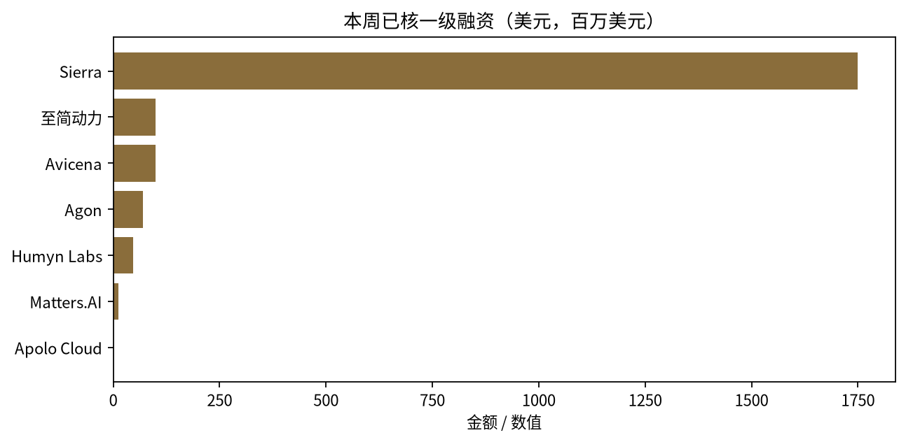
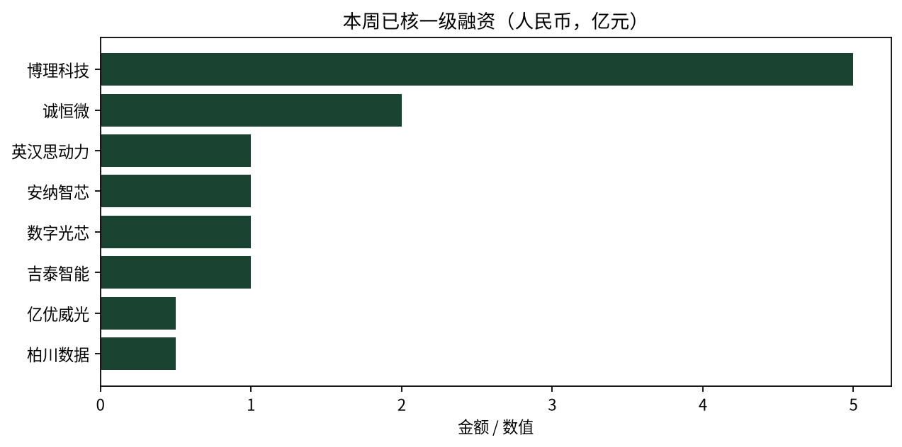

Anthropic 用一场 810 亿美元的 IPO 把 AI 股权送进公开市场，三天后股价跌破发行价；同周黄仁勋复职让英伟达单日涨 31%。**担保人回来了，折价没有回去。**

上周是信用层先给担保定价，本周是股权层被迫在公开市场接受同一套折价。IPO 发行价不再是「起点」，而是第一把公开的尺；绿鞋一关，支撑就消失。对一级市场，这不是一条远方的新闻——它正在改写你手里每一个「最近一轮估值」的可信度。

## 本期要点

**一、Anthropic：83 美元的发行价，只撑了三天。** 11 月 19 日，Anthropic 的 424B4 把发行价定在每股 **83 美元**，高于此前 70—78 美元的区间上沿；基础发行 **9.8 亿股**，公司卖 9.5635 亿股、老股东卖 2,364.9 万股，毛募资 **813.4 亿美元**。它还同步向七家产业方私募 **260 亿美元** Class N：Google 与 NVIDIA 各 100 亿、AMD 25 亿、Broadcom/Micron/Microsoft 各 10 亿、TSMC 5 亿；这批股票无投票权、不注册、不受 180 天锁定。上市首日，股价开在 111.50 美元、收 97.17 美元，较发行价涨 17.1%。第二天，承销商 Morgan Stanley 选择以 83 美元向公司买入全部 **1.47 亿股**绿鞋、关闭稳定空头，股价收 88.91 美元、跌 8.50%。11 月 24 日，股价收 **79.22 美元**、跌 9.61%，盘中最低 75.61 美元，**跌破发行价**。首日打新的人赚了 17%，第二天买的人到收盘亏了 8.5%；到 11 月 24 日，股价较发行价低 4.6%——同一家公司，三个价格，取决于你什么时候被允许进场。

**二、英伟达：Q3 的成绩单很好，复职的边界很清楚。** 11 月 17 日递交的 8-K 显示，英伟达 Q3 营收 **1,158 亿美元**（同比 +103%），数据中心 **1,076 亿美元**（同比 +110%）；Q4 指引 **1,300 亿美元 ±3%**、毛利率 **71%—72%**，且**不含中国数据中心 compute 收入**。真正需要盯的不是营收，是融资口径：担保最大总敞口 **1,180 亿美元**（其中 SB Energy 信用支持 1,050 亿）、neocloud 剩余承诺 **320 亿美元**、供给承诺 **3,900 亿美元**、应收账款 **810 亿美元**、DSO **64 天**（上季 60 天）。文件原话是，neocloud 和前沿实验室的需求极强，但「many are growing faster than their balance sheets and long-term credit profiles can support」。11 月 22 日，董事会一致通过恢复黄仁勋为总裁、CEO、董事，11 月 23 日披露；新闻稿写明董事会听取了美国政府在高层级的意见，并相信复职「不构成国家安全风险」，但针对外国情报事件的独立董事调查**将继续进行**，公司新设国家安全与出口管制委员会、新设首席合规官。市场用一天 +31% 回应复职，却在第二天回吐逾 7%——**复职解除了「谁签字」的治理折价，没有解除「谁付钱」的信用折价。**

**三、信用层：8% 是本周最直白的报价。** SpaceX 为购买 GPU 发行的债券至少 **320 亿美元**、最终约 **440 亿美元**，其中一部分收益率**超过 8%**；11 月 20 日，Apollo 与 Goldman Sachs 完成定价 **约 440 亿美元**优先/次级票据，为 SpaceX 购买 NVIDIA Vera Rubin 芯片融资，交易超额认购，BlackRock、GSAM、KKR 旗下账户 anchor，租赁计划 2027 年上半年随 GPU 交付起算。这是迄今最大的 GPU 融资，也是本周信用层最硬的一笔：**抵押物是芯片，不是机房；芯片折旧远快于建筑，所以资金要 8%。** 同一周，NVIDIA 支持的 Firmus 被报道洽谈**最高约 40 亿美元**债务包，其中约 15 亿美元债券、收益率约 8%、期限 69 个月、已获两家机构 BBB；CoreWeave 一度跌破 40 美元 IPO 价。**当一家未上市、信用极强的主体都要为 AI 芯片付 8%，一级市场的「最近一轮估值」就很难再用 10% 以下的折现率去倒推。**

**四、CrowdStrike / Zscaler：439 亿美元全股票，2026 年最大 AI 安全并购。** 11 月 22 日，CrowdStrike 签署协议以 **1.135 股**换 1 股收购 Zscaler，估值约 **439 亿美元**、每股约 260.41 美元，较 Zscaler 11 月 20 日收盘溢价约 **34%**；没有现金对价，只有碎股现金。条款里最硬的是三条：若发行将超过 CrowdStrike 发行前股本 **20%**（Nasdaq 规则），交换比例自动下调、超出部分改付现金；Zscaler 在特定情形下支付 **14 亿美元**分手费；外部日 **2027 年 11 月 23 日**，若仅剩反垄断/FDI 条件可延至 2028 年 2 月。Zscaler CEO 将在交割后加入 CrowdStrike 董事会，其及关联信托签署投票支持协议，覆盖 Zscaler 约 **34%** 流通股。**全股票避免新增债务，把估值风险交给 CrowdStrike 股价；20% 上限则把「未经股东批准的过度稀释」写成了自动条款。** 这也解释了为什么大型 AI 并购的交割窗口普遍被推到 2027 年下半年：监管时间表，比谈判桌更难控制。

**五、中国：一级 19 笔仍按旧价，二级已经按流通盘重估。** 本周中国一级市场核到 **19 笔**有料融资，单笔最大是至简动力 **1 亿美元、投后 16 亿美元（约 107 亿元）**，蚂蚁集团领投，阿里、腾讯、红杉中国、蓝驰跟投；博理科技 **超 5 亿元**、章鱼动力 **数亿元**、傲意科技 **数亿元 D 轮**、英汉思动力 **超亿元 B 轮**。但二级市场给同类资产的是另一套价格：燧原科技 11 月 19 日封死 20cm 跌停、收 364.33 元，四个交易日自 613 元高点回撤 **40.5%**，而当日无限售流通股只有 **1,790 万股、占总股本 4.16%**；摩尔线程 11 月 24 日收 284 元、市值 1,335 亿元，较 2025 年 12 月峰值 4,423 亿元蒸发逾 3,000 亿元，**12 月 7 日还有约 1.86 亿股（39.55%）解禁**；智谱、MiniMax 较年内高点跌近九成。**业绩在加速，股价仍在跌，因为短期定价权不在业绩，在边际筹码。**

## 三天里发生了什么

Anthropic 的破发不是「基本面变坏」，是三个机制在同一周叠加。

第一，**绿鞋是「有期限的买盘」，不是「无限期的护盘」。** 承销商有最多 30 天使用稳定机制，但 11 月 20 日就选择向公司买入全部 1.47 亿股绿鞋、关闭空头——因为股价远高于 83 美元，买绿鞋比在二级市场买回更划算。空头一关，稳定买盘就结束；此后价格由边际买盘决定。

第二，**供给在前，指数买盘在后。** 9.8 亿股基础发行 + 1.47 亿股绿鞋 = **11.27 亿股**在首周进入流通；Class N 的 3.13 亿股虽不注册，但 6 个月后可依 Rule 144 转售；最多 **3.15 亿股**可从首日起卖；另有最多 **34 亿股**可在 180 天组到期前出售。MSCI 则要等到 **11 月 30 日收盘后**才纳入。**卖压先到，被动买盘后到**，首周的价格发现因此由主动基金和内部人主导。

第三，**发行价本身是「折价定价」。** 承销商通常把 IPO 价定在预期交易价之下，用首日涨幅换认购需求；当需求足够强、发行规模上调 1.55 亿股后，首日涨幅仍然 +17%，说明定价留了足够的安全垫。**但安全垫只对打新者有意义，对二级市场买家没有——他们买的是 97 美元，不是 83 美元。**

还有一个容易被忽略的口径：Anthropic 的「募资额」有三个数。424B4 的净募资是 **约 1,048 亿美元**（含 Class N）；毛口径 IPO + Class N 是 **1,073 亿美元**；绿鞋全行使后的净募资是 **约 1,170 亿美元**。三个数不能混用。同样，估值也有三个口径：按发行后总股本 132.2 亿股 × 83 美元 ≈ **1.10 万亿美元**（基本股本）；媒体普遍报道 **约 1.5 万亿美元**（完全稀释，含期权/RSU/可转票据）；首日收盘媒体口径 **1.76 万亿美元**。**口径不同，结论就不同；这也是本周最容易被误读的一组数字。**

## 担保人回来了，信用没有

英伟达的 Q3 文件值得逐项读，因为它把「AI 资本链」的信用结构写在了表上。

担保最大总敞口 **1,180 亿美元**，分三块：neocloud 土地/电力/壳 **35 亿美元**、SB Energy 信用支持 **1,050 亿美元**、电力与系统信用支持 **95 亿美元**。SB Energy 对应的是俄亥俄 PORTS-Pike 园区 9 栋楼、约 4.25GW、20 年独家租给 OpenAI；担保按楼分阶段生效，首笔预计 FY2029，最高 1,050 亿美元后随 OpenAI 付租下降。文件同时写明：「To date, we have not made any payments related to our guarantees.」——这 1,180 亿不是损失，是「如果伙伴付不出钱，英伟达替它付」的或有承诺。

承诺端更值得看。供给承诺 **3,900 亿美元**（上季 2,790 亿，主因内存多年期采购）；云服务 + 未起租数据中心租赁 **1,020 亿美元**（上季 740 亿）；neocloud 协议剩余承诺 **320 亿美元**。这些承诺的生效条件是：neocloud 先取得融资购买设备、容量投运并被英伟达接受；否则「the amount and timing of our commitments may be affected, and certain commitments could be reduced or eliminated」。**换句话说，英伟达的「订单」不是无条件收入，是「你先借到钱、把机房建好、我验收，才生效」的或有订单。**

应收端也在说话：应收账款 **810 亿美元**，DSO **64 天**（上季 60 天），公司归因于 Rubin 出货节奏与「extended payment terms on large, multi-quarter agreements with certain investment-grade customers」。**收入在加速，回款在变慢；这是同一个硬币的两面。**

然后黄仁勋回来了。11 月 22 日董事会一致通过、11 月 23 日 8-K 披露，只有 Item 5.02：恢复 Jen-Hsun Huang 为总裁、CEO、董事，即刻生效；Kress 回任 CFO；Harvey C. Jones 留任董事长。新闻稿写明董事会「received input from senior levels of the United States government」，并相信复职「poses no national security risk」；同时，针对「Mr. Huang has been the target of a foreign intelligence effort」的独立董事调查**将继续进行**，公司新设 **National Security and Export Control Committee** 与 **Chief Compliance Officer** 职位。**复职不是调查的终点，是治理折价的阶段性解除。**

市场反应很诚实：11 月 23 日 NVDA 收涨 **31%**，市值增加约 1 万亿美元；11 月 24 日盘中回吐逾 7%。同一周，Anthropic 跌破发行价，CoreWeave 一度跌破 40 美元 IPO 价，Nasdaq 11 月 20 日抹去 2026 年全部涨幅。**黄仁勋的回归能修复英伟达自己的股权价格，却修复不了整条 AI 资本链的折价——因为折价的对象不是「谁在签字」，是「谁付钱」。**

## 并购用股票，基金用主权钱

本周的并购几乎都不用现金。CrowdStrike 用 1.135 股换 1 股买 Zscaler，439 亿美元全股票；AMD 在 11 月 17 日完成对 Taalas 的收购，11 月 23 日提交转售注册，S-3 只给出股权对价（交割 1.66 万股 + 46.63 万股可交换股 + 或有对价），媒体称约/最高 29 亿美元，但文件未载总价；Workday 在 11 月 24 日的 Q3 业绩稿里写「acquired C1.ai」，对价未披露；Amazon 被报道「接近」以 75 亿美元收购 Decart，但没有 8-K、没有交割确认。**股票作为收购货币，只在收购方股价被市场接受时成立；这也解释了为什么 CrowdStrike 要用 20% 上限和现金真补来给交易上保险。**

基金端则是另一种「不用现金」：主权基金和产业资本直接买股权。MGX 从 Anthropic IPO 获得约 **200 亿美元**账面收益（未审计，按 11 月 19 日收盘 97.17 美元计算；11 月 20 日跌至约 88.90 美元后已回吐大半）；它今年 2 月 co-led Anthropic 300 亿美元轮、5 月参加 650 亿美元 Series H、IPO 时继续加仓，7 月还募了 490 亿美元 AI Fund，称最多 80% 的组合将投美国项目。另一端的 SoftBank，11 月 20 日东京收盘 **-14.48%**（盘中 -16.6%），孙正义 11 月 18 日公开说没投 Anthropic 是「mistake」。**同一场 IPO，持有者账面 +200 亿、错过者 -14.48%——市场惩罚的是融资结构，不是判断力。**

中国基金在「变小、变硬、变长」。招商局（深圳）AI 基金 **50 亿元**完成登记；上海国投先导 AI 母基金公示拟参投 **3 只**子基金（春华、高瓴创投、东方富海）；四川发展科创母基金 **25.3 亿元**；博原资本二期 **近 11 亿元**；横店柏晖基金 **16.5 亿元**，十余家浙江上市公司做 LP，最终占 DeepSeek 员工/持股平台杭州程砚出资总额 **1.43%**。国资报告给出的宏观底色是：截至 2026Q3，狭义国资基金 **16.80 万亿元、16,205 只**；2026 前三季新设 **1,481 只（+22.4%）**、规模 **9,663.18 亿元（-14.2%）**；国资 LP 出资金额占已披露总额 **64.3%**；国资对子基金出资 **74.59% 投本省**。**基金更小、投向更硬，意味着单只基金对单个项目的平均下注变小、对返投的依赖变重；返投比例在本周公开材料中均未披露。**

全球信用端还有两个未完成项：Firmus 的 40 亿美元债务包（其中 15 亿美元债、约 8%）仍是 mulls/seeks；HUMAIN Ventures 的 100 亿美元 AI 基金是「据报道拟设」，零首关。**目标规模不等于已关闭，账面浮盈不等于已实现退出——这是本周基金/退出栏最需要守住的两条线。**

## 中国：一级按旧价，二级按流通盘

先看一级。至简动力 1 亿美元、投后 16 亿美元，是本周中国区最大单笔；它成立仅 16 个月，公开信息中尚无成体系营收，定价买的是「量产履历 + 百台交付 + 产线场景」。博理科技超 5 亿元（B2+B+）、章鱼动力数亿元（年内第 4 轮，美的资本新进、小米第 4 轮加注）、傲意科技数亿元 D 轮、英汉思动力超亿元 B 轮，四笔都在具身链上。半导体侧单笔都在 2 亿元以下，且普遍用「首批交割」而不是「完成」：诚恒微近 2 亿元 A 轮、投后约 11.7 亿元；数字光芯近亿元 B 轮首次交割；亿优威光约 5,000 万元 Pre-A 首批交割；安纳智芯亿元级（成立一年第 4 轮）。**「首批交割」四个字，说明资金分期到位、与里程碑挂钩——这是本周中国一级市场最一致的一条条款语言。**

再看二级。燧原科技的 40.5% 回撤，不是业绩事件：Q3 营收 12.12 亿元、同比 +395.34%，前三季营收 23.32 亿元、同比 +331.74%，业绩会还指引 2027 年合并报表盈利。但跌停当日，无限售流通股只有 1,790 万股、占总股本 4.16%，流通市值约 65 亿元，换手率约 28%——**65 亿元的流通盘，承载 1,568 亿元总市值的定价。** 摩尔线程的剧本更清楚：11 月 23 日董事会通过 5—10 亿元、上限 511 元/股的回购，11 月 24 日收 284 元、市值 1,335 亿元；12 月 7 日约 1.86 亿股（39.55%）解禁。回购用于员工持股/股权激励而非注销，不减少总股本，也不直接增厚每股收益——**它解决的是解禁前的价格预期，不是经营现金流。**

港股大模型是另一条更长的回撤曲线：智谱 11 月 20 日跌 7.17%、市值约 1,635 亿港元，较 6 月高点 1.33 万亿港元跌近九成；MiniMax 跌 10.8%、市值约 408 亿港元，较 3 月高点跌逾九成。两家 2026H1 收入分别 +399.74%、+283.1%——**收入翻倍、估值跌九成，是分母和倍数同时收缩。**

IPO 管线则卡在「过会易、注册慢」：超聚变 11 月 12 日创业板过会，拟募 80 亿元，但截至 11 月 24 日未见证监会同意注册批复、招股意向书、发行价或上市日期；平头哥仍是保密递表（9 月，背景），本周只有分析稿；月之暗面「11 月 17/18 日递交港股 IPO、估值 350 亿美元」仅标题级，正文未取得，估值口径与 10 月的约 500 亿美元冲突。**注册/备案摩擦，是当前中国 AI IPO 供给最真实的约束。**

## 全球：欧洲修治理，海湾买股权，印度钱多笔少

欧洲的 IPO 窗口在口头上打开，在文件上还没打开。Nscale 被 FT 报道计划以约 350 亿美元估值 IPO，但同期在放缓招聘、削减开支、处理供应商黑名单风险；11 月 24 日进一步报道其考虑转向私募/推迟 IPO。Mistral 的 CEO 明确说欧洲是「自然的 IPO 地点」，但**今年不 IPO**；同周 Mistral 拿到 Deutsche Telekom 旗下 T.Capital **1 亿欧元（约 1.09 亿美元）**战略增资，Series D 累计募资 34.8 亿美元、9 月关闭时投后 244 亿美元。**欧洲公司想上市，但先要修治理与供应链；美国公司上了市，但公开市场只给了三天溢价。**

欧洲的另一种资本是「主权 + 国防」。英国 Agon 拿到 7,000 万美元 A 轮、投后 4.5 亿美元，Northzone 领投，**UK Sovereign AI Fund 与 NSSIF 首次联合出手**，前 Sequoia 掌门 Roelof Botha 个人参与；Avicena 拿到 1 亿美元+ C 轮，InterVest 领投，SK Hynix、Samsung、AMD、Hitachi 等产业方跟投，2027 年才首款产品。**同样是 AI 硬科技，Agon 卖的是「合成战场」的软件/数据，Avicena 卖的是「光进铜退」的互连——两者都不需要卖芯片，因此更容易跨境。**

美国应用层则给出了一个「收入倍数」样本：Sierra 完成 **17.5 亿美元 F 轮、投后 300 亿美元**，6 个月估值翻倍，run-rate 收入 **4 亿美元**——30 亿 / 4 亿 = **75 倍**，6 个月前 150 亿美元 / 约 2 亿美元也是 75 倍。**6 个月前估值 150 亿美元，当前 30 亿 / 4 亿 = 75 倍。** 对比之下，Cognition 在谈 750 亿美元估值、Pragmatik 以 50 亿美元估值融资数千万美元，收入均未披露——**同样的 AI 叙事，Sierra 是「有收入」，另外两家是「有故事」。**

亚洲市场的温度则明显更低：印度 2026 年前 9 月 AI 融资 **16 亿美元、同比 +96%**，但交易数 **-42% 至 87 笔**，Top 10 占 90%；韩国准备启动 **18 年来首次**证券市场稳定基金，但只是「可随时部署」，本周没有一分钱入市；SoftBank 单日 -14.48%，Nasdaq 抹去 2026 年全部涨幅。**钱没有消失，是变挑了：向头部、后期、有收入的项目集中，早期笔数在收缩。**

## 融资对比表

> 仅列窗内已确认、且可按原文金额列示的融资；「数亿/数千万/未披露」单列，不做中值估算；人民币与美元分列，不折算加总。

| 公司 | 轮次 | 金额 | 投资方 | 赛道 | 地区 |
|---|---|---|---|---|---|
| Sierra | Series F | 17.5 亿美元（投后 300 亿美元） | Greenoaks、Lightspeed 领投 | S5 横向应用 | 美国 |
| 至简动力 | Pre-A / B | 1 亿美元 | 蚂蚁集团领投；阿里、腾讯、红杉中国、蓝驰 | S7 具身 | 中国 |
| Avicena | Series C | 1 亿美元+ | InterVest 领投；SK Hynix、Samsung、AMD 等 | S1 算力 | 美国/全球 |
| Agon | Series A | 7,000 万美元（投后 4.5 亿美元） | Northzone 领投；UK SovAI、NSSIF | S1 算力/国防 | 英国 |
| 博理科技 | B2 + B+ | 超 5 亿元 | 基石、金沙江、经纬、长盈精密 | S7 具身 | 中国 |
| 诚恒微 | A 轮 | 近 2 亿元（投后 11.7 亿元） | 中金资本、中车资本、毅达等 | S1 算力 | 中国 |
| 英汉思动力 | B 轮 | 超亿元 | 国科投资 | S7 具身 | 中国 |
| 吉泰智能 | B+ 轮 | 近亿元（投后 15 亿元） | 本轮未披露 | S7 具身 | 中国 |

> 另有 7 笔仅披露「数亿/数千万/亿元级」、4 笔金额未披露（纳宇、普利姆、璇相、DeepSeek 本体）；Pragmatik 为「数千万美元」区间、Cognition 在谈 750 亿美元估值、Etched/Marlowe 仅媒体口径，均不入图。

*图 1：本周已核一级融资（美元，百万美元）。Sierra 17.5 亿美元为单笔最大；至简动力、Avicena 各 1 亿美元；Agon 7,000 万、Humyn 4,700 万、Matters.AI 1,200 万。数据来源：TechCrunch、腾讯新闻、VentureBurn、Tech.eu、公司稿；源数据见 `charts/data-funding-usd.csv`。*

*图 2：本周已核一级融资（人民币，亿元，按原文下限绘制）。博理科技 5 亿元、诚恒微 2 亿元、英汉思/安纳/数字光芯/吉泰各 1 亿元、亿优威/柏川各 0.5 亿元。另有 7 笔仅区间金额、4 笔未披露，未入图。数据来源：搜狐、腾讯新闻、澎湃、新浪财经；源数据见 `charts/data-funding-cny.csv`。*

## 本周 vs 上周

| 主线 | 上周（第 13 期） | 本周（第 14 期） | 走向 |
|---|---|---|---|
| AI 股权定价权 | 簿记超额、预计高于 70—78 美元 | 83 美元定价；首日 +17.1%；11-24 收 79.22 破发 | 公开市场成为第一把尺 |
| 担保人 / 英伟达 | 黄仁勋 11-11 辞任；1,180 亿美元担保 | 11-22 复职；NVDA +31%；DSO 64 天 | 治理折价解除，信用约束未解除 |
| 信用层 | QTS 债务发售砍 60%；垃圾债约 370 亿美元 | SpaceX GPU 债部分 >8%；Apollo/Goldman 440 亿美元；Firmus 约 8% | 8% 成为 AI 资本开支的边际成本 |
| 中国一级 | 13 笔；单笔最大 5 亿元 | 19 笔；至简 1 亿美元/投后 16 亿美元 | 一级仍按旧价，产业资本连续复投 |
| 中国 IPO/次新 | 超聚变过会；国星宇航首日破发 | 燧原 4 日 -40.5%；摩尔 39.55% 解禁倒计时 | 短期定价权在流通盘 |
| 并购 | AMD/World Labs 82 亿美元全股票交割 | CrowdStrike/Zscaler 439 亿美元全股票 | 平台用股票买分发/身份 |
| 基金/退出 | Norwest 40 亿美元、Plural 10 亿欧元 | 招商局 50 亿元；MGX +200 亿美元浮盈；SoftBank -14.48% | 主权基金/产业资本接棒 |

**重心迁移**：上周市场还在讨论「担保人走了，信用层怎么定价」；本周担保人回来了，股权层却被公开市场重新定价。**定价权从「谁背书」移到「谁付钱」，而且付钱的人只愿意出 79.22 美元。**

## 对你意味着什么（编辑建议）

**对一级市场投资人：把「最近一轮估值」换成「公开市场可比 + 解禁后流通盘」重新 mark。** Anthropic 的 83 美元发行价、燧原的 4.16% 流通盘、摩尔的 39.55% 解禁，是三个不同的折价来源；用首日收盘价或最近一轮估值做 valuation comp，会系统性高估。建议在 2027 年 IPO 管线模型里，把「首日价格」和「解禁后 90 天均价」分成两个情景，而不是一个。

**对创业者：IPO 窗口没有关闭，但「上市即退出」的假设失效了。** Anthropic 首日 +17%、三天破发，说明公开市场愿意为增长付钱，但不愿意为流动性付钱；锁定期、绿鞋、指数纳入的时间表，比发行价本身更影响股东的实际回报。在 term sheet 里，把「IPO 后 6 个月可实现的净回报」而不是「IPO 估值」作为管理层激励的锚，会更接近真实。

**对二级市场投资者：担保人回归是治理事件，不是信用事件。** 英伟达的 1,180 亿美元担保、DSO 64 天、对 neocloud 的「先融资、后生效」条件，说明信用链的约束仍在；SpaceX 的 >8% 债、Firmus 的约 8% 债、CoreWeave 破 40 美元，是同一套折现率的不同报价。把「GPU 抵押债收益率」当作 AI 资本链的实时温度计，比看 NVDA 股价更早。

**对基金 LP / GP：基金在变小、变硬、变长；返投条款是最大的信息不对称。** 本周中国六只基金样本单只多在 10—50 亿元，国资 LP 占已披露出资 64.3%，74.59% 投本省；全球侧主权基金（MGX/HUMAIN）与私募信贷（Apollo/Goldman）接棒。在 LP 尽调里，把「返投比例、存续期、让利条款」列为与 IRR 同级的必问项；没有披露的，按最保守情形建模。

## 来源

- **一手文件**：Anthropic 424B4（SEC，2026-11-19，accession 0001628280-26-074944）；NVIDIA Q3 FY27 8-K + CFO Commentary（0001045810-26-000088）与复职 8-K（0001045810-26-000090）；CrowdStrike/Zscaler 8-K（0001104659-26-130785 / 0001193125-26-471211）；AMD S-3ASR（0001193125-26-472370）；Workday 8-K（0001327811-26-000057）；EDGAR Form D 全量（2026-11-18—24，1,346 条）；BIS 远程算力规则（91 FR 74970）。
- **关键媒体/公司稿**：TechCrunch 11-23（Sierra）；腾讯新闻 11-24（至简）；搜狐·大河财立方 11-24（章鱼）；澎湃 11-20（诚恒微）；东方财富 11-23（摩尔回购）；Tech.eu 11-23（Agon）；VentureBurn 11-24（Avicena）；DCD 11-19（Mistral）、11-20/23（Apollo/Firmus）；FT 11-22 / Yahoo 11-21（Nscale）；The National/Absolute Geeks 11-20（MGX）；Business Standard 11-19（SoftBank）；Fortune India/ET 11-23（India Tracxn）；Atomico《State of European Tech 2026》via EU-Startups 11-18。
- **完整逐条来源与读取范围**：见本期资料库母稿 `master.md` §9 及 `shards/A-cn-funding/`、`shards/B-cn-ipo-policy/`、`shards/C-us-edgar/`、`shards/D-global-compare/` 的来源清单。
