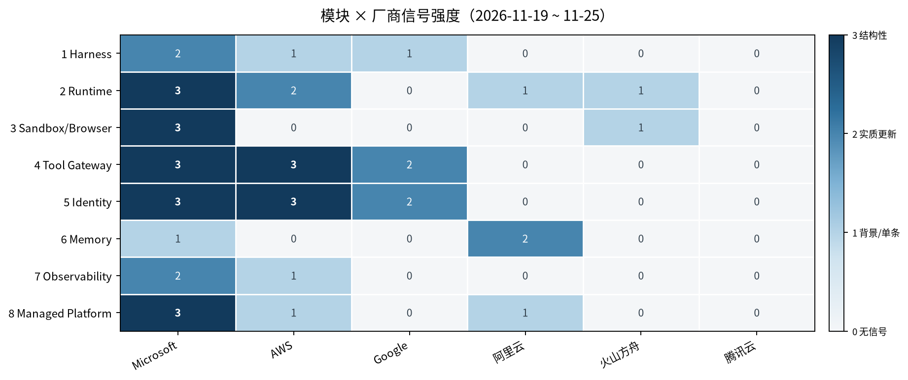

**本周的主线只有一句话：Agent 的治理执行点，从 agent 内部搬到了企业既有的网络、网关与身份目录。**

上周平台还在卖「Agent 能跑很久」，卖的是档期、检查点和档案；这周四家云厂同时换了回答方式——不承诺替你管住 agent，而是把 agent 的 MCP、A2A 与模型调用交给企业已经有的执法点：AWS 的 WAF、Azure 的 APIM 与 Policy、Google 的 Agent Registry，以及各自的身份目录。平台只保证「能连出去」，不保证「连得对」。

## 本期要点

### 1. Foundry 把「agent 能不能出网」变成发版门槛

微软在 Ignite 这一周发了九篇 Foundry 博客、九条 Azure 更新，最硬的一条不是模型能力，而是出口治理：托管 agent 的网络出口策略在**沙箱之外、请求到达目的地之前**求值，默认拒绝，策略无法求值也拒绝；管理员用 Azure Policy 治理出站域名，agent 作者必须在**创建 agent 版本之前**挂上合规策略，未挂不许发版。切到强制模式后，已在运行的会话保持启动时的旧策略，必须发新版本才生效——这条细节决定了「改策略」和「改行为」不是一回事。

同一批更新里，MCP 工具流量的路由方式被改了：以前 Foundry 会自动注册 MCP server 并帮你路由，现在必须先在客户自己的 AI Gateway 或 APIM 里配好 MCP route，再把 gateway-routed endpoint 填回 Foundry，存量工具要逐个手改。官方文档直接写了 "Foundry no longer performs this registration"。平台把「网关配置正确性」交还给客户，也把「配了网关 ≠ 被治理」这个坑留在了明面上：Foundry 只保存一个 endpoint 字符串，工具没改 endpoint 就仍然直连。

配套的是身份。Foundry agent 可以拿到 Entra agent identity 与一个真正的 agent user account——独立邮箱、日历、OneDrive、组织图里的经理、审计轨迹，用 blueprint 模板分发，一个 kill switch 可以禁用一整类 agent。它解决的是两个真实故障：没有登录用户的事件触发 agent 无法代表任何人行动；群聊里的 agent 必须猜「代表谁」于是越权。

### 2. AWS 让 WAF 直接管 MCP 和 A2A

11 月 24 日凌晨，AWS 上线了 LLM/MCP/A2A 端点的自动发现与保护，覆盖整个 Organization，端点可以在 API Gateway、ALB、CloudFront 之后。它分两层：发现层在 API Gateway 的 API Portal，读 AWS 侧的流量日志与服务配置，把新发现的端点先标成 shadow API 再由人决定是否纳管；执行层在 WAF 规则组，直接解析 MCP/A2A 消息结构、阻断协议畸形消息，语义判断外包给 Bedrock Guardrails 的同步 API，检测提示注入、越狱与响应中的敏感数据。

这套设计的关键是「不需要在 agent 或 MCP server 里装东西」，代价是只有经过这三个入口的流量才在视野内，内容检查还要多付一次跨服务调用的延迟与费用。AI Security 目前只在 7 个区域可用，API Portal 覆盖 32 个区域，安全预算从「agent 平台」转到了「WAF + Guardrails」两个既有计费项。

### 3. Google 把网关的授权输入换成了身份目录

Google 在 11 月 24 日的安全博客里把 Agent Gateway 定义成 protocol-native 网关：同一入口承载 LLM、MCP、A2A 三类流量，对着 Agent Registry 校验 Agent Identity，执行 IAM 策略与**默认拒绝**的出站规则，用 Model Armor 筛查请求，自定义检查经 Service Extensions 转给 Identity-Aware Proxy 或客户自建策略引擎。

它的特别之处是不另建 ACL——身份在注册表里，授权求值走 IAM，agent 的 principal 形如 `principal://TRUST_DOMAIN/resources/...`，trust domain 分组织级与项目级。Workspace 侧还有一条少见的协议层强制：MCP server 拒绝非 agent 的 OAuth client，2027 年 2 月 1 日起技术上强制 agent 只走 Workspace MCP server 或 CLI。对开发者意味着「一个共享 OAuth app 打天下」的做法到期了。

### 4. 身份传播画上了管理边界，撤销还在草案里

AWS 在 11 月 25 日把 trusted identity propagation 扩到 IAM federation 与 Roles Anywhere。机制值得讲清：它不是把用户 token 传下去，而是由 STS 在 AssumeRole 时给 role session 附加一组调用方改不了的 context key（`aws:OriginIdentity/Subject`、`Issuer`、`IdentityProviderOrgID` 等），role 决定「这个会话能做什么」，context 决定「这次请求是谁发起的」；context 本身不授予权限，只供 IAM 条件与 CloudTrail 使用。**传播边界就是管理边界**：同组织内续传，跨组织或独立账号在新角色会话创建时直接丢弃。

标准侧同周出现四条 IETF 个人草案，正好补上产品没回答的部分：intent token 用 RAR 包络加累计配额定义「授权的上界」，delegation revocation 用 SET 事件按 `(iss, jti)` 撤销整棵派生树，DNS link 用一条 TXT 记录把 agent 名绑到 OAuth client，OAuth over AGTP 则用每请求签名替代 client_secret。都还是草案，不能当产品能力，但它们已经把企业该问的问题写清楚了：撤销一个用户之后，派生出去的 agent 凭证在对方组织里多久失效。

### 5. Harness 把「重启后还剩什么」写进了契约

OpenClaw 2026.11.10 在 11 月 25 日发布，做的是故障语义：子 agent 的「欠付结果」持久化、跨 Gateway 重启保留，yielded 父会话在子任务完成后被唤醒，requester 中断后重试完成投递，被中断的 turn 与已流式输出在重启后仍在；后台 `exec` 进程在 Linux/macOS 上跨重启继续跑；cron 新增 `operator.cron` 作用域，让已认证用户管理会话自有自动化而保留 owner 归属。Claude Code 2.1.328 到 2.1.332 修的是同一类问题——resume 后丢已加载 skill、丢 compaction 摘要、丢 turn 工具调用；OpenAI Agents SDK 1.0.0-alpha.2 则把 `ResumableSession` 与「审批中暂停后恢复」做进 SDK，用条件写保证多 worker 下 checkpoint 不互相覆盖。

这一组还有一个容易被忽略的破坏面：默认值。Claude Code 2.1.328 让无权限模式的交互会话默认进 auto mode，2.1.332 把 Foundry 默认模型改成 Sonnet 5.5 并把 Sonnet 4/Opus 4/4.1 计为 retired；Google ADK 2.15.0 默认开启动态 instruction 路由；OpenAI Agents SDK 0.25.0 把 compaction 默认模型改成 `gpt-6-luna`。这些都不打 breaking 标记，却直接改变生产行为。

## 运行时：密度提上去了，恢复语义才见真章

Foundry 把会话改成共享委派子网 IP，官方规划口径从「每会话一个 IP、/24 约 250 并发」变成「/24 约 60,000 会话」，隔离仍靠每会话 microVM；真正的上限变成区域订阅配额，默认 1,000 到 2,000 会话，提升要开工单。密度之外，恢复被定义得很窄：resilient execution 是**从 handler 开头重跑**，不是确定性重放，局部变量和调用栈都不恢复，handler 必须自己用 checkpoint 判断哪些已完成；流式恢复后客户端还要丢弃快照之外的输出。memory snapshot 也不是会话检查点，而是「初始化完成后的版本基线」，开启后 idle 恢复不保留 `$HOME`、本地文件与进程内存。

AgentCore Runtime 本周唯一能精确到日的事件是 Instances 计算类型在 GovCloud 西区 GA：agent 跑在客户自己账号的 EC2 上，平台管置备、更新、扩缩与生命周期，会话最长 14 天，计费是 EC2 加管理费。这是给合规区的「计算归属」答案，但 GPU、嵌套虚拟化、特权模式只在 Instances，S3 挂载只在 V2，两条产品线的能力并不重合。

国内云的机制其实写得很细，只是发布日拿不到。火山方舟的会话是七态状态机（`idle/running/terminated/rescheduling/initializing/failed/upgrading`），连续 idle 14 天转 `terminated`，期间可恢复文件系统、已装软件包与沙箱临时文件，续期必须发一条 content 非空的 `user.message`；事件历史默认保留 6 个月，归档幂等，升级 Agent 必须保持原 `session_id`。这些页面更新都在窗口内，但公告分区仍停在 202610——可以引用语义，不能写「本周上线」。阿里百炼本周只有知识库的 Wiki 与图谱控制面更新，沙箱持久化仍是「只存磁盘、不存进程」。

## 沙箱与浏览器：从省 token 转向省「每次运行的固定开销」

browser-use 1.0.7 用「50 秒先返回已有输出、再用空代码续取」绕开 MCP 客户端的 60 秒硬超时；1.0.8 把 judge 改成 run 的额外一轮，让 provider 从缓存读整段 run、不再重复计费 trace，同时把 gateway 的额度预占从 32,768 降到 16,384 输出 token，避免小额账户跑到一半被拒。三条改动都不碰模型能力，改的是「一次任务要付多少固定成本、会被什么上限打断」。

隔离侧则在收紧默认值。agent-browser 0.44.0 给本地 stream server 的 `/api` 加了同源与 loopback Host 校验，WebSocket 升级要求 `Origin` 匹配 `Host`，并把「allowlist 为空」从「不限制」改成直接报错；refs 在页面替换后直接报 "no longer loaded"，不再点到错误元素。这是升级即可能报错的版本，但把静默误操作换成了显式失败。

云厂这边真正落地的是 Foundry Browser Automation：GA 底座是 Azure Playwright Workspaces，浏览器不在 agent 沙箱里，而在托管浏览器会话里，因此网络边界（VNet 注入、客户代理）、凭证边界（Key Vault 服务端读取，代码与模型都看不到）、人的边界（take control）可以各自配置。企业采购的三个硬条件第一次凑齐，代价是这些能力都带 `2026-1x-01-preview` 的 API 版本。Browserbase 同周上线的 Browser Sizes 只加 CPU、不加内存，是「同一并发额度内提单会话吞吐」的开关。E2B 与 Modal 本周都没有窗内版本，Daytona 的发布通道读不到、只能记「未取得」；Stagehand 4.5.0 比窗口晚了两小时五十分，只能算下周。

## 协议与网关：规范不动，注册表在补供应链

MCP 本周没有新规范修订，SEP 索引没有新增（45 个 Final、1 个 Accepted），A2A 的 v1.1.0-rc 仍停在 10 月 29 日，窗内五个提交全是文档。真正的动作在分发侧：MCP Registry 从 11 月 20 日到 23 日连发七个版本，把发布路径接上 OSV 恶意包检查、再加一条每日全量或按需的 malware sweep，修多 proof 验签，把 publisher 私钥改成从文件或环境变量注入，并让撤销的版本保留 moderator hold。

这与本周的漏洞潮是同一件事的两面。AWS 本周连发三条 agent 相关安全公告：document-loader-mcp-server 的 base dir 限制在特定环境变量组合下可被文档内容绕过；ECS MCP Server 的脱敏在默认设置下失效，troubleshooting 工具会把容器环境变量值与 secret 引用返回给能影响 agent 输入的一方；Kiro Web 则把 agent 读到的内容里的 tool-call markup 当成命令执行。GitHub Advisory 同期还有一批 MCP 相关 CVE。边缘的协议合规检查挡得住畸形消息，挡不住「格式合法但内容是秘密」——MCP server 的版本必须像依赖库一样纳管。

Azure 的 A2A 直通说明了另一件事：直通不等于完整实现。Foundry 同时提供 v1.0（GA，仅 JSONRPC）与 v0.3（preview）的 agent card，按卡内版本、`A2A-Version` 头或查询串协商，冲突返回 400；但托管 agent 侧只支持 v1.0、每请求必须是单轮 `SendMessage`，不支持 `GetTask`，也不许带 `contextId`/`taskId`。平台把 A2A 调用转成一次无状态请求交给容器，不代为保存任务。

## 记忆：租户隔离下沉到数据访问层

Graphiti v0.32.0 把 `group_id` 校验从 MCP 工具层下沉到 core：任何带 UUID 的读写，只要 UUID 属于别的 group，就按「不存在」处理（用 404 语义而不是 403，避免泄露存在性）。此前 core 的 UUID 直查不验证归属，知道一个 UUID 就能跨组读或删。这条修复来自 Codex Security 的一个发现，说明多租户图记忆的隔离边界此前只做在工具层。

OpenViking v0.5.6 把「PostgreSQL 化」从向量层推到元数据层：Account、Task/Work、Watch 三类 store 可以各自切到 PostgreSQL，多节点共享账号、任务与 Watch 状态不再需要 Redis。代价写在迁移说明里——启动不建表、切后端不迁数据、QueueFS 的格式变了所以扩展与 server 必须同版本升级。上期点名的「八个写工具默认开放」在本期十二条迁移说明里没有任何修正，核对相关配置文件也未见该字段，只能判「无公开修正证据」，升级检查单得自己留着。

检索本身在变成「有预算的循环」。Zep 的 Smart Query 把「查一条、用结果决定下一条、何时停」收进服务端：fast 最多三轮、可并行，deep 先规划再枚举、上限 300 条并带 `truncated` 标记；代价是模型、工具、轮数都不由调用方决定，且 API 标注 experimental。supermemory 一周三条同主题修复则提醒另一件事：记忆注入如果每轮改写前缀，prompt cache 就全废——「记忆层好不好」开始要用 cache 命中率衡量，而不只是召回率。

## 观测：三个 major 撞在同一周

OTel GenAI 在 11 月 21 日发布独立后的首个版本 v0.1.0，带 20 条 breaking。影响最大的是两条：`gen_ai.client.token.usage` 被拆成 input/output 两个直方图；推理、embedding、agent 调用、工具执行四类操作各自拥有独立 duration，不再上报到通用 `gen_ai.client.operation.duration`。旧模型把量级差几个数量级的分布混在一张直方图上，分位数本来就没有意义；新模型让它们分开，代价是所有仪表盘与告警规则要重建。同版还新增了 A2A 协议约定，agent 之间的调用第一次有统一 span。

NeMo Guardrails v0.25.0 是 9 月 16 日以来首个代码版本，第一次同时提供两个拦截面：面向模型 API 的网关（应用仍按 OpenAI 协议发请求，网关在中间检查后原样转发 provider payload），与面向编码 agent 的 hooks server（通过 Claude Code、Codex 的 pre-tool-use hooks 接入，拒绝就不执行）。它还做了一次安全姿态反转：检测器故障或结果非法现在直接 block，此前可能放过。代价是检测服务抖动会变成用户侧错误。

Phoenix v22 给 DECISION 与 EMBEDDING span 记成本，并把 model type 设为不可变——允许改 type 会让旧 span 按新价格重算，账单不可复现。Langfuse 把计费迁到 billable-units ledger，Topics 才敢转 public beta；Braintrust 的 Patterns 转 GA 并从 12 月 7 日起计费；LangSmith 的 Engine 把每类失败模式做成可执行 issue，盯修复 MR 并在合并后回查最近一天的 run。四家独立工具的走向一致：基础 trace 与人工标注被平台吃掉，它们往「调查、归因、成本」层上移。护栏侧则继续单腿——Guardrails AI 自 8 月 26 日起仍无提交。

## 控制面：微软单边推进的一周

除出口治理与身份，Foundry 这周还把评测与成本做进了请求路径：Insights 与多轮评测 GA；人工标注把专家评分转成评测数据集，并为每个测试用例生成 rubric（官方称 HelpSteer3 测试中人机一致率从 65% 升到 81%，人类间为 89%）；cost controls 按 resource、project、deployment、agent、session 设预算，请求运行时计数，80% 告警、100% 阻断，但官方明确它不是发票上限，也不覆盖工具费、托管计算与预置吞吐。Dev Pack GA 则把 `azure.yaml` 与 Foundry CLI（`azd ai`）做成一套项目文件，并给 GitHub Copilot、Claude Code、Cursor 提供同一个 Foundry Skill——控制面厂商向竞品宿主分发开发面，是少见的一步。

在托管平台这条轴上，其他云厂这周安静：AWS 只有 AgentCore GovCloud 一条；Google 的 Gemini Enterprise Agent Platform 最新条目停在 11 月 17 日，且旧 Vertex AI release notes 页已声明不再更新、2026 年条目止于 5 月 26 日，按旧入口监控会误判为长期静默；Agent 365 的公开更新停在 10 月 23 日，本周重心在「造 agent」而不是「管 fleet」。国内三家仍是阿里一条知识库更新、火山月档、腾讯一条文档解析计费公告，Coze 的公开文档仍是 JS 外壳。

*图 1：8 个能力模块 × 6 家厂商的本周信号强度。0 = 窗内无公开信号，1 = 仅单一条目或仅背景，2 = 单一实质更新，3 = 结构性变化。评分为编辑判断，依据为本报告各模块状态表，用于横向比较，不是能力评分；「0」不等于「无能力」，只表示本周没有可核的公开动作。数据来源：本报告 §1–§8 状态表。*

## 本周 vs 上周

| 主线 | 上周（第 22 期，11-12~11-18） | 本周（11-19~11-25） | 走向 |
|---|---|---|---|
| 核心问题 | 跑久了、断过一次，还算不算同一次作业 | 跑出去之后，算谁的身份、在哪一层被拦 | 从时间轴转到空间轴 |
| 治理执行点 | 平台功能：deferred 档期、检查点、会话存储 | 企业既有部件：WAF、APIM/Policy、Agent Registry | 新出现：网关不再是独立品类 |
| 责任切分 | 平台保证续命，进度归应用 | 平台保证能连，客户保证连得对 | 延续同一句式，换了一根轴 |
| 身份 | 凭证按调用作用域绑定，撤销进草案 | 传播有管理边界（跨组织即丢），撤销仍草案 | 从「绑定」到「边界」 |
| 长跑状态 | 只存磁盘不存进程；快照是单点恢复位 | 恢复=重跑 handler；快照=版本基线 | 语义更窄、更明确 |
| 计价 | 基线 + 突发 + 延迟三档 | 成本控制嵌进请求路径（80% 告警/100% 阻断） | 从报价单到运行时闸门 |
| 协议 | 规范半年一版，扩展靠 revision 判稳 | 规范静默，注册表补 OSV 扫描与验签 | 从改协议到管分发 |
| 观测 | OTel 无权威版本 | OTel v0.1.0 落地，20 条 breaking | 从「没有版本」到「有版本要迁移」 |
| 国内云 | 晚披露、错位披露 | 文档更新在窗内、公告分区没动 | 机制可读，发布不可断言 |

上周的答案是「把状态放到进程外面」；本周的答案是「把边界放到 agent 外面」。两者接续在同一个前提上：托管平台只提供挂点，不提供保证——上周的挂点是检查点，本周的挂点是网关与身份目录。

## 对你意味着什么

**编辑建议，按优先级排序：**

1. **先画一张 agent 出网图。** 列出每个 agent 的全部出站路径：模型 API、MCP server、A2A 对端、代码执行与浏览器。凡是没经过可写策略的网关或 WAF 的路径，都是当前的黑盒；本周四家的方案都建立在「流量可见」这个前提上。
2. **把 egress policy 加进发版清单，而不只是运行时配置。** Foundry 的出口策略在创建 agent 版本前绑定，运行中的会话保持旧策略；这意味着「改策略」必须走一次发版。把它写进变更流程，否则会以为改了却没生效。
3. **盘一遍「配了网关但没被治理」的工具。** Foundry 只认 endpoint 字符串，工具自身的 `server_url` 与 connection endpoint 不一致时仍会直连；存量 MCP 工具需要逐个改 endpoint。迁移前先做一次全量比对。
4. **身份侧现在就能做的三件事**：让 agent 用自己的 workload identity 跑、把「代表谁」放进不可伪造的 context（如 TIP 的 `aws:OriginIdentity/*`）、让下游能读到它。跨组织的调用要准备回退到 OAuth/联邦——TIP 的 context 跨组织会被丢弃，不要指望一路透传。
5. **把 MCP server 当依赖库管。** 本周三条 AWS 公告加一批 CVE 说明：路径穿越、脱敏绕过、命令注入会同时出现在「以操作者凭证运行、又读不可信内容」的工具上。版本纳管之外，单独验证默认配置——脱敏开关、只读模式、认证是否真的生效。WAF 挡不住语义层的遗漏。
6. **把观测栈当成一个迁移窗口排期。** OTel GenAI v0.1.0 的 20 条 breaking、NeMo 0.25 的 Python 3.10 移除与命名变更、Phoenix v22 的 model type 不可变撞在同一周；优先检查是否还在用 `gen_ai.client.token.usage`、是否把工具执行算进通用 duration、是否有属性靠 JSON 字符串传递。
7. **给无人值守任务加一条「默认值断言」。** auto mode、Foundry 默认模型、ADK 动态路由、compaction 模型四处默认变化都不打 breaking 标记。CI 里断言解析后的有效默认值，比 pin 版本号更能防静默行为漂移。

## 来源

- **Microsoft**：[Foundry 博客 feed](https://devblogs.microsoft.com/foundry/feed/)｜[Ignite 2026 总览](https://devblogs.microsoft.com/foundry/whats-new-in-microsoft-foundry-ignite-2026/)｜[Hosted agents at Ignite](https://devblogs.microsoft.com/foundry/hosted-agents-foundry-agent-service-ignite-2026/)｜[Tools & Toolboxes](https://devblogs.microsoft.com/foundry/build-once-reuse-across-your-agent-fleet-tools-and-toolboxes-in-foundry/)｜[Dev Pack](https://devblogs.microsoft.com/foundry/the-foundry-dev-pack-is-here-build-foundry-agents-your-way/)｜[Browser Automation](https://devblogs.microsoft.com/foundry/browser-automation-tool-ignite/)｜[VNet 五项检查](https://devblogs.microsoft.com/foundry/hosted-agents-private-network-setup/)｜[Azure Updates RSS](https://www.microsoft.com/releasecommunications/api/v2/azure/rss)｜[Foundry MCP 治理](https://learn.microsoft.com/en-us/azure/foundry/agents/how-to/tools/governance)｜[A2A 端点](https://learn.microsoft.com/en-us/azure/foundry/agents/how-to/enable-agent-to-agent-endpoint)｜[Hosted agents 概念](https://learn.microsoft.com/en-us/azure/foundry/agents/concepts/hosted-agents)｜[Agent 365](https://learn.microsoft.com/en-us/microsoft-agent-365/overview)
- **AWS**：[What's New feed](https://aws.amazon.com/about-aws/whats-new/recent/feed/)｜[WAF AI 端点发现与保护](https://aws.amazon.com/about-aws/whats-new/2026/11/waf-ai-endpoint-discovery-protection/)｜[API Gateway API Portal](https://aws.amazon.com/about-aws/whats-new/2026/11/amazon-api-gateway-announces-api-portal/)｜[IAM TIP 扩展](https://aws.amazon.com/about-aws/whats-new/2026/11/aws-iam/)｜[TIP 文档](https://docs.aws.amazon.com/IAM/latest/UserGuide/id_roles_providers_tip.html)｜[AgentCore GovCloud](https://aws.amazon.com/about-aws/whats-new/2026/11/agentcore-runtime-instances-govcloud)｜[AgentCore release notes](https://docs.aws.amazon.com/bedrock-agentcore/latest/devguide/release-notes.html)｜[安全公告 feed](https://aws.amazon.com/security/security-bulletins/rss/feed/)
- **Google**：[Agent Gateway 安全博客](https://cloud.google.com/blog/products/identity-security/deploying-agents-safely-in-your-enterprise)｜[Agent Platform release notes](https://docs.cloud.google.com/gemini-enterprise-agent-platform/release-notes)｜[IAM principal 标识](https://docs.cloud.google.com/iam/docs/principal-identifiers)｜[ADK](https://github.com/google/adk-python/releases.atom)
- **OpenClaw**：[Releases](https://github.com/openclaw/openclaw/releases.atom)｜[2026.11.10 changelog](https://raw.githubusercontent.com/openclaw/openclaw/main/CHANGELOG/2026.11.10.md)
- **MCP / A2A**：[Spec](https://modelcontextprotocol.io/specification/)｜[SEPs](https://modelcontextprotocol.io/seps)｜[两周年博客](https://blog.modelcontextprotocol.io/posts/mcp-turns-two/)｜[Registry](https://github.com/modelcontextprotocol/registry/releases.atom)｜[A2A](https://github.com/a2aproject/A2A/releases.atom)
- **Anthropic**：[Claude Code CHANGELOG](https://raw.githubusercontent.com/anthropics/claude-code/main/CHANGELOG.md)｜[Platform release notes](https://platform.claude.com/docs/en/release-notes/overview)｜[Agent SDK](https://github.com/anthropics/claude-agent-sdk-python/releases.atom)
- **框架 / 沙箱 / 浏览器**：[OpenAI Agents SDK](https://github.com/openai/openai-agents-python/releases.atom)｜[LangGraph](https://github.com/langchain-ai/langgraph/releases.atom)｜[LangSmith changelog](https://docs.langchain.com/langsmith/changelog)｜[browser-use](https://github.com/browser-use/browser-use/releases.atom)｜[agent-browser](https://github.com/vercel-labs/agent-browser/releases.atom)｜[Browserbase](https://www.browserbase.com/changelog)｜[Stagehand](https://github.com/browserbase/stagehand/releases.atom)｜[E2B](https://github.com/e2b-dev/E2B/releases.atom)
- **工具网关 / 身份**：[Composio](https://docs.composio.dev/docs/changelog.md)｜[Nango](https://github.com/NangoHQ/nango/releases.atom)｜[Arcade](https://github.com/ArcadeAI/arcade-mcp/releases)｜[IETF OAuth WG](https://datatracker.ietf.org/wg/oauth/documents/)
- **记忆 / 观测**：[OpenViking](https://github.com/volcengine/OpenViking/releases.atom)｜[Graphiti](https://github.com/getzep/graphiti/releases.atom)｜[Zep Smart Query](https://www.getzep.com/blog/smart-query-api/)｜[supermemory](https://github.com/supermemoryai/supermemory/commits/main.atom)｜[Cognee](https://github.com/topoteretes/cognee/releases.atom)｜[Firecrawl](https://www.firecrawl.dev/changelog)｜[OTel GenAI](https://github.com/open-telemetry/semantic-conventions-genai/releases.atom)｜[NeMo Guardrails](https://github.com/NVIDIA/NeMo-Guardrails/releases.atom)｜[Phoenix](https://github.com/Arize-ai/phoenix/releases.atom)｜[Langfuse](https://github.com/langfuse/langfuse/releases.atom)｜[Braintrust](https://docs.braintrust.dev/changelog)｜[Guardrails AI](https://github.com/guardrails-ai/guardrails/commits/main.atom)
- **国内云**：[百炼发布记录](https://help.aliyun.com/zh/model-studio/application-release-notes)｜[百炼沙箱](https://help.aliyun.com/zh/model-studio/managed-agents-session-operations)｜[火山产品动态](https://docs.volcengine.com/docs/82379/1159177)｜[腾讯云公告](https://cloud.tencent.com/announce)
