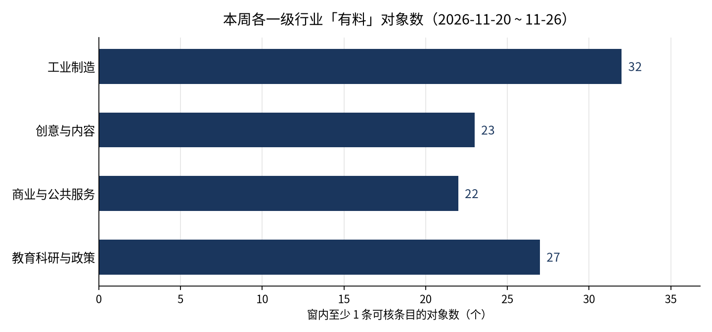
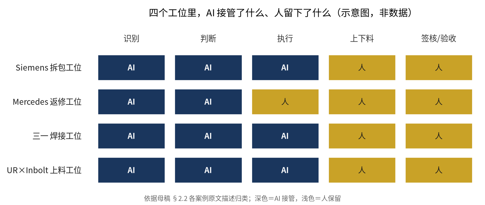

上周的问题是「放行之后怎么验」。这一周，问题变成了：**放行到多小的单位，按什么结算，出错算谁的。**

在纽伦堡的 SPS 展会上，西门子没有发布「一条 AI 产线」，而是发布了一个会自动拆包的机械臂工位——因为每天到货的箱子形状太杂，固定程序写不出来。同一周，奔驰在美国阿拉巴马州的工厂给 E/E 返修工位加了一层 AI，不换系统，只加一个「副驾驶」；在长沙三一的起重机臂架车间，焊接工位已经做到「一人看两台」。

商业侧做的是同一件事，单位换成了「一笔」：沃尔玛给 AI 购物助手发绑定「商户＋购物车＋金额＋会话」的一次性令牌；PayPal 给它发一张不受卖家保护的虚拟卡；美国几家大银行干脆把免责写进了客户协议。

**AI 不再按项目卖，也不再按项目担责。本周各方都在定义那个「单元」。**

## 本期要点

### 1. 西门子把 AI 拆成三层卖，最底层是「一个工位」

11 月 24 日，西门子在 SPS 2026 上把工业 AI 铺成三层。规划层是 Autonomous Production Planner：多个 agent 生成并优化排产，每一版排程先在工厂的物理数字孪生里跑一遍，通过了才释放到生产——公司预期减少 70% 人工计划工作量、成本最多降 20%。工程层是 Eigen for Process Industries：面向 SIMATIC PCS 7（v10 起），能读懂既有控制逻辑、按工程清单生成控制模块，选定用例省 20%–60%，以**既有 PCS 7 许可之上的独立订阅**交付，BASF 是首批试用客户。

最能说明方向的是现场层：埃尔朗根电子厂里那个还在测试单元的拆包工位。工厂每天收 80 到 200 个包裹，箱型尺寸差异大到固定机器人程序无法处理，拆包至今主要靠人。西门子的做法是让相机实时看工位，由为物理任务训练的基础模型判断下一步，开箱、取出元件料盘；模型从人远程遥操作中学习，推理跑在产线侧的工业 PC 加 Nvidia 芯片上——不是云端，因为节拍不允许回路出车间。西门子自动化业务总裁 Rainer Brehm 把话讲得很直：「下一次生产力跃迁将来自自动化那些以前无法自动化的任务。」

上期我们问过：Eigen 到底怎么验？这一周有了三项答案：AI 辅助写 PLC 代码带**仿真测试**；排产先过**物理数字孪生**；项目级会**对照工程数据与客户标准**检查信号地址与缺失连接，工程师逐项批准后才进生产。仍未答的是**回滚**，而西门子自己在专访里承认，「创建安全配置」还是未来能力。

### 2. 奔驰给返修工位加了一层「副驾驶」，快 20%–30%

11 月 23 日，奔驰与 Arena Physica 签全球协议，在生产线上部署 Atlas 平台，首发美国 Tuscaloosa 工厂，用于新 GLE 与 GLS 的电子电气返修。初测阶段，技师诊断与返修的速度提升 20%–30%，新技师和老技师两个层级都有效。

它的搭法值得细看。底层是一张叫 Metagraph 的图：把整车的引脚、连接器、线束做成数字表征，还标注了每个部件的功能重要度和物理位置。诊断时，agent 在这张图上做因果收缩——哪些引脚可能造成这个症状；然后每做一次实测，候选集就缩小一次，结果再回流进知识库。推理是确定性与概率的结合，不是纯大模型：确定性部分保证可解释、可复现，概率部分负责排序候选。

更关键的是形态——Atlas 是**以 add-on 形式挂进奔驰现有的返修辅助系统**，不改既有架构。E/E 返修是产线末端最贵的瓶颈，而「不换系统、只加一层」意味着它可以单点立项、单点验收。这与西门子的 Eigen 正好分工：一个在工程态改设计，一个在运行态修已经装坏的车，后者离钱更近。

### 3. 美国大行把「agent 出错算谁的」写进了客户协议

11 月 24 日，富国银行新版客户协议里的第 15 条生效，原文是「Your use of any AI Agent is AT YOUR OWN RISK」：经你授权的 agent 发起的任何交易，**视同你本人发起**，银行不再做额外验证；要切断 agent，得你自己及时撤销，还得保留撤销的书面证据。摩根大通的条款要求客户对「agent 对你指令的错误理解或执行、以及它实施的非预期或越权行为」负责；花旗的写法更短——「视为你授权」；美国银行禁止共享账号密码；PNC 加了警示，Capital One 计划 2027 年初跟进。

这套法律构造叫「授权即代理」：把 agent 当成你交出去的密码或副卡，于是未授权交易的争议保护就被挡在门外。唯一反向的信号是美国运通，说正在研究对部分 agent 误操作提供有限赔付，但还没成文。

同一天路透的另一条线是银行对**自建** agent 的管控：与敏感系统隔离、限制连续运行时长、不把密码和日志交给 agent、收紧凭证与授权范围、测试环境与生产隔离，以及一个能整体断电的 kill switch 加业务连续性预案。触发权在银行内部的运维和风控手里，不在客户，也不在模型厂商。

对做 agent 产品的人来说，这条线的含义很硬：靠「替用户登录网银」的产品形态在美国基本被判死，只能走令牌化或银行自建通道。

### 4. 沃尔玛自己发令牌，PayPal 自己发卡

11 月 23 日，沃尔玛上线 Agent Gateway，首发支持 Meta 的购物助手 Muse，通过自家助手 Sparky 完成发现与结账。它的设计是目前公开可查最完整的零售侧收银台：首次加购时在沃尔玛账户内建一个 **Agent Profile**，用来隔离 agent 活动、设置消费上限、审批购买；只有消费者本人能指定 agent 用哪张已存卡，外部 agent **不能新增卡片、不能改支付偏好、拿不到原始卡号**；每笔交易一枚短期令牌，绑定「商户＋购物车＋金额＋会话」，用后即失效，下一笔重新授权。

PayPal 走的是另一条：给 agentic 购物服务发一张虚拟卡号，只能用于 PayPal 结算，退款必须退回同一张虚拟卡，网络费等成本按合同由**商户**承担，而且这类交易**明确排除在卖家保护之外**，争议回到卡组织的拒付流程。风险被推回卡组织与商户，PayPal 只做结算通道。

两家合起来说明：这一周争的不是「能不能付」，而是**谁发凭证**。亚马逊的封禁则暴露了真战场——它以 Meta 未提前告知、agent 不表明身份为由封了 Muse，谈判焦点是「推荐哪些商品」和站内广告收入。agent 商务的第一场平台战争，是注意力和货架权的战争。

规模上要泼一盆冷水。Salesforce 预测这轮网络周 AI 影响 758 亿美元、占线上销售 21%；但 Bain 基于 Similarweb 的分析说，AI 助手占零售商网站流量**不到 1%**，Uber 10 月最后一周约 3.2 亿笔交易里只有约 500 笔来自 agent。**钱在「被 AI 推荐」，不在「被 AI 结账」。**

### 5. Canva 把设计从「席位」改成「调用」

11 月 24 日，Canva 的 MCP 正式 GA 并取消 waitlist，同时上线 REST API、service account 和 **API billing**：客户产品里的终端用户不必各自拥有 Canva 账号，由集成方按用量结算。公司的数据是：MCP 注册近 50 万，10 月用量环比 +93%，新开发者月增速从 9 月的 22% 升到 10 月近 46%；10 月的命令行输入里，**72% 来自 agent**。自研的图像模型 Craft 也通过 MCP 与 API 对外开放。

有两个细节值得记。一是官方说重组 MCP 时「合并重叠工具、减少歧义」，让跑在小模型上的 agent 也能选对工具——工具描述本身成了产品设计。二是计价：设计工具的报价锚点，从「多少个设计席位」变成了「多少次调用、多少自动化任务」。企业谈判要新增的条款是调用单价、超额阶梯、生成资产的归属与可迁移性。

对照之下，上期还在讨论的「开关」已经不够用了。这一周 TIDAL 宣布 12 月 9 日删除约 2,700 万首「完全由 AI 生成」的曲目（占目录 6.3%），Deezer 给用户一个过滤开关，Spotify 只做「同意才进池」。三条路都以「是不是 100% AI」为分类键——**问题从「能不能关」变成了「谁来判定、能不能申诉、删了之后版税怎么算」。**

## 分行业看

*图 1：本周各一级行业「有料」对象数（2026-11-20~11-26）。口径为窗内至少 1 条可核条目的对象，同一主体不重复计，共 104 个。这是覆盖广度指标，不是行业景气指标——本期撞上 SPS 展会周，工业与教育政策侧覆盖对象最多。数据来源：本期母稿 §1.1；原始数据 `charts/data-industry-covered.csv`。*

### 工业制造：四个工位，同一种拆法

*图 2：四个工位里，AI 接管了什么、人留下了什么（示意图，非数据，依据母稿 §2.2 各案例原文描述归类）。*

把西门子拆包、奔驰返修、三一焊接、UR 上料四个案例并排看，结构是一样的：**AI 接管识别与判断，人保留上下料与签核**。三一的宁乡车间是最能算账的一例——7 台焊接机器人，一名焊工从「看守一台、手持遥控器调参」变成「同时照看两台」，只做上下料，年底累计焊接里程约 10 万米；训练数据是团队用一年半时间让多名老师傅试板焊接、记录手法并打分得来的。所谓「一人两机」，不是因为机器人变快，而是因为人被从回路里摘了出来。

Universal Robots 那边，Inbolt 的 3D 视觉引导直接跑进了 Gen 7 机器人的控制器，腕部相机按 CAD 文件识别零件，每个循环都把轨迹修正到零件的实际位置，一个程序能在 80 多个零件参考之间切换，新零件由终端用户自己重训。它被定位成「每个新单元的标配选项」——**同一件事既是交付单位（一个工位），也是计价单位（一台机器人的一个许可）**。

支撑这三层的是两条基础设施。一条是实时的位置：西门子的模型跑在控制器旁的 Industrial Edge 上，经 PROFINET 接到 S7，PLC 保住确定性周期，AI 参与回路但不出车间；施耐德则用可移植功能块换掉控制层的绑定，AI 训练在云端（Bedrock/SageMaker）、下发靠 Greengrass、时间关键负载留本地。另一条是语义：11 月 25 日，AutomationML 宣布明年 1 月 1 日并入 OPC Foundation，把工程信息标准与 OPC UA 的运行时模型合到一处；同期西门子把 12 万多种硬件产品的设备描述开放出来。**agent 要操作工位，先得有一份机器能读的设备说明书。**

中国装备三家这一周也把「物理 AI」写进了公司定位，并且开始给回收期：三一的两款无人设备已在十余个项目落地、累计约 3,000 小时，测算 1–2 年全生命周期成本打平；徐工发布四台去掉驾驶舱的装备，架构是「云端大模型看现场、车端大模型做执行」，并联合谋先飞建工程机械的仿真训练基座；中联的工业互联网平台接入 180 余万台设备。

需要泼的冷水有两盆。一是景气：德国电气与自动化行业协会 ZVEI 在 SPS 公布，行业前三季度营收 +7.8%、订单 +10.8%，但增长主要来自数据中心和能源基础设施，机械、汽车、化工仍明显低于往年，主席 Brehm 说「还不能说出现了广泛的工业上行」。二是赚钱：中重科技在投资者问答里承认，工业 AI 智能体业务还在试点，**尚未形成收入**。

### 创意与内容：一边按调用卖，一边按「是不是纯 AI」删

除了 Canva 的计价迁移，这一周创意业还有两条暗线。一条是资产组织：字节的即梦把「一整部短剧」当成管理对象，上传剧本后自动解析人物、场景、道具、音色、服装并入库，改一个资产，所有引用它的分镜同步更新；芒果 TV 反过来，先用 AIGC 做样片，再用样片指导真人实拍——真人短剧成本百万级，AI 短剧压到 20 万元以内。另一条是合法性：迪士尼把 AI 收进首任 CTO 的统一系统——据 TheWrap 报道，经理层背 20% 年度降本指标，公司目标 FY2029 实现 30 亿美元年化节省，Adobe 用迪士尼自有 IP 训练 Firefly；而 Netflix 的芬奇新片因为「看得见的 AI 感」被影评人围攻，片尾字幕里多了一个新岗位——generative supervisor。

### 商业与公共服务：条款之外，还有身份

除了银行与沃尔玛，这一周政策侧第一次把 agent 的身份写成了义务。欧盟 Digital Fairness Act 第 26 条要求：消费者首次使用时自己选择哪些购买需要批准；当推荐方收费或存在利益冲突时，无论用户此前怎么设置，都必须逐笔确认；商家不得强迫使用这类工具。金融服务被排除在这套 agent 条款之外。阿联酋内阁则批准了官方所称「全球首个政府 agentic AI 战略」，目标 50% 的政府运行转向 agent 型、培训 8 万名联邦雇员、至少 90% 的模型部署在政府基础设施内，政府礼宾 agent 明年 3 月上线，并在联邦财务政策里新增「AI 采购」专章。中国这边，工信部要求智能体终端进网时做适配验证与风险评估、终端上的智能体配唯一身份码，并按「实际控制能力」把责任分给开发者、终端厂商和分发平台（原文本次未取得，仅据媒体报道）。

### 教育科研：学区不等供应商拆了，自己动手

上期是三大学区威胁弃用 Google 搜索。这一周，Google 内部先炸了：550 多名员工联名，要求撤回「学校关掉 Gemini 就失去 Search」的政策，收件人是 Pichai、教育副总裁和搜索负责人；公司确认收到信，但没有回应具体诉求。拆不开的原因也比上期更清楚——Google 今年在两起诉讼里以「AI Overview 与搜索是同一个工具」抗辩并获胜，拆开在法律上同样困难。

学区开始自己想办法。北弗吉尼亚的 Fairfax County 学区已经在自己开发并试点一种在校园设备上拦截 AI 的工具，本质是一个「AI 广告拦截器」；但 NPR 也点出，小学区没有人力自建或维护，即便买第三方工具也跟不上 IT 需求。芝加哥公立学区可能快速通过覆盖全区的三年禁令，21 名新当选校董中约一半签了支持承诺；纽约对 2–8 年级设一年禁令，该区约 130 万台 Chromebook 里有 50 万台配发给学生；洛杉矶已关闭 AI Overviews 并在复核搜索方案。

最硬的一条其实在韩国：11 月 19 日高考当天，政府用灾难警报在考场排查违禁设备，当场查出 54 人；11 月 26 日教育部宣布，全国金属探测器从约 8,300 台增购到**约 20,000 台**，用于 12 月初的高一高二期末考，还配套了「上完厕所返校要再扫一次」「建议穿无纽扣运动服」这样的执行细则。长期方案是另一份文件：转向简答与论述型评价，并联合研发 AI 辅助评分。

## 本周 vs 上周

上周的主线是「可验收的放行」：写权限交出去，验收留在原处。这一周这条线没被推翻，而是被切细了——放行的单位从「一个项目」变成「一个工位、一张令牌、一次调用」。

| 主线 | 上周（11-13~11-19） | 本周（11-20~11-26） | 走向 |
|---|---|---|---|
| 交付单位 | 在工程环境里生成，人负责最终部署 | 单工位替换：拆包、返修、焊接、上料 | 从「改环境」到「换工位」 |
| 计价方式 | 买功能不买版本、支付会话与短时令牌 | 独立订阅叠加既有许可、每台机器人一个许可、按 API 调用计费 | 从「会话」到「单元」 |
| 责任归属 | 学区问「能不能只买检索」 | 大行把 agent 误操作写成客户自担，PayPal 摘掉卖家保护 | 从「谁能关」到「谁承担」 |
| Agent 商务 | 受理侧扩容、预算会话 | 零售商自建网关、支付机构发虚拟卡、agent 成交不足 1% 流量 | 从「受理侧认不认」到「谁发凭证」 |
| 创意授权 | 关闭开关、版税入账 | 平台按「是否 100% AI」删除、过滤、同意池 | 从「开关」到「分类处置」 |
| 教育入口 | 三大学区考虑弃购 | 员工请愿、学区自研拦截扩展、三年禁令待表决 | 从「要求拆」到「自己拆」 |
| 工业标准 | 无相关新规 | 工程语义标准合并进 OPC UA，设备描述开放 | 从「无标准」到「语义合并」 |
| 评测与代价 | 模型扛不扛得住反驳 | 推荐准确率、单位经济、能不能赚钱 | 从「答对」到「算得过账」 |

一句话收束：上周卖方在证明「AI 写得对」，这一周买方在问「这一笔算谁头上」。**单元一旦确定，责任就跟着走：工位出错找工厂，单笔出错找授权者。**

## 对你意味着什么（编辑建议）

以下是编辑部基于本周事实的判断，不是本周发生的事实：

1. **把交付物按「工位」重写一遍。** 如果你在做工业方案，客户要的已经不是「一条 AI 产线」，而是「这个工位能不能少一个人」。报价单里应该出现三行：工位改造、模型维护（含重训）、许可或订阅。西门子和 UR 已经这样卖了。
2. **在合同里把「回滚」和「安全配置」写清楚。** 西门子答了仿真验证、数字孪生验证和规则检查，但回滚未披露、安全配置生成仍是路线图。这三项决定出问题时谁停机、停多久。
3. **做 agent 支付或代操作的产品，先选边。** 要么走令牌化/银行通道（可被识别、可被限额），要么接受「用户自担」的条款环境。美国大行的条款已经把「替用户登录」这条路堵上了。
4. **把「谁发凭证」当成竞品分析的第一栏。** 沃尔玛自己发令牌、PayPal 发虚拟卡、卡组织做受理侧鉴权——三种做法决定了撤销权在谁手里。给零售商做方案时，先问它想不想自己掌握撤销权。
5. **「能不能关」已经不够，要问「谁判定」。** 采购创意或内容工具时，把三个问题写进条款：谁能判定内容是不是 AI 生成、判定错了怎么申诉、删除或下架后已产生的收入怎么结算。
6. **别把「AI 影响」当成「AI 成交」。** 21% 与不足 1% 同时为真。今年的预算应该押在「被 AI 推荐」（商品数据结构化、可被 agent 读取），而不是「被 AI 结账」。
7. **教育项目先问决策单位在谁。** 美国是校董会加设备管理，中国是省级平台与算力配额，韩国是教育厅集中采购。找错层级，方案再好也进不去。

## 来源

**工业制造**
- Siemens（Eigen for Process Industries 官方稿）｜2026-11-25｜https://www.webwire.com/ViewPressRel.asp?aId=364669
- Computer&AUTOMATION（Siemens 专访，验证与边界）｜2026-11-24｜https://www.computer-automation.de/engineering-en/siemens-sps-industrial-ai-needs-clear-guidelines.htm
- Automation World（SPS 组合与 Edge↔S7 机制）｜2026-11-25｜https://www.automationworld.com/factory/digital-transformation/news/55421630/siemens-expands-automation-portfolio-toward-ai-powered-autonomous-production
- The Next Web（埃尔朗根拆包机器人与 Brehm 引语）｜2026-11-25｜https://thenextweb.com/news/siemens-ai-unpacking-robot-production-planner-sps-2026
- Mercedes-Benz × Arena Physica（Atlas）｜2026-11-23｜https://www.tmcnet.com/usubmit/2026/11/23/10486393.htm
- Universal Robots × Inbolt｜2026-11-24｜https://www.logisticsmanager.com/3d-ai-vision-powered-robots-ready-for-industrial-applications/
- 三一（bauma CHINA 与回收期）｜2026-11-25｜https://finance.sina.com.cn/jjxw/2026-11-25/doc-inizwsex4516600.shtml
- 三一宁乡焊接线（一人两机）｜2026-11-20｜https://www.sohu.com/a/1103958149_362225
- 徐工（四台无驾驶舱装备与仿真基座）｜2026-11-25｜https://js.ifeng.com/c/8yLMRKUHMsZ
- 施耐德 × AWS（开放自动化）｜2026-11-25｜https://www.tmcnet.com/usubmit/2026/11/25/10487325.htm
- OPC Foundation × AutomationML｜2026-11-25｜https://roboticsandautomationnews.com/2026/11/25/automationml-to-join-opc-foundation-to-strengthen-industrial-interoperability/107519/
- ZVEI（SPS 2026 行业数据）｜2026-11-24｜https://www.computer-automation.de/engineering-en/zvei--the-automation-industry-is-growing-again.htm

**创意与内容**
- Canva（MCP GA 与 API 计费）｜2026-11-24｜https://cxotoday.com/media-coverage/building-the-design-layer-of-the-internet-opening-canva-to-every-agent-and-developer/
- TIDAL 禁令｜2026-11-24｜https://arstechnica.com/ai/2026/11/tidal-will-ban-fully-ai-generated-music-on-december-9/
- Spotify（remix 与版税池）｜2026-11-22｜https://allhiphop.com/news/spotify-ai-remixes-no-user-testing-artist-opt-in/
- Disney（CTO 集中化与代价）｜2026-11-26｜https://businesschief.com/news/disney-ceo-josh-damaro-centralises-ai-and-meets-resistance
- Netflix（芬奇片与 generative supervisor）｜2026-11-20｜https://kotaku.com/critics-arent-happy-with-david-fincher-generative-ai-tarantino-cliff-booth-sequel-2000758811
- 即梦（以整部剧为管理单元）｜2026-11-24｜https://www.thepaper.cn/newsDetail_forward_34402130

**商业与公共服务**
- PCWorld（银行 agent 条款）｜2026-11-23｜https://www.pcworld.com/article/3292942/your-ai-shopping-agent-screws-up-the-bank-says-thats-your-problem.html
- Reuters（银行内控，经 SANA 转述）｜2026-11-23｜https://sana.sy/en/economic/2361319/
- The Verge（Walmart Agent Gateway）｜2026-11-23｜https://www.theverge.com/ai-artificial-intelligence/1039874/walmart-agent-gateway-meta-muse-black-friday
- PayPal Agentic Virtual Card（条款转述）｜2026-11-24｜https://www.ad-hoc-news.de/wissenschaft/paypal-agentic-virtual-card-haendler-tragen-gebuehren-verkaeuferschutz-entfaellt/70547978
- Business Insider（Bain：agent 成交不足 1%）｜2026-11-22｜https://www.businessinsider.com/ai-agents-holiday-shopping-not-yet-trusted-consumers-retailers
- SGB Online（Salesforce 网络周预测）｜2026-11-26｜https://sgbonline.com/salesforce-predicts-record-357-billion-cyber-week-with-ai-influencing-21-percent-of-sales/
- Sharjah24/WAM（UAE Agentic AI 战略）｜2026-11-25｜https://sharjah24.ae/en/Articles/2026/11/25/d62

**教育科研与政策**
- NPR（Google 员工请愿与 Fairfax 自研拦截）｜2026-11-21｜https://www.npr.org/2026/11/21/nx-s1-6048599/google-employees-protest-ai-in-schools-policy
- Fortune（三大学区与迈阿密-戴德）｜2026-11-21｜https://www.yahoo.com/news/us/articles/google-told-schools-accept-ai-114000908.html
- Chicago Tribune（芝加哥三年禁令评论）｜2026-11-23｜https://www.chicagotribune.com/2026/11/23/opinion-ai-decision-chicago-schools/
- SBS（韩国考场金属探测器增至约 2 万台）｜2026-11-26｜https://news.sbs.co.kr/english/article.do?news_id=N1008864475
- 欧盟 Digital Fairness Act 第 26 条（委员会法律页）｜2026-11-23 公开反馈｜https://commission.europa.eu/law/law-topic/consumer-protection-law/digital-fairness-act_en
- 华声在线（湖南「人工智能+教育」方案）｜2026-11-22｜https://news.qq.com/rain/a/20261122A00IJ400
- Mothership（中新教育 MOU 与框架互认）｜2026-11-22｜https://mothership.sg/2026/11/singapore-china-mou/
