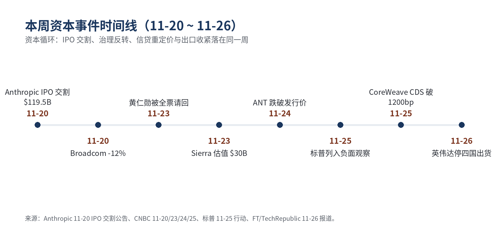
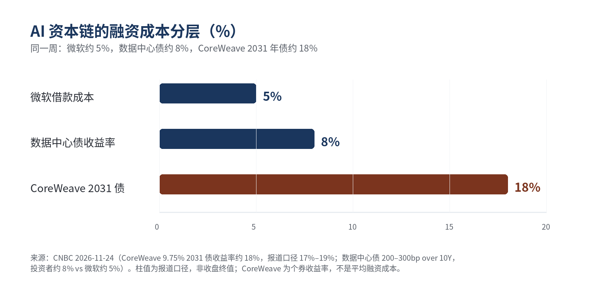

这一周，AI 公司第一次同时把客户、供应商和银行拉进同一张资产负债表。Anthropic 用 $119.5B 完成史上最大 IPO，其中 $26.0B 是七家供应商以发行价买下的；四天后，股价跌破发行价。英伟达的创始人被董事会请了回来，股价单日涨 31%，标普却把它列入负面观察。CoreWeave 的无担保债收益率约 18%，同一家公司用 Meta 的合同作抵押，能借到 7%。

过去两周，我们问的是「谁为资本开支签字」和「谁在每笔成交上开票」。这一周，问题变成了：**谁为这些算力付利息**。签字的人、开票的人都已就位，账单开始计息。

*图 1：本周资本事件时间线。来源：Anthropic 11-20 IPO 交割公告、CNBC 11-20/23/24/25、标普 11-25 行动、FT/TechRepublic 11-26 报道。*

## 本期要点

### 供应商掏了 $26B 买自己的客户

Anthropic 11-20 公告完成 IPO：以每股 $83 发行 11.27 亿股，含承销商全额行使的 1.47 亿股超额配售，IPO 募资约 935 亿美元；同日完成 3.13 亿股 Class N、约 260 亿美元的同步私募，认购方是 AMD、Broadcom、Google、Micron、Microsoft、NVIDIA 和 TSMC。两项合计 1,195 亿美元，公司从 IPO 实收约 916 亿美元。

这不是普通的战略配售。七家认购方既是 Anthropic 的芯片、云与分发供应商，也是它的股东——等于把未来几年的采购毛利，提前折成了股权收益。市场很快给出了另一面：11-19 首日开盘 111.50 美元、收 97.17 美元；11-20 收 88.91 美元；11-24 收 81.91 美元、跌 6.5%，上市第 4 个交易日跌破发行价；11-25 盘中最低 73.85 美元。发行端全额行使超额配售，说明一级需求仍强；二级用四天把 22% 的产业资本配售打成浮亏。分析师还在给 120 到 150 美元的目标价，但市场先交易的是「谁在为这 260 亿美元循环背书」。（[Anthropic](https://www.anthropic.com/news/ipo-close)、[CNBC](https://www.cnbc.com/2026/11/24/anthropic-stock-ipo-price.html)）

### 辞职 11 天后，董事会全票请他回来

11-08 黄仁勋承认婚外情，11-12 辞任，CFO Colette Kress 任临时 CEO；11-17 董事长 Harvey Jones 还拒绝恢复他的职务。11-23，董事会一致投票、立即生效地恢复他为总裁、CEO 兼董事，理由是满意其「candor and ability to lead NVIDIA」，并在听取「美国政府在高级层面的意见」后确信回归「不构成国家安全风险」。Kress 回任 CFO，Jones 留任董事长；作为交换，董事会新设全部由独立董事组成的国家安全与出口管制委员会、新设首席合规官，并让涉外情报调查「进行到底」。

市场先给了 31.48% 的涨幅，收 165.05 美元、成交 7.725 亿股、市值增加近 1 万亿美元，标普 500 与纳指同日涨 4.74% 和 6.51%。随后回吐，到 11-25 较周一收盘跌约 12.5%。同一天，标普把英伟达的 AA 评级列入负面观察，90 天内可能下调一档，理由直指董事任期过长、缺乏继任计划与「关键人风险」；穆迪已在 11-18 把展望从正面调至稳定。加州司法部与 SEC 的调查未结，12 月还有两场国会听证。回归解决了经营连续性，却把「政府干预」写进了信用利差。（[NVIDIA](https://nvidianews.nvidia.com/news/nvidia-board-reinstates-jensen-huang-as-president-ceo-and-board-director)、[CNBC](https://www.cnbc.com/2026/11/23/nvidia-jensen-huang-ceo.html)、[标普](https://www.cnbc.com/2026/11/26/nvidia-market-governance-risk.html)）

### 信贷先开价：18% 的债、1,314bp 的 CDS

英伟达的回归没有缓解信用市场。11-24 至 11-25，CoreWeave 2031 年到期的 9.75% 债券收益率约 18%，5 年期 CDS 达 1,314bp，隐含 5 年违约概率约 68%；Oracle 的 5 年期 CDS 升到 355.68bp；英伟达自身 CDS 走阔 3.4%，它披露的对外担保截至 10-25 达 1,180 亿美元。按 PIMCO 引用的高盛口径，最大 AI 公司今年可能发债约 2,500 亿美元，广义 AI 行业 3,000 到 5,700 亿美元；数据中心债定价比 10 年期美债高 200 到 300 个基点，投资者拿到约 8%，而微软借款成本约 5%。微软、Amazon、Meta、Alphabet 的资本开支，预计 2026 与 2027 两年都超过经营性现金流。

同一周，客户集中度也被重新定价。11-20 郭明錤称 Google 把 2027 年 Broadcom 设计的 TPU 8i 削减约 100 万颗、约 20%，主要砍高价的 8i Max，转向与联发科合作的 8t；双方都没有确认，Broadcom 当日仍跌 12% 至 306.55 美元（盘中口径）、市值蒸发约 1,910 亿美元。股权市场给增长定价，信贷市场给「能不能建成、谁兜底」定价；一条未经证实的供应链帖文就足以让 1,910 亿美元消失，说明市场已不给「AI 收入可持续性」容错。（[CNBC](https://www.cnbc.com/2026/11/24/nvidia-jensen-huang-ai-credit-markets.html)、[CNBC](https://www.cnbc.com/2026/11/25/ai-debt-big-tech-spending-nvidia.html)、[Broadcom](https://finance.yahoo.com/markets/stocks/articles/broadcom-stock-plunges-12-loses-191304321.html)）

### 中国资产同周分化：华为被定罪，模型股回撤四成

11-24，美国纽约东区联邦陪审团裁定华为及三家子公司有罪，罪名包括共谋窃取商业秘密、电汇与银行欺诈、共谋违反 IEEPA 与洗钱共谋；量刑定在 2027-09-14。这与中文媒体同期「昇腾 950 卖到韩国」的叙事正好相反——后者没有客户、没有合同，华为也没有确认。

资本市场上，中国 AI 资产出现清晰分层。智谱一周跌 12.3%，较 11-11 高点回撤 41.3%；MiniMax 一周跌 8.3%，较 11-12 回撤 43.4%；而同周宇树科技涨 12.9%，11-23 涨停收 708 元、市值超过 2,800 亿元，11-26 为 2,693.73 亿元、市盈率约 522 倍。模型公司跟着全球同类一起被重定价，具身资产仍被追高。华为的判决则提醒：算力出海的公关叙事与合规现实，是两条线。（[DOJ](https://www.justice.gov/opa/pr/chinese-tech-giant-huawei-and-subsidiaries-convicted-sanctions-violations-fraud-conspiracy)；行情：智谱 02513.HK、MiniMax 00100.HK、宇树 688836.SH）

### 个人 agent 从「能聊」到「能办事」

字节 11-23 开启个人智能体「小豆」邀请制公测，官方产品页写明可连接抖音、飞书、日历、健康与位置，授权后可代打餐厅订座电话；11-24，豆包 App 灰度「豆包购物」，一级入口直连抖音商城。阿里「千问 Go」11-25 全面开放免费代打电话，订餐厅、找快递、查失物，逐次授权，通话中表明 AI 身份。

海外，Meta 的 Muse 11-23 在英国上线，面向 18 岁以上用户，合作方包括 M&S、ASOS、Currys、Ocado 与 Trainline，结账走 Stripe Onelink 的 agent 专用卡或 Shop Pay；Walmart 同日把黑五接入 Muse 的 Agent Gateway，用消费上限与 Agent Profile 控权。11-25 至 26 日传出 Amazon 与 Meta 正在谈判解除 Muse 在 Amazon 的封锁，议题包括赞助位如何标注、agent 订单如何归因。

一周之内，中美两家把个人 agent 做成了 App 的一级入口。竞争点从模型能力转到授权粒度与责任边界：谁能让用户放心把电话、购物车和支付交出去，谁就拿到下一个分发入口。上周关上的货架门，这周开始谈条件。（[豆包小豆](https://www.doubao.com/xiaodou/)、[Meta](https://about.fb.com/news/2026/11/introducing-muse-in-the-uk-a-personal-ai-agent-you-control/)）

## 资本循环：四个齿轮

把这周的交易拆开看，AI 公司让买方「买得起」的办法有四种，风险落在四个不同的位置。

**供应商入股。** Anthropic 的 260 亿美元私募，是供应商以发行价买客户。对 Anthropic，这是把未来资本开支提前货币化；对供应商，这是把卖铲子的收入变成铲子公司的股东回报，同时锁定客户。代价是当股价跌破 83 美元，七家同时浮亏，下一轮资本开支的账面回报开始与股价绑定。

**客户权证。** AMD 11-23 向 SEC 提交的 3.37 亿股转售登记里，含 OpenAI 与 Meta 各 1.6 亿股认股权证，行权价 0.01 美元，按采购 Instinct GPU 的里程碑分批归属，首批挂钩交付首个 1GW 的 MI450。以 11-24 收盘 413.27 美元计，两份权证名义价值约 1,322 亿美元，行权成本只有 320 万美元。这是「采购返利」的股权版：AMD 用极低价权证换 1GW 级采购承诺，客户拿到股价上涨的期权，代价是未来 3.2 亿股潜在稀释。11-24 AMD 收跌 8.86%，市场交易的是稀释，不是订单。（[SEC](https://www.sec.gov/Archives/edgar/data/2488/000119312526472370/d171551ds3asr.htm)）

**厂商担保。** 英伟达为 neocloud 的 GPU 采购与债务提供担保，截至 10-25 达 1,180 亿美元。它让客户能以更低成本加杠杆买卡，英伟达确认收入；风险被搬到资产负债表之外，但 CDS 市场会把它算回英伟达的信用。黄仁勋回归被解读为「继续 circular financing」的概率上升，英伟达 CFO 则说会「严格评估未来投资」。

**项目级融资。** CoreWeave 的无担保债要付约 18%，但同一家公司用「为 Meta 部署的 GPU + Meta 合同」作抵押，由 Morgan Stanley 与 MUFG 牵头的 45 亿美元贷款，定价只要 7% 到 7.5%，还预期被评为投资级。同一借款人、两种信用，价差超过 10 个百分点。这是「用客户信用隔离风险」的资本结构套利；成功，则打开一条可复制的低成本通道，失败，则说明连投资级抵押结构都卖不动。

*图 2：AI 资本链的融资成本分层。来源：CNBC 2026-11-24（CoreWeave 9.75% 2031 债收益率约 18%，报道口径 17%–19%；数据中心债 200–300bp over 10Y，投资者约 8% vs 微软约 5%）。柱值为报道口径，非收盘终值；CoreWeave 为个券收益率，不是平均融资成本。*

四个齿轮咬合在一起，形成一条闭环：供应商买发行人的股票，发行人给客户权证，厂商给客户担保，银行按客户信用放贷。每一环都让当期的「买得起」成立，也让下一期的「还得起」更难。这也是为什么标普把治理写进评级、穆迪调展望，会同时影响整条链的资本成本。

## 巨头：把 agent 做成入口，也做成账单

**OpenAI 这一周把「安全」做成了产品，也把「成本」做成了配额。** 11-22，首席科学家 Jakub Pachocki 发文，提议用对数困惑度（log-perplexity）作为跨实验室的「能力速度表」：GPT-3.5 约 0.99、GPT-4 约 0.91，低于 0.80 出现网安与数学能力，约 0.76 出现突破性数学结果，下一个窗口在 0.68 到 0.7。文章没有给出具体阈值，也没有指定执行机构，短期更像话语权动作。11-23，OpenAI 与 Cisco 发布 Shirudo：基于 eBPF 的 Linux 运行时防护，盾牌加密签名后加载、用 TPM 记录，演示里用 Codex 生成的盾牌挡住了 Java4Shell 攻击。11-25 起，Chat 与 Work 合并成单一用量表，Instant 模型仍不限量，12 月扩大范围——用配额而不是涨价来守毛利。

**Google 把 agent 推进了科研流程。** 11-23，DeepMind 用 Gemini 4 agent 找更快的量子算法：聚变模拟的计算成本降 11.8 倍、纠错量子比特从 5,650 降到 4,338、arcsin 问题降 290 倍；做法是多支 agent 团队独立攻关，想法先在 Lean 中形式化验证，再进入共享 notebook，每四小时交易、辩论一次。11-25，Google 又称 Cogentic 一天产出六篇数学论文，包括一个整数分解的 L[1/3] 算法——但对 RSA 没有实际威胁，且论文未经同行评审、Lean 证明未公开。产品侧，AI Mode 接入 Wallet（只读）、Drive 与 Gemini，购物 overlay 用截屏做跨店比价；Nest app 将在 2027-01-25 关闭，Assistant 在 2027-08-02 退役。

**微软在卖「够用」，也在补可靠性。** Ignite 会后核验的 Agent 365 增加了 FinOps、工具注册表、Dynamic Agent Risk 与 MCP 治理；Copilot Autopilot 拿到独立邮箱、虚拟机与 Entra 身份。Nadella 在 11-25 说「落后三到六个月是好位置，只要花 5% 到 20% 的算力」，Copilot 在 OpenAI、Anthropic 与自研 MAI 之间自动路由。同一周披露的还有一次历史事故的复盘：11-12 至 13 日持续约 24 小时的全球中断，微软内部启动了「Code Red」——这是本周新披露的历史事项，不是本周新发生的事故。

**Amazon 的两副面孔更清楚了。** 11-22 至 23 日，它收购 Decart 的优化栈与团队，媒体称 75 亿美元：买的是资产与团队而非股权，现金加股票、大部分递延，创始人留任五年，不含世界模型；目的是用软件抹平 Trainium 与英伟达的差距。11-20 早上 7 点，AWS 的 x402 与 AgentCore payments 博文入窗：agent 按次购买 Marketplace 的软件与数据，卖家回 HTTP 402 签名报价，agent 用支付 token 重试，结算进 AWS Billing，默认会话预算 0.05 美元、单请求上限 0.02 美元。云这边在给 agent 开账单，零售那边仍在挡 agent——同一家公司，两种治理。

**xAI 把生成内容的合规风险带进了诉讼。** 11-23，弗吉尼亚与俄勒冈两州总检察长分别依消费者保护法起诉 X、xAI 与 SpaceX，指 Grok 生成儿童性虐待图像与报复色情；诉状引用 CCDH 的研究称，2025 年 12 月下旬的 8 天里，X 上出现约 300 万张性化图像，其中 2.3 万张涉及儿童。xAI 官网在窗口内不可达，公司未置评。

**Meta 把社交分发变成了 agent 分发，也撞上了权限墙。** Muse 在英国上线，每个实例跑在独立云虚拟机里，聊天与虚拟机数据不进广告系统，结账用代理卡；Walmart 用 Agent Gateway 把商品搜索、购物车与结账做成结构化接口，agent 拿不到原始卡号。但 Muse 在 Android 上通过通知权限、在 Mac 上通过辅助功能读到了 Signal 的消息——端到端加密在「通知已解密并显示」之后失效。Meta 还拒绝了英国 FCA 的联合沙箱测试。

## 中国：开源三连、入口战与算力换轨

**开源成了本周中国厂商的共同语言。** 百度 11-24 以 Apache 2.0 开源文心 5.5 Flash Preview：2800 亿总参、140 亿激活、100 万上下文、FP4 专家权重，模型卡自述是「后训练中间 checkpoint」，训练仍在进行。腾讯三天连发：11-24 的 Hy-MT3 支持 102 种语言，11-25 开放 Hy4 flash 的 GGUF 量化权重（220B 模型可跑在 64GB 终端），11-26 开源草稿模型 DFly2——草稿层复用目标模型的 KV 与注意力索引，长文生成最高提速 4.2 倍、不增显存。智谱 11-23 发布 GLM-5.4：750B 参数，把 28 层循环跑两遍，官方称智能水平可比 2T 到 3T 参数模型。

**但技术叙事没有托住估值。** 智谱发布次日跌 6.23%，第三日再跌 15.05%，一周跌 12.3%，较 11-11 高点回撤 41.3%；MiniMax 一周跌 8.3%，较 11-12 回撤 43.4%。市场给「架构创新」的定价，远低于给「现金流」的定价。

**入口战在同周开打。** 字节的小豆、豆包的购物入口、阿里的千问 Go，都把「代办」做成一级入口；三家都没有披露成本由谁承担、出错谁负责。这是个人 agent 从演示走向规模化的真正关卡：不是模型能不能做，而是授权粒度够不够细、责任边界够不够清楚。

**算力换轨是表态多于事实。** MiniMax 创始人称加快采用华为与平头哥，DeepSeek 传 12 月发 V4.1 Pro 并转国产芯，智谱称上万张国产卡进展顺利——三件都是表态或传闻，不能当既成事实。华为 11-24 的美国有罪判决，则让「昇腾出海」的合规风险更具体：量刑在 2027 年，短期不影响出货，但海外客户的供应链风险溢价不会下降。

## 应用与算力：按结果计费，按现金流打折

应用层出现两种相反的定价方式。Sierra 11-23 完成 17.5 亿美元 Series F、投后 300 亿美元，年化收入超过 4 亿美元，约为 75 倍；它明确按「已完成的业务结果」计费——问题解决、贷款发放、保险理赔——不按 token。Perplexity 则把成本转回用户：Pro 的 Computer 改为每周配额，effort 从 Light 到 Ultra 分级，周期从首个任务起算、七天重置、不结转。一端按结果收钱，一端按算力限供。

一级市场仍在抬价。Databricks 在谈约 2,250 亿美元估值，比 8 月的 1,900 亿高 20%，年化收入超过 70 亿美元，约为 32 倍；Cognition 传 20 亿美元以上、估值 750 亿美元；ElevenLabs 传 330 亿美元。但 IPO 窗口在收窄：Ghodsi 明确说不在当前周期上市，预测市场把 OpenAI 的 IPO 推到 2027。

算力侧的分化更直接。AMD 的 3.37 亿股转售登记让股价跌 8.86%，同一天微软在 Azure 接收了首套 Helios 机架级系统——MI455X、Venice、Pensando 与 ROCm 一起交付，但官方措辞严格限定在「早期负载验证」，不是量产。Broadcom 因一条未证实的订单传闻蒸发 1,910 亿美元，12-09 的财报是第一验证点。Oracle 用 200 亿美元融资（8,620 万股、每股 116 美元，加 100 亿美元票据）把 OpenAI 的 3,000 亿美元合同「全额融资」，但 CDS 仍升到 356bp。

具身智能则继续按另一套逻辑定价。宇树 11-23 涨停、市值超过 2,800 亿元，11-26 市盈率约 522 倍；王兴兴说 5 到 10 年中国机器人年产量会超过 2,000 万台，同时预警上市后利润可能下滑。优必选被纳入恒生科技指数，12-07 生效。Tesla 在德国 EMAG 总部注册实体，拟接收约 220 名工艺人员做柔轮与波发生器——买的是工艺，不是产能。Figure 用 41 秒的「苹果测试」视频回应马斯克，宣称零样本、全自主，但没有排除遥操作，也没有第三方验证。

## 本周 vs 上周

| 主线 | 上周（11-13~19） | 本周（11-20~26） | 走向 |
|---|---|---|---|
| Anthropic 上市 | 定价 83 美元，首日涨 17%、收 97.17 | 交割 1,195 亿美元（含 260 亿供应商私募），11-24 收 81.91 破发 | 延续并反转 |
| 英伟达治理 | 黄仁勋辞任，董事会四天换帅，11-17 拒绝恢复 | 11-23 全票请回、单日涨 31%；11-25 标普负面观察 | 反转：制度回到关键人，代价是评级 |
| agent 支付与货架 | 四条轨道落地；Amazon 关门、Muse 默认不搜 Amazon | 无新轨道；AWS x402 博文入窗；Amazon-Meta 谈解封、Walmart 接入 | 从铺轨转向入口与谈判 |
| 前沿模型 | GPT-6.2、Gemini 4 Neon 同周 | 无新前沿模型；开源小模型密集 | 降温：注意力转向资本与入口 |
| 中国开源 | 腾讯 Hy4 flash 开权重设闸口、阿里 Qwen4-Max 闭源 | 百度 Apache 2.0 开源 280B、腾讯 GGUF/DFly2、智谱 Loop 架构 | 延续：开源作为获客与生态手段 |
| 中国资产 | 智谱、MiniMax 受 Anthropic IPO 冲击下跌 | 智谱 -12.3%（高点 -41.3%）、MiniMax -8.3%（高点 -43.4%） vs 宇树 +12.9% | 分化：模型降、具身升 |
| 一级市场 | 只有 Anthropic 一个标尺 | Databricks 2,250 亿、Sierra 300 亿、Cognition 传 750 亿、ElevenLabs 传 330 亿 | 抬价延续，与二级背离 |

上周的主线是「结算层铺轨、货架关门」，本周换成了「谁为铺轨的钱付息」。轨道的数量没有增加，利息开始出现：Anthropic 破发、英伟达被列入评级观察、CoreWeave 的债与 CDS 同时创纪录、Broadcom 因一条客户订单传闻蒸发 1,910 亿美元。重心从「能不能收到钱」，移到了「收到钱之前，资本成本扛不扛得住」。

## 对你意味着什么（编辑建议）

- **如果你在一级市场配置 AI**：把「供应商/客户是否参与上一轮」作为估值尽调的一栏。参与者越多、折价越深，下一轮公开市场可比公司下跌时的传导越快。Databricks 的 2,250 亿美元是 primary 还是 secondary，会决定它是「增长资本」还是「流动性退出」。
- **如果你在二级市场看 AI 硬件**：把 CDS 与债券收益率放在股价之前看。英伟达的 1,180 亿美元担保、Oracle 的 356bp、CoreWeave 的 18% 与 1,314bp，是比订单更早的约束；标普把治理写进评级后，整条链的加权资本成本会一起上移。
- **如果你在企业里采购 agent**：优先问三个问题——授权粒度到什么程度、支付凭证是否由 agent 持有、出错时谁赔付。Walmart 的 Agent Profile（消费上限、代理卡）与 AWS 的会话预算（0.05 美元默认、0.02 美元单请求上限）是目前最接近可复制的模板。
- **如果你看中国 AI 资产**：把「模型公司」与「具身公司」分开建模。前者按 token/秒计价、可被价格战压缩，后者按台交付、锚在订单与产能；宇树的 522 倍 PE 与智谱的 41% 回撤，是同一枚硬币的两面。
- **如果你在做算力出海**：华为 11-24 的判决提醒，合规风险与公关叙事是两条线；「昇腾卖到韩国」目前没有客户与合同，不能作为收入假设。

## 来源

- Anthropic：IPO 交割公告（2026-11-20）https://www.anthropic.com/news/ipo-close
- CNBC：Anthropic 跌破发行价（2026-11-24）https://www.cnbc.com/2026/11/24/anthropic-stock-ipo-price.html
- NVIDIA：董事会复职新闻稿（2026-11-23）https://nvidianews.nvidia.com/news/nvidia-board-reinstates-jensen-huang-as-president-ceo-and-board-director
- CNBC：黄仁勋复职与市场反应（2026-11-23）https://www.cnbc.com/2026/11/23/nvidia-jensen-huang-ceo.html
- CNBC：标普将英伟达列入负面观察（2026-11-25/26）https://www.cnbc.com/2026/11/26/nvidia-market-governance-risk.html
- CNBC：AI 信用与 CDS（2026-11-24）https://www.cnbc.com/2026/11/24/nvidia-jensen-huang-ai-credit-markets.html
- CNBC：AI 债务与资本开支（2026-11-25）https://www.cnbc.com/2026/11/25/ai-debt-big-tech-spending-nvidia.html
- Yahoo Finance：Broadcom 单日跌 12%、市值蒸发 1,910 亿美元（2026-11-20）https://finance.yahoo.com/markets/stocks/articles/broadcom-stock-plunges-12-loses-191304321.html
- SEC：AMD S-3ASR（2026-11-23）https://www.sec.gov/Archives/edgar/data/2488/000119312526472370/d171551ds3asr.htm
- Crypto.news：CoreWeave 45 亿美元 Meta 相关贷款（2026-11-25）https://crypto.news/morgan-stanley-and-mufg-prepare-4-5-billion-coreweave-loan-tied-to-meta/
- TNW：Oracle 称 OpenAI 合同全额融资（2026-11-20）https://thenextweb.com/news/oracle-openai-contract-fully-funded-20bn-raise
- OpenAI：Perplexity and Intelligence（2026-11-22）https://openai.com/index/perplexity-and-intelligence/
- OpenAI：Shirudo（2026-11-23）https://openai.com/index/introducing-shirudo/
- DeepMind：用 agent 与形式化验证寻找更快量子算法（2026-11-23）https://deepmind.google/blog/finding-faster-quantum-algorithms-with-agents-and-formal-verification/
- Meta：Muse 在英国上线（2026-11-23）https://about.fb.com/news/2026/11/introducing-muse-in-the-uk-a-personal-ai-agent-you-control/
- 豆包：小豆产品页（读取 2026-11-27）https://www.doubao.com/xiaodou/
- IT之家：千问 Go 全面开放免费代打电话（2026-11-25）https://www.ithome.com/1/031/977.htm
- 美国司法部：华为及子公司被裁定有罪（2026-11-24）https://www.justice.gov/opa/pr/chinese-tech-giant-huawei-and-subsidiaries-convicted-sanctions-violations-fraud-conspiracy
- Hugging Face：文心 5.5 Flash Preview（2026-11-24）https://huggingface.co/baidu/ERNIE-5.5-Flash-Preview
- 智谱：GLM-5.4 文档（2026-11-23）https://docs.z.ai/guides/llm/glm-5.4
- MiniMax：H3 Family（2026-11-26）https://www.minimax.io/blog/minimax-h3-family
- 腾讯新闻：混元开源 DFly2（2026-11-26）https://news.qq.com/rain/a/20261126A0CW1I00
- Sierra：Series F（2026-11-23）https://sierra.ai/blog/series-f-30b
- PYMNTS：Databricks 洽谈 2,250 亿美元估值（2026-11-24）https://www.pymnts.com/news/investment-tracker/2026/databricks-pursues-225-billion-valuation-months-after-5-billion-raise/
- Cognition：SWE-2.1（2026-11-24）https://cognition.com/blog/swe-2-1
- Harvey：把 Tenet 配方用于美国开源权重模型（2026-11-24）https://www.harvey.ai/blog/applying-the-harvey-tenet-training-recipe-to-us-open-weight-models
- Perplexity：Time Machine（2026-11-25）https://www.perplexity.ai/hub/blog/freeze-the-web-with-perplexity-time-machine
- Runway：Praxis-1（读取 2026-11-27）https://runway.com/product/praxis
- 美联储金融稳定报告（背景，非本周）：Crypto Briefing 转述（2026-11-25）https://cryptobriefing.com/federal-reserve-ai-infrastructure-debt-warning/
